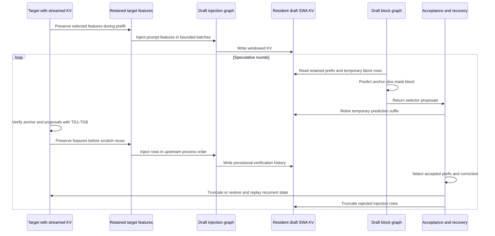
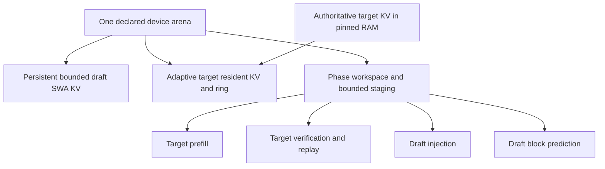
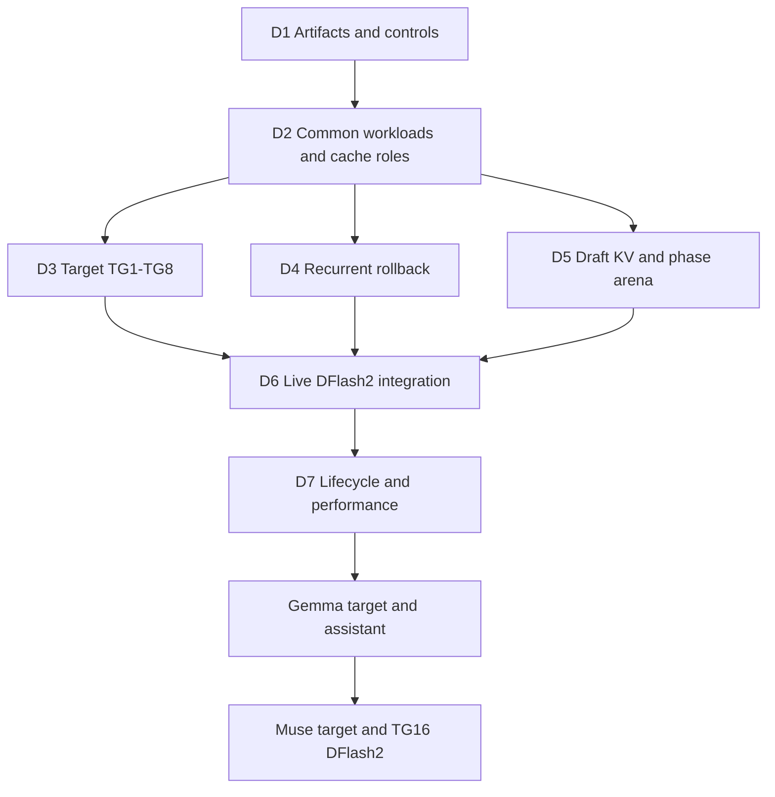
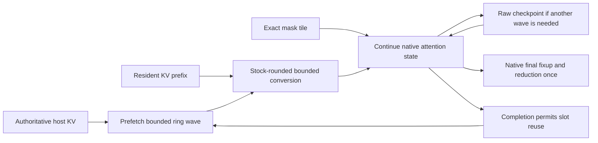

# Qwen3.8 DFlash2 Adaptive KV Streaming Roadmap

Enable the separate Qwen3.8-27B DFlash2 drafter alongside the existing target KV streaming and shared phase arena. Preserve upstream block drafting, attention masks and acceptance semantics. Keep bounded draft sliding-window KV resident; extend target streamed verification from TG4 through TG8.

Status: D1-D5 ownership/integration and D6's initial live/matched-round checkpoints are qualified on RTX 5070 Ti. D6 is not closed: full 262144-context physical fit fails on this card under the tested budgets. PF0's allocation/numerical baseline is complete; PF1-PF6 bounded-prefill work remains pending. D7 and older-device execution remain pending. The 5-10 percent routing-overhead goal is met in sampled 128K equal-residency FP16 cases, not at every short-history width/path. Updated: 2026-10-12. Source baseline: `feature/adaptive-kv-stream-v2` at `1240f34c7744`, rebased onto upstream `10a60cf30`. Development branch: `feature/adaptive-kv-dflash2`. These stages do not renumber existing consumer, MTP, Gemma or attention-port stages.

Saving this plan does not start implementation, download models, change branches, stop production or authorize commits. Each lettered stage below is a reviewable implementation/test unit. Stage completed work and its progress entry for user review.

## Scope and acceptance

The first pairing is the current Unsloth Qwen3.8-27B `UD-IQ4_XS` target and a matching Qwen3.8-27B DFlash2 GGUF sidecar. Start artifact qualification with Q4_K_M sidecar weights; pin the exact filename, revision and checksum in D1. File size is not proof that actual device allocations fit.

Initial hardware profile: one serial request, one CUDA GPU, Flash Attention, GPU KV offload, target Q8_0 K / Q4_0 V and batch/ubatch 256/256. Disable UVM for physical-budget qualification. Use draft F16/F16 as the initial native correctness control; qualify independent draft Q8_0/Q4_0 before using it for deployment comparisons. Unlike embedded streamed MTP, these independent caches do not require matching target/draft KV types.

Acceptance requires:

- Draft lengths 1-7 and every target verification/replay width TG1-TG8.
- Native context capacity 262144, with physical fit and context-end behavior measured rather than assumed.
- Bounded resident draft KV, ordinary stock draft SWA attention and no permanent draft reservation in the target ring.
- One declared arena for participating target/draft KV, temporary compute and staging. Report weights, persistent target recurrent state, host storage and native driver/executable allocations separately.
- Stock-order streamed target arithmetic, matched-mode numerical qualification and preserved current no-speculation/embedded-MTP behavior.
- Correct serial requests, truncation, window wrap, prompt-state restoration, cancellation and failure cleanup.

Initial non-goals: Gemma/Muse target execution, draft KV streaming, DFlash2 media inputs, parallel slots, multi-GPU, DSpark/Eagle3, changing the selector, and probabilistic rejection-sampling qualification. Preserve ordinary non-streaming behavior for other modes. Other accelerator streaming adapters and actual older-card qualification remain separate work.

## Verified model profile

Published drafter settings, to be checked against the selected GGUF:

| Property | Qwen3.8-27B DFlash2 |
| --- | --- |
| Block | Eight positions: anchor plus at most seven proposals |
| Draft layers | Five, all sliding-window attention |
| Window | 2048 positions per layer |
| K/V head dimension and KV heads | 128 and eight KV heads |
| Query heads | 32 |
| Publisher target feature indices | Zero-based 5, 19, 33, 47, 61 |
| Draft attention | Non-causal block attention with its trained SWA mask |
| Drafting | One block forward, then selector path extraction |

Sources: [publisher configuration](https://huggingface.co/incoai/Qwen3.8-27B-DFlash2/blob/main/config.json) and [GGUF model card](https://huggingface.co/z-lab/Qwen3.8-27B-DFlash2-GGUF/blob/main/README.md). D1 pins immutable artifact references.

The converter writes block size, SWA, causal and selector metadata. It adds one to publisher feature indices because llama.cpp extracts layer inputs rather than indexed layer outputs. Test this mapping; do not hardcode the five indices in common memory code.

The target still owns 16 full-attention KV histories and 48 recurrent blocks. Do not add five auxiliary layers to its homogeneous pool: the draft has independent 128-dimensional windowed caches, unlike the target's 256-dimensional full-history caches.

### Widths and microbatches

For requested draft length D, upstream predicts D+1 positions, capped by the trained block size. Confidence cutoff can return fewer proposals. Target verification processes the anchor plus the returned proposals; rejection and context-end handling produce intermediate widths.

Qualify TG1-TG8, not only powers of two. Keep each complete non-causal draft block in one microbatch; validate its batch/ubatch limits before execution. Do not implement TG8 as two TG4 forwards: that changes draft attention, dynamic convolution and selector behavior, and can change target recurrent arithmetic.

Prefill feature injection can process 256-row batches but does not run draft attention. It is a separate workload, not TG256 block prediction.

## Original implementation gaps (baseline before D1-D6)

| Area | Current boundary | Extension |
| --- | --- | --- |
| Server admission | Streaming speculation admits only embedded draft-mtp | Admit this DFlash2 pairing after its complete path passes |
| Rollback | Host spill tied to one auxiliary MTP layer and depth at most three | Derive rollback from target recurrent state and verification workload |
| Streamed decode | Model/session admission, workspace queries and CUDA resume stop at four query rows | Capability-driven target widths through eight |
| Phase planning | Four-entry verification/catch-up arrays and MTP-specific phases | Measure admitted operation/width without equating all speculation with MTP |
| Draft workspace | Live borrowing tied to `mtp_publish_host` | Separate serial consumers can borrow without auxiliary host-backed MTP KV |
| Feature extraction | Enabled by speculative initialization | Include required outputs in construction/reservation and retain them across handoff |
| Draft KV | Stock SWA cache owns separate backend allocations | Bounded persistent arena leases preserve stock cache semantics |

The upstream DFlash2 driver is the algorithmic reference. Do not rewrite its convolution, selector, projections or trained mask to simplify allocation. Missing support must not trigger an unbudgeted second workspace or a full-history target decode gather.

## Common contracts for three model families

Reuse existing owners, consumers, transitions, views and backend operations. Extend the smallest descriptors needed for these cache roles:

| Cache role | Ownership | Examples |
| --- | --- | --- |
| Streamed full-history producer | Owns authoritative history; publishes writes; device pages are reconstructible | Qwen target; future Gemma/Muse full caches |
| Bounded resident producer | Owns window-sized device storage with stock position/truncation semantics | Qwen/Muse DFlash2; future target SWA |
| Shared read-only consumer | Retains source identity/generation and leases; adds no KV history | Future Gemma assistant |
| Independent full-history auxiliary producer | Owns a host history and temporarily borrows the ring | Existing embedded Qwen MTP |

A serial workload describes its operation, cache access, input/query width, retained outputs and rollback needs. Distinguish target prefill, verification, draft feature injection and block prediction. Eight-row drafting is not prefill merely because eight exceeds four; injection occurs during both prefill and verification.

Make measurements extensible to Muse's TG16 and Gemma's geometry without admitting either prematurely. Backend support depends on actual width, dimensions, KV types, masks and launch resources. Do not replace every literal four with sixteen or introduce a model registry for this port.

Common code owns policy and lifetimes; model adapters describe feature/cache relationships; backends execute kernels, copies and completion. Keep common ownership tests usable without CUDA. Reuse [the Gemma plan](GEMMA4_ADAPTIVE_KV_ROADMAP.md) for future shared-reader and mixed-attention requirements.

### Shared bounded resident KV consumer

D5a implements one backend-neutral bounded resident KV consumer, not a DFlash2-specific allocator. It wraps existing stock cache storage and exposes exact requirements, persistent regions, identities, leases and completion to the arena owner. The stock cache keeps responsibility for cells, logical positions, masks, writes and truncation; this consumer does not reimplement SWA attention or infer acceptance from a memory operation.

Derive requirements from the cache group's actual layer IDs, K/V dimensions and head counts, quant types, window, microbatch headroom, padding and alignment. Do not bake in five layers, a 2048-token window or 128-dimensional heads. Resident KV survives all participating phase layouts. Keep its region stable when possible; relocation requires drained readers and explicit content preservation, not reconstruction from only the newest features.

| Responsibility | Shared implementation | Model-specific behavior |
| --- | --- | --- |
| Capacity and byte accounting | Checked geometry, bounds, stock sizing inputs and exact arena requirements | Actual window, cache groups, geometry and admitted full-size SWA behavior |
| Storage lifetime | Persistent leases, content identity, completion, rebind and teardown | Which phases write or retain the cache |
| State lifetime | Ownership hooks for reset, save/restore and validation | Stock cell/position updates and which suffix is discarded |
| Attention and writes | Existing backend operations over valid leased storage | Causal target attention versus non-causal draft blocks and feature injection |
| Read-only sharing | Stable source identity and generation-valid read leases | Gemma assistant source mapping and fixed drafting position |

Use synthetic layouts for both profiles in common tests: Qwen DFlash2's window 2048, dimension 128 and eight KV heads; Gemma target SWA's window 1024, dimension 256 and sixteen KV heads. Vary layer count, KV encodings, microbatch, padding and alignment independently. These are infrastructure fixtures, not Gemma model qualification.

The next Gemma G3a stage reuses this consumer for its target SWA group. Gemma still needs mixed SWA/full-cache coordination and separate causal-mask, truncation and assistant-reader tests. Its assistant aliases target caches rather than creating another bounded cache. Muse can later use the same consumer for both its target SWA and its DFlash2 draft SWA groups, each with its own identity.

## Execution and state lifetime



Confirm callback/acceptance timing in the server fixture. Verification can inject rows later rejected; injected history is not automatically accepted history. Replay must not double-commit rows or consume features from a rejected branch.

Persistent injected KV survives phase changes even though graph scratch is recyclable. Temporary mask rows and injected feature rows are different content generations at overlapping positions. SWA headroom must prevent speculative writes from destroying a prefix needed after rejection.

Keep upstream's host feature path initially. Copy or retain required outputs before draft work reuses target scratch. Optimize this transport only after exact ordering and lifetime tests pass.

## Memory budget



For every admitted phase:

```text
arena capacity >= preserved bounded draft KV
                + target KV working set required by that phase
                + phase graph, attention and writer workspace
                + live handoff and rollback staging
                + alignment and owned metadata
```

Only mutually exclusive lifetimes share storage. Reserve measured maxima rather than sums while preserving persistent regions. On transition, resize and repartition target KV to use available space; avoid stranded scratch or unnecessary ring growth.

Stock serial SWA capacity is padded to 256 from `min(n_ctx, window + n_ubatch)`. Window 2048 and ubatch 256 normally produce 2304 positions. Five layers with eight KV heads and dimension 128 give these illustrative encoded-data sizes:

| Draft KV | Encoded data at 2304 positions |
| --- | ---: |
| F16/F16 | 45 MiB |
| Q8_0/Q4_0 | 18.28125 MiB |

These are calculations, not total allocation measurements. Check tensor/buffer alignment, metadata, empty full-cache groups and scratch in D1/D5. Different ubatch or full-size SWA changes the requirement. Initially reject full-size SWA for the bounded-cache profile.

Sidecar weights, feature buffers, selector/convolution workspace, rollback snapshots and native graph resources may dominate extra memory. Measure them before claiming fit or speedup. Report permanent VRAM increases or quantization changes for user approval. Do not introduce an arbitrary safety reserve or silently reduce target layers, context or batch size.

## Dependencies



D3-D5 have independent tests/commits; keep live admission disabled until D6. A fitting D=3 pairing is the first live checkpoint. D=7 and native-context acceptance are required for completion.

## D1 Artifacts and ordinary controls

| Stage | Boundary | Required evidence |
| --- | --- | --- |
| D1a | Pin artifacts and inspect converted block, SWA, feature-layer, tokenizer and selector metadata. | Valid/missing/malformed/overflow fixtures, correct index mapping, wrong sidecar/incompatible target rejection. `ctx_other` does not imply KV aliasing. |
| D1b | Run ordinary non-streaming DFlash2 with D=1,3,7 at fitting contexts; trace its separate workloads. | Actual widths, masks, stock kernels, features, lattice, proposals, logits and visible SWA rows. Measure weights, KV, compute, features, rollback and native resources. |
| D1c | Establish matched-control fixture and physical-fit ledger before choosing the arena layout. | Independent runs with pinned settings; changed-block negative tests. Report whether the intended 16 GiB/native-context profile is feasible without UVM. |

Retain native controls with the same artifacts and KV encodings; published performance is not local evidence.

## D2 Common workloads and cache roles

| Stage | Boundary | Required TDD evidence |
| --- | --- | --- |
| D2a | Describe verification widths, injection rows, prediction blocks and rollback independently of auxiliary MTP layers. Define bounded-cache requirements without model-specific geometry; reuse phase/measurement infrastructure. | Current paths unchanged; producer/reader roles; independent cache generations; distinct Qwen/Gemma bounded groups; read-only aliases do not add storage or publish; extensible TG16 metadata without false kernel admission. |
| D2b | Admit actual workspace, feature/output lifetimes and capabilities for every workload. Validate block microbatch limits. | Exact-fit/one-byte-short, overflow, missing kernel versus quota shortage, invalid ubatch and width eight not inferred as prefill. Any allowed fallback must be budgeted. |

Do not add user flags for draft cache count or force five draft layers into the target ring policy.

## D3 Target TG1 through TG8 span and resume attention

| Stage | Boundary | Required TDD evidence |
| --- | --- | --- |
| D3a | Extend checked geometry, launch/workspace queries and selected-pair dispatch to widths 5-8 using stock family selection. | Widths 1-8, odd widths, tails, compiled-code and device/resource limits, overflow and transactional failure. Existing TG1-TG4 budgets unchanged. |
| D3b | Extend wide spanned MMA and resumed SIMT execution through TG8, preserving stock arithmetic and pipeline. | Native comparisons for resident/mixed/wrapped layouts, odd widths, history tails, multiple query tiles and short-workspace rejection. No context-sized gather or query-batch splitting. This completed checkpoint does not qualify progressive MMA execution. |
| D3c | Implement progressive MMA resume with raw accumulator checkpoints at complete K-tile boundaries. Preserve native Stream-K destination/split order and finalize each slice once. | Failing tests first for checkpoint/resume, delayed copies, history larger than the ring and wave boundaries. Checked, bounded scratch sizing; exact-fit/one-byte-short and overflow rejection; no premature normalization or final reduction. Measure added scratch before common-budget integration. |
| D3d | Qualify progressive attention correctness, lifecycle safety and routing overhead before target integration. | Stock-equivalent comparisons across TG1-TG8 and admitted families, resident/mixed/wrapped layouts, delayed transfers, cancellation, stale metadata and exactly-once finalization. CUDA memory/synchronization sanitizers, immutable stock snapshots and narrow-width regressions. Measure equal-residency overhead outside unit tests against the 5-10 percent goal; distinguish actual older-device execution from compile/plan coverage. |
| D3e | Connect new widths through session/model admission, encoded writes, scratch planning and capture. | End-to-end synthetic widths, append/repartition/cancellation, malformed spans, canaries, CUDA sanitizers, immutable ordinary snapshots and current MTP regressions. Budget all admitted target widths, not only TG8. Keep embedded MTP's separately qualified width limits unchanged. |

The former D3b scope is split into D3b-D3d; the former D3c integration stage is now D3e. Complete these stages in order. D3 completion qualifies target attention infrastructure, not live DFlash2 drafting; D4-D7 remain required.

Require byte identity where the matching native family already has exact qualification. Preserve accepted family-specific older-architecture bounds; investigate new differences without silently relaxing thresholds. Measure kernel overhead outside unit tests, retaining the prior 5-10 percent routing-overhead goal at equal residency.

## D4 Recurrent rollback independent of draft KV

| Stage | Boundary | Required TDD evidence |
| --- | --- | --- |
| D4a | Select host-spilled target rollback from verification requirements, allowing zero auxiliary cache layers. | Depths 1-7, depth-zero baseline, embedded MTP depths 1-3 and actual history reservation. Unsupported depth fails before execution. |
| D4b | Extend bounded device staging and host snapshot lifecycle for TG1-TG8; reuse spill/publication infrastructure. | Zero/partial/full acceptance, current versus candidate state, pending D2H, stale generation, stage wrap, failed copy, cancellation and exact restore/replay. Report device/pinned-host growth before choosing larger staging. |
| D4c | Qualify rollback at page/window boundaries and long prefixes. | Matching-mode state/logits, repeated rejection, context-end headroom and no accumulation of obsolete snapshots across rounds. |

A pre-round checkpoint/replay path may serve as an explicitly labeled diagnostic control, not a silent replacement for the admitted fast rollback path.

## D5 Resident draft cache and shared phase arena

| Stage | Boundary | Required TDD evidence |
| --- | --- | --- |
| D5a | Implement the common bounded resident KV consumer and attach stock DFlash2 SWA storage. Keep capacity/lifetime logic model-neutral and retain stock cells, positions and masks. | Synthetic Qwen/Gemma geometry, varying groups/quants/headroom/alignment, context-independent byte bound, exact-fit/canaries, persistent content across rebind, cancellation/reset/save-restore hooks, read-only source lifetimes, no unused full-cache tensor storage and this profile's full-size SWA rejection. |
| D5b | Let separate serial draft contexts borrow measured scratch without `mtp_publish_host`. Register injection/block workloads. | CPU/mock then CUDA handoff, retained outputs, scheduler replacement, graph retirement, lease lifetimes, pending publication and failed rebind recovery. No unbudgeted separate-workspace fallback. |
| D5c | Fit persistent draft KV, phase-specific target/draft scratch, staging and target KV grants in one parent. | Low/high/low contexts, all widths, phase minima, correct target pool shrink/grow/repartition, preserved cache bytes and prepared copy resources. No stale captured addresses. |

Draft weights stay resident outside the parent initially. Deferred weight loading or per-round eviction requires a separate measured tradeoff and approval.

## D6 Live DFlash2 integration

| Stage | Boundary | Required TDD evidence |
| --- | --- | --- |
| D6a | Add construction-time feature extraction and connect upstream injection/selector calls to explicit handoff. | Missing/stale/permuted features, index conversion, 256-row injection, text-position transport, bounded outputs and intact non-causal blocks. Text tests do not qualify media. |
| D6b | Admit the narrow server pairing, first D=3 then D=7; preserve temporary-suffix removal and acceptance/replay ordering. | Real D=1/3/7, all returned widths, empty proposals, partial/full/zero acceptance, correction, provisional writes and replay. No second target pool or embedded MTP head allocation. |
| D6c | Extend strict numerical fixture and serial server state integration. | Independent native/streamed comparisons of features, lattice, proposals, logits, logical KV and recurrent state. Inject one-bit/mask/order/publication faults. Existing embedded-MTP checks pass. |

Force acceptance patterns in lifecycle fixtures and run ordinary acceptance in server controls. Streamed TG8 versus no-speculation TG1 is not an exactness oracle: widths/history must match. A resident-only run cannot qualify streaming.

Keep short-prefix native controls physically resident when they fit. A full-context native control may exceed this card's VRAM even when the streamed pairing fits; a separately labeled UVM control can qualify arithmetic at that length if it retains the same GPU kernel and execution mode. Its timing and residency are not the non-UVM physical-budget benchmark. If no matching control is feasible, report the numerical coverage limit rather than substituting a different-family CPU result or claiming full-context bit identity.

## PF Bounded prefill footprint and performance

This workstream addresses the open D6 physical-fit gate after the completed D5 ownership/integration checkpoint and generalizes the bounded-prefill implementation to configurable batch/microbatch limits and KV types. It also implements the relevant bounded-prefill portion of consumer follow-up 5.8; it does not mark all of 5.7-5.9 complete or renumber D5-D7. Complete numerical and memory boundaries first, measuring performance at each step, then tune the resulting pipeline. Saving this roadmap does not begin implementation or complete D6.

### Measured motivation and attribution

At context capacity 262144, the target bootstrap phase rejects a 1536 MiB parent because its minimum is 1704159488 bytes, or 1625.213 MiB. This is a prefill/startup reservation, not steady-state decode usage. The larger 1728 MiB probe records graph compute of 1260677376 bytes and strict attention gathering of 436207616 bytes. The 16384-context control records graph compute of 128215296 bytes. These graph measurements differ by exactly 4608 bytes per context token.

| Component | Full-context bytes / MiB | Current scaling | Planned replacement |
| --- | --- | --- | --- |
| Stock MMA FP16 K and V conversion extras | 1073741824 / 1024 | Two FP16 planes, each 256 features x four KV heads x context tokens | Bounded conversion tiles with stock rounding |
| F16 attention mask for 256 queries | 134217728 / 128 | Context tokens x microbatch queries | Bounded mask tiles or qualified compact causal description |
| Remaining graph workspace | 52717824 / 50.276 | Residual after the two known terms, not yet tensor-attributed | Audit liveness; retain initially rather than promise further savings |
| Encoded strict-prefill gathering buffer | 436207616 / 416 | One full layer of Q8_0 K and Q4_0 V, reused across layers | Resident/ring wave execution without a full-layer destination |
| Minimum target KV pool | 7241728 / 6.906 | Minimum page geometry, not a performant long-context pool | Keep separately budgeted elastic target KV |
| KV writer scratch | 32768 / 0.031 | Current fixed scratch | Preserve and revalidate bounds |

The stock allocation helper explicitly appends full FP16 planes for MMA/tile attention. The mask shape and these terms account for the observed graph-size delta exactly, but PF0 must verify the actual peak tensor lifetimes, scheduler copies and native temporary allocations. Do not present the residual as a proven universally constant allocation. The theoretical context-linear opportunity is 1568 MiB at this profile; it is not a measured net saving after replacement staging/checkpoint memory.

The phase arena already returns prefill-only storage to the target KV pool during decode. Reducing prefill memory within the same parent does not automatically add another 1568 MiB to the decode pool. The primary benefit is a lower startup/prefill minimum and better full-context fit. Compare decode grants explicitly after sidecar attachment; draft weights, current recurrent state and driver/executable allocations remain outside this arena.

### Scope and invariants

- The first regression anchor is the admitted CUDA Qwen profile: serial text, Q8_0 K / Q4_0 V, b/ub 256/256 and Flash Attention. The implementation must not specialize common sizing or execution contracts to that batch or quant pair. Generalized batch/microbatch and independently selected K/V types are part of PF acceptance, gated by actual compiled, device-valid counterparts for the stock-selected family. Disable UVM for physical-fit measurements. Draft KV remains independently bounded as in D5. Model, device, parallel-request and multi-GPU expansion remain outside this workstream.
- A constant footprint means a checked upper bound independent of populated/context-capacity token count for fixed model geometry, microbatch ceiling, staging capacity and device resources. Native launch choices may vary with history; reserve a bounded maximum rather than forcing a different launch to keep an exact byte count identical. Host KV, host metadata and work/transfer volume may still grow with context.
- Retain the original logical query batch, native family, column grouping, KV tile sizes, Stream-K destinations/splits, FP16 conversion rounding, mask values, softmax recurrence and final fixup/reduction. Do not run a 256-row prefill as independent TG8 calls, independently normalize chunks, merge new partial softmax results, change precision or substitute a different kernel family to fit.
- Pause only at qualified native tile boundaries. Save and restore raw accumulator bits and required pipeline state; retain native last-tile/finalization behavior. Copy/conversion may run ahead, but attention traverses the original logical tile order within each native work partition.
- Publish new KV before its reader begins. Retain resident/ring/cache generations and prepared resources until the last actual consumer completes. A prefetched slot is not reusable merely because its H2D copy finished.
- Common owners describe capacity, leases, producer/consumer completion and scheduling. Backends describe supported geometry, stock-equivalent execution, conversion, mask delivery and exact workspace requirements. Reuse the existing private execution/copy contracts; do not put CUDA events or Qwen constants into common policy.
- A different-memory fallback must be planned and validated before launch. A strict-gather diagnostic may remain available in a separate validated configuration; no silent full-context gather/conversion fallback in a bounded grant. Reject unsupported mask or kernel requirements with a concrete reason before submission.
- Preserve existing TG1-TG8 decode and embedded-MTP paths. Shared source edits need explicit decode regression tests; reduced memory alone is not proof of unchanged performance.

### Generalized batch and KV configuration

Keep upstream's distinction between logical batch limit (`-b`) and physical microbatch limit (`-ub`). Use the effective limits after ordinary context normalization, not raw CLI values or a new normalization rule. A logical batch can cover several microbatches; bounded attention uses each actual microbatch's query count while reservations cover its admitted maximum. Do not artificially split a microbatch to force it into the existing TG8 path. Keep output retention, recurrent rollback and feature injection sized for their own workloads rather than assuming that all use the prefill width.

The common plan takes independent K/V types, head geometry, effective batch/microbatch ceilings, cache padding, backend alignment, selected native family and staging capacity. Use GGML row/block traits and actual backend allocation quotes, checked before arithmetic. Derive encoded K and V strides independently; do not assume equal block sizes, equal compression, a fixed bytes-per-token value or that the 32 KiB writer scratch is valid for every configuration. FP16 conversion capacity depends on which input planes the selected native kernel actually converts; F16 input need not acquire an unnecessary conversion plane. Mask/checkpoint capacity depends on admitted query tiles and native work partitions. Changing any plan-defining type, width or geometry invalidates retained plans/captures and requires re-admission before writes.

Reconcile all boundaries, not just the attention kernel: SET_ROWS/writer production, host/page layout, ring sizing, conversion, mask delivery, scratch queries, GGML external-output allocation, scheduler reservation, shared-arena phases and serial sidecar construction. Remove blanket 256/256 or Q8_0/Q4_0 admission restrictions only after these boundaries pass for the requested profile. Draft feature injection follows its actual admitted microbatch; complete non-causal draft blocks must still fit their own effective batch/microbatch limits. Report that semantic limit instead of silently splitting a block. Target and independent DFlash2 draft KV types need not match; keep the existing embedded-MTP compatibility rules unless separately qualified.

Use a capability matrix rather than an unconditional promise of every Cartesian pair. Enumerate the upstream CLI cache types (currently F32, F16, BF16, Q8_0, Q4_0, Q4_1, IQ4_NL, Q5_0 and Q5_1) and ask separately whether the backend provides the native family, exact converter/writer, bounded span/resume executor and valid launch resources. Existing encoded readers cover most, but not IQ4_NL; a native converter alone does not establish a bounded counterpart. Missing readers/counterparts require implementation and qualification before admission, or an explicit unsupported result. Common size accounting must still handle all upstream-valid types without a pair-specific formula. Honor both all-quants and selective-pair builds; name the missing stage/type/family rather than reporting every failure as a missing build flag.

Do not change the original stock family/tuning for a requested pair or width to simplify this implementation. Exactness is relative to the matching stock execution for that same configuration, not Q8_0/Q4_0 or 256/256 output. Changing KV quantization or `ub` can legitimately change model output even when the streamed implementation is correct.

The bounded VRAM target is constant with respect to context length for a fixed admitted configuration. It can legitimately increase with `ub`, encoded row size, query/head geometry or other declared workload requirements; no one-size arena minimum is promised. Stock tensor quant blocks, cache/page padding and query tiles are distinct alignment constraints. A fixed number of staging bytes must cover complete native tiles for both K and V, otherwise preflight reports the exact shortage rather than overrunning or changing arithmetic.

### Pipeline to qualify



The diagram is a lifetime/data-flow contract, not a new attention reduction. Independent copies and conversions can overlap current computation. Reuse a converted wave across its consuming query tiles before overwriting it; avoid multiplying H2D or conversion work by query tile count. Checkpoint memory must be bounded by admitted query tiles and native work partitions, not allocated per historical KV tile.

### Reviewable TDD checkpoints

| Stage | Implementation boundary | Required evidence before closing |
| --- | --- | --- |
| PF0 Baseline and allocation attribution | Pin current/native controls; expose test-side tensor allocation and peak-lifetime accounting, including backend extras and resources outside the parent. Audit batch normalization and every pair/width-specific admission rule; save numerical, memory, prefill and decode baselines. | Reproduce 16K and 262K size accounting; distinguish capacity from used tokens, prefill from decode and target from attached sidecar. Identify allocator padding/copies and native pool high-water marks. Build the batch/quant capability matrix and capture expected unsupported cases before changing gates. Existing short controls pass. |
| PF1 Bounded conversion, strict gather retained | Extend stock-compatible wide-query planning/execution for configurable prefill ceilings, initially through the MMA counterpart and admitting other selected families only when qualified. Consume bounded converted tiles with type-specific stock rounding; retain full encoded gathering. Register actual external scratch instead of the above-four-query native-extra rule. | First fail on unsupported width/pair, full-plane allocation, inadequate grants or conversion mismatch. Qualify actual full/short microbatches, multiple query tiles, native launch/split/fixup order, no-conversion F16 and independent K/V geometry. Keep gather/masks unchanged. Stock-equivalent conversion tests, all-type accounting and existing TG1-TG8 controls pass without an unbudgeted fallback. |
| PF2 Progressive ring prefill and event-based lifetime | Remove the full encoded gathering destination. Consume resident plus bounded ring waves with PF1 native continuation; derive both planes/page capacity from actual KV types. Extend writer/SET_ROWS admission to effective microbatch ceilings. Replace host waits only where completion dependencies prove safe reuse. | First fail on unavailable/overwritten waves, writer-width overflow, quant-block misalignment, unsafe conversion reuse or boundary/finalization errors. Test asymmetric K/V types, history larger than the ring, mixed/wrapped layouts, short tails, delayed producer/copy/consumer, cancellation and retry. Match controls and bound copies/conversion across query tiles; common and CUDA safety tests pass. |
| PF3 Bounded mask delivery | Remove context-by-query GPU mask allocation/copy for variable microbatch widths. Preserve exact values through qualified compact metadata or bounded explicit tiles, including stock padding. Keep logical semantics in the cache/model adapter. | First fail on allocation growth or a changed mask bit. Cover padded tails, positions/cache holes, serial prompt reuse, non-power-of-two widths and short final batches. Reject unsupported custom paths before launch. GGML must not silently upload a full mask. Mask/state/output and lifetime tests pass. |
| PF4 Shared-arena/preflight integration and generalized admission | Include configuration-derived staging, conversion, writer, checkpoint, mask and native extras in every admitted phase. Reserve checked maxima using the same requirements as execution; keep persistent draft KV/stage disjoint. Replace blanket batch/pair gates with qualified capabilities. | Exact-fit/one-byte-short per admitted configuration, overflow, stale captures, no second-buffer fallback, low/high/low phases and prepared-resource failures. Test differing logical/physical batch limits and independent target/draft KV. Non-UVM 262144 anchor pairing fits prefill/verification/recovery. Report peak VRAM/decode grant and any other configuration's real capacity limits; startup alone is not a pass. |
| PF5 Pipeline performance tuning | Tune waves/lookahead, batched retirement, conversion reuse, submission gaps and execution-island/capture reuse using actual row sizes and query tiles, not a Q8/Q4 or 256-row special policy. Keep event-based ownership from PF2 and original arithmetic. | Profile resident/onset/moderate/heavy streaming at the anchor and representative other batches/quants. Attribute H2D, conversion, MMA, checkpoint, waits and launches separately. Each change gets matched outputs and equal-budget throughput; keep only measured benefit or an explicitly accepted tradeoff. No percentage speedup promises. |
| PF6 Numerical, memory and performance acceptance | Compare the generalized bounded-prefill implementation against unchanged matching strict/native controls, then resume D6/D7 gates. Publish tested batch/quant/device/build support and specific rejection reasons. | Complete the matrix below, bounded allocation evidence across contexts for each admitted configuration, safety suites and 256-token samples plus longer lifecycle controls. No-speculation, embedded-MTP and DFlash2 D=1/3/7 pass where admitted. Unsupported combinations and unqualified native-context/older-device cases stay explicit. |

PF1 may need separate planner/contract and executor/qualification commits if it exceeds a reviewable change. Retain the checkpoint's acceptance gate rather than calling planner-only coverage complete. The same rule applies to new mask delivery contracts. Completed evidence is recorded below; planning alone does not complete a checkpoint.

### Numerical and boundary qualification matrix

- Keep unchanged native/strict-gather controls compiled from the same pinned source/toolchain/options; compare identical input KV, mask, query width, positions, scale and native execution family. Compare immediate attention outputs before whole-model outputs. TG256 prefill versus TG8/TG1 is not a numerical oracle.
- Batch coverage: start with effective b/ub pairs 128/64, 256/128, 256/256, 512/128, 512/256, 512/512, 1024/256, 1024/512 and 1024/1024, plus a valid non-power-of-two case after stock normalization. Verify logical batches spanning multiple microbatches and short final batches. Planner-only negative tests cover zero/overflow, requested limits normalized by stock, insufficient workspace and complete draft blocks that cannot fit; do not introduce new CLI semantics. A physically oversized but otherwise valid configuration must produce a precise quota/availability error rather than an unexplained 256-only restriction.
- Query coverage: actual full/partial microbatches at every admitted ceiling, every stock query-column boundary and existing verification widths TG1-TG8. Do not compile an independent specialization for every numeric width if stock already uses a shared tile bucket. Qualify preserved stock family/column grouping instead. Unsupported widths/geometries remain explicit.
- KV coverage: enumerate every upstream-valid K/V Cartesian pair for size/planner/capability tests. Run device conversion/writer tests for each admitted type and stock-order attention tests for each admitted pair. Include all nine Q8_0/Q5_0/Q4_0 pairs, F16/BF16 controls, F32 where native support exists, Q4_1/Q5_1 and asymmetric bit widths; IQ4_NL needs its own qualified bounded reader/counterpart or an explicit negative case. Missing selectively compiled pairs and missing device resources must not allocate a fallback. No quant gets a hidden fixed-size path.
- Run the batch and pair axes separately at the anchor, then crossed corner cases (largest admitted ub, largest encoded planes, asymmetric pairs and short final batches) to catch coupled assumptions without requiring a full-context sweep for every Cartesian cell. This sampling rule does not replace pair-specific kernel correctness tests. Target and draft types are tested independently only within each mode's admitted semantics.
- History coverage: just below/at/above native K-tile, 256-token page and staging-wave boundaries; large history requiring repeated reuse; first/last padded tile; resident prefix, all-streamed, wrapped ring and transition back to resident operation.
- Deliberate faults: one-bit converted KV or mask mutation, swapped logical tiles, stale generation, early slot reuse, missing checkpoint state, duplicate normalization/finalization and failed completion. These must trip the corresponding tests rather than only producing plausible text.
- Compare FP16 conversion and mask bits, attention outputs, retained target features, logits, logical accepted KV, serialized recurrent state, draft proposals and token-conditioned selector scores. Preserve existing canonical handling of top-k candidate permutations. Require bit identity for the initially exact-qualified matching family; existing legacy bounds are not permission to loosen a new prefill result.
- Use CPU/mock tests for bounds, plan identity, source retention, completion ordering, cancellation and phase ownership; CUDA tests for conversion, pipeline state and native arithmetic. Use existing tests/fixtures, ASan/UBSan and CUDA memcheck/synccheck/racecheck where applicable; do not add timing assertions to unit tests.
- When a physically resident full-context native reference cannot fit, use a separately labeled same-kernel UVM numerical control if feasible. Keep physical-budget/performance runs non-UVM. If neither control is feasible, report the coverage limit; successful short exact controls do not establish full-context exactness.

### Memory and performance measurement rules

Run focused points after each checkpoint before the full sweep: all-resident, streaming onset, moderate ring and heavy ring. Choose onset/ring points from actual active/resident/ring counts, not fixed labels that may become wrong after memory changes. Include 16K as the small control and 262144 as the capacity endpoint; reserve room for generated tokens inside the context.

At PF6, reuse the existing realistic article source and sweep harness for 8K through 192K in 8K increments, then named 224K/248K/256K capacity points, with at least 256 generated tokens where capacity permits. Keep successful results and use new output directories. Use the same prompt IDs and generated-token budget for comparisons. Follow with longer continuations crossing page/repartition boundaries and rejection-heavy recovery.

Report prefill throughput separately from target/draft decode throughput, acceptance, phase-transition cost, total GPU high-water mark, graph tensor workspace, conversion/gather/mask/checkpoint bytes, effective decode KV pool, persistent draft KV, publication staging, backend-native temporaries and host footprint. Count H2D/D2H/D2D bytes/calls, repeated conversion and CPU/device waits; Nsight instrumentation is separate from uninstrumented timings.

Maintain two comparisons: equal declared parent with observed decode grants recorded, and independently maximum-fit parents for each configuration. Do not attribute a larger resident pool or changed acceptance to faster kernels. Auto-max must exercise graph instantiation and admitted recovery workloads with UVM disabled, not just startup. Short-context prefill and TG1-TG8 decode are explicit regression checks. Any statistically credible regression must be investigated, fixed or presented for user acceptance; noise from one short sample is not a performance verdict.

Run the full context sweep for the anchor configuration; use focused resident/onset/moderate/heavy points for the additional batch/quant axes and crossed corners, extending sweeps when results expose a regression. Compare each configuration to its own stock arithmetic baseline. Publish requested and effective b/ub, target/draft KV types, admitted family and measured arena requirements with every result; a type or batch change can alter both output and the context where streaming begins.

Completion means generalized configuration-derived sizing and capability admission are implemented, tested batch/quant profiles are documented, admitted prefill workspaces have context-independent upper bounds, the full-context anchor pairing fits real execution and matching-mode controls pass. It does not promise identical footprint across different microbatches/quants, every native pair having a streamed kernel, constant host memory, unchanged attention compute/PCIe work, guaranteed driver availability or a particular speedup. A plan/preflight rejection must be distinguishable from runtime device failure; retained driver resources and other GPU users remain part of physical-fit testing.

## D7 Lifecycle and performance qualification

| Stage | Boundary | Required evidence |
| --- | --- | --- |
| D7a | Complete window-wrap, serial reuse, prompt-state restoration and cancellation. | Below/at/above 2048, wrap during prediction/rejection, cell reuse, ring repartition, different prompts, cached append, low/high/low reuse, serialized draft KV/carry and recovered output. |
| D7b | Qualify startup/runtime failures and native context under declared physical budgets. | Missing kernels, undersized grants, driver/allocation failures, context-end partial blocks, teardown/restart and no stale events/leases or growing memory. No-MTP/MTP controls pass. |
| D7c | Benchmark no speculation, embedded MTP=3 and DFlash2 D=3/7 with realistic prompts; document reproduction. | 256 generated-token sweeps, resident/light/moderate/heavy ring, native-context endpoint and longer rejection-heavy continuations. Label equal-budget versus independent maximum-fit comparisons. |

Reuse the sweep harness. Auto-max probes each mode without UVM when requested; launch success alone does not prove block prediction, graph instantiation and recovery fit. Exercise admitted workloads, keep successful data points and distinguish quota shortages, true OOM and correctness failures.

Record accepted-token throughput, prefill, acceptance, proposals/verification, effective target KV grant, persistent draft bytes, target/draft compute, feature D2H, target H2D, replay and phase-transition costs. Control artifact versions and budgets; do not attribute acceptance or pool-size changes to kernel speed.

Speedup is an empirical gate, not a promise. If draft weights or execution cost outweigh savings, report the hardware/workload result before proposing offload, different quantization or a new memory policy.

## Reusable outcomes and later models

Gemma G3a reuses D5a's bounded resident KV consumer; it does not implement a second SWA allocator. Gemma adds mixed target-cache coordination and causal model behavior around that storage. Its assistant remains a read-only source-KV consumer, not a DFlash2 model with independent draft history. DFlash2 injection, temporary mask rows and selector behavior stay in the draft adapter.

Muse reuses feature injection, block/selector phases, bounded draft SWA and acceptance fixtures. Its target needs mixed-attention integration and geometry/mask qualification. TG1-TG16 is a named follow-up; Qwen TG8 tests do not qualify Muse.

Other backends provide capability queries, stock-equivalent attention and completion semantics behind the same contracts. Common memory tests do not prove that streamed kernels exist.

## Source and test references

| Area | Starting point |
| --- | --- |
| Driver and context creation | [common/speculative.cpp](common/speculative.cpp), [common/common.cpp](common/common.cpp) |
| Injection and selector | [src/models/dflash.cpp](src/models/dflash.cpp), [conversion/qwen.py](conversion/qwen.py) |
| SWA sizing and state | [src/llama-kv-cache-iswa.cpp](src/llama-kv-cache-iswa.cpp), [src/llama-kv-cache.cpp](src/llama-kv-cache.cpp) |
| Server verification and recovery | [tools/server/server-context.cpp](tools/server/server-context.cpp) |
| Phase ownership | [src/llama-memory-phase-owner.h](src/llama-memory-phase-owner.h), [src/llama-context-memory.h](src/llama-context-memory.h) |
| Rollback | [src/llama-memory-recurrent-spill.h](src/llama-memory-recurrent-spill.h) |
| Streaming and CUDA execution | [src/llama-kv-stream-session.cpp](src/llama-kv-stream-session.cpp), [ggml/src/ggml-cuda/kv-stream-partial.cu](ggml/src/ggml-cuda/kv-stream-partial.cu), [ggml/src/ggml-cuda/fattn.cu](ggml/src/ggml-cuda/fattn.cu) |
| Strict numerical fixture | [tests/kv-stream-bit-exact-test.h](tests/kv-stream-bit-exact-test.h), [tests/test-kv-stream-context.cpp](tests/test-kv-stream-context.cpp) |
| Existing design and qualification | [DEVICE_MEMORY_INFRASTRUCTURE.md](DEVICE_MEMORY_INFRASTRUCTURE.md), [MTP_ADAPTIVE_KV_ROADMAP.md](MTP_ADAPTIVE_KV_ROADMAP.md), [UPSTREAM_ATTENTION_PORT_ROADMAP.md](UPSTREAM_ATTENTION_PORT_ROADMAP.md) |

Reuse phase-owner/context-memory, recurrent-spill, batch-allocation, geometry/dispatch, session/publication, span/resume and server suites. Prefer adding cases to existing tests. No new test framework or timing-sensitive CI assertions.

## TDD workflow and progress

Add failing tests first and retain the red result; implement the minimum coherent change; run affected and existing regressions. Find the first numerical/state mismatch instead of relying only on decoded text. Update exact checks, measurements and limitations; stage related work and let the user commit.

| Milestone | Status | Completion gate |
| --- | --- | --- |
| D1 Artifacts and ordinary controls | D1a committed at `e783f9d61`; D1b at `1cd9036ce`; D1c complete | Pinned metadata, controls and physical-fit ledger |
| D2 Common contracts | D2a at `4db05567e`; D2b contracts complete | Neutral workload/cache roles and unchanged current paths |
| D3 Target TG1-TG8 | D3a at `0f9c78645`; D3b at `89baa844f`; D3c-D3e at `dd6c33716`/`80223bf7a`/`eb43fd0fe`, plus the qualified optimization checkpoint below | Native order, bounds, integration and measured performance pass; short-history overhead and older-device execution limits remain explicit |
| D4 Recurrent rollback | D4a at `ea48f3bc7`; D4b at `983f878d4`; D4c qualified below | Two-slot depth-seven recovery passes matching-mode target, shorter-width and long-prefix qualification |
| D5 Draft KV and phase arena | Qualified ownership/integration checkpoints below | Persistent draft KV, publication staging and phase grants in one physical parent; no unbudgeted draft workspace fallback |
| D6 Live DFlash2 integration | Live/matched-round checkpoints pass; full-context card-fit gate remains open | D=1/3/7, TG1-TG8, both initial draft quant pairs, forced decisions and live server controls |
| D7 Lifecycle and performance | Planned | Native-context recovery and comparison matrix |

No stage completes merely because startup succeeds or output looks plausible. D3a was implemented independently at the user's request. D3's optimization gate, D4's rollback qualification and D5's ownership/integration checkpoints are complete. D6's live/matched-round checkpoints are qualified, but its full-context fit gate is open; the PF workstream is the next planned prerequisite. These results do not qualify native-context DFlash2 or D7 on their own, and D3 measurements must not be described as achieving every performance goal.

### D1a pinned artifacts and offline metadata audit

Implemented on 2026-10-11 for user review. The [artifact manifest](benchmarks/data/dflash2-qwen27b-artifacts.json) pins immutable repository revisions, filenames, byte lengths and SHA-256 hashes for the existing Unsloth IQ4_XS target, the Inco Q4_K_M DFlash2 sidecar and its publisher configuration. The sidecar and configuration are cached in `llama-cache`; no model binary is added to Git.

| Input | Revision | Verified file bytes |
| --- | --- | ---: |
| Unsloth Qwen3.8-27B UD-IQ4_XS | `4ca720788d1e01f1bff70c033e0d0028fd02e502` | 14252845984 |
| Inco Qwen3.8-27B DFlash2 Q4_K_M | `51962825493a48b846b40126d35c799ac4093ad0` | 1143006816 |
| Inco DFlash2 publisher configuration | `015e795645c74b1a0eeef3b570031fb62e769bc5` | 1239 |

[inspect_dflash_artifacts.py](benchmarks/inspect_dflash_artifacts.py) reuses the repository's GGUFReader, not a new binary parser. It verifies all input hashes before metadata inspection, validates required field/array types, bounds and checked products, and rejects replaced/changed inputs before publishing a report. CLI paths are configurable; no host path is embedded in the manifest. Dependencies are already declared by `gguf-py`; the audit loads neither model weights into an inference context nor any accelerator.

The real inputs pass: target trunk 64, draft layers five, block size eight, window 2048, K/V head dimension 128, eight KV heads, 32 query heads and encoded feature width 25600. Publisher outputs `[5,19,33,47,61]` map in order to GGUF input layers `[6,20,34,48,62]`. Required projections, convolution bases and selector shapes match. The sidecar has no token-embedding or output-projection tensor, so it borrows those target weights; its KV remains independent rather than aliasing the target cache.

Both files have the same 248320 ordered tokens/types and tokenizer model. Their fingerprint is `b9878640053a6c13f1a46e2982a770d86b41f56aae027b0d6f9f0601fe69793b`. One conversion difference is retained explicitly: publisher EOS 248044 names `<|endoftext|>`, while both GGUF EOS flags use 248046, `<|im_end|>`. The audit warns on this recognized end-marker alias, requires target/draft converted EOS flags to agree, and still rejects arbitrary EOS or mask mismatches. Mask ID 248070 matches the trained configuration; its token spelling is not used to invent a different mask.

The sidecar tensor payload totals 1132057600 bytes (1079.614 MiB). This is artifact accounting, not a measured GPU allocation or a fit guarantee. The report deliberately retains `runtime_qualified: false`. D1b/D1c must still establish ordinary execution, kernel/mask behavior, stopping/rejection and physical memory requirements.

```sh
# Install the existing GGUF tools' dependencies in your Python environment.
python -m pip install -e ./gguf-py
python benchmarks/inspect_dflash_artifacts.py \
  --target /path/to/Qwen3.8-27B-UD-IQ4_XS.gguf \
  --draft /path/to/Qwen3.8-27B-DFlash2-Q4_K_M.gguf \
  --draft-config /path/to/pinned/config.json
python -m unittest discover -s benchmarks/server-ab/tests -p test_dflash_artifacts.py
```

The initial profile stub failed 89 assertions. Follow-up tests failed before end-marker handling, manifest validation and stable-input orchestration existed. All 22 tests now pass, including a real small GGUF round trip, feature-order conversion, wrong target/sidecar, missing or malformed fields/tensors, integer/type/size bounds, vocabulary identity, checksums, duplicate/oversized JSON and replacement after hashing. The project's pinned ty check passes for both new Python files. Existing sweep and qualification suites pass 32 and 18 tests.

Evidence: `/tmp/dflash2-d1a-red-profile-tests.log`, `/tmp/dflash2-d1a-red-integrity-tests.log`, `/tmp/dflash2-d1a-red-stable-input-tests.log`, `/tmp/dflash2-d1a-final-tests.log`, `/tmp/dflash2-d1a-typecheck.log` and `/tmp/dflash2-d1a-real-artifact-audit.json`. Production was not stopped or reconfigured for this stage. No runtime admission, loader, kernel or arena behavior changed.

### D1b ordinary controls and workload tracing

Completed on 2026-10-11. Ordinary DFlash2 runs initially failed on the first 256-row feature injection: the borrowed CPU workspace had been measured using token graphs only. Its feature graph needs a wider input. The native regression failed before the fix and passes afterward (43 assertions including existing exact-fixture checks). Commit `cca0dd3c6` measures the injection graph before creating the workspace; it does not enable streaming, change attention arithmetic, or add a fallback allocation.

[run_dflash_controls.py](benchmarks/run_dflash_controls.py) reuses the existing corpus, artifact auditor, server environment and SSE collector. It runs only the ordinary DFlash2 path: one slot, 256/256, target Q8_0/Q4_0, explicit draft quants, all-layer offload requested, fit disabled, no mmproj, no stream pool, no UVM and no host-spill override. It saves complete successful results and explicitly records capacity failures. It never changes quants/offload to make a point fit. Timing, captured tensors and Nsight run in separate server processes; captured/profiler timing is not the performance control. The script does not stop production itself.

[dflash-control-trace.cpp](benchmarks/dflash-control-trace.cpp) is an optional Linux-only, test-side interposer, not a runtime API or backend adapter. It labels ordinary `llama_process` calls, distinguishes startup warmup from real blocks, records actual tokens/positions and memory breakdowns, and captures bounded feature, logits, selector-lattice, K/V and mask payloads. It retains physical visible-column indices and the stock SWA cell-to-position map. SHA-256 and byte-length checks detect changed/truncated payloads. Captures are limited to two occurrences per selected tensor and 512 MiB per process; this is attribution evidence, not exhaustive long-run numerical qualification. D1c/D6 add matched controls and lifecycle coverage.

All requested D=1/3/7 controls complete without UVM at capacities 1024 and 4096 using F16/F16 draft KV. Independent Q8_0/Q4_0 draft KV also completes at 4096. The latter is not compared numerically with F16; matching controls must use the same encoding. The 4096-capacity controls use the same 2304-token Wikipedia prefix and generate 64 tokens. These are ordinary-path smoke/measurement controls, not the later 256-token streaming sweep.

| Ordinary draft KV | D=1 decode tok/s | D=3 decode tok/s | D=7 decode tok/s |
| --- | ---: | ---: | ---: |
| F16/F16 | 75.34 | 92.18 | 100.60 |
| Q8_0/Q4_0 | 72.89 | 91.33 | 100.73 |

Actual injected batches range from one to 256 rows, each with feature width 25600. Prediction widths are exactly 2/4/8; verification/replay also visits smaller widths. The independent draft cache has five SWA layers, zero full-history layers and capacity 2304 beyond the window. Non-causal blocks expose 2048 through 2048+D visible positions, not just 2048 for every query: earlier block queries can also see their future block positions. Both cache cells and mask columns are recorded instead of assuming a contiguous logical window.

Nsight confirms native head-256 target attention and native head-128 draft attention, with the stock split-fixup kernels. Its NVTX ranges separate target tokens, feature injection and draft blocks. Successful 1024-capacity profiles cover all three draft depths. F16 D=7 at capacity 4096 completes unprofiled and under tensor capture, but Nsight adds enough footprint to hit genuine OOM after one generated token. That failed point is retained, not retried or substituted with a smaller/offloaded profile.

Measured device allocations at capacity 4096:

| Component | F16/F16 draft | Q8_0/Q4_0 draft |
| --- | ---: | ---: |
| Target GPU weights, excluding unused embedded MTP | 12726.348 MiB | same |
| Target CPU-mapped weights (stock input embedding placement) | 520.996 MiB | same |
| Separate draft GPU weights | 1079.615 MiB | same |
| Target full-history KV | 104 MiB | same |
| Draft bounded SWA KV | 45 MiB | 18.281 MiB |
| Draft maximum reserved GPU compute | 274.902 MiB | 278.731 MiB |
| Draft CPU workspace for injection | 25.008 MiB | 25.086 MiB |
| Target recurrent state including ordinary GPU rollback, D=1/3/7 | 299.25 / 598.50 / 1197 MiB | same |

Target GPU compute is about 93.276 MiB for D=1/3 and 97.510 MiB for D=7 in these captured controls. Feature payloads reach 25 MiB per 256-row injection; that does not count all host vector capacity/output allocations. Native resources are separate from the allocator totals: the successful 1024/D=7 Nsight run observes 18 event creations, two stream creations and three graph instantiations. Its CUDA allocation timeline reports peaks of 15482.001 MiB device allocations and 84.311 MiB pinned host allocations; CUDA-internal/library overhead is not all represented in those tracked allocations. Do not add the context/model totals twice, assume graph-resource bytes from event counts, or treat a sampled free-memory reading as a guaranteed deployment margin.

The captured 4096/D=7 run ends with only 17.375 MiB CUDA-reported free memory (39.375 MiB with quantized draft KV). Ordinary GPU rollback costs roughly 149.625 MiB per additional depth; D4 must qualify host spill rather than carry this growing GPU history into the intended long-context budget. D5 must also measure actual injection/block workloads rather than blindly reserve a 256-row prediction graph. A full-context fit claim remains pending.

Reproduction, after stopping any conflicting GPU workload and building the full server target:

```sh
build=build-upstream-attention-port
cmake --build "$build" --target llama-server test-kv-stream-context --parallel
g++ -std=c++17 -O2 -fPIC -shared benchmarks/dflash-control-trace.cpp \
  -Iinclude -Iggml/include -I/usr/local/cuda/include \
  -L"$build/bin" -Wl,-rpath,"$PWD/$build/bin" -lllama -lggml-base -lggml \
  "$build/vendor/hash/libvendor-hash.a" -ldl -o /tmp/dflash-control-trace.so
python benchmarks/run_dflash_controls.py \
  --target /path/to/pinned/UD-IQ4_XS.gguf \
  --draft /path/to/pinned/DFlash2-Q4_K_M.gguf \
  --draft-config /path/to/pinned/config.json \
  --server "$build/bin/llama-server" --output /path/to/new/results \
  --contexts 1024,4096 --depths 1,3,7 \
  --trace-library /tmp/dflash-control-trace.so
# Optional separate profiling pass: add --nsys /path/to/nsys.
# Independent quantized-draft control: add --draft-k q8_0 --draft-v q4_0.
```

TDD evidence: 27 Python tests (artifact integrity, ordinary commands, complete responses, workload coverage, warmup exclusion, payload integrity and failure classification), nine CPU trace-helper assertions (masks, bounds, NaN and empty output), the native feature-workspace regression, five focused host CTests, and the existing 32 sweep / 18 qualification tests pass. The pinned ty check passes with the existing server-ab import directory. Full native controls, raw payloads and Nsight reports are under `benchmarks/results/dflash2-d1b-qualified-f16`, `dflash2-d1b-native-ledger` and `dflash2-d1b-native-quantized-draft`. Initial red evidence is in `/tmp/dflash2-d1b-red-tests.log` and `/tmp/dflash2-d1b-red-native.log`; green/regression logs use the same prefix. Production is restored and healthy with its existing configuration.

### D1c matched native fixtures and physical-fit ledger

Completed on 2026-10-11. The control harness now supports `--compare-to /path/to/independent/control`. It rejects different artifact hashes, quants, batch/microbatch settings, draft limits, context/prompt/decode lengths and UVM mode. It verifies payload files before comparing trace records, returns the first mismatching record and keeps failed results rather than retrying them. Device free-memory observations and payload filenames are not arithmetic outputs and are excluded from equality.

Stock CUDA top-k is intentionally unordered (`ggml/src/ggml-cuda/top-k.cu` uses CUB's unsorted output and an atomic radix gather). Independent ordinary runs therefore produce permutations of the same selector lattice, even when raw logits and final token IDs are identical. The fixture compares each candidate's F32 score by its successor/predecessor token IDs, keeping the exact score bits. It checks unique valid candidate IDs, zero anchor/padding, repeated anchor-score blocks and every transition score. This is not a numerical tolerance or a change to the stock selector. Different candidate sets, changed scores, proposals, masks, positions or tensor data fail qualification; raw lattice hashes remain available for integrity checks. Ties can still change upstream argmax behavior, so generated/proposed token IDs must also match.

Independent F16/F16 controls at capacity 4096 with a 2304-token prefix and 64 generated tokens match 212/157/127 non-memory trace records for D=1/3/7. Independent Q8_0/Q4_0 controls pass both the 64-token fixture and a 256-token fixture. The latter matches all 256 output token IDs and 705/452/357 records for D=1/3/7, including the complete recorded process/token/position/cell-map sequence and the bounded captured tensors. This proves native-fixture repeatability within that scope; it does not qualify streamed attention or claim that every tensor in all 256 rounds was captured.

The fit ledger uses measured model/cache components rather than file sizes. At 262144 positions, the target's ordinary Q8_0/Q4_0 full-history KV alone requires 6656 MiB. With Q8_0/Q4_0 draft KV, the ordinary device-allocation lower bounds are 20779.494 / 21078.744 / 21677.244 MiB for D=1/3/7, before compute, outputs/features and native resources, against 15880.625 MiB CUDA-usable memory. Ordinary full-context execution cannot fit without paging/offload. Thus short resident native controls are necessary; an eventual full-context numerical control will need the separately labeled UVM path described under D6.

After keeping weights and one current recurrent state outside the future shared parent, its optimistic upper bound is 1925.037 MiB. Reserving the bounded 18.281 MiB draft KV leaves at most 1906.756 MiB for target elastic KV and shared scratch/staging, before output buffers and native/library resources. Neither value is an admitted arena size. The ledger explicitly returns `streamed_fit_qualified: false`; D2/D4/D5 must measure actual workloads, depth-seven staging and retained native resources before selecting a deployable budget. Sharing serial workspace and spilling rollback are required budget changes, not optional assumptions hidden in a benchmark.

Reproduce matching controls with the D1b command, adding `--compare-to /path/to/previous/results --decode-tokens 256`. Both runs must use 256 decode tokens; draft quant settings must match. Evidence is under `benchmarks/results/dflash2-d1c-256-control`, `dflash2-d1c-256-match` and `dflash2-d1c-matched-q8-q4`. Initial negative-test logs are `/tmp/dflash2-d1c-red-tests.log`, `-red-lattice-tests.log` and `-red-fit-tests.log`; all 30 artifact/control tests and the pinned ty check pass. Negative cases cover altered blocks/positions, mask columns, artifacts, numerical scores, candidate IDs, padding and incompatible workload settings. Production is restored and healthy.

Next: D2a's backend-neutral workload/cache contracts. D3a remains the existing independent planning checkpoint; do not skip D2 admission or treat TG5-TG8 as executable merely because their geometry can be described.

### D2a common workload and cache-role contracts

Implemented on 2026-10-11. Existing phase infrastructure now distinguishes feature injection and block prediction without a DFlash architecture check or an auxiliary-MTP-layer count. `llama_memory_workload_requirement` carries physical input/query/output rows, a microbatch limit, independent rollback depth, causal intent, cache generation and reader/writer intent. A one-row prefill is not inferred to be decode; describing TG16 does not imply backend/kernel availability. D2b owns measured capability and budget admission.

`llama_memory_cache_requirement` describes full-history storage, bounded resident windows and read-only source aliases. The encoded K+V bytes per row are supplied by the geometry adapter; common code does not assume a quant pair or head dimension. Bounded capacity is the padded minimum of configured history and window plus producer headroom. Qwen and Gemma window groups have independent identities, generations and bounds. Read-only aliases validate the owning source generation, layer range and layout, contribute zero new storage and cannot publish writes. This is a metadata contract, not a new source-lease owner: D5 must retain actual source storage through the existing lease infrastructure.

The existing phase cache-identity type is reused, and current MTP/target enum values and paths remain unchanged. No server admission, runtime allocation, CUDA kernel, target ring policy or current MTP budgeting changes in this stage. Overflow/padding/type/range failures preserve the output descriptor.

TDD: the initial build failed because the new contracts did not exist. The phase suite now passes 224 assertions across ten tests, including independent synthetic Qwen/Gemma groups, short/long window bounds, source aliases, stale generations, layer/geometry mismatches, zero sizes, padding and multiplication overflow, invalid enums, writer rejection, distinct injection/block/verification widths, metadata TG16 and microbatch limits. ASan/UBSan passes this suite and the 88-assertion owner suite. Five focused host CTests and four CUDA-build CTests pass; a full CUDA server rebuild and the 43-assertion real-model native regression also pass. Logs use `/tmp/dflash2-d2a-*`. Production is restored and healthy.

### D2b measured primary-arena admission

Implemented on 2026-10-11. `llama_memory_workload_budget_make` checks a complete declared workload catalog against matching cache and execution measurements. It distinguishes missing/stale caches, missing measurements, unavailable execution, unmeasured fallback, invalid/overflowing measurements and insufficient arena capacity. Exact-fit succeeds; one-byte-short reports the additional byte without modifying the previous budget. A cached TG4 measurement cannot satisfy TG8, and a selected fallback must supply its own validated measurements.

Cache allocation measurements include backend padding, byte alignment, capacity, generation and format. Encoded payload size is a lower bound, not an allocation quote. Equal row-byte counts can hide different formats: Qwen's target 256-dimensional/four-head KV and draft 128-dimensional/eight-head KV have equal flattened row lengths. Aliases and cached allocation quotes now also compare K/V types, head dimensions, KV-head count and V transposition. This closes a metadata ambiguity discovered while implementing measured admission; no runtime alias is introduced.

The budget keeps measured persistent cache storage live, places it after any preplanned persistent prefix, aligns workspace after that storage, and takes the maximum serial workload rather than summing all graph workspaces. Separately live target KV grants, staging and retained device outputs must appear in each quote. Read-only aliases add no storage. Full-history host backing adds no implicit device allocation; any persistent device part must be explicitly measured. Host-feature peak is reported separately and still needs host-domain capacity/lifetime validation during integration.

This is the backend-neutral admission contract, not a hardware probe or new resource owner. Adapters must supply measurements from the exact compiled/device-valid path and retain prepared native resources. D3e/D5/D6 connect those adapters and leases to the live model. The current server's DFlash2-streaming rejection and existing MTP/native allocation paths remain unchanged; passing a synthetic metadata budget does not qualify execution or full-context fit.

TDD evidence: missing-contract builds failed first, and alignment tests then exposed three failures (persistent-prefix alignment) plus two failures (cache-allocation alignment). Those cases now pass. The phase suite passes 239 assertions and the owner/budget suite 121, including same-byte/different-format aliases, measured backend padding, duplicate/stale cache catalogs, exact/short quota, width-eight versus width-four quotes, fallback rejection and checked byte addition/alignment. Both suites pass ASan/UBSan; five focused host and four CUDA-build CTests pass. The full CUDA server is rebuilt, and its 43-assertion ordinary real-model regression passes. Logs use `/tmp/dflash2-d2b-*`. Production is restored and healthy.

At this checkpoint, the next work was real TG5-TG8 span/resume kernels and matched numerical qualification, now divided into D3b-D3d. D3a's geometry descriptions and D2's budget contracts must not be mistaken for that implementation.

### D3a checked launch planning

Implemented on 2026-10-11 and committed at `0f9c78645`:

- Head-256 MMA query-column selection follows stock through eight rows for the existing admitted grouped-head ratios. Turing-only builds retain 32-column tiles and can require multiple query tiles. Invalid widths/groups select no tile.
- Span launch planning derives query-tile count rather than assuming one, checks destination/work and fixup-size arithmetic, and looks up the actual selected-pair kernel before reporting resources.
- Workspace probes use the requested query width and checked tensor strides. A wide request cannot publish a narrower TG4 grant when its own compiled plan is missing.
- Valid TG5-TG8 requests distinguish missing streamed implementations from malformed geometry. TG9 remains outside this streamed profile; native metadata queries retain stock behavior.

No wide typed MMA/tile instances or new attention arithmetic were added in D3a. At that checkpoint the RTX 5070 Ti provider reported missing streamed implementations for TG5-TG8, not successful execution. D3b-D3d add and numerically qualify those kernels and progressive execution; D3e connects them to the model/session. Existing model/session TG4 limits and the server's DFlash2 rejection remain intact.

TDD evidence: the initial host run failed 50 assertions; the initial CUDA metadata run failed eight. The query-tile-count tests also failed to build before their checked helper was added. The host planning suite now passes 17 tests / 910 assertions, including odd widths, invalid inputs, resource/overflow failure preservation, Turing geometry and query-tile counts. ASan/UBSan passes the same suite. Nine focused host CTests pass. The CUDA planning fixture passes 129 assertions for configured and absent pairs, malformed strides, stale query metadata and unchanged failed output. Its first attempted green fixture used legal native head-major KV but invalid streaming-owner strides; correcting it to production token-major storage preserved the validator rather than weakening it.

All 70 ordinary attention cases remain bit-identical to the immutable stock CUDA snapshot. Existing span, resume and dispatch suites pass 1463, 328 and 10 assertions respectively, without skips or widened tolerances. This is TG1-TG4 regression evidence, not TG5-TG8 numerical qualification. No speed or older-hardware execution claim is added.

Logs: `/tmp/dflash2-d3a-red-host-tests.log`, `/tmp/dflash2-d3a-red-cuda-tests.log`, `/tmp/dflash2-d3a-green-host-tests.log`, `/tmp/dflash2-d3a-sanitize-tests.log`, `/tmp/dflash2-d3a-host-regressions.log`, `/tmp/dflash2-d3a-final-cuda-tests.log`, `/tmp/dflash2-d3a-native-snapshot.log` and the `vector-spans`/`resume`/`dispatch` regression logs with the same prefix. Production is restored with its existing configuration and a healthy `/health` response.

### D3b checkpoint: wide spans and resumed SIMT

Qualified on 2026-10-11 at `89baa844f`. This completes the narrowed D3b scope after splitting progressive MMA implementation and qualification into D3c/D3d; it did not complete the original combined D3b scope. Selected-pair MMA registries now instantiate the native eight-column variants and the launcher dispatches those exact variants rather than a four-column case. The existing stock arithmetic, shared-memory pipeline, occupancy-based Stream-K selection and final fixup are retained. Wide queries are not split into smaller forwards and no context-sized gather is introduced.

The SIMT tile path accepts queries through eight, adds the required eight-row variants and retains stock's head-256 32-column ceiling. With grouped heads, it can therefore use more than one query tile instead of rejecting the request. Resume-state sizing accounts for those query tiles; for example, the synthetic two-tile host case needs twice the per-tile accumulator storage. Existing narrow budgets stay unchanged.

Tests first failed on missing wide dispatch/planning and on rejected wide resume metadata. The actual backend dispatcher now matches stock output bits for TG5/TG6/TG7/TG8, GQA ratios 2/6/8, resident or wrapped three-span input, and padded history tails. A short workspace is rejected without touching output. Missing selected pairs, TG9 and malformed/stale metadata still fail. The model/session admission ceiling remains four until D3e.

Full CUDA qualification passes: 1746 dispatcher assertions, 672 encoded-conversion cases, 80640 staging cases, 3360 encoded-MMA cases, 11520 tile-load probes, 1152 FP16 span-MMA cases, 2432 bit-exact resumed-SIMT cases and 130 resumed-vector cases. The 70 ordinary cases still match the immutable pre-port stock snapshot. Wide-dispatch memory and synchronization sanitizers report zero errors; the 104-assertion tile layout/cursor suite passes ASan/UBSan. Logs use `/tmp/dflash2-d3b-*`. Production is restored and healthy.

Next is D3c: the re-ported stock MMA family does not have progressive resume, including existing TG3/TG4. Its `resumable` query deliberately still reports `missing_streamed_implementation`; the tests retain that rejection rather than claiming wide spans qualify progressive operation. Implement raw native accumulator checkpoints across complete K-tile boundaries, preserve Stream-K destination/split order and suppress premature finalization. Measure the added scratch before integrating it into the common budget. D3d then completes delayed-copy, history-larger-than-ring, exactly-once reduction and routing-overhead qualification. Older-device execution remains pending; no throughput or older-hardware claim is made from the numerical suite alone. D3e connects the qualified target paths to session/model admission.

### D3c-D3e native-order resume and target integration qualification

MMA resume retains native Stream-K slices and stores raw per-thread fragments before final reduction. Caller-owned scratch also protects partial output; singleton slices that cannot cross a complete K-tile boundary need neither checkpoint storage nor a separate output plane. The target owner has an explicit private `max_decode_rows` limit, defaulting to four; opting into eight quotes all reachable widths. Embedded MTP's four retained plans are unchanged. Existing native helpers retain their pipeline, split assignments and fixup order; no query splitting or context-sized decode gather is introduced. Live DFlash2 remains rejected pending D4-D7.

The final full numerical matrix passes 3196 cases, comparing native contiguous, ordinary spans, one-wave resumed and repeatedly rebound small-ring execution. Deterministically delayed copy/read-fence checks pass 80 cases with zero CUDA memory, synchronization and race-check errors. After removing excess singleton scratch, existing model/session regressions pass 3152/1433 assertions, and ordinary model-graph TG5-TG8 verification passes 268 assertions with exact stock output checks. Host layout/wave tests pass 258 assertions; 70 immutable stock attention snapshots remain unchanged. The 648-assertion TG3-TG8 session test also passes CUDA memcheck with zero errors. Production is restored with its existing configuration and a healthy `/health` response.

Qualification exposed a test-harness race, not an arithmetic error: device ring clearing used the default stream while uploads and attention used nonblocking streams. Ordering the clear on the copy stream and completing initial output clearing before cross-stream work restores exact results, including high-gain stress cases. The one-wave resumed control isolated transfer reuse from checkpoint arithmetic; no numerical thresholds were relaxed. `--case-mma-checkpoint` and `--case-mma-checkpoint-tg2` retain the regressions, and singleton waves assert that output remains unpublished before the final wave.

The optional `test-cuda-fattn-mma-resume --benchmark` uses warm CUDA events and page-aligned 8192-token spans. FP16 address-routing overhead was roughly 9-13 percent for TG3/TG4/TG8 in this sample, not a guarantee of the 5-10 percent goal. Quantized span timings include tile-local conversion, whereas the contiguous control already has converted FP16 inputs; those ratios are not end-to-end native conversion-plus-attention comparisons. Short unaligned Nsight fixtures also overrepresent boundary handling and are diagnostic, not deployment throughput claims. Further candidates are batching ready spans across ring wrap, preserving native block identities while excluding idle wave blocks, eliminating unnecessary checkpoints and reducing repeated address resolution. No arithmetic/reduction-order changes are proposed.

Evidence logs: `/tmp/dflash2-d3c-singleton-host.log`, `/tmp/dflash2-d3d-final-full.log`, `/tmp/dflash2-d3d-final-stock.log`, `/tmp/dflash2-d3d-memcheck.log`, `/tmp/dflash2-d3d-synccheck.log`, `/tmp/dflash2-d3d-racecheck-red.log` (zero hazards), `/tmp/dflash2-d3e-memcheck.log`, `/tmp/dflash2-d3e-wide-model.log`, `/tmp/dflash2-d3e-session-regression.log` and `/tmp/dflash2-d3e-model-regression.log`. The warm benchmark is `/tmp/dflash2-d3d-benchmark.log`; the diagnostic Nsight report is `/tmp/dflash2-d3d-mma-quick.nsys-rep`. These local files are not checked into Git. Older-device runtime qualification and long-context DFlash2 performance/fit remain unclaimed.

### Reopened D3 optimization gate

Apply these in order, with failing tests first and matched before/after measurements at each checkpoint. Preserve native Stream-K split identities, per-tile arithmetic and final fixup order. The prior functional qualification remains a reference, not permission to relax numerical thresholds.

1. Batch ready spans across ring wrap through a private backend-neutral resume-wave hook. Include a resident prefix when it fits the same three-span wave; preserve every original DMA readiness/read-completion fence and retained source grant. Reject gaps, unsubmitted requests, overlaps and short scratch before launching.
2. Exclude native blocks that do no work in the current wave. Keep original block IDs/counts visible to arithmetic, checkpoint indexing and final reduction; compact launch indices must not become new split IDs.
3. Resolve physical source addresses once per interior K/V tile. Keep boundary/tail handling and encoded conversion order unchanged; measure register pressure and reject unhelpful variants.
4. Compact checkpoint storage to slices that can actually cross a native tile boundary. Validate exact-fit/one-byte-short and overflow behavior, preserve empty/singleton cases and final-only publication, and report workspace changes.

Compare full-wave native/spanned/resumed attention separately from progressively streamed waves. Quantized comparisons must distinguish already-converted FP16 controls from native conversion-plus-attention cost. Require the bit-exact oracle, immutable stock snapshots, deterministic delayed-copy tests, sanitizers and current owner/MTP regressions to remain green. Do not close D3c-D3e until these requested changes and their measurements are recorded.

### D3 optimization checkpoint: implementation and qualification

All four requested changes are implemented and qualified on RTX 5070 Ti. No native arithmetic, split assignment or final reduction order changed. This closes the requested D3c-D3e optimization gate, not D4-D7, older-device execution, or a universal performance guarantee.

1. **Wrapped ready-wave batching.** The backend-neutral FIFO describes a submitted logical prefix spanning at most three physical intervals. An optional private version-11 `resume_spans` hook consumes that bounded view; adapters without it retain the existing path. The owner can include the resident prefix in the first wave, but still acquires and retires every original DMA batch fence. No whole-layer readiness requirement or extra ring allocation is introduced. Across TG3/TG4/TG8, the three-layer, five-slot, 8193-token fixture reduces attention launches from 43 to 21 for all seven compiled test pairs: Q8_0/Q4_0, Q8_0/Q8_0, Q4_0/Q4_0, Q5_1/Q4_1, Q4_0/F16, F16/F16 and BF16/BF16. Each output matches both the unbatched path and stock bits. Gaps, malformed offsets, unaligned sources, forged quotes and one-byte-short scratch are rejected without changing output.
2. **Inactive native-block exclusion.** A checked host intersection selects only native CTAs that overlap the current wave. Their original IDs and original total count still determine destination slices, checkpoint identities and all fixup offsets. The original reduction grid/order is unchanged. In the one-native-tile wave stress fixture, 35840 launched CTAs become 512; with 128K history and 32-page waves, 2240 become 168. These are launch-work counts, not proportional speedup claims. GPU kernel intervals improve by about 5-15 percent in the small-wave fixture and 10-31 percent in the 128K fixture; copy and host-submission time are excluded.
3. **Interior tile address resolution.** Encoded prefetch resolves a wholly contained tile once, then advances row addresses by its stride. Boundary and padded-tail tiles retain row-specific resolution, and conversion/swizzle order is unchanged. The FP16 address-caching experiment increased TG8 kernel time, so that wider-query route retains the lean prior resolver. A larger-tile route can reuse its known span directly. At 8K, BF16 span kernel time improves roughly 7-16 percent relative to the pre-change run; Q8_0/Q4_0 TG3/TG4 improves about 1-3 percent, while TG8 differences are small. Register/local-memory metrics are printed by the optional benchmark; an unhelpful universal FP16 variant was not kept.
4. **Compact native checkpoints.** Only CTA/output-tile intersections spanning two or more native K tiles receive checkpoint storage. Mixed schedules use a bounded immutable ID table initialized on the first wave and retained with the operation's scratch. Uniform schedules use the original CTA ID directly, avoiding the table and its repeated uploads. Singleton slices still allocate no checkpoint or private output plane and cannot publish early. The sampled checkpoint plane shrinks from 4909056 to 4874240 bytes, with no table for that uniform schedule; this is a modest 34 KiB saving, not a large new KV pool. Near-singleton mixed schedules save more: the two-destination/three-tile/four-block host fixture needs two rather than five checkpoint slots. Every quoted table, alignment, fragment and output byte remains included in the measured scratch grant.

The warm equal-residency benchmark reports attention-kernel time, excluding final fixup and transfers. Representative FP16 results at 128K are:

| Query width | Native contiguous | Three-span | One-wave resumed | Span / resumed overhead |
| --- | ---: | ---: | ---: | ---: |
| TG3 | 331.152 us | 332.400 us | 333.160 us | 0.38% / 0.61% |
| TG4 | 332.272 us | 333.240 us | 334.200 us | 0.29% / 0.58% |
| TG8 | 342.520 us | 346.584 us | 346.344 us | 1.19% / 1.12% |

At 8K, the span path still has roughly 8-13 percent FP16 overhead and the one-wave resume path roughly 8-17 percent, depending on width. Thus the 5-10 percent goal is not met everywhere. Quantized-span timings include tile-local conversion, whereas the contiguous oracle has preconverted FP16 data: do not present that comparison as stock end-to-end quantized attention or DFlash2 token throughput. Progressive-wave benchmarks are separate controls and include checkpoint work, but their summed GPU intervals exclude ring copies and CPU scheduling. None of these measurements qualifies live DFlash2 performance.

TDD/qualification evidence:

- Missing FIFO-wave, active-block and compact-layout interfaces produced the initial failing builds. The host brute-force intersection/layout oracle now passes 55555 assertions, and FIFO planning passes 1183; both pass ASan/UBSan.
- Six-way native/spanned/full-grid-wave/one-wave/active-grid/compact-state comparison passes all 3196 numerical cases with exact output and split metadata. Both 8K and 128K benchmark matrices add 18 matched cases, including physically rebound ring waves, without a mismatch. The 70 immutable native snapshots remain unchanged.
- The seven-pair owner fixture passes 610 assertions and CUDA memcheck. Full CUDA session/model suites pass 2043/3152 assertions; the separate ordinary model-graph wide-target fixture passes 268. Current embedded-MTP lifecycle and admission tests remain green.
- CUDA memcheck, synccheck and racecheck pass the deterministic delayed-copy quick matrix with zero errors/hazards. Existing span-dispatch tests pass 1750 assertions, and legacy resumed tile/vector tests pass 2432/130 cases with their prior numerical contracts unchanged. A stale dispatch assertion that rejected TG5 was corrected to reject TG9; its TG1-TG4 checks and transactional failed-quote checks remain intact.

Reproduce the warm measurements with `build-upstream-attention-port/bin/test-cuda-fattn-mma-resume --benchmark` and `--benchmark-long`, with UVM disabled and no competing GPU workload. The former uses 8K history and single-native-tile waves; the latter uses 128K history and 8192-token/32-page waves. Neither command is a server sweep or end-to-end DFlash2 benchmark. Logs are `/tmp/dflash2-opt-uniform-*`, `/tmp/dflash2-opt-long-benchmark.log`, `/tmp/dflash2-opt-legacy-spans.log`, `/tmp/dflash2-opt-legacy-resume.log` and `/tmp/dflash2-opt-dispatch-green.log`; these local artifacts are not committed. Production is restored with its existing configuration and a healthy `/health` response.

### D4a implementation checkpoint: rollback without auxiliary KV

The private, backend-neutral rollback planner derives verification rows from depth, not draft-cache layer count. Streaming targets admit depths 0-7, while the existing embedded-MTP profile retains depth 0-3. Depth zero allocates no host snapshot bank. Invalid depth, arithmetic-extreme values and ubatch smaller than depth+1 fail before memory construction and leave prior planning output unchanged. The existing context/device/serial/architecture restrictions remain intact; no live DFlash2 pairing is enabled.

Context construction now selects host spill for an independent streaming target with rollback enabled. Its memory parameters pass the declared decode-width ceiling to the KV owner; all existing TG1-TG4 workspace quotes remain covered. Phase transitions and resume-after-vision reserve the independent target's depth+1 rows instead of assuming TG1 or attached MTP. Startup measures every reachable verification width with one and all requested logits, so a TG8 reservation is not used as an unproven bound for smaller graph shapes. These quotes are automatic and do not require the diagnostic `LLAMA_RS_HOST_SPILL` environment variable.

TDD evidence: the initial build failed on the absent planning interface. Host spill/planning tests pass 196 assertions, including depths 0-7, embedded-MTP limits, exact microbatch bounds, transactional rejection and unchanged snapshot lifecycle; ASan/UBSan passes the same suite. CUDA spill tests pass 220 assertions. A real IQ4_XS test with UVM and diagnostic spill flags unset passes 62 assertions: the existing embedded-MTP depth-3 case remains valid, and a zero-auxiliary-layer target executes TG1-TG4, truncates three provisional positions and resumes through its host-spilled recurrent bank. Unsupported depth eight and embedded-MTP depth four fail at initialization. The first new integration fixture incorrectly requested 256 prefill logits despite declaring an output capacity of four; correcting that fixture preserved the runtime output bound. Logs use `/tmp/dflash2-d4a-*`. Production is restored and healthy.

At this checkpoint, depth-seven metadata was tested but wider live rollback, pending-copy/failure and long-prefix tests remained D4b/D4c work. The existing two-slot layout estimates 43.640625 MiB of device staging and 1047.375 MiB of pinned snapshots at depth seven, versus 18.703125 MiB and 448.875 MiB at depth three. Current recurrent state is separate and unchanged. The user subsequently approved the two-slot design rather than chunked publication; qualification follows below. No depth-seven production deployment was performed at D4a.

### D4b checkpoint: two-slot publication and failure-safe snapshot ownership

The rollback plan explicitly selects two publication slots for a nonzero streaming rollback depth and none for depth zero. All recurrent layers reuse that same pair of buffers. Each slot holds one layer's R and S snapshots for the declared depth, not a second set of current recurrent states or a KV ring. The existing read-completion fences prevent overwriting a slot whose D2H copies are still pending. At depth seven, the measured Qwen staging plane is 43.640625 MiB; the 149.625 MiB current recurrent state remains unchanged, and host snapshots occupy 1047.375 MiB. These are data-buffer sizes, not a claim that native/library resources consume no memory.

Publication admission now prepares its copy backend's lazy stream and records/drains its ready, reuse, stage and completion events before the phase arena takes the remaining VRAM. The same retained resources are reused during execution. A failed preparation leaves the bank without a published staging owner and permits a clean retry; a different already-bound device is rejected. This uses the existing backend-neutral event/transfer APIs, not a new CUDA-specific publication interface or an arbitrary VRAM reserve.

TDD exposed a queued-copy failure bug: transfer bookkeeping was updated after the backend call, so an exception after enqueue could leave an overwritten host snapshot labeled as untouched or a partially restored current state reusable. Destination tracking now happens before enqueue, backend exceptions return failure, and a failed submission cannot be published even if it was the last plane. Cancellation drains the queues, invalidates potentially changed host planes, and keeps a failed restore unavailable until explicit reset/state reconstruction. Untouched older S snapshots retain their original generation, matching stock behavior for short forwards; this does not promise valid rollback beyond the written history of the last verification block.

The synthetic suite covers TG1-TG8, seven candidate slots, disabled layers, multi-cell rows, sparse/mixed generations, stale identities, all selected restores, repeated slot reuse, queued D2H/H2D failures, cancellation, reset and preparation retry. A CPU test backend defers D2H reads until an explicit drain, so removing the reuse fence would corrupt the previous layer deterministically; this is not a timing-based race test. Normal width changes keep both bank and stage capacities constant. First tests failed on the missing slot-plan field, queued transfer exceptions, publication after failed submissions and absent preparation; the final CPU and CUDA suites each pass 1860 assertions without skips. ASan/UBSan and CUDA memcheck/synccheck/racecheck report zero errors/hazards. Logs use `/tmp/dflash2-d4b-accepted-*`; the earlier red logs retain the failure evidence. Live target matching, shared-arena handoff and longer prefixes are the D4c checkpoint.

### D4c checkpoint: matching-native target recovery through TG8

The optional `test-kv-stream-context --model GGUF --target-rs-rollback` fixture runs independent native and streamed target contexts sequentially, without a draft context or auxiliary KV layer. Both use the same IQ4_XS weights, Q8_0/Q4_0 KV, 256/256 batching and declared rollback depth. Controls are stored in the existing disk-backed bit oracle instead of accumulating full recurrent snapshots in RAM. UVM and diagnostic spill environment flags are unset; streaming selects the host bank automatically.

Twelve paired cases cover depths 1/3/7 and prefill lengths 249/505/2041/16381. Six serial verification rounds force zero, partial and full proposal acceptance, including repeated rejection. Rejected proposal IDs differ from correction IDs, so the comparison exercises real KV overwrite rather than replaying identical cached tokens. A depth-seven case also uses verification widths 8/5/7/6/2/4, checking partially updated snapshot sets and legal rollback within the actual block's written history. Correction forwards cover TG1. Most streamed cases use a 16 MiB physical KV pool to exercise the ring; the depth-seven/505-token case instead uses a 2240 MiB shared phase arena and qualifies prefill/decode handoff. Both contexts are filled to their declared capacity and reject another verification block without changing logical positions or serialized recurrent state.

Every case matches stock bytes for verification logits, current and selected recurrent state, retained/corrected encoded KV and correction logits. The suite passes 1885 assertions with no skips or numerical-tolerance changes. Each paired case compares approximately 3.3-3.8 GB of canonical data across 884-920 records. Measured staging is 6.234375/18.703125/43.640625 MiB at depths 1/3/7, consistent with the two-slot layout. The existing embedded-MTP/independent-depth-three probe passes 62 assertions after the final changes; its depth-four MTP and depth-eight target rejection checks remain intact.

This closes D4a-D4c for the current target profile on RTX 5070 Ti, not live DFlash2 inference. Prefixes around 2048 exercise target position/rollback handling near the future draft-window boundary; they do not qualify draft SWA storage, which remains D5/D6. The tested maximum prefix is 16381 tokens, not a native-context or performance claim. Older-device execution, the sidecar's bounded cache, shared draft workspace and native-context live acceptance remain separate gates. Logs are `/tmp/dflash2-d4c-accepted-native.log` and `/tmp/dflash2-d4-accepted-mtp.log`; CUDA sanitizer logs use `/tmp/dflash2-d4b-accepted-*`. The full server is rebuilt locally, while production has been restored with its existing image/configuration and a healthy `/health` response.

### D5a bounded resident storage checkpoint

Implemented and qualified on 2026-10-12. `llama_memory_bounded_kv` is a private backend-neutral storage consumer. It measures serial homogeneous K/V roots using the declared head geometry, quantization, window, producer headroom and row padding. The quote includes backend per-tensor padding/alignment and must agree with the complete tensor-list quote. Duplicate layer IDs, incompatible quant blocks, overflow, inconsistent quotes and malformed placements fail without changing the previous result. Multiple homogeneous groups can use separate consumers; heterogeneous tensors are not silently treated as one group.

The stock cache adapter verifies these measurements against actual root addresses and buffer size. `retain_bounded_storage` wraps and retains the existing stock buffer through an arena lease; it does not allocate another GPU cache or replace stock cells, masks, positions, attention or truncation. The actual DFlash2 sidecar has five SWA layers and a 2304-row bounded allocation at ubatch 256. Its F16/F16 control occupies 45 MiB. The Q8_0/Q4_0 geometry quote remains 18.28125 MiB. The unused full-history cache has no K/V roots; an actual 4096-row full-size SWA allocation is rejected as a bounded 2304-row allocation.

The consumer registers its preserved resource in the serial phase plan. Once bound, it accepts only the same persistent buffer/region; it rejects moving or shrinking a live cache rather than assuming that its bytes or captured addresses can be reconstructed. Scratch-region changes can proceed while read-only source pins keep that fixed cache alive. Cancellation and failure/recovery in another phase participant do not clear or move its bytes. Write tickets require the matching cache generation, exclude retained readers and pending preparations, and advance the generation only after the caller completes successful work. Failed writes close read admission until explicit reconstruction. The stock adapter does not automatically intercept arbitrary stock cache mutations: D5b/D6 must gate those calls through the context owner and report their completion. Write tickets are not device events; outstanding work must finish before owner destruction.

Qualification:

- Existing `test-memory-phase-owner`: 12 tests / 707 assertions pass in CPU Release, CUDA-linked Release and CPU ASan/UBSan with leak detection. Coverage includes synthetic Qwen/Gemma window groups, all 36 pairs of F16/BF16/Q8_0/Q5_0/Q4_0/Q4_1 storage formats, context-independent long-history bounds, backend padding, exact-fit tensor placement, overrun rejection, neighboring canaries, malformed layout quotes, stale generations, reader/write exclusion, failed writes, reconstruction, unchanged rebinds, retained source lifetime, low/high/low scratch changes, cancellation and failed participant recovery. These are storage tests, not flash-attention support claims for every pair or actual Gemma model qualification.
- Existing `test-kv-stream-context --dflash-native`: 7 tests / 72 assertions pass with the pinned IQ4_XS target and Q4_K_M sidecar on RTX 5070 Ti, UVM disabled. The retained stock buffer participates in ordinary feature injection/prediction, byte-identical sequence save/restore and reset; the source lease survives draft-context teardown. The full-size SWA negative control is included. CUDA memcheck reports zero errors. No streamed target execution is enabled by this control.
- The full `llama-server` target is rebuilt after the internal changes. Production is restored with its existing image/configuration; no production compose or image is changed by this checkpoint.

Logs: `/tmp/dflash2-d5a-final-host.log`, `/tmp/dflash2-d5a-final-cuda-owner.log`, `/tmp/dflash2-d5a-final-sanitize.log`, and `/tmp/dflash2-d5a-native-memcheck.log`. D5c must place the persistent cache and phase grants in one physical parent and qualify pool resizing, prepared resources and graph retirement. Neither shared-parent fitting nor live/full-context DFlash2 has been qualified by D5a.

### D5b serial draft workspace checkpoint

The separate DFlash2 context can now borrow the target's measured workspace without attaching an MTP host cache or auxiliary ring layer. It uses the parent's device-local buffer type and has no separate GPU-workspace fallback if the declared budget fails. Construction validates feature indices/width, enables extraction, and reserves the target before a child captures shared addresses. Repeating an unchanged extraction setting does not dirty the reservation. The draft reserves injection up to the microbatch limit and each complete prediction width through its metadata block size; an eight-position block is not measured as 256-token prediction. Both declared phase grants conservatively include injection and prediction peaks for this checkpoint.

The real F16/F16 sidecar control passes 72 assertions at context 4096 with a 512 MiB target arena. Measured draft compute is 30.0078 MiB rather than the ordinary 274.9025 MiB reservation. The bounded draft cache still uses a separate 45 MiB allocation until D5c. The existing two/three-scheduler tests pass 667 CPU and 695 CUDA assertions, including retained asynchronous outputs, reentrant/failed drain, native capture retirement and parent-before-child teardown. Logs: `/tmp/dflash2-d5b-native.log`, `/tmp/dflash2-d5b-host.log`, `/tmp/dflash2-d5b-coordinator-cuda.log`. This is private context/workspace admission, not D6 server admission or a numerical/performance claim. Production is restored with its previous configuration.

### D5c persistent-cache checkpoint (staging still pending)

The draft's stock SWA tensors now use a fixed region in the target's declared physical parent. The coordinator suspends/drains and retires old addresses before materializing the region, then restores phase-specific target grants around it. Stock tensor allocation is bounded to the lease; its retained source uses the original region lease, not an independent arena alias that could escape the parent's reclamation gate. External source leases block cleanup, while returning the last lease permits transactional reclamation. Owner/loan lifetimes also handle constructor failure and parent-before-child teardown without a raw callback into a destroyed owner.

Graph re-reservation keeps the owner, scheduler and persistent region when the new measurements fit the declared phase catalog. Oversized remeasurements fail rather than allocating separate scratch. The real control checks both draft and target graph rebuilds, target decode-to-prefill transitions and byte-preserved draft state across those operations. Complete prediction blocks larger than the measured metadata width are rejected before cache writes. CPU/CUDA common tests exercise the same region API and actual scheduler writes with device-readable canaries, external-reader cleanup rejection and parent-before-loan teardown. Release and ASan/UBSan suites pass; the real-model control also passes CUDA memcheck with zero errors. Logs: `/tmp/dflash2-d5c-final-native.log`, `/tmp/dflash2-d5c-final-cuda.log`, `/tmp/dflash2-d5c-host.log`, `/tmp/dflash2-d5c-sanitize.log`, `/tmp/dflash2-d5c-native-memcheck.log`.

The remaining publication staging integration is qualified in the following checkpoint. A one-parent budget does not mean weights, current recurrent state or native backend/executable resources are implicitly inside that parent.

### D5c publication staging and D6 live bridge checkpoint

`llama_context_memory_loan` now represents either an independently leased fixed cache region or a fixed publication-staging region. The regions have separate resource IDs/lifetimes and stay disjoint from elastic target KV and graph scratch. The spill bank can bind its existing two-slot layout to a persistent lease while idle; the copy backend, prepared streams/events, snapshot geometry and arithmetic are unchanged. The prior separately allocated device stage is released after rebinding. Outstanding capture rejects rebinding; nonpersistent or one-byte-short leases reject without replacing the previous stage. Current target recurrent state and authoritative host snapshots remain outside the arena. The stage and draft KV appear separately in `memory_phase` diagnostics and are included in parent usage.

The narrow live configuration admits only serial text DFlash2 with a declared arena, target Q8_0/Q4_0 KV, 256/256 batching, explicit Flash Attention, no mmproj/auxiliary MTP/other speculation, 1-7 draft tokens and independent draft F16/F16 or Q8_0/Q4_0. Metadata validates the paired target, ordered feature IDs, encoder width, bounded homogeneous SWA geometry and block microbatch bound. Every prediction width is measured and checked against device-valid stock attention; missing compiled attention cannot silently select a CPU or second-workspace fallback. The target rollback depth must cover the requested proposals. Target warmup captures are retired before sidecar weight loading; the physical-fit measurement below distinguishes retirement from actually reclaiming cached backend memory.

Retained target features carry the successful invocation's token/position provenance. Missing/stale/permuted input transport, a changed ordered extraction mapping, a cleared/truncated target position or state restoration cannot reuse old outputs for injection. Input matching and ownership are common code, not CUDA logic. Injection and prediction still use upstream's feature gathering, masks, convolution, selector and temporary-suffix/acceptance behavior. No embedded MTP head or five extra target ring layers are allocated.

Qualification on the pinned IQ4_XS target/Q4_K_M sidecar:

- `--dflash-bit-exact` uses independent sequential native/streamed contexts and a disk-backed byte oracle, with native staged host rollback enabled to keep the control physically fitting. Eight paired profiles cover D=1/3/7 at 2304 prefill and D=7 at 16000 prefill, each with F16/F16 and Q8_0/Q4_0 draft KV. Eight rounds force shorter/empty returned proposals, TG1-TG8 verification, zero/partial/full acceptance and changed rejected/correction IDs. Proposals, token-conditioned selector scores, target features/logits, accepted logical target/draft KV and serialized recurrent state match bit-for-bit. Both 16000-prefill streamed cases must report an active ring. Final fixture: 490 assertions, no failures/skips (`/tmp/dflash2-d6-exact-final.log`).
- Selector candidate axes can be permuted by stock top-k ties. The oracle canonicalizes axes by vocabulary ID, preserving every score bit; it does not round scores or introduce a tolerance. Its permutation/one-bit mutation tests include predecessor-axis permutations. Raw candidate-array ordering is not an arithmetic-equivalence claim. The initial uncanonicalized test detected this ordering difference while proposal IDs matched.
- Live Wikipedia controls match 64 generated IDs/157 captured records for D=3, F16 draft KV, context 4096 and a 512 MiB arena; D=7 with Q8/Q4 draft KV, 16000 prefill/context 16384 matches all 256 generated IDs/624 captured records. The latter uninstrumented decode samples are 66.50 tok/s native and 66.41 tok/s streamed, with identical 173/565 accepted/generated draft counts. This is qualification, not a performance sweep or acceptance-rate claim for other text. Results are `benchmarks/results/dflash2-d6-{native,stream}-short-20261012` and `benchmarks/results/dflash2-d6-{native,stream}-long-q8-20261012`.
- CPU/CUDA region and spill-bank suites, ASan/UBSan with leak detection, and CUDA memcheck pass. Logs use `/tmp/dflash2-d6-{memory,rs,phase}-*` and `/tmp/dflash2-d6-sanitize-*`. The existing unit harness is retained; no new test framework/dependency is required.
- The existing `--mtp-memory-probe` passes 65 assertions after the integration changes (`/tmp/dflash2-d6-mtp-regression.log`). Embedded MTP's separate admission, quantization and host-cache path remain unchanged. This short regression check does not replace D7's full MTP/no-speculation performance matrix.

#### Open full-context fit gate (do not call D6 complete)

With UVM disabled, target context 262144 rejects a 1536 MiB arena during preflight: the measured bootstrap phase alone requires 1704159488 bytes (about 1625.2 MiB), before the sidecar's fixed KV/staging grants. At 1792 MiB the target initializes but the 1079.61 MiB sidecar weight allocation fails. A 1728 MiB probe that explicitly retires target warmup graphs reports device free memory unchanged at 949.38 MiB, still below the sidecar allocation. Driver/executable and retained native temporary resources are not zero merely because their graph captures were retired.

These failures are retained in `dflash2-d6-native-context-20261012`, `dflash2-d6-native-context-1792-20261012`, and `dflash2-d6-native-context-retired-20261012`. No layers, batch/ubatch, context or quantization were reduced to hide the limit. Full-context fit/long-run numerical identity is not qualified. The user requested the PF0-PF6 bounded-prefill footprint/performance roadmap above before implementation. Current upstream-derived masks already use F16, so a hypothetical F32-to-F16 saving must not be claimed. PF0 must verify actual peak-lifetime/native-temporary attribution, and later checkpoints must qualify peak and steady-state memory, not just make sidecar loading succeed by freeing memory needed by the next forward.

`run_dflash_controls.py` now optionally accepts `--arena-mib`, `--rs-host-spill` and a configurable completion timeout. The native host-spill control does not use the older fit-ledger formula that assumed GPU rollback snapshots. The harness preserves completed points and distinguishes physical OOM from preflight quota rejection; matching comparisons still require identical artifacts, operation widths and KV encodings. Production is restored after test jobs with its existing image/configuration.

### PF0 allocation, configuration and numerical baseline

The existing opt-in `GGML_ALLOCATOR_DEBUG` diagnostics now retain the allocator's actual aligned reservation for each live tensor instead of printing only `ggml_nbytes()`. Peak logs include exact bytes, allocator identity, payload, reserved size and physical range. This changes only the diagnostic build; ordinary allocation and kernels are unchanged. The test-side `test-alloc --debug-quotes` fixture first failed because backend extras were omitted, then passed with a 16-byte payload, 48-byte reservation and 64-byte allocator peak. Run that mode only against a build configured with `-DCMAKE_C_FLAGS=-DGGML_ALLOCATOR_DEBUG`. The full CPU allocator suite passes 52 cases; accelerator coverage is separate.

New command tests first failed on silently fixed batch/quant arguments and unchecked invalid values. The control runner now takes `--batch-size`, `--ubatch-size`, independent `--target-k/v` and `--draft-k/v`, and optional `--verbosity` for attribution. It preserves raw requests for stock normalization and does not relax current runtime admission. Trace injection bounds follow the requested microbatch ceiling rather than an assumed 256. Quota failure is separate from physical CUDA OOM. All 33 Python artifact/control tests pass. Host metadata tests enumerate all 81 upstream CLI K/V pairs at widths 1/8/64/129/256/512/1024, with missing-counterpart failure preserving the output descriptor; the attention-plan suite passes 18 cases / 4879 assertions. This proves geometry accounting, not kernel availability.

Current capability audit: adaptive DFlash2 still requires 256/256, target Q8_0/Q4_0 and independent draft F16/F16 or Q8_0/Q4_0 in `common_streamed_dflash_error`. The target/session/backend span and resume gates stop at TG8; the MMA column helper also rejects larger widths. Native prefill instead uses strict gathering; GGML reserves native output extras for widths above four despite an external-workspace hint. The SET_ROWS writer and separate draft construction must also be requalified before changing these gates. The current SM120 build selectively compiles f16-f16, q8_0-q4_0, q8_0-q8_0, q4_0-q4_0, bf16-bf16, q5_1-q4_1 and q4_0-f16 native pairs; missing pairs are not evidence of a generic implementation failure. PF1-PF4 must replace actual restrictions through capability evidence, not declare support from metadata success.

The 16K and 262K diagnostic runs reproduce the exact 122.276 and 1202.276 MiB bootstrap graph peaks. At 262K, the live attention output has a 6291456-byte payload but a 1080033280-byte reservation, confirming 1073741824 bytes of FP16 conversion extras in the actual peak. The simultaneously live mask is 134217728 bytes. Remaining peak space includes other live tensors, alignment and allocator gaps. DFlash2's retained features raise the 16K graph peak from 122.276 to 142.276 MiB. The 1536 MiB full-context arena still fails preflight at 1625.213 MiB; no fitting claim is added. Artifacts: `benchmarks/results/pf0-allocation-16k` and `pf0-allocation-262k`. Diagnostic timings are not performance measurements.

After restoring the CUDA build's ordinary C flags, matched eight-profile native/streamed tests pass all 490 assertions through TG8, both admitted draft pairs, forced acceptance/rejection and 16000-token active-ring prefixes. Native controls need `LLAMA_RS_HOST_SPILL=1 LLAMA_RS_STAGED_PUBLICATION=1` on this card; a probe without that configuration exhausts physical VRAM rather than identifying an arithmetic mismatch. Four focused CUDA/host CTest targets pass (allocator, context memory, attention plan and span contracts). Logs: `/tmp/pf0-{alloc,python,plan,ctest,exact}-*`; failing diagnostic/command tests are retained separately.

The realistic article control at context 16384, prefill 16000 and 256 generated tokens records uninstrumented native 1596.06 prefill / 66.47 decode tok/s, and 512 MiB streamed 1530.18 / 66.16 tok/s. Independent captures match all 256 token IDs and 624 trace records. These are single baseline samples, not a statistical regression or speedup verdict. Separate Nsight memory passes report profiler-tracked device allocation peaks of 14917.59 MiB native and 14530.79 MiB streamed, excluding pinned host memory; these tracked peaks are not total VRAM including driver-reserved memory. The streamed trace observes 981.31 MiB device free after sidecar operations. Artifacts: `benchmarks/results/pf0-baseline-{native,stream}-16k`, including capture payloads and Nsight reports/SQLite exports. No measurements overwrite prior results or alter production configuration.
