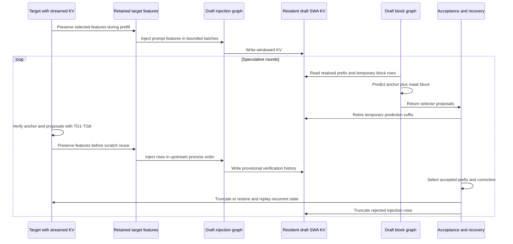
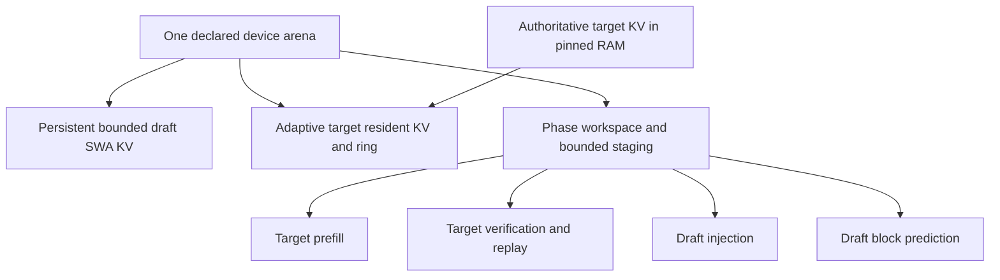
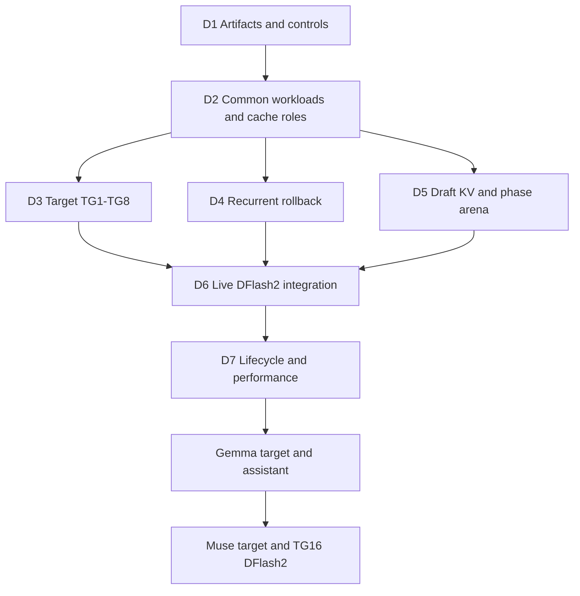

# Qwen3.8 DFlash2 Adaptive KV Streaming Roadmap

Enable the separate Qwen3.8-27B DFlash2 drafter alongside the existing target KV streaming and shared phase arena. Preserve upstream block drafting, attention masks and acceptance semantics. Keep bounded draft sliding-window KV resident; extend target streamed verification from TG4 through TG8.

Status: implementation started with isolated D3a launch planning; live DFlash2 integration remains unimplemented and unqualified. Saved: 2026-10-11. Source baseline: `feature/adaptive-kv-stream-v2` at `1240f34c7744`, rebased onto upstream `10a60cf30`. Development branch: `feature/adaptive-kv-dflash2`. DFlash2 stages D1-D7 do not renumber existing consumer, MTP, Gemma or attention-port stages.

Saving this plan does not start implementation, download models, change branches, stop production or authorize commits. Each lettered stage below is a reviewable implementation/test unit. Stage completed work and its progress entry for user review.

## Scope and acceptance

The first pairing is the current Unsloth Qwen3.8-27B `UD-IQ4_XS` target and a matching Qwen3.8-27B DFlash2 GGUF sidecar. Start artifact qualification with Q4_K_M sidecar weights; pin the exact filename, revision and checksum in D1. File size is not proof that actual device allocations fit.

Initial hardware profile: one serial request, one CUDA GPU, Flash Attention, GPU KV offload, target Q8_0 K / Q4_0 V and batch/ubatch 256/256. Disable UVM for physical-budget qualification. Use draft F16/F16 as the initial native correctness control; qualify independent draft Q8_0/Q4_0 before using it for deployment comparisons. Unlike embedded streamed MTP, these independent caches do not require matching target/draft KV types.

Acceptance requires:

- Draft lengths 1-7 and every target verification/replay width TG1-TG8.
- Native context capacity 262144, with physical fit and context-end behavior measured rather than assumed.
- Bounded resident draft KV, ordinary stock draft SWA attention and no permanent draft reservation in the target ring.
- One declared arena for participating target/draft KV, temporary compute and staging. Report weights, persistent target recurrent state, host storage and native driver/executable allocations separately.
- Stock-order streamed target arithmetic, matched-mode numerical qualification and preserved current no-speculation/embedded-MTP behavior.
- Correct serial requests, truncation, window wrap, prompt-state restoration, cancellation and failure cleanup.

Initial non-goals: Gemma/Muse target execution, draft KV streaming, DFlash2 media inputs, parallel slots, multi-GPU, DSpark/Eagle3, changing the selector, and probabilistic rejection-sampling qualification. Preserve ordinary non-streaming behavior for other modes. Other accelerator streaming adapters and actual older-card qualification remain separate work.

## Verified model profile

Published drafter settings, to be checked against the selected GGUF:

| Property | Qwen3.8-27B DFlash2 |
| --- | --- |
| Block | Eight positions: anchor plus at most seven proposals |
| Draft layers | Five, all sliding-window attention |
| Window | 2048 positions per layer |
| K/V head dimension and KV heads | 128 and eight KV heads |
| Query heads | 32 |
| Publisher target feature indices | Zero-based 5, 19, 33, 47, 61 |
| Draft attention | Non-causal block attention with its trained SWA mask |
| Drafting | One block forward, then selector path extraction |

Sources: [publisher configuration](https://huggingface.co/incoai/Qwen3.8-27B-DFlash2/blob/main/config.json) and [GGUF model card](https://huggingface.co/z-lab/Qwen3.8-27B-DFlash2-GGUF/blob/main/README.md). D1 pins immutable artifact references.

The converter writes block size, SWA, causal and selector metadata. It adds one to publisher feature indices because llama.cpp extracts layer inputs rather than indexed layer outputs. Test this mapping; do not hardcode the five indices in common memory code.

The target still owns 16 full-attention KV histories and 48 recurrent blocks. Do not add five auxiliary layers to its homogeneous pool: the draft has independent 128-dimensional windowed caches, unlike the target's 256-dimensional full-history caches.

### Widths and microbatches

For requested draft length D, upstream predicts D+1 positions, capped by the trained block size. Confidence cutoff can return fewer proposals. Target verification processes the anchor plus the returned proposals; rejection and context-end handling produce intermediate widths.

Qualify TG1-TG8, not only powers of two. Keep each complete non-causal draft block in one microbatch; validate its batch/ubatch limits before execution. Do not implement TG8 as two TG4 forwards: that changes draft attention, dynamic convolution and selector behavior, and can change target recurrent arithmetic.

Prefill feature injection can process 256-row batches but does not run draft attention. It is a separate workload, not TG256 block prediction.

## Current implementation gaps

| Area | Current boundary | Extension |
| --- | --- | --- |
| Server admission | Streaming speculation admits only embedded draft-mtp | Admit this DFlash2 pairing after its complete path passes |
| Rollback | Host spill tied to one auxiliary MTP layer and depth at most three | Derive rollback from target recurrent state and verification workload |
| Streamed decode | Model/session admission, workspace queries and CUDA resume stop at four query rows | Capability-driven target widths through eight |
| Phase planning | Four-entry verification/catch-up arrays and MTP-specific phases | Measure admitted operation/width without equating all speculation with MTP |
| Draft workspace | Live borrowing tied to `mtp_publish_host` | Separate serial consumers can borrow without auxiliary host-backed MTP KV |
| Feature extraction | Enabled by speculative initialization | Include required outputs in construction/reservation and retain them across handoff |
| Draft KV | Stock SWA cache owns separate backend allocations | Bounded persistent arena leases preserve stock cache semantics |

The upstream DFlash2 driver is the algorithmic reference. Do not rewrite its convolution, selector, projections or trained mask to simplify allocation. Missing support must not trigger an unbudgeted second workspace or a full-history target decode gather.

## Common contracts for three model families

Reuse existing owners, consumers, transitions, views and backend operations. Extend the smallest descriptors needed for these cache roles:

| Cache role | Ownership | Examples |
| --- | --- | --- |
| Streamed full-history producer | Owns authoritative history; publishes writes; device pages are reconstructible | Qwen target; future Gemma/Muse full caches |
| Bounded resident producer | Owns window-sized device storage with stock position/truncation semantics | Qwen/Muse DFlash2; future target SWA |
| Shared read-only consumer | Retains source identity/generation and leases; adds no KV history | Future Gemma assistant |
| Independent full-history auxiliary producer | Owns a host history and temporarily borrows the ring | Existing embedded Qwen MTP |

A serial workload describes its operation, cache access, input/query width, retained outputs and rollback needs. Distinguish target prefill, verification, draft feature injection and block prediction. Eight-row drafting is not prefill merely because eight exceeds four; injection occurs during both prefill and verification.

Make measurements extensible to Muse's TG16 and Gemma's geometry without admitting either prematurely. Backend support depends on actual width, dimensions, KV types, masks and launch resources. Do not replace every literal four with sixteen or introduce a model registry for this port.

Common code owns policy and lifetimes; model adapters describe feature/cache relationships; backends execute kernels, copies and completion. Keep common ownership tests usable without CUDA. Reuse [the Gemma plan](GEMMA4_ADAPTIVE_KV_ROADMAP.md) for future shared-reader and mixed-attention requirements.

### Shared bounded resident KV consumer

D5a implements one backend-neutral bounded resident KV consumer, not a DFlash2-specific allocator. It wraps existing stock cache storage and exposes exact requirements, persistent regions, identities, leases and completion to the arena owner. The stock cache keeps responsibility for cells, logical positions, masks, writes and truncation; this consumer does not reimplement SWA attention or infer acceptance from a memory operation.

Derive requirements from the cache group's actual layer IDs, K/V dimensions and head counts, quant types, window, microbatch headroom, padding and alignment. Do not bake in five layers, a 2048-token window or 128-dimensional heads. Resident KV survives all participating phase layouts. Keep its region stable when possible; relocation requires drained readers and explicit content preservation, not reconstruction from only the newest features.

| Responsibility | Shared implementation | Model-specific behavior |
| --- | --- | --- |
| Capacity and byte accounting | Checked geometry, bounds, stock sizing inputs and exact arena requirements | Actual window, cache groups, geometry and admitted full-size SWA behavior |
| Storage lifetime | Persistent leases, content identity, completion, rebind and teardown | Which phases write or retain the cache |
| State lifetime | Ownership hooks for reset, save/restore and validation | Stock cell/position updates and which suffix is discarded |
| Attention and writes | Existing backend operations over valid leased storage | Causal target attention versus non-causal draft blocks and feature injection |
| Read-only sharing | Stable source identity and generation-valid read leases | Gemma assistant source mapping and fixed drafting position |

Use synthetic layouts for both profiles in common tests: Qwen DFlash2's window 2048, dimension 128 and eight KV heads; Gemma target SWA's window 1024, dimension 256 and sixteen KV heads. Vary layer count, KV encodings, microbatch, padding and alignment independently. These are infrastructure fixtures, not Gemma model qualification.

The next Gemma G3a stage reuses this consumer for its target SWA group. Gemma still needs mixed SWA/full-cache coordination and separate causal-mask, truncation and assistant-reader tests. Its assistant aliases target caches rather than creating another bounded cache. Muse can later use the same consumer for both its target SWA and its DFlash2 draft SWA groups, each with its own identity.

## Execution and state lifetime



Confirm callback/acceptance timing in the server fixture. Verification can inject rows later rejected; injected history is not automatically accepted history. Replay must not double-commit rows or consume features from a rejected branch.

Persistent injected KV survives phase changes even though graph scratch is recyclable. Temporary mask rows and injected feature rows are different content generations at overlapping positions. SWA headroom must prevent speculative writes from destroying a prefix needed after rejection.

Keep upstream's host feature path initially. Copy or retain required outputs before draft work reuses target scratch. Optimize this transport only after exact ordering and lifetime tests pass.

## Memory budget



For every admitted phase:

```text
arena capacity >= preserved bounded draft KV
                + target KV working set required by that phase
                + phase graph, attention and writer workspace
                + live handoff and rollback staging
                + alignment and owned metadata
```

Only mutually exclusive lifetimes share storage. Reserve measured maxima rather than sums while preserving persistent regions. On transition, resize and repartition target KV to use available space; avoid stranded scratch or unnecessary ring growth.

Stock serial SWA capacity is padded to 256 from `min(n_ctx, window + n_ubatch)`. Window 2048 and ubatch 256 normally produce 2304 positions. Five layers with eight KV heads and dimension 128 give these illustrative encoded-data sizes:

| Draft KV | Encoded data at 2304 positions |
| --- | ---: |
| F16/F16 | 45 MiB |
| Q8_0/Q4_0 | 18.28125 MiB |

These are calculations, not total allocation measurements. Check tensor/buffer alignment, metadata, empty full-cache groups and scratch in D1/D5. Different ubatch or full-size SWA changes the requirement. Initially reject full-size SWA for the bounded-cache profile.

Sidecar weights, feature buffers, selector/convolution workspace, rollback snapshots and native graph resources may dominate extra memory. Measure them before claiming fit or speedup. Report permanent VRAM increases or quantization changes for user approval. Do not introduce an arbitrary safety reserve or silently reduce target layers, context or batch size.

## Dependencies



D3-D5 have independent tests/commits; keep live admission disabled until D6. A fitting D=3 pairing is the first live checkpoint. D=7 and native-context acceptance are required for completion.

## D1 Artifacts and ordinary controls

| Stage | Boundary | Required evidence |
| --- | --- | --- |
| D1a | Pin artifacts and inspect converted block, SWA, feature-layer, tokenizer and selector metadata. | Valid/missing/malformed/overflow fixtures, correct index mapping, wrong sidecar/incompatible target rejection. `ctx_other` does not imply KV aliasing. |
| D1b | Run ordinary non-streaming DFlash2 with D=1,3,7 at fitting contexts; trace its separate workloads. | Actual widths, masks, stock kernels, features, lattice, proposals, logits and visible SWA rows. Measure weights, KV, compute, features, rollback and native resources. |
| D1c | Establish matched-control fixture and physical-fit ledger before choosing the arena layout. | Independent runs with pinned settings; changed-block negative tests. Report whether the intended 16 GiB/native-context profile is feasible without UVM. |

Retain native controls with the same artifacts and KV encodings; published performance is not local evidence.

## D2 Common workloads and cache roles

| Stage | Boundary | Required TDD evidence |
| --- | --- | --- |
| D2a | Describe verification widths, injection rows, prediction blocks and rollback independently of auxiliary MTP layers. Define bounded-cache requirements without model-specific geometry; reuse phase/measurement infrastructure. | Current paths unchanged; producer/reader roles; independent cache generations; distinct Qwen/Gemma bounded groups; read-only aliases do not add storage or publish; extensible TG16 metadata without false kernel admission. |
| D2b | Admit actual workspace, feature/output lifetimes and capabilities for every workload. Validate block microbatch limits. | Exact-fit/one-byte-short, overflow, missing kernel versus quota shortage, invalid ubatch and width eight not inferred as prefill. Any allowed fallback must be budgeted. |

Do not add user flags for draft cache count or force five draft layers into the target ring policy.

## D3 Target TG1 through TG8 span and resume attention

| Stage | Boundary | Required TDD evidence |
| --- | --- | --- |
| D3a | Extend checked geometry, launch/workspace queries and selected-pair dispatch to widths 5-8 using stock family selection. | Widths 1-8, odd widths, tails, compiled-code and device/resource limits, overflow and transactional failure. Existing TG1-TG4 budgets unchanged. |
| D3b | Extend span and progressive resume execution, preserving stock tile/split, quant conversion and final reduction order. | Native comparisons, resident/mixed/wrapped layout, history larger than ring, delayed copies, wave boundaries and one finalization. No context-sized gather or query-batch splitting. |
| D3c | Connect new widths through session/model admission, encoded writes, scratch planning and capture. | End-to-end synthetic widths, append/repartition/cancellation, malformed spans, canaries, CUDA sanitizers, immutable ordinary snapshots and current MTP regressions. |

Require byte identity where the matching native family already has exact qualification. Preserve accepted family-specific older-architecture bounds; investigate new differences without silently relaxing thresholds. Measure kernel overhead outside unit tests, retaining the prior 5-10 percent routing-overhead goal at equal residency.

## D4 Recurrent rollback independent of draft KV

| Stage | Boundary | Required TDD evidence |
| --- | --- | --- |
| D4a | Select host-spilled target rollback from verification requirements, allowing zero auxiliary cache layers. | Depths 1-7, depth-zero baseline, embedded MTP depths 1-3 and actual history reservation. Unsupported depth fails before execution. |
| D4b | Extend bounded device staging and host snapshot lifecycle for TG1-TG8; reuse spill/publication infrastructure. | Zero/partial/full acceptance, current versus candidate state, pending D2H, stale generation, stage wrap, failed copy, cancellation and exact restore/replay. Report device/pinned-host growth before choosing larger staging. |
| D4c | Qualify rollback at page/window boundaries and long prefixes. | Matching-mode state/logits, repeated rejection, context-end headroom and no accumulation of obsolete snapshots across rounds. |

A pre-round checkpoint/replay path may serve as an explicitly labeled diagnostic control, not a silent replacement for the admitted fast rollback path.

## D5 Resident draft cache and shared phase arena

| Stage | Boundary | Required TDD evidence |
| --- | --- | --- |
| D5a | Implement the common bounded resident KV consumer and attach stock DFlash2 SWA storage. Keep capacity/lifetime logic model-neutral and retain stock cells, positions and masks. | Synthetic Qwen/Gemma geometry, varying groups/quants/headroom/alignment, context-independent byte bound, exact-fit/canaries, persistent content across rebind, cancellation/reset/save-restore hooks, read-only source lifetimes, no unused full-cache tensor storage and this profile's full-size SWA rejection. |
| D5b | Let separate serial draft contexts borrow measured scratch without `mtp_publish_host`. Register injection/block workloads. | CPU/mock then CUDA handoff, retained outputs, scheduler replacement, graph retirement, lease lifetimes, pending publication and failed rebind recovery. No unbudgeted separate-workspace fallback. |
| D5c | Fit persistent draft KV, phase-specific target/draft scratch, staging and target KV grants in one parent. | Low/high/low contexts, all widths, phase minima, correct target pool shrink/grow/repartition, preserved cache bytes and prepared copy resources. No stale captured addresses. |

Draft weights stay resident outside the parent initially. Deferred weight loading or per-round eviction requires a separate measured tradeoff and approval.

## D6 Live DFlash2 integration

| Stage | Boundary | Required TDD evidence |
| --- | --- | --- |
| D6a | Add construction-time feature extraction and connect upstream injection/selector calls to explicit handoff. | Missing/stale/permuted features, index conversion, 256-row injection, text-position transport, bounded outputs and intact non-causal blocks. Text tests do not qualify media. |
| D6b | Admit the narrow server pairing, first D=3 then D=7; preserve temporary-suffix removal and acceptance/replay ordering. | Real D=1/3/7, all returned widths, empty proposals, partial/full/zero acceptance, correction, provisional writes and replay. No second target pool or embedded MTP head allocation. |
| D6c | Extend strict numerical fixture and serial server state integration. | Independent native/streamed comparisons of features, lattice, proposals, logits, logical KV and recurrent state. Inject one-bit/mask/order/publication faults. Existing embedded-MTP checks pass. |

Force acceptance patterns in lifecycle fixtures and run ordinary acceptance in server controls. Streamed TG8 versus no-speculation TG1 is not an exactness oracle: widths/history must match. A resident-only run cannot qualify streaming.

Keep short-prefix native controls physically resident when they fit. A full-context native control may exceed this card's VRAM even when the streamed pairing fits; a separately labeled UVM control can qualify arithmetic at that length if it retains the same GPU kernel and execution mode. Its timing and residency are not the non-UVM physical-budget benchmark. If no matching control is feasible, report the numerical coverage limit rather than substituting a different-family CPU result or claiming full-context bit identity.

## D7 Lifecycle and performance qualification

| Stage | Boundary | Required evidence |
| --- | --- | --- |
| D7a | Complete window-wrap, serial reuse, prompt-state restoration and cancellation. | Below/at/above 2048, wrap during prediction/rejection, cell reuse, ring repartition, different prompts, cached append, low/high/low reuse, serialized draft KV/carry and recovered output. |
| D7b | Qualify startup/runtime failures and native context under declared physical budgets. | Missing kernels, undersized grants, driver/allocation failures, context-end partial blocks, teardown/restart and no stale events/leases or growing memory. No-MTP/MTP controls pass. |
| D7c | Benchmark no speculation, embedded MTP=3 and DFlash2 D=3/7 with realistic prompts; document reproduction. | 256 generated-token sweeps, resident/light/moderate/heavy ring, native-context endpoint and longer rejection-heavy continuations. Label equal-budget versus independent maximum-fit comparisons. |

Reuse the sweep harness. Auto-max probes each mode without UVM when requested; launch success alone does not prove block prediction, graph instantiation and recovery fit. Exercise admitted workloads, keep successful data points and distinguish quota shortages, true OOM and correctness failures.

Record accepted-token throughput, prefill, acceptance, proposals/verification, effective target KV grant, persistent draft bytes, target/draft compute, feature D2H, target H2D, replay and phase-transition costs. Control artifact versions and budgets; do not attribute acceptance or pool-size changes to kernel speed.

Speedup is an empirical gate, not a promise. If draft weights or execution cost outweigh savings, report the hardware/workload result before proposing offload, different quantization or a new memory policy.

## Reusable outcomes and later models

Gemma G3a reuses D5a's bounded resident KV consumer; it does not implement a second SWA allocator. Gemma adds mixed target-cache coordination and causal model behavior around that storage. Its assistant remains a read-only source-KV consumer, not a DFlash2 model with independent draft history. DFlash2 injection, temporary mask rows and selector behavior stay in the draft adapter.

Muse reuses feature injection, block/selector phases, bounded draft SWA and acceptance fixtures. Its target needs mixed-attention integration and geometry/mask qualification. TG1-TG16 is a named follow-up; Qwen TG8 tests do not qualify Muse.

Other backends provide capability queries, stock-equivalent attention and completion semantics behind the same contracts. Common memory tests do not prove that streamed kernels exist.

## Source and test references

| Area | Starting point |
| --- | --- |
| Driver and context creation | [common/speculative.cpp](common/speculative.cpp), [common/common.cpp](common/common.cpp) |
| Injection and selector | [src/models/dflash.cpp](src/models/dflash.cpp), [conversion/qwen.py](conversion/qwen.py) |
| SWA sizing and state | [src/llama-kv-cache-iswa.cpp](src/llama-kv-cache-iswa.cpp), [src/llama-kv-cache.cpp](src/llama-kv-cache.cpp) |
| Server verification and recovery | [tools/server/server-context.cpp](tools/server/server-context.cpp) |
| Phase ownership | [src/llama-memory-phase-owner.h](src/llama-memory-phase-owner.h), [src/llama-context-memory.h](src/llama-context-memory.h) |
| Rollback | [src/llama-memory-recurrent-spill.h](src/llama-memory-recurrent-spill.h) |
| Streaming and CUDA execution | [src/llama-kv-stream-session.cpp](src/llama-kv-stream-session.cpp), [ggml/src/ggml-cuda/kv-stream-partial.cu](ggml/src/ggml-cuda/kv-stream-partial.cu), [ggml/src/ggml-cuda/fattn.cu](ggml/src/ggml-cuda/fattn.cu) |
| Strict numerical fixture | [tests/kv-stream-bit-exact-test.h](tests/kv-stream-bit-exact-test.h), [tests/test-kv-stream-context.cpp](tests/test-kv-stream-context.cpp) |
| Existing design and qualification | [DEVICE_MEMORY_INFRASTRUCTURE.md](DEVICE_MEMORY_INFRASTRUCTURE.md), [MTP_ADAPTIVE_KV_ROADMAP.md](MTP_ADAPTIVE_KV_ROADMAP.md), [UPSTREAM_ATTENTION_PORT_ROADMAP.md](UPSTREAM_ATTENTION_PORT_ROADMAP.md) |

Reuse phase-owner/context-memory, recurrent-spill, batch-allocation, geometry/dispatch, session/publication, span/resume and server suites. Prefer adding cases to existing tests. No new test framework or timing-sensitive CI assertions.

## TDD workflow and progress

Add failing tests first and retain the red result; implement the minimum coherent change; run affected and existing regressions. Find the first numerical/state mismatch instead of relying only on decoded text. Update exact checks, measurements and limitations; stage related work and let the user commit.

| Milestone | Status | Completion gate |
| --- | --- | --- |
| D1 Artifacts and ordinary controls | Planned | Pinned metadata, controls and physical-fit ledger |
| D2 Common contracts | Planned | Neutral workload/cache roles and unchanged current paths |
| D3 Target TG1-TG8 | D3a ready for review; D3b/D3c planned | Stock-order span/resume and bounded workspace |
| D4 Recurrent rollback | Planned | Depth-seven recovery independent of auxiliary MTP |
| D5 Draft KV and phase arena | Planned | Reusable bounded resident KV consumer, synthetic Qwen/Gemma coverage and one participating parent |
| D6 Live DFlash2 integration | Planned | D=1/3/7 numerical and server controls |
| D7 Lifecycle and performance | Planned | Native-context recovery and comparison matrix |

No stage completes merely because startup succeeds or output looks plausible. At the user's request, D3a starts independently with existing kernel/metadata fixtures; D1/D2 controls and contracts remain prerequisites for later live integration and are not marked complete.

### D3a checked launch planning

Implemented on 2026-10-11, staged for user review:

- Head-256 MMA query-column selection follows stock through eight rows for the existing admitted grouped-head ratios. Turing-only builds retain 32-column tiles and can require multiple query tiles. Invalid widths/groups select no tile.
- Span launch planning derives query-tile count rather than assuming one, checks destination/work and fixup-size arithmetic, and looks up the actual selected-pair kernel before reporting resources.
- Workspace probes use the requested query width and checked tensor strides. A wide request cannot publish a narrower TG4 grant when its own compiled plan is missing.
- Valid TG5-TG8 requests distinguish missing streamed implementations from malformed geometry. TG9 remains outside this streamed profile; native metadata queries retain stock behavior.

No wide typed MMA/tile instances or new attention arithmetic are added in D3a. The current RTX 5070 Ti provider therefore reports missing streamed implementations for TG5-TG8, not successful execution. D3b adds and numerically qualifies those kernels and progressive execution; D3c connects them to the model/session. Existing model/session TG4 limits and the server's DFlash2 rejection remain intact.

TDD evidence: the initial host run failed 50 assertions; the initial CUDA metadata run failed eight. The query-tile-count tests also failed to build before their checked helper was added. The host planning suite now passes 17 tests / 910 assertions, including odd widths, invalid inputs, resource/overflow failure preservation, Turing geometry and query-tile counts. ASan/UBSan passes the same suite. Nine focused host CTests pass. The CUDA planning fixture passes 129 assertions for configured and absent pairs, malformed strides, stale query metadata and unchanged failed output. Its first attempted green fixture used legal native head-major KV but invalid streaming-owner strides; correcting it to production token-major storage preserved the validator rather than weakening it.

All 70 ordinary attention cases remain bit-identical to the immutable stock CUDA snapshot. Existing span, resume and dispatch suites pass 1463, 328 and 10 assertions respectively, without skips or widened tolerances. This is TG1-TG4 regression evidence, not TG5-TG8 numerical qualification. No speed or older-hardware execution claim is added.

Logs: `/tmp/dflash2-d3a-red-host-tests.log`, `/tmp/dflash2-d3a-red-cuda-tests.log`, `/tmp/dflash2-d3a-green-host-tests.log`, `/tmp/dflash2-d3a-sanitize-tests.log`, `/tmp/dflash2-d3a-host-regressions.log`, `/tmp/dflash2-d3a-final-cuda-tests.log`, `/tmp/dflash2-d3a-native-snapshot.log` and the `vector-spans`/`resume`/`dispatch` regression logs with the same prefix. Production is restored with its existing configuration and a healthy `/health` response.
