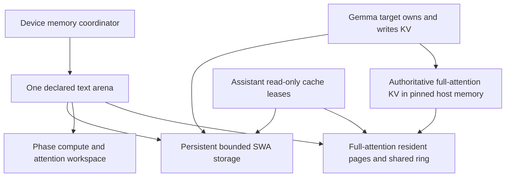
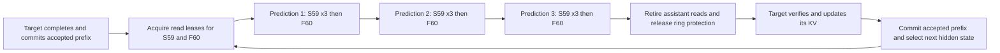
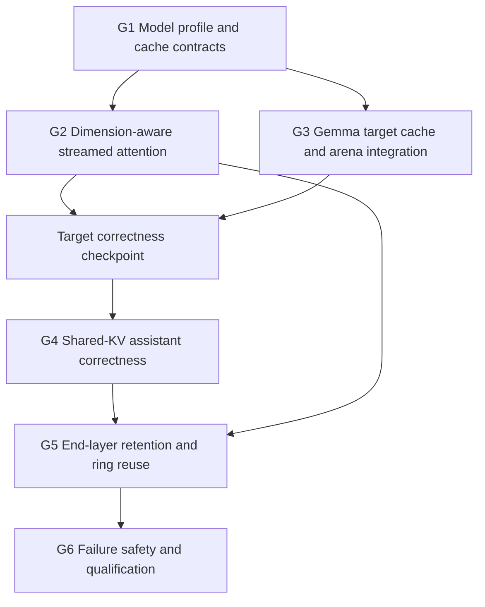

# Gemma 4 Adaptive KV Streaming Roadmap

Extend the existing memory ownership, adaptive KV streaming and phase arena implementation to Gemma 4 31B text generation, then add its shared-KV MTP assistant. Preserve the qualified Qwen path. Reuse the common memory and scheduling contracts; put model differences in narrow adapters and backend differences in capability-driven attention implementations.

Status: implementation started on `feature/gemma4-adaptive-kv-stream`, forked from `feature/adaptive-kv-stream-v2` at `db8fd5d89` on 2026-10-17. No Gemma streaming or assistant profile is qualified yet. This supersedes the 2026-10-14 planning baseline at `45ee09caa` and includes the completed upstream attention re-port, DFlash2, vision lifecycle and KQ1-KQ6 quantization work. Production remains on its existing configuration.

Use the independent G1-G6 milestone identifiers below. They do not replace or renumber existing consumer, vision, MTP or CUDA compatibility stages. Each lettered stage is a commit unit containing implementation, tests and a progress entry. The user authorized title-only commits for completed steps and continuation through G6, including MTP. Do not push. If a feasibility gate requires a material scope or configuration change, report the evidence and obtain a decision instead of weakening acceptance.

### Existing foundations and remaining work

Reuse the implemented foundations below. Their Qwen and synthetic qualification does not establish Gemma model support:

- The [common bounded resident KV consumer](DFLASH2_ADAPTIVE_KV_ROADMAP.md#shared-bounded-resident-kv-consumer) provides checked storage requirements, persistent leases, identity and lifecycle handling. G3a adapts it to Gemma's stock causal sliding-window cache; it does not build a new allocator.
- Common target scheduling, span/resume machinery and recurrent rollback infrastructure cover TG1-TG8 for the qualified Qwen paths. Gemma's 512-dimensional full-attention kernels, cache routing and assistant admission still require implementation and qualification. Gemma does not use Qwen recurrent rollback.
- PF0-PF6 added bounded, stock-order prefill with progressive resident/ring execution, tile-local conversion and compact visibility descriptors for supported configurations. Extend these paths to Gemma geometry instead of restoring a full-history encoded/F16 gather as the default. Existing compact descriptors do not advertise SWA support; Gemma's local attention keeps stock window/mask semantics.
- Prepared transfer resources, transfer-span fences, sparse feedback and explicit cross-consumer prefetch are implemented. Commit `45ee09caa` qualifies target/attached-MTP handoff and immutable-prefix adoption for TG1-TG8 on Qwen. Gemma still needs read-only target-cache bindings and its own consumer-order qualification.
- KQ1-KQ6 provide quant-aware storage/publication and capability-driven admission. CUDA currently qualifies 64 reader pairs across F32, F16, BF16, Q8_0, Q5_0, Q5_1, Q4_0 and Q4_1; IQ4_NL lacks a native CUDA flash-attention reader and is rejected before execution. Preserve this behavior, the all-pair operator coverage and the existing Qwen MTP/DFlash qualification. Q8/Q4 is the initial Gemma measurement profile, not a new hardcoded format requirement.
- Shared adaptive draft caches inherit target formats and reject explicit draft-format overrides. Gemma's borrowed caches must obey the same byte-consistency rule. The ordinary speculative driver already has a shared-cache assistant mode; extend its streaming admission and cache bindings rather than replacing its candidate-generation algorithm.

G1-G6 remain the implementation sequence. Revalidate compatibility at the actual starting revision and record changes here rather than repeating completed infrastructure stages. The deferred phase-scoped recurrent staging plan in [the MTP roadmap](MTP_ADAPTIVE_KV_ROADMAP.md#deferred-phase-scoped-recurrent-publication-staging-2026-10-14) is not a prerequisite for this non-recurrent Gemma target.

## Scope and acceptance

The initial model profile is `unsloth/gemma-4-31B-it-GGUF`, `gemma-4-31B-it-Q3_K_M.gguf`, with its matching separate 31B assistant. This replaces the earlier `UD-Q3_K_XL` baseline. G1a pins both actual artifacts, revisions and checksums before qualification. The first runtime profile is one serial request on one CUDA device, Flash Attention, GPU KV offload, Q8_0 keys and Q4_0 values, batch/ubatch 256/256 and UVM disabled for physical-budget qualification. Qualify no MTP first, then maximum draft lengths 1-3 and target verification TG1-TG4.

KV-format support is not limited to that measurement profile. The user explicitly requires all 64 K/V combinations of F32, F16, BF16, Q8_0, Q5_0, Q5_1, Q4_0 and Q4_1. Build and qualify the complete reader matrix, including affine and unequal K/V quantization. Reuse native compiled-pair selection for deliberately reduced builds and reject omitted pairs clearly; do not silently make Q8/Q4 the only working pair. A format without an implemented stock-compatible reader, such as IQ4_NL, needs a separate implementation and qualification before being advertised.

Derive verification/catch-up requirements and headroom from the requested draft length and algorithm, not new fixed four-row assumptions. For sequential proposal length D, target verification needs up to D+1 rows. Common TG8 support is not permission to admit Gemma draft lengths 4-7 before their kernels, workspace and cache recovery are qualified. Gemma's shared-KV assistant has no independent KV catch-up workload.

Derive cache geometry, cache roles and kernel support from metadata and actual backend capabilities. This qualification profile is not permission to hardcode Q8/Q4 byte sizes, 60 layers, target layer 59/60 or head dimension 256 into common infrastructure.

Acceptance requires correct inference within the admitted working-set budget, preserved cache semantics across serial requests, stock-matched numerical qualification and bounded device allocation. When the phase minima fit, exceeding KV residency must cause streaming, not failure merely because a complete full-attention layer cannot remain in VRAM simultaneously.

The objective includes native context 262144. Whether this GGUF's actual GPU weights, local caches and minimum compute fit on a 16 GB card is a measured feasibility condition. File size is not GPU weight allocation size. Report an impossible phase minimum and obtain an explicit decision about further work or configuration changes. Do not silently reduce layers, batch, context, change KV quants or enable UVM and call the original profile qualified.

Initial non-goals are parallel slots, multi-GPU splitting, a new accelerator streaming port, other Gemma variants, assistant-weight eviction during every speculative round, mmproj/vision/audio/video qualification, and DFlash/DFlash2 integration. Native Gemma MTP is in scope. Reuse infrastructure developed for Qwen DFlash2 without admitting a Gemma DFlash pairing. Optional follow-ups have separate gates. Muse Glimmer is outside this workstream.

## Model profile and execution order

Use one-based layer numbers in explanations and zero-based indices in code. Confirm the selected GGUF's actual metadata before allocation; publisher JSON does not replace artifact inspection.

| Property | Qwen 3.8 27B target | Gemma 4 31B target |
| --- | --- | --- |
| Target blocks | 64 | 60 |
| Repeated attention pattern | Three recurrent blocks, then full attention | Five sliding-window blocks, then full attention |
| Full-attention histories | 16 | 10 |
| Bounded companion memory | Convolution history and DeltaNet state for 48 recurrent blocks | Local KV caches for 50 sliding-window blocks |
| Full-attention K/V head dimensions | 256/256 | 512/512 |
| Full-attention KV heads | 4 | 4 |
| Local attention geometry | No sliding-window target cache | 256/256 dimensions, 16 KV heads |
| Target KV sharing | Not the Gemma sharing mechanism | Published 31B configuration has zero shared-KV target layers |
| Draft cache ownership | Independent Qwen MTP logical history | Assistant borrows existing target KV |

Gemma target visits are `S1 ... S5, F6, S7 ... S11, F12, ... S59, F60`. All block operations still run. Copy queues may look ahead without reordering model dependencies.

The selected assistant has four blocks: local, local, local, full. The current llama.cpp adapter maps its three local blocks to target S59 and its full block to F60. Derive and validate source mappings from topology, cache role and geometry rather than scattering those two indices through the implementation. Draft length three means three passes through all four blocks, not three separate KV-producing heads.

The assistant reads a frozen target prefix throughout drafting. It does not append draft K/V or run an independent prompt-KV catch-up. Token/hidden inputs change between predictions; query position stays fixed within a round. Target verification writes target KV and supplies the accepted hidden state for the next round.

### Published metadata references

- [Target GGUF repository](https://huggingface.co/unsloth/gemma-4-31B-it-GGUF/tree/c1ac76e99d5513b141e8adde7288b85c3f9c32ec), including matching assistant files. Pin actual filenames, revisions and checksums for qualification.
- [Target configuration](https://huggingface.co/unsloth/gemma-4-31B-it-GGUF/resolve/c1ac76e99d5513b141e8adde7288b85c3f9c32ec/config.json).
- [Google assistant configuration](https://huggingface.co/google/gemma-4-31B-it-assistant/blob/627c5ec1458b9086b841a91e0512fd31fd2fbbf1/config.json).
- [Assistant execution semantics](https://huggingface.co/docs/transformers/model_doc/gemma4_assistant), including cache sharing, no independent prefill and fixed drafting position IDs.

## Memory ownership and phase design

The target is the only KV writer and owns two distinct cache groups. Each cache has a logical identity, valid positions and content generation. The assistant receives read-only source views tied to those identities, not another set of cache layers.



Local cache bytes stay on the device through text prefill, target verification and drafting. They hold a bounded token window plus batch headroom and alignment, not the whole prompt. With the bounded profile (`swa_full=false`), one sequence, window 1024 and ubatch 256, that means 1280 local positions. The C API currently defaults `swa_full` to true; select the bounded profile explicitly. Full-size SWA remains valid for ordinary native contexts, but the bounded arena quote rejects it instead of silently shrinking its storage.

Only the full-attention group participates in the adaptive resident/ring policy. Its geometry is uniform for the selected profile, but differs from the local group. Do not combine both groups in one page-size calculation or assume identical valid token ranges.

The local group uses the common bounded resident KV consumer implemented in DFlash2 D5a. Its checked sizing, persistent arena regions, leases, content identity and transition lifecycle are reusable; Gemma supplies actual layer IDs, geometry, window and stock causal cache behavior. The Qwen draft's feature-injection and temporary mask-token rules are not Gemma target write semantics. Sharing infrastructure does not mean replacing either model's masks or calculating local attention with a new custom kernel.

Speculative rejection must preserve the accepted prefix's local-cache bytes as well as cell positions and masks. If provisional writes can overwrite a window entry needed after rollback, retain sufficient headroom or explicitly preserve/restore those entries before admitting execution. Logical truncation alone is not proof of recovery. Derive the requirement from the actual stock cache behavior and requested verification width.

Gemma's target combines that resident group with streamed full-attention storage. Its assistant receives generation-valid read leases over existing target sources, not a new SWA allocation. Keep local KV contents and positions alive through assistant reads and text phase changes; a read lease may not publish or advance the target's cache.

Persistent bytes do not require an unchanged lease handle forever. If an arena generation needs fresh handles, retire old graph users, preserve the fixed local-cache region and contents, then publish new bindings. A retained raw pointer is not equivalent to a valid lease.

The accounting is:

```text
arena capacity >= persistent local KV
                + phase compute workspace
                + phase attention and writer scratch
                + full-attention resident and ring working set
                + required alignment and owned metadata storage
```

Target and assistant compute are serial and may share the maximum of their phase requirements, rather than their sum, once output lifetimes permit the handoff. Preserve or copy needed target hidden rows and logits before recycling their scratch. Report target weights, assistant weights and driver/native-executable allocations separately when outside the parent arena.

Use the existing bounded, stock-order prefill design as the implementation baseline, extending its conversion, continuation and compact-mask paths to the actual 512-dimensional full-attention geometry. Preserve local stock attention separately. Quotes and preflight must cover every admitted full/short microbatch and selected native family. A separately budgeted strict-gather path may remain a numerical diagnostic, but must not be a silent production fallback. Neither prefill nor decode may conceal missing support with an unbudgeted full-cache gather. G3f is conditional only if the adapted bounded path needs an additional design to meet the intended profile.

### Assistant and ring reuse



Retain F60 pages that remain valid after the final target attention. Fetch missing chunks: progressive target execution does not leave the complete F60 history in the ring automatically. Reuse retained data across assistant predictions where capacity permits.

Two modes are required. Complete-layer execution retains the resident prefix and ring suffix through drafting. Progressive execution resumes stock-equivalent attention over ready chunks when the complete cache cannot fit; it may transfer some F60 data again on later predictions. Complete-layer retention must not become an unconditional maximum-context admission requirement.

Release protection only after the final GPU reader completes. Target lookahead may use unrelated free slots, but cannot overwrite F60 pages still needed by a later assistant pass. Return drafting protection before conflicting target writes or next-pass prefetch. No permanent MTP reservation is taken from the target ring.

## Implementation dependencies



Retain the architecture gate until a complete path is available. Kernel work can use synthetic fixtures without claiming Gemma server support. Reuse completed foundations at each stage; MTP optimization follows correct target and assistant integration.

## Milestone G1 Model profile and cache contracts

Outcome: describe both models without allocating unsupported storage or assuming every memory container is Qwen hybrid memory.

| Stage | Implementation boundary | Required TDD evidence |
| --- | --- | --- |
| G1a | Pin Q3_K_M target and matching assistant artifacts, inspect GGUF metadata, create small fixtures, and capture ordinary dispatch and allocations at a fitting short context. Confirm the assistant loader selects the separate assistant artifact. Establish physical target-only and joint assistant feasibility before promising the full profile. | Valid versus wrong assistant, tokenizer/embedding mismatch, absent source cache, unsupported metadata and incompatible geometry. Record ordinary target and MTP controls, actual source revision and shared-foundation dependencies. Full native-context stock allocation is not required as a control when it cannot fit. |
| G1b | Add the smallest private adapter exposing full-attention streaming and bounded companion resources. Route Qwen through it unchanged; keep recurrent operations inside its adapter. | Qwen routing equivalence, Gemma topology, unsupported adapter rejection, retained lifetimes and no invalid hybrid casts. Resolve stable groups once where practical. |
| G1c | Define producer versus read-only source bindings with cache ID, source layer, geometry, valid positions, content generation and lease revision. Separate assistant block count from new KV-history count. Update common initialization to distinguish embedded cache-producing MTP from a separate shared-cache assistant, without treating the assistant's four blocks as auxiliary KV histories. | Multiple readers alias one source, bad mappings/stale generations fail, readers cannot publish, separate assistant loading is admitted only for a valid source contract, explicit draft KV overrides reject, and four assistant blocks add no cache histories. Qwen embedded MTP and DFlash admission remain unchanged. |
| G1d | Preserve structured quota shortage versus allocation/capture OOM throughout assistant construction. Failed shared admission must not become a misleading OOM from separate fallback scratch. | Narrow feasible intervals, one-MiB fit, updated assistant minimum, quota followed by fallback OOM, unrelated errors, cleanup and retry. Preserve explicitly allowed separate-workspace fallbacks. |

G1a also establishes hardware feasibility: actual GPU weights, local KV, compute/attention scratch, pinned host memory and assistant weights. It does not claim fit from GGUF file size.

## Milestone G2 Dimension-aware streamed attention

Outcome: select supported streamed kernels by actual geometry, rather than globally rejecting head dimensions other than 256.

| Stage | Implementation boundary | Required TDD evidence |
| --- | --- | --- |
| G2a | Carry independent K/V head dimensions through geometry, requests, dispatch identities, capability queries and workspace plans. Derive row sizes, F16 strides and partial outputs. Keep page token count independent. | 256/512 metadata, unequal dimensions where supported, quant alignment, overflow, tails and transactional failure. Qwen budgets stay unchanged. |
| G2b | Generate D512 MMA arithmetic once per tile/input/resume policy, using fully unrolled inline loaders with runtime KV-format selection. Preserve existing compiled-pair admission, stock family/configuration and resource checks. Keep D256 typed vector/MMA/tile kernels unchanged; retain the separate stock-compatible D512 tile family. | Matching path versus absent code, all selected reader pairs, reduced-quants builds, dimensional checkpoint bytes and exact preflight sizing. Verify that D512 code generation does not recreate the key/value Cartesian product around the arithmetic body. |
| G2c | Generalize 512/512 span execution and tile-local conversion, retaining fast small-span addressing and stock pipelines. Generalize output reductions and byte strides without replacing page/thread constants. | TG1-TG4 stock comparisons for initial MTP admission, resident-only/mixed/wrapped/streamed spans, quant tails, masks, scale parameters and CUDA memcheck. Preserve existing Qwen TG1-TG8 tests. No independently normalized half-head calculations. |
| G2d | Extend the existing bounded progressive/resumable machinery to Gemma decode/verification and wide prefill. Preserve stock split/tile order, final reduction and type-specific conversion; adapt compact full-attention visibility descriptors without changing local SWA semantics. | Cache larger than pool, tiny ring, full/short query tiles through the admitted ubatch, wrapped spans, exact mask bits, delayed copies, cancellation and one finalization. No context-sized encoded/F16 gather or dense context-by-query mask in the admitted bounded full-attention path. |
| G2e | Cache immutable plans where safe; qualify overhead and resource use before live integration. | Existing 256 regressions, representative compiled pairs, 512 dispatch trace, repeated calls and scratch bounds. Investigate routing overhead above the agreed 5-10% goal at equal residency. |

Stock-family clarification from the implementation audit: the current upstream vector registry has 64/128/256 head instances, not 512. Gemma's full-attention path must follow stock MMA/tile selection even at TG1, rather than inventing a 512-wide vector baseline. Compile the needed 512 MMA/tile instances through the existing pair flags. Native MMA checkpoint bytes depend on stock fragment specialization, not just head width: the 512-wide, 32-column specialization uses a thinner accumulator tile. Derive/verify native bytes, retain compile-time size assertions and size the host checkpoint from the same supported geometry before execution.

Accept only when a compiled streamed path and its resources support the requested geometry, KV types, query width and operation features. This does not admit arbitrary dimensions, sinks, masks or softcapping without implementations. Preserve stock attention scaling; final-logit softcapping is not an attention softmax parameter.

### Accepted D512 code-generation design (2026-10-18)

The initial G2b candidate instantiated the complete D512 MMA body for each K/V format pair and exceeded four hours of compilation before it was stopped. Replace only that family with the fully unrolled runtime-selected inline tile reader qualified in the independent experiment. Select the format uniformly at a tile-loading boundary while retaining stock conversion expressions, loading-loop unrolling, tensor-core arithmetic, native splits, checkpoint state and final reduction. Do not use the rejected compact-loop or out-of-line device-loader revisions. Do not replace D256's existing static readers or its vector/MMA selection with the D512 approach.

The six-geometry isolated family compiled in 29m40s with six workers. This is not a clean full-server build measurement. The user accepted these results and explicitly waived another compile-time qualification run; reuse completed build evidence and caches where correct, and rebuild only what integration requires. Thirty minutes remains the practical build-cost target, not a newly measured full-build guarantee. Required numerical, resource, failure-safety and performance regression gates remain in force. Do not restart the abandoned pair-specialized D512 MMA build.

The independent operator experiments passed 22,950 bit-exact comparisons across the three investigated implementations; the selected reader itself passed 7,650 cases, including all 64 pairs, wrapped spans, conversion policies and resume checkpoints. Real Gemma Q3_K_M kernel-swap controls then passed 1,602 exact D512 comparisons at TG1-TG4 and matching generated tokens in 48 timed requests. At context capacities 2/8/16/24Ki, native decode was 42.38/40.35/36.92/34.19 token/s; selected three-span decode was 41.97/39.88/37.19/35.59. Forced two-wave decode was 40.95/37.07/33.15/30.71. Native prefill was retained and differed by less than 0.3%. These measurements justify the compile strategy, not a claim that resume or PCIe transfer is free. Use one launch when coverage is ready; retain progressive resume when the actual ring requires it, without imposing a fixed two-wave policy.

The real-server comparison used resident native caches and an isolated launch module, not live Gemma host streaming. Its native 32Ki control failed context allocation; no 32Ki streaming result was fabricated. Requalify the production dispatch/allocator integration through G2c-G6, preserve Qwen regressions, and measure actual Gemma ring performance after G3. Experiment evidence remains in `../llama.cpp-d512-runtime-reader/benchmarks/attention-codegen/results-performance-reference`, `results-extra-checks` and `results-server-native-launch`.

## Milestone G3 Gemma target cache and arena integration

Outcome: correct target generation with bounded resident local KV and adaptive full-attention KV, without MTP first.

| Stage | Implementation boundary | Required TDD evidence |
| --- | --- | --- |
| G3a | Integrate DFlash2 D5a's common bounded resident KV consumer with Gemma's target SWA group, preserving stock causal cells, masks and sequence semantics. Register exact persistent requirements; do not create a second allocator. | Gemma geometry/group IDs, window/headroom/padding and byte guards, explicit `swa_full` behavior, content/positions across rebind, stock causal outputs and no DFlash injection semantics. Common synthetic coverage does not replace these model tests. |
| G3b | Attach streaming to Gemma's non-SWA cache. Derive layer IDs, route encoded writes/attention through the owner, and leave local attention on stock execution. | Correct source mapping, target publication once per full-cache layer, no recurrent access, no streaming of local layers and no full host history for a local window. |
| G3c | Coordinate prefill/decode grants while preserving local KV. Reclaim prefill graph/gather storage for full-cache residency and ring; retire captures before rebinding. | Local bytes untouched by repartition, larger effective decode pool, low-high-low transitions, failed rebind recovery, stale-view rejection and parent bounds. |
| G3d | Integrate serial reset, append, truncation, prefix reuse and prompt-state save/restore for both groups. Establish the local-cache headroom or preservation needed for speculative rollback before assistant admission. | Changed content at equal length, shorter prefixes, partial reuse, restored state, window wraparound, cancellation and retry. Verify accepted local bytes survive provisional window overwrites; check positions/masks as well as bytes. |
| G3e | Enable Gemma admission only after real-model target controls pass; verify native-context hardware minima. | Matching stock-family logits/continuations, short/medium/long physical-budget tests, startup diagnostics and Qwen regressions. Larger-than-pool histories execute progressively when minima fit. |

Conditional stage **G3f** is activated only if adapting the existing bounded prefill path in G2d/G3c exposes an additional feasibility gap. Record the specific missing family, mask, geometry or workspace requirement and agree on the extra bounded design before implementation. Do not defer ordinary bounded prefill until this optional stage, quietly restore a full-history gather, or lower the batch size. If physical minima remain impossible, report the blocked hardware profile.

G3c construction sequence: local storage must not be allocated once privately and again inside a maximum-fit parent. Build allocation-free local-cache metadata using the existing no-allocation buffer pattern, measure graph workspace without executing it, then allocate the declared parent after releasing bootstrap grants. Reserve the common bounded consumer's persistent local region inside that parent and bind the stock local roots through the existing checked allocator. Retire/rebuild graphs that referenced placeholder tensors before admitting execution. Deferred local caches reject normal batch preparation until bound. Initial binding is transactional and empty-cache-only; keep old placeholder metadata alive until graph retirement rather than copying backend-private tensor state. Subsequent phase transitions preserve the fixed local region and shrink/grow only compute, attention and full-cache grants. Qualify metadata-only reservation, exact/short leases, failed binding and retry, low-high-low phases and no transient second local allocation before claiming this sequence integrated.

The target checkpoint requires G1, G2 and G3a-G3e, plus G3f if its feasibility gate requires it. It does not claim assistant support.

## Milestone G4 Shared KV assistant correctness

Outcome: Gemma MTP reads target KV without adding four auxiliary caches or running a full assistant KV prefill.

| Stage | Implementation boundary | Required TDD evidence |
| --- | --- | --- |
| G4a | Attach the matching assistant through leased target sources, using the common bounded consumer's read-only leases for local KV and the streamed source for full KV. Replace raw-address aliases where arena bindings can move. Provide correct progressive borrowed reads when a complete full-attention history exceeds the ring; this is a correctness requirement, not a G5-only optimization. | Correct local/global aliases, incompatible metadata rejection, stale generations, read-only enforcement, retained source lifetime and no new draft KV storage/rows. Independent draft quant flags cannot silently reinterpret shared bytes. A smaller-than-one-cache ring completes stock-matched drafting without duplicate full-history staging. |
| G4b | Register the actual assistant serial workload and share compute scratch safely. Reserve normal one-query draft graphs, not an unused full-prompt assistant graph. Derive target verification requirements from configured proposal depth and validate every admitted width. | Workspace guards, retained target outputs, short-prefill handoff, exact/one-byte-short budgets, graph retirement and reuse. No assistant KV catch-up; hidden handoff remains. Unsupported wider requests reject before execution. |
| G4c | Preserve stock candidate generation: changing token/hidden inputs, fixed position within a round, confidence cutoff and configured sequential predictions. Initially admit and qualify lengths 1-3 without baking that ceiling into common cache/lease contracts. | Lengths 1-3, intermediate verification widths, early stop, hidden-state reset, all four blocks visited each pass and unchanged cache version throughout drafting. Higher lengths require separate qualification, not merely removal of the CLI gate. |
| G4d | Integrate verification, accepted-prefix selection and target cache rollback. Retire old assistant views before mutation and select the accepted target hidden row. Preserve overwritten local entries where accepted-prefix recovery needs them. | Zero/partial/full acceptance at every rejection position, correction token, context-end headroom, rejection across window wrap, restored prefixes, cancellation and request reuse. Compare local-cache content/positions and correction logits with stock. No Qwen recurrent snapshots for Gemma. |

Conditional stage **G4e** addresses a measured prefill peak caused by assistant weights that are unused during target prefill. Evaluate deferred device loading and a phase-owned weight lifecycle using the existing infrastructure. Handle later requests, not just startup, and validate joint decode requirements. Per-round weight eviction/upload is not the default; footprint/transfer tradeoffs require an explicit decision.

Compare with ordinary Gemma MTP using matching checkpoints, cache types and execution mode. Do not demand equality against no-MTP TG1 if stock's own batched verification differs numerically.

## Milestone G5 End layer retention and ring reuse

Outcome: retain useful F60 data through drafting without a permanent reservation during main-model execution or a complete-layer residency requirement.

| Stage | Implementation boundary | Required TDD evidence |
| --- | --- | --- |
| G5a | Hand the final target cache to the assistant with accepted-frontier, generation and completion identity. Reuse valid pages/device-published tail rows; fetch missing data. | Pending host publication, rejected suffixes, stale ring bytes, wrong identity and unaccepted rows excluded. Do not assume progressive target attention retained every F60 chunk. |
| G5b | Optimize the correct G4 progressive reader with retained complete coverage when it fits, and retained partial coverage where safe when it does not. Never allocate duplicate history or full-cache decode staging. | One suffix upload across predictions when coverage permits; smaller-than-one-cache ring still works; repeat traffic measured honestly. Exact source bytes in mixed/wrapped spans. |
| G5c | Evaluate prepared final-reader handoff fences and precise retirement without globally draining next-consumer work. Retain an optimization only if matched runtime measurements show a meaningful benefit. | Evaluated and deferred: native-exact and strict-memory gates passed, but matched 8/96 Ki server trials showed no meaningful gain. Preserve G5b's synchronous production behavior; keep experimental artifacts for future work. |
| G5d | Connect Gemma's actual source-read sequence to existing explicit next-consumer lookahead, immutable-prefix adoption, sparse feedback and adaptive repartition. Keep assistant cache reads distinct from Qwen auxiliary-cache publication. | No premature next-target prefetch evicting useful F60 data, separate target/borrowed-read accounting, stale-frontier rejection, context growth, partition crossings and repeated-round benchmarks. Reuse existing TG1-TG8 transport contracts without claiming wider Gemma admission. |

Next-consumer identity must include the source layer/access role as well as cache ID. In Gemma, F60 assistant reads and the next target's first full-attention read belong to the same owning full-history cache; the existing Qwen cache-ID-only hint cannot distinguish them. Extend that hint through the common scheduling contract, retain its embedded-MTP compatibility adapter, and verify frozen read frontiers separately from append headroom. Do not fabricate another cache ID/history solely to route prefetch.

S59 is read three times per assistant pass with different queries. Keeping its bytes resident does not permit reusing its attention outputs. F60 is read once per pass; retention saves uploads, not attention evaluations. Assistant weights and workspace remain real costs.

G5a first qualifies ready-source lookahead/adoption at the existing session boundary: validate the committed binding/frontier/geometry, retain its execution pin and use the existing progressive copy sequence without appending rows or demanding a complete layer. Matching reads adopt that sequence; stale identities reject without disturbing a valid handoff, while mismatched appends drain it. Live integration still needs a source-layer/access-role-aware next-consumer hint so an F60 read is not mistaken for a new target append with the same cache ID. Completed-ring coverage reuse remains G5b, and reducing the baseline synchronous fences remains G5c. Inspection also confirms that borrowed reads currently share the target feedback bookkeeping; G5d must isolate policy-training identity and transfer accounting instead of training target repartition from assistant-only work.

The first G5a session subgate passes 2,497 assertions and strict CUDA memcheck with zero errors across D256/D512, Q8/Q4 and F16/F16, TG1/TG3/TG4, narrow/32-head profiles and 257/4,097 rows with two ring slots. Actual 32-head families execute; unsupported narrow families reject before copying. Matching/idempotent lookahead, stale binding rejection, wrong-layer drain, append cancellation, scratch detachment and exact one-pass nonresident payload are covered. Fresh CPU sanitizers, Qwen 64-pair/3,645-record MTP, DFlash and real Gemma acceptance remain passing (`gemma4-g5a-20261018/read-lookahead`). This initial subgate alone did not qualify live integration.

G5a is complete (`gemma4-g5a-20261018/live-integration-v3` and `final-qualification`). Separate after-append and after-read intents distinguish an immutable assistant read from a future target append even though they share one owning cache ID. The existing proxy supplies its actual source ordinal and alias identity; committed generation/frontier are resolved after publication. Final target attention queues the declared assistant source, repeated predictions queue another read, and the final prediction or early cutoff restores target lookahead. Pool/host-only primes survive compute-grant retirement and reattachment while cached writer graphs release obsolete source references. There is no new backend API, device buffer or kernel arithmetic. The expanded session/proxy tests pass 2,917/1,056 assertions, including graph handoff, repeated-read adoption and early cutoff. The initial graph-retirement red reproduced unwanted cancellation; two later fixture errors omitted writer reattachment and put native replay leaves outside their declared grant. Both fixtures were corrected with the existing checked allocator, without relaxing ownership or numerical checks.

All twenty-six final GPU gates and six CPU sanitizer suites pass; seven identical live subgates are reused only after complete source/commit, fifteen binary hashes, command and environment checks, with origins recorded explicitly. Strict actual small-ring acceptance reports zero CUDA memcheck errors in 1,733.42 seconds, with default PDL, all API errors, exit code 99 and eager-only sanitizer execution unchanged. Normal and ring profiles retain all 3,560 exact native records; all twenty-four public-server cases match 64 token IDs and draft/acceptance counts for lengths 1-3. Qwen's 64 pairs and 3,645-record MTP oracle, DFlash and Gemma lifecycle/phase/ownership controls remain passing. Final provenance covers twenty binaries; production is healthy and all test scopes/owner/watch are inactive. Median short-request decode ratios versus G4d are 0.9998/0.9968/0.9994 for lengths 1/2/3, a coarse regression check rather than a controlled streaming speedup result. Completed-ring coverage reuse remains G5b, final-reader fence optimization G5c, and borrowed-read feedback isolation G5d; none is claimed solved by ready-source lookahead.

G5b is complete (`gemma4-g5b-20261018/qualification` and `streamed-performance`): a lazy, slot-bounded host manifest identifies existing encoded ring pages by source layer, row range, live tail and owning generation/mirror epoch. Only explicitly read-only committed sequences reuse it. Missing/cached runs retain the same FIFO order; the existing producer fence protects cached readers before later slot overwrites. No new backend interface, device allocation or permanent ring reservation is introduced. Known appends invalidate changed pages, unknown identity/layout changes invalidate the manifest, and cancellation cannot promote pending copies to retained coverage. Complete suffixes can be read repeatedly without new H2D; a partially preserved first wave can also be reused. Histories whose earlier waves already overwrite every useful slot still upload normally. Native/resume arithmetic and logical attention order are unchanged.

The missing-API CPU red and a behavioral red (427,648 unnecessary bytes on a repeated two-slot read) are preserved. Expanded tests pass 6,337 assertions across six representative pairs covering all eight supported encodings, D256/D512 and TG1-TG4, including changing queries, complete/partial/large histories, cancellation, wrong layers, physical mirror invalidation and same-frontier rewritten data. Release/ASan/UBSan FIFO/manifest tests pass 1,377 assertions. All twenty-six base GPU gates, seven extra gates and seven CPU sanitizer suites pass, including Qwen's 64-pair operators/3,645-record MTP oracle, DFlash, public-server equality and actual Gemma acceptance. Strict retained-ring and full-model ring acceptance both report zero errors with default PDL/API-all/error-exit 99/eager-only sanitizer execution unchanged. Full-model checking takes 1,734.67 seconds. Complete source/commit and twenty-two binary hashes are verified; production is healthy and owner/watch/scopes are inactive.

Matched real-server samples retain the same Q3_K_M target, Q8_0 assistant weights, Q8/Q4 cache, UVM off, 1 GiB parent, MTP=3 and 128 outputs. The preserved pre-reuse adaptive runtime is not a pristine upstream/native-allocation control. At 8/16/32/64 Ki, three timed fresh-prompt trials show no meaningful regression, with median decode changes +0.13/+0.79/+0.12/-0.34%. These points do not exercise streamed assistant KV: the concentrated placement keeps F60 resident even when nine other full roots stream. Production-policy reconstruction and recorded layouts establish the distinction. At 96/128 Ki, all ten roots stream and F60's 350/494-page suffix fits the 390/550-slot ring. Three matched cached-prefix trials after a full warmup improve median decode from 31.22 to 33.79 token/s (+8.2%) and 21.48 to 23.42 (+9.1%). The separate single cold samples improve by about 8.1%/9.1%, with effectively unchanged full-prefill speed. All output IDs and draft/acceptance counts match pre-reuse at every trial. Cached-prefix timings must not be mixed with the earlier fresh-prefill protocol. This qualifies the measured optimization, not the G6 full-context sweep or generic heavy-ring savings. G5c fence/handoff refinement and G5d target/read feedback isolation remain.

G5c was evaluated, but its optimization is deferred rather than merged. The prototype reused prepared queue events for child-query/source-attention/child-output ordering, retained the source execution pin through precise read completion, and preserved successor copies. TDD covered synchronous fallback, queued input/output wait failures, repeated cleanup failure and explicit reconstruction. Its final focused run passed all twelve gates, including 1,764 proxy assertions, 1,585 ordered-read assertions across 48 profiles, strict CUDA memory checks with zero errors, the 6,337 retained-read checks, Qwen's 3,645-record MTP oracle and 804 native-exact Gemma candidate records. Two expanded-fixture mistakes were diagnosed without weakening checks: restoring a token frontier after clearing host KV without restoring its bytes, and replay inputs outside their declared graph lease. Both failed and corrected artifacts are retained.

Matched real-server tests used the same Q3_K_M target, Q8_0 assistant weights, Q8/Q4 cache, UVM off, 1 GiB arena, MTP=3, 128 outputs and one full warmup followed by three cached-prefix trials. All sixteen records matched G5b's output token IDs and draft/acceptance counts. The initial candidate changed median throughput by -0.40% at 8 Ki and -0.32% at 96 Ki. CPU-only tracing confirmed actual use of the ordered path, but the reader-end wait moved into an unconditional empty-writer retirement wait. A refined candidate removed that redundant wait while preserving completion for real writer resources. Its final medians were 46.08 -> 46.17 token/s at 8 Ki (+0.20%) and 33.796 -> 33.802 at 96 Ki (+0.018%), not a meaningful improvement over measurement variation. First-request decode and prefill were also effectively unchanged. Nested CPU timing ranges are not additive GPU active-time measurements.

The prototype, including its native events/prepared queue and unused helper APIs/tests, was removed from production source. G5b's qualified synchronous behavior remains unchanged; no final-reader performance benefit is claimed. The complete final patch, binaries, hashes, numerical/safety logs and matched samples are preserved under `benchmarks/results/gemma4-g5c-20261018/deferred-candidate` and `empty-writer-qualification-v2`; earlier trial/failure artifacts remain alongside them. Nsight could not fit the unchanged 1 GiB profile: free memory before assistant loading fell from the normal 497.38 MiB to 483.38 MiB, followed by a stock D256 SWA scratch-allocation OOM before decode capture. CPU-only tracing retained the original model and budget. Further async work should follow evidence of a useful critical-path overlap opportunity, not merely a lower synchronization count. G5d feedback isolation and G6 qualification remain required.

## Milestone G6 Failure safety and qualification

Outcome: expose only qualified profiles and produce reproducible comparisons without hiding failed points or regressing Qwen.

| Stage | Implementation boundary | Required TDD evidence |
| --- | --- | --- |
| G6a | Complete phase preflight and error propagation for target, local caches and assistant readers. Reuse prepared transfer resources; validate every admitted query width, bounded prefill variant and fallback's actual requirements, including local rollback headroom/preservation. | Exact aligned minima/additional bytes, graph/copy failures, poisoned/null handles, recovery and teardown. No hidden gather fallback. External executable OOM is reported safely, not promised impossible. |
| G6b | Run common-owner regressions and supported CUDA build/runtime profiles. Keep model/cache semantics backend-neutral without claiming another streaming backend. | Views, leases, allocators, transition/Meta tests where changed; CPU sanitizers; CUDA memcheck; Gemma representative KV pairs and older-architecture builds. Preserve the existing 64-pair Qwen operator matrix and TG1-TG8 numerical controls. Forward JIT is not real older-card performance evidence. |
| G6c | Qualify real serial server lifecycles with and without the assistant. | Low/high/low prompts, different content, cached prefixes, state restore, long decode across partitions, window wraps, cancellation, pending publication and restart. Check cache frontiers and stock-matched logits, not speed alone. |
| G6d | Run controlled sweeps/traces after correctness gates, matching artifacts, build, corpus, positions, query mode, cache types and environment. | Context-matched 8 Ki steps toward 256 Ki, at least 256 output tokens, no MTP/draft lengths 1-3; resident/light/moderate/heavy ring controls and long decode. Independent per-mode max arenas/no-fit records. |
| G6e | Document launch usage, allocation categories, capabilities and actual qualification. Create checkpoint branches only with user approval after gates pass. | Reproducible scripts/plots, explicit missing points, rebuilt server/libraries together, correct transfer denominators and production restoration. Loading another variant is not qualification. |

Measure stock/no-streaming controls where their allocations fit. A stock UVM control can serve longer-context comparisons when feasible, but remains distinct from required non-UVM bounded-budget qualification. Match stock family and query width for numerical tests.

Transfer accounting distinguishes target verification, assistant reads, host publication and any weight movement. Report accepted output counts, drafted/accepted counts, bytes per round and bytes per emitted token with explicit denominators. Bytes per attention call are not bytes per generated token. Report effective phase pools and physical allocation; UVM residency cannot be inferred from `nvidia-smi` alone.

## Numerical and performance gates

All-resident paths retain stock behavior. Streamed paths preserve stock family, conversion, token traversal, split boundaries and reduction order where applicable. Require bit identity where justified and observed; establish absolute/relative error and continuation criteria before accepting other paths. Do not relax tolerance just to make a failing test pass.

Do not use independently normalized per-span attention with an arbitrary merge as the preferred production arithmetic. Do not split a 512-dimensional head into separately normalized 256-dimensional heads. A semantic CPU oracle is useful, but does not replace the stock numerical control.

The 5-10% span-routing overhead goal concerns equal geometry and residency. It is not a promise that long streamed decoding is within 10% of fully resident stock. Weight size, local-cache reservation, transferred bytes and draft acceptance affect end-to-end throughput.

Inspect actual families, transfer spans, fence waits, launch gaps, layout changes and scratch at representative contexts. Preserve qualified 256-dimensional Qwen paths through the refactor; do not silently replace them with an unqualified generic path.

## Optional follow ups

- **Gemma vision/mmproj (deferred):** qualify the real projector/embedding path separately. Suspension must preserve full-cache mirrors and bounded local bytes/positions; retire assistant readers first. The Qwen projector lifecycle is not automatically sufficient. Not part of G1-G6 acceptance.
- **Gemma DFlash/DFlash2 (deferred):** select and inspect an actual matching checkpoint before planning its cache roles, feature taps, masks, block width and loader support. Do not treat a DFlash checkpoint as DFlash2 or assume its draft caches are all windowed. Not part of G1-G6 acceptance.
- **Longer native-MTP proposals:** extend qualified Gemma admission beyond lengths 1-3 only after all requested widths, cache recovery and workspace minima pass. Common TG1-TG8 machinery is reusable, not an already-qualified Gemma profile.
- **Other Gemma variants:** inspect geometry, inter-layer reuse, per-layer embeddings and assistant mappings. Preserve aliases rather than duplicating physical caches, then qualify each profile.
- **Other backends:** provide actual attention and async-copy adapters behind these same contracts and compare against each backend's stock paths.
- **Other models:** discuss Muse Glimmer separately before changing this plan or assuming its topology. Describe cache roles/geometry/ownership rather than model-name switches, but do not build a new model registry just for this port.

## Existing code and roadmap references

| Area | Implementation or reference |
| --- | --- |
| Ownership and leases | [DEVICE_MEMORY_INFRASTRUCTURE.md](DEVICE_MEMORY_INFRASTRUCTURE.md), [ggml-backend-memory.h](ggml/src/ggml-backend-memory.h) |
| Plans and execution | [DEVICE_MEMORY_CONSUMERS_ROADMAP.md](DEVICE_MEMORY_CONSUMERS_ROADMAP.md), [llama-context-memory.cpp](src/llama-context-memory.cpp), [llama-memory-transition.h](src/llama-memory-transition.h) |
| Qwen policy and retained layers | [MTP_ADAPTIVE_KV_ROADMAP.md](MTP_ADAPTIVE_KV_ROADMAP.md), [llama-kv-stream-model.cpp](src/llama-kv-stream-model.cpp), [llama-kv-stream-layer-lease.cpp](src/llama-kv-stream-layer-lease.cpp) |
| Gemma target and cache groups | [gemma4.cpp](src/models/gemma4.cpp), [llama-kv-cache-iswa.cpp](src/llama-kv-cache-iswa.cpp), [llama-model.cpp](src/llama-model.cpp) |
| Assistant and drafting | [gemma4-assistant.cpp](src/models/gemma4-assistant.cpp), [speculative.cpp](common/speculative.cpp) |
| Current gates and assumptions | [llama-context.cpp](src/llama-context.cpp), [llama-kv-cache.cpp](src/llama-kv-cache.cpp), [kv-stream-partial.cu](ggml/src/ggml-cuda/kv-stream-partial.cu), [kv-stream-tile.cu](ggml/src/ggml-cuda/kv-stream-tile.cu) |
| Private backend operations | [ggml-backend-execution.h](ggml/src/ggml-backend-execution.h), [ggml-kv-stream-device.h](ggml/src/ggml-kv-stream-device.h), [ggml-kv-stream-copy.h](ggml/src/ggml-kv-stream-copy.h) |

Reuse the existing geometry, policy, model/context, span/resume/tile, context-memory, transition/recovery and sweep fixtures. Add Gemma tests for topology and assistant semantics rather than replacing Qwen coverage.

## TDD workflow and progress

For each stage, add the failing test first, record the original failure, implement the smallest correct change, run affected tests and broader regressions proportional to risk. Update this plan with the change, measurements, limitations and stage commit. Commit only related files with a title-only message under the user's authorization. Do not push, switch production models or start another workstream. Temporary production stops for GPU qualification are permitted by the user's standing authorization; restore and verify the existing service afterward.

The 2026-10-17 review updates the baseline, quantization regression gates, separate-assistant admission and progressive-reader dependency. No Gemma implementation stage is marked complete by the existing Qwen/synthetic evidence. Model downloads and real-model controls belong to G1a; record their exact artifacts and results below.

### Progress ledger

- 2026-10-18: user approved integrating the fully unrolled runtime-selected D512 MMA reader and resuming G2b-G6. The original branch is no longer frozen for this approved integration. Update dimensional generation first with TDD; leave D256 kernels and compiled-pair restrictions intact. Further clean compile-time benchmarking is waived, but stage acceptance still requires numerical/resource tests, performance regressions and title-only commits under the standing authorization. G2b is not yet complete, and neither the isolated operator nor native-cache server experiments qualify live Gemma streaming or MTP.

- 2026-10-17: created `feature/gemma4-adaptive-kv-stream` from `db8fd5d89`; reviewed the native shared-cache assistant driver, current Qwen-only streaming admission and the stock SWA/base cache split. Updated the roadmap before implementation. All G1-G6 runtime qualification remains pending.
- G1a complete (2026-10-17): pinned and downloaded the target and Q8_0 assistant in [gemma4-31b-artifacts.json](benchmarks/data/gemma4-31b-artifacts.json), verified both SHA-256 hashes, and added the GPU-free [artifact audit](benchmarks/inspect_gemma_artifacts.py). Confirmed 60 target blocks, ten full caches (512/512, four KV heads), 50 local caches (256/256, 16 KV heads, window 1024), and assistant source IDs `[58,58,58,59]` with no new histories. Nine adversarial metadata tests plus a real miniature-GGUF reader test cover identity, geometry, missing producers, projection dimensions and raw attribute versus token-order differences. Red evidence: missing-audit import, missing target projections accepted, and raw attributes confused with token reordering; each was corrected before green tests. Existing 54 DFlash artifact/harness tests and Python type checks pass.
- G1a native controls: the coherent baseline CUDA server at `db8fd5d89`, arch 120, all FA reader pairs, no arena/UVM/mmproj, Q8/Q4, all GPU layers, b/ub 256 and capacity 8192 completed 2048-token prompts plus 32 outputs in target-only and separate-assistant MTP=3 modes. Outputs matched each other for this prompt; this is not a streamed-path numerical claim or a representative throughput sweep. Process VRAM was 15100/15694 MiB; short control rates were 41.38/76.69 token/s, with 21/30 draft tokens accepted. Evidence and commands: `benchmarks/results/gemma4-g1a-20261017/native-controls.json` and native logs. Both runs restored production and verified port 1234 healthy. Native full-context allocation and streamed phase minima are still unqualified.
- Artifact caveat: ordered token text is identical, but the files' raw token types differ at IDs 1 and 258884. The audit retains the original type-sensitive fingerprints, reports that difference, and separately checks the ordered text fingerprint, following native assistant compatibility rather than falsely declaring a token reorder. Native loading applies its existing control-token handling. No runtime tokenizer behavior was changed.
- G1b complete (2026-10-17): added a private checked role adapter for full KV, bounded KV and optional recurrent storage, plus the corresponding microbatch adapter. Contexts resolve storage roles once after constructing memory; generic streaming/workspace paths no longer cast the owner or microbatch to Qwen hybrid memory. Unknown/null memory returns no resources, and the existing architecture admission gate remains closed for Gemma. No new allocator, virtual backend API or kernel path was introduced. TDD started with the missing adapter compile failure; the CPU fixture checks actual iSWA, hybrid, standalone and recurrent-only objects. Release and ASan/UBSan context/geometry/arena tests pass. A rebuilt complete CUDA server/test set passes the unchanged Qwen MTP=3 native/streamed oracle (2047 prefill, b/ub 8, four forced-acceptance rounds, 32 MiB pool): all 3645 records match bit-for-bit, with both target and MTP streaming exercised. Evidence: `benchmarks/results/gemma4-g1a-20261017/qwen-adapter-bit-exact.log`. Production was restored and verified healthy. Broader format/performance qualification remains a G6 gate.
- G1c complete (2026-10-17): extended the existing cache descriptors with a read-only range binding that validates source identity/generation, per-group layer index, format, valid-position interval and physical lease revision. It allocates no cache storage and does not replace retained leases or final-reader completion. Tests model all four Gemma readers sharing two owning groups, reject writes and stale bindings, preserve output on failure, and catch a bounded source falsely advertising more rows than its capacity (red test failed at all three local readers before the capacity check). Common initialization now distinguishes a separate Gemma shared-cache assistant from cache-producing embedded MTP; assistant block count adds zero auxiliary histories, and an explicit auxiliary-layer override is rejected. Existing draft-format inheritance/rejection remains unchanged. Release phase/parser/context/geometry tests and freshly rebuilt ASan/UBSan phase/parser/arena tests pass. Runtime Gemma streaming admission remains closed pending G2-G3; logical descriptors alone do not authorize raw pointer borrowing.
- G1d complete (2026-10-17): context-workspace construction now returns private structured admission evidence distinguishing invalid bindings, quota shortage, allocation, execution-binding capture and transition failures. Borrowed-graph quota failures retain the required/available/additional byte counts and phase/resource when known. The existing permitted Qwen separate-workspace fallback is attempted only for an actual quota shortage; if it also fails, initialization retains both the original shortage and the fallback's failure reason. Fault tests cover exact fits, an aligned one-step deficit, one-MiB deficit, too-small explicit parent, failed capture, quota followed by allocation failure, cleanup and successful retry. Initial missing-result compile tests and the explicit-parent misclassification test were red before fixes. Release and ASan/UBSan context/parser/phase tests pass, along with phase-owner/transition/workspace regressions. Rebuilt CUDA tests pass 856 memory assertions and the unchanged Qwen MTP native/streamed bit-exact control. Production restored healthy. Native driver executable allocations remain external and fallible; this stage does not promise that future external GPU pressure cannot cause OOM.
- G2a complete (2026-10-17): added backend-neutral geometry-aware resume/workspace requests with independent K/V dimensions, version-15 optional backend callbacks and a checked 256/256-only bridge to older quote callbacks. Full dimensions now reach model/session/resident quotes, producer validation and partial-output sizing. Resume-plan identities and prepared CUDA cache keys include both head widths; model construction rejects missing wide-geometry quoting before allocating the authoritative history. CPU tests cover 512/512 and unequal metadata, page-independent row sizing, the selected profile's separate local/full byte counts, malformed/overflowing requests, transactional rejection, legacy arguments and cache-key separation. This does not admit unequal-dimension CUDA kernels. Release and ASan/UBSan geometry/plan/model/session/context suites pass. The complete CUDA server/libraries were rebuilt together; the unchanged 64-pair operator matrix passes 3075 assertions and Qwen MTP=3 matches all 3645 native/streamed records. Production restored healthy. The new wide-backend test is intentionally red because geometry-aware CUDA implementations and native checkpoint sizing belong to G2b-G2d; no Gemma streaming admission was enabled. Evidence: `/tmp/gemma-g2a-*.log` and the refreshed local G1a regression logs.
- G2b complete (2026-10-18): replaced the abandoned pair-specialized D512 MMA generation with six tile files using the accepted fully unrolled runtime reader. Encoded K/V pairs share arithmetic kernels while input/resume/dense policies stay distinct; the existing native registry still controls compiled-pair admission. D256 kernel signatures and typed selection remain unchanged. The separate D512 tile fallback stays typed and follows the stock family. TDD generation checks first failed on the absent generator, then passed exactly-six-file and quant-subset-invariant inventory checks. The coherent incremental server/library build passed 1,616 compiled-instance assertions over all 64 D512 pairs, 55,632 CPU checkpoint assertions, 856 CUDA memory assertions, the unchanged 3,075-assertion Qwen matrix (3,081 including the new CPU dimension fixture), and all 3,645 matched Qwen MTP records. A standalone probe rebuilt the real native factories for Q8/Q4 plus mandatory F16/F16, linked them against the shared D512 registry, and checked all 64 admission combinations; no large D512 arithmetic rebuild was needed. This is a reduced-factory admission probe, not a clean reduced-server build. Wide live geometry dispatch remains the next red gate; no Gemma streaming admission was enabled. Evidence: `benchmarks/results/gemma4-g2b-runtime-20261018`. Production restored healthy. The user waived another clean compile-time benchmark; no full-build-under-30-min claim is made.
- G2c complete (2026-10-18): wired dimensional native MMA planning, cached resources, checkpoint/fixup sizes and actual D512 runtime-format launches through the normal backend, retaining the typed D256 launch ABI. Optional v15 geometry callbacks now quote implemented equal-width 256/512 paths and delegate legacy 256 requests unchanged. Generalized the native row-conversion diagnostic to 512 while preserving its old 256 entry point; raw partial/fold/merge exports stay 256-only. TDD recorded missing live dispatch and eight failing wide-conversion cases before their fixes. Final CUDA qualification passed 9,293 assertions, including 3,072 bit-exact comparisons over all 64 pairs, TG1-TG4, one/two/three spans, wrapped placement, inside-tile boundaries and masked rows; exact one-byte-short and invalid-metadata rejection preserves output. All-pair geometry and transactional rejection passed 1,632 assertions, and eight-format conversion passed 33. Strict CUDA memcheck reported zero errors on spans and conversion. Memory checks use eager execution because the stock control deliberately handles graph-update failure/re-instantiation; normal graph-enabled numerical tests passed separately, with API-error reporting and error-exit checks retained. Existing Qwen matrix, 856 CUDA memory assertions and 3,645 matched MTP records passed. Earlier quota-fixture and sanitizer API-return artifacts are preserved with the diagnoses. Evidence: `benchmarks/results/gemma4-g2c-20261018/qualification-v4`. Production restored healthy. This qualifies the wide MMA adapter, not live Gemma contexts, the older-device D512 tile host path or full progressive-prefill lifecycle; those remain G2d-G3 gates.

- G2d complete (2026-10-18): reused the common progressive owner, copy queue and writer for D512 decode and bounded prefill. Fixed general attention admission that incorrectly rejected D512 before dispatch, while keeping the legacy vector partial operation explicitly D256-only. Dimensioned the tile fallback's native column selection, split search, checkpoints, row strides and final reduction; D512 uses stock's 16-column cap and exact compact visibility masks without adding a context-sized gather or dense mask. D256 retains its existing typed/dense arithmetic and eight-query tile admission. A complete native occupancy wave bounds prefill split scratch independently of history; CPU native-search and overflow/transactional checks pass 92,983 assertions. Actual-owner tests pass 43,778 assertions, including 8,192 bit-exact layer comparisons across all 64 pairs, two history lengths, requested ring sizes one/four and TG1-TG8 plus short/full prefill tiles through 256 queries. Direct real-device tile comparisons pass 27,521 assertions across all 64 pairs, dense/compact masks, wrapped three-span and two-wave execution, no early publication and short-workspace rejection. These explicitly select the tile family on the actual device; they do not claim Pascal/Volta hardware measurements. New real SET_ROWS/publication, cancellation and reversed-layer retry checks pass 8,001 assertions; blocked producer/consumer and copy-queue regressions pass 1,482, and existing producer tests pass 588. Strict eager CUDA memcheck reports zero errors for both the full tile and actual-owner progressive matrices; ordinary graph-enabled comparisons pass separately. Qwen's 64-pair matrix, CUDA context-memory tests and all 3,645 native/streamed MTP records remain passing. Evidence: `benchmarks/results/gemma4-g2d-20261018/tile-qualification` and `final-qualification`. Production restored healthy. Gemma model admission remains closed until G3; G2e still qualifies immutable-plan overhead and resource use.

- G2e complete (2026-10-18): extended the existing operator benchmark to independent head geometry, with a focused profiling mode and compiled-resource diagnostics. All 288 resident comparisons matched native output bits: Q8/Q4, Q8/Q8, Q5_1/Q5_1 and F16/F16; 2/8/16/64 Ki histories; TG1/2/3/4/8 and 256-query prefill; one/two/three spans. These are synchronized operator wall times, not full-model token rates or isolated shader timings. Quantized decode generally beats native conversion-plus-attention at 8-64 Ki; some 2 Ki cases add about 4-13 us. F16 TG1-TG4 approaches native at longer histories, while TG8 remains above the 5-10% investigation goal. Quantized wide prefill takes roughly 2-2.5x native time in this test. Four Nsight Systems traces localize that excess to GPU reader execution, not PCIe or host plan lookup: at 8 Ki/TG256, Q8/Q4 reader core averages 4.509 ms versus native core 2.038 ms plus 0.106 ms conversion. Source inspection identifies repeated tile-local conversion across query tiles; compiled resource records also show register/local-memory pressure. Hardware-counter attribution remains unavailable because Nsight Compute reports ERR_NVGPUCTRPERM. Do not attribute the entire difference to format dispatch or claim the universal 5-10% target was met. Retained the accepted fully unrolled reader and existing bounded immutable MMA-plan cache; no speculative host-cache or kernel change was applied. Repeated compiled-resource checks pass 194 assertions, all-pair geometry quotes 1,632, cache/metadata CPU tests 7,215 and Qwen matrix 3,081. The CUDA library hash is identical to the fully qualified G2d library, preserving its numerical/memory/MTP evidence. CSVs, source/binary provenance and traces: `benchmarks/results/gemma4-g2e-20261018`. Production restored healthy. G3 must still establish real-model correctness, physical fit and model-level performance; this closes the routing/resource investigation, not the remaining optimization opportunities.

- G3a complete (2026-10-18): added a model-aware SWA allocation quote to the existing iSWA cache, using the common bounded KV layout/consumer instead of a second allocator. It selects owned local roots and derives dimensions, KV heads, encoded row sizes, window/batch headroom and padding from actual parameters. Reused it in DFlash's serial draft startup, retaining that path's all-local/same-device restrictions. Gemma's no-op layer-reuse callback is now accepted by the existing leased-cache constructor; actual selected-layer aliases still reject, and offload/parallel/shared-source restrictions remain unchanged. All 64-pair metadata quotes and guards pass in 11,870-assertion release and ASan/UBSan suites. A real Q3_K_M Gemma control verifies 50 local roots, 1,280 rows and exactly 425,984,000 Q8/Q4 bytes; actual aliases and one-byte-short physical grants reject. The persistent owner registers the same exact requirement in prefill/decode plans, preserves every local K/V byte and cell position across same-lease rebinding, and matches eight native logit vectors after a 1,333-token prompt crossing the local window. This adds 1,485 model assertions (2,425 including shared test controls). Native full-size SWA remains usable; its bounded quote rejects transactionally. The first model fixture used the C API's full-SWA default and was corrected explicitly; the subsequent red gate reproduced only the overly broad no-op-reuse rejection before fixing it. DFlash shared-arena control, all 3,645 Qwen MTP records and the 64-pair operator matrix pass. Evidence: `benchmarks/results/gemma4-g3a-20261018/red`, `red-v2`, and `green`. Production restored healthy. This qualifies the bounded local-cache integration points; Gemma target streaming, common parent coordination and public admission remain G3b-G3e.

- G3b complete (2026-10-18): routed iSWA streaming configuration only to the non-SWA cache, removing its bounded-local lease from that parameter copy; the local cache receives only an explicitly supplied persistent lease. Forwarded these private parameters from model memory construction while leaving the public Gemma context gate closed through G3e. Private cache construction now accepts Gemma target geometry through native/backend capability checks instead of assuming 256-wide heads, and permits only no-op reuse callbacks. Full-size SWA, actual aliases and invented Gemma auxiliary histories reject explicitly. Real-checkpoint mapping checks pass 117 assertions: physical full roots F6/F12/.../F60 map to ten 512-wide/four-KV-head host planes (260 MiB at 8 Ki), while fifty 256-wide/sixteen-head local caches remain device-resident at 1,280 rows without a streamed local history or recurrent consumer. Extended the existing managed-graph fixture to ten full-cache layers, real SET_ROWS, per-layer-distinct data, sixteen 256-row prefill batches, TG5-TG8 and truncation/replay. All 200 attention results and committed K/V publications match their native references; the logical frontier commits only after the final layer. This fixture passes 2,224 assertions; the unchanged D256 wide producer case passes 268. Cache contracts pass ASan/UBSan, G3a's actual-model causal/local-byte checks remain passing, and DFlash shared-arena, all 3,645 Qwen MTP records and the 64-pair operator matrix pass. Evidence: `benchmarks/results/gemma4-g3b-20261018/red` and `green`. Production restored healthy. These are private cache/managed-graph integration tests, not a full Gemma streamed server qualification; common parent coordination and public admission remain G3c-G3e.

- G3c complete (2026-10-18): local cache construction can now defer physical storage while keeping stock tensor metadata for workspace measurement. After bootstrap grants retire, the common owner allocates exactly the declared parent, reserves the existing bounded consumer's persistent suffix and binds native local roots through the checked allocator. Initial binding rejects short/nonpersistent/incompatible grants without publishing partial metadata; normal batch preparation stays closed until binding, and a repeated identical binding preserves contents. Reservation graphs retire before replacement, with placeholder metadata retained safely until cache destruction. Fixed-parent remeasurement retains the target owner rather than treating its local-cache loan as a draft workspace. A new root-owner regression exposed missing execution recapture when no serial child existed: its CPU red gate produced 38 failures before the fix; the ready path remains constant-time and recaptures only after retirement. The actual Gemma cache/common-owner fixture uses one 805,306,368-byte parent, including all 425,984,000 local-cache bytes. Prefill/decode/prefill changes the full-cache pool from 279,865,600 to 369,126,784 bytes and back, recomputing resident/ring layout from 32/8 to 33/103, without moving or changing local roots. All local bytes, repeated-prefill output bits, failed-transition recovery/retry, logical frontier, exact accounting and bounds pass 1,167 assertions (2,107 including common controls). Deferred binding adds 168 assertions; ASan/UBSan owner/cache suites pass 892/940, CUDA owner 920, native Gemma local control 2,425, D512/D256 managed producers 2,224/268, DFlash shared arena 991 and Qwen quant matrix 3,081. All 3,645 Qwen MTP records remain bit-exact. Strict CUDA memcheck reports zero errors; its first launcher failed only because the service PATH omitted the installed tool, so only that missing gate was retried with an absolute path after exact source/binary provenance checks. Evidence: `benchmarks/results/gemma4-g3c-20261018/deferred-binding`, `phase-parent`, `phase-parent-v2`, `final-qualification` and its `memcheck-retry`. Production restored healthy. This qualifies common parent/cache integration, not public Gemma streamed-model execution; logical lifecycle and real-model admission remain G3d/G3e.

- G3d complete (2026-10-18): integrated two-group serial lifecycle checks using the actual Gemma cache geometry and native cell preparation/application, with deterministic encoded row imports. The red gate reproduced a full-cache range rejection that still removed local cells; iSWA now validates both groups first and stops if the first mutation fails. A second red gate reproduced truncation to an old prefix whose required local history had already been evicted. Real truncation now checks that local position, spatial and token metadata cover every still-visible retained row before changing either group; a native-mask binary search and capacity-bounded comparison avoid scanning the full context or allocating a history mirror. Empty/full resets and true no-ops remain supported. The expanded fixture passes 5,238 assertions (6,178 including common controls): equal-length changed content, rejected interior/prefix operations, suffix reuse/rewrite, exact two-group 64-row saved-state round trips, a 2,304-row local-window wrap, zero through four accepted provisional rows, cancellation/retry and preservation of the complete visible local window's positions and representative encoded K/V rows. The 1,280-row local allocation preserves the 1,024-row attention window across these four-row rollbacks without extra storage. Older unavailable prefixes reject transactionally and require reprocessing or an appropriate saved state. CPU position/metadata tests pass 11,369 assertions in release and ASan/UBSan; owner/cache sanitizer suites, native Gemma local controls, shared-parent/deferred/group tests, managed D512/D256 producers, DFlash shared arena, all 64 Qwen KV pairs and all 3,645 exact Qwen MTP records remain passing. Strict CUDA memcheck reports zero errors in both the lifecycle and shared-parent fixtures. Evidence: `benchmarks/results/gemma4-g3d-20261018/red`, `red-v2`, `green`, `prefix-red` and `final-qualification`. Production restored healthy. These cache-level tests establish the lifecycle and rollback preconditions; real Gemma streamed-model logits/continuations remain G3e and shared-assistant verification remains G4.

- G3e complete (2026-10-18): admitted Gemma target contexts under the existing serial/single-CUDA-device/all-layers-offloaded/causal/flash-attention requirements. Shared Gemma assistants remain explicitly rejected until G4. The iSWA graph now retains the paired K producer through managed V publication, matching the ordinary cache graph, and keeps local SWA masks dense/native in both construction and reuse while full-cache masks retain compact descriptors. Private mask-helper arguments avoid copying context parameter vectors on the token reuse path. Preserved upstream's recurrent-only `n_rs_seq` clamping for Gemma rather than treating it as assistant verification depth.

  Actual Q3_K_M/Q8-Q4 target controls use b/ub 256, bounded SWA, UVM off and a 1 GiB arena. The short profile matches eight complete native logit vectors; the 24 Ki capacity/23,552-row prompt profile matches sixteen vectors with the ring active. The separate 32 Ki/32,000-row streamed profile and 262,144-capacity/65,536-row prompt profile pass finite-output, frontier, phase and physical-budget checks with sixteen decode rows. The long profile is neither a full-262K-prefill measurement nor a native numerical comparison. Original native 32 Ki startup OOM allocating its 326.92 MiB graph workspace is preserved as a capacity limit. Decode pools remain approximately 606 MiB across these normal profiles, including the fixed 406.25 MiB local cache separately inside the same declared arena. Six startup profiles reject with their expected causes, including compute and combined persistent-cache quota shortages; subsequent valid construction and execution recover.

  Strict full-model sanitizer at 1 GiB failed physical MMQ scratch allocation, including in a fresh streamed-only process, although normal and uninstrumented eager execution passed. With the user's explicit approval, only sanitizer runs use a 768 MiB arena; ordinary qualification still uses 1 GiB. A bounded test-only override preserves that distinction. Fresh native and streamed processes retain all eight exact full-logit comparisons through a framed control file; malformed profiles, truncated/trailing/corrupt payloads and transactional reads have CPU tests. Native, streamed and admission-only CUDA memcheck all report zero errors with API reporting and error-exit 99 unchanged. The sanitized native control SHA matches the ordinary native control. CPU and ASan/UBSan cache/oracle tests pass 964 assertions; owner tests pass 892. Fresh normal final qualification passes 24 Ki native comparisons, larger streamed profiles, lifecycle/shared-parent/native-local controls, D512/D256 managed producers, DFlash shared arena, all 64 Qwen KV pairs and all 3,645 exact Qwen MTP records. Separate sanitizer evidence is reused only after exact source/commit/binary provenance checks. Evidence: `benchmarks/results/gemma4-g3e-20261018/final-qualification-v3` and `split-process-memory-768`; earlier red, fixture and resource failures are preserved. Production restored healthy. This completes the target checkpoint, not Gemma assistant/MTP support or the final G6 performance sweep.

- G4a complete (2026-10-18; chronological qualification record): the first backend-neutral session reader can describe a committed full-cache source and consume a versioned, read-only binding without appending KV. It checks source identity/generation, physical revision, frontier, format, layer, actual resumable-kernel admission and the current scratch grant before execution. It reuses the existing progressive resident/ring attention path and never requires a complete source layer in the ring. This initial synchronous path explicitly completes backend work before releasing its execution pin; retiring DMA alone did not fence resident-only span kernels. TDD preserved that completion failure with a deterministic queue-order probe and strict native-bit comparisons, then verified the fix. A detached-scratch assertion was reproduced and fixed with clean rejection, no output writes or poisoning, exact grant reattachment and one-byte-short grant/accounting checks. The focused test passes 1,581 assertions across D256/D512, Q8/Q4 and F16/F16, TG1/TG3/TG4, resident and smaller-than-one-layer ring profiles, repeated reads, unchanged host bytes/frontiers/generations and subsequent target appends. Required 32-head profiles execute and match stock bits; narrower geometries lacking a compiled native resumable family explicitly reject rather than masquerading as successful numerical cases. Strict CUDA memcheck reports zero errors, and all 3,645 Qwen MTP oracle records remain exact. Evidence: `benchmarks/results/gemma4-g4a-20261018/reader-final`, with earlier red/failure artifacts retained. Production restored healthy. This is only the session-reader subpart: native/local source leases, cache/model hookup and actual assistant qualification remain before G4a is complete or committed. The live Gemma assistant guard remains closed.

  Additional unchanged-session regression controls pass 610 wave-batching assertions and 648 wider-query/resume assertions, plus another exact 3,645-record Qwen MTP run (`benchmarks/results/gemma4-g4a-20261018/existing-controls`). Before live hookup, replace raw shared tensor metadata with retained physical sources and assistant-owned K/V/per-stream view metadata. Keep semantic read versions tied to the owning target's committed cache, not a disconnected local counter. A retained buffer does not remove the existing requirement that the target context/model outlive its assistant. Read-only full-cache operations must route to the new source reader, never to the target append/publication path.

  The native-source view subpart is also qualified. The common bounded read lease now provides `bind_layer_views()` for a selected model-layer ID, validating metadata space, shape, format, exact offsets and buffer ancestry before creating caller-owned views of live native roots. It uses GGML's existing view initialization, not new root initialization, so backend-private state and encoded/padding bytes remain unchanged. A structural red test reproduced 128 failures in the rejected root-initialization draft before this correction. Native root metadata and the read pin must both outlive all returned views; this does not remove the target context/model lifetime requirement. CPU release and ASan/UBSan owner suites pass 16,990 assertions. CUDA metadata-view tests pass 5,120 assertions across all 64 pairs, mixed and Gemma-shaped dimensions, source-region/ancestor buffers, invalid sources, short metadata, aliased outputs, first/second initialization failures, canaries and retained physical lifetime. Strict CUDA memcheck reports zero errors. The actual Gemma bounded-cache control adds leased S59 views, exact source bytes, wrong-layer rejection and pinned-writer rejection before its unchanged native decode comparison; it passes 2,459 assertions. Existing CUDA owner tests, the 1,581-assertion reader test, Qwen MTP, DFlash shared memory and the 64-pair Qwen operator matrix remain passing. Evidence: `benchmarks/results/gemma4-g4a-20261018/native-views`. The read-only streamed source proxy, cache routing and actual assistant integration are still required; G4a remains incomplete and uncommitted.

  The full-source execution proxy and first shared-cache bridge are implemented. They reuse the existing buffer-local execution hook and progressive reader, not the target's append/publication dispatcher. The proxy owns its root metadata, retains the authoritative host buffer, snapshots committed identity/frontier and both source/parent binding revisions, orders another backend instance's query queue before reading, and rejects writes or stale armed frames. The target context/model/backend still must outlive the assistant; retaining a buffer is not context ownership. A query-limit red test reproduced two failures before construction was restricted to the target's prepared decode quota. The expanded proxy test passes 504 assertions across Q8/Q4 and F16/F16, TG1/TG3/TG4, resident/streamed histories, repeated reads, parent-phase changes, source truncation, retained-buffer metadata lifetime and injected queue-completion failure; strict CUDA memcheck reports zero errors. Evidence: `benchmarks/results/gemma4-g4a-20261018/proxy-lifecycle`.

  Shared full-cache aliases can now acquire owned read-only proxy roots through the ordinary cache view API. Source ordinals derive from the selected native roots, not Gemma layer constants. A reproduced constructor bug silently accepted a requested KV quantization mismatch; shared source formats and streamed geometry now reject explicitly. A cache-only actual-checkpoint oracle passes 1,202 assertions, including six bit-exact stock attention comparisons at TG1/TG3/TG4 with 128,000 cached rows. One layer is 425,984,000 bytes, larger than the entire 369,126,784-byte KV pool, so the reader necessarily handles multiple ring waves. Native CUDA memcheck reports zero errors. This fixture uses the existing 768 MiB operator parent with 406.25 MiB persistent SWA and CPU-mapped unused model weights; its CUDA caches are real, but it is not a full-model or assistant-forward qualification. The normal 1 GiB full-model profiles are unchanged. Earlier bad stream-count and diagnostic-counter assumptions are preserved separately, as is the GPU-weight/native-oracle 1,406.68 MiB allocation OOM. Evidence: `benchmarks/results/gemma4-g4a-20261018/cache-source-oracle`. Additional writer, unarmed-frame, quota and source-preservation checks plus a fresh regression pass are being qualified. Local-cache alias hookup and the actual assistant remain required before completing or committing G4a.

  The expanded full-cache regression passed on exact source provenance (`shared-cache-regression`): 2,191 cache/guard assertions, CUDA memcheck zero errors, 504 proxy assertions, 1,581 reader assertions, native-view/owner/serial-workspace checks, managed D512/D256 producers, Qwen's 64 pairs and 3,645 MTP records, DFlash shared memory and the normal 1 GiB real-Gemma target's eight exact native logit vectors. CPU ASan/UBSan owner and cache contracts also pass; production was restored healthy. No whole G4a commit was made. The next local-cache bridge now owns separate metadata for three aliases of the same target SWA root and holds a read pin only across a declared native-read frame. A small shared validation lookup reuses the exact native/view address, format and ancestry checks without allocating GGML metadata or initializing backend state. Its CPU tests are green; the expanded actual-cache and CUDA/sanitizer qualification is pending. Semantic generations must still come from the actual target in the later context hookup, not an independent local write counter. The current private fixture exercises physical lease exclusion and refreshed read frames, not the completed assistant context or proposal loop.

  The local-cache bridge is now qualified (`local-cache-bridge`): 2,220 cache assertions and zero CUDA memcheck errors, including three owned aliases of S59, exact native attention, source preservation, read-pin exclusion and refreshed frames. Allocation-free cached-view validation is covered across all 64 pairs with zero metadata/backend initialization; CPU ASan/UBSan ownership passes 18,014 assertions and CUDA view tests pass 6,144. The unchanged Qwen MTP/64-pair, DFlash, managed producer, ownership and real Gemma target controls also pass.

  The first actual assistant context also matches native output bits (`actual-assistant-integrated-v2`): Q3_K_M target and matching Q8_0 assistant weights stay on CUDA, target context 4 Ki with b/ub 256, a 1 GiB arena and a TG1-only assistant context. Three fixed-position predictions match full native logit and hidden vectors; source KV bytes/cells stay unchanged and the target resumes with an exact native logit vector. Context read frames take their semantic generation/frontier from the target's committed full-cache source and use bounded pins only for physical local-storage lifetime. Full-cache attention uses its prepared streaming scratch; local SWA remains native. Assistant graph workspace is 1.40 MiB instead of the native 33.40 MiB. Main weights (14,038.87 MiB) and assistant weights (475.81 MiB) remain outside the arena; sharing the small assistant graph workspace is G4b. Constructor admission currently requires matching serial TG1 geometry/types/device/arena; general workload reservation and verification widths remain G4b. The test itself passed 79 assertions. Its runner's short restoration timeout expired during a 300-second remote repository SSL timeout; the unchanged production container later became healthy. That failed runner status and its later recovery are preserved separately rather than relabeling the whole job as successful. A deliberately tiny-pool, b/ub 1 correctness profile is being added to prove the complete assistant also works when one source exceeds the entire KV pool; the normal 1 GiB profile is unchanged. Startup/payload/lifecycle guards and final regression review remain before the G4a commit.

  The tiny-pool actual assistant test exposed an independent graph-workspace remeasurement defect: a changed hidden-output graph was measured against the previous borrowed workspace range and asserted before streamed prefill. The native control passed; no streamed numerical result was accepted from that failed run. Graph dry-run measurement now uses an unbound scheduler, followed by checked growth through the existing backend-neutral serial arena transition. The physical parent and persistent local KV stay fixed; quota rejection and allocation-failure recovery are tested. Focused CUDA workspace tests pass 2,757 assertions with zero memcheck errors; the reader and 3,645-record Qwen MTP oracle remain passing. Evidence: `workspace-growth`, with `actual-assistant-forced` preserved as the original failure. The unchanged forced actual assistant profile must still pass before G4a completion.

  The forced real-assistant retry now passes 12,356 actual-model assertions (13,320 total). With the same Q3_K_M and Q8_0 weights on CUDA, a 6,143-row history occupies 20,443,904 bytes per full source, exceeding the entire 9,654,144-byte KV pool in the deliberately small 424 MiB test arena. Three assistant logit/hidden vectors and subsequent target output match native bits; source bytes and cells stay unchanged. The normal 1 GiB profile is unchanged. Expanded normal-context tests pass 216 actual-model assertions: ten exact-cause constructor rejections, eleven malformed payloads rejected before source acquisition, read-only clear behavior, and a target suffix rewrite while the assistant remains attached. Old-frontier reads reject and fresh frames use the target's newer semantic generation; complete output vectors still match native. Initial test-only identity-comparison and unmasked-hidden-row mistakes are preserved with their corrections, not reported as product failures. Evidence: `actual-assistant-forced-v2` and `actual-assistant-guards-v2`. Final fresh regressions and strict actual-assistant memory checking remain before the whole-stage G4a commit. A separate 2 Ki/TG1/424 MiB memory-check profile retains exact comparisons and requires actual streaming; it is not a replacement for normal 1 GiB execution or the larger-than-entire-pool control.

  G4a final acceptance is complete. Fresh broad gates pass CPU ASan/UBSan ownership/cache/session/workspace checks, 2,220 shared-cache assertions with zero CUDA memcheck errors, read-only reader/proxy checks, all 64 native-view pairs, serial workspace growth/failure recovery, managed D512/D256 producers, Qwen's 64-pair matrix and 3,645 exact MTP records, DFlash shared memory and the real Gemma target control. Normal 1 GiB assistant tests pass all 216 model assertions; the 424 MiB larger-than-entire-pool control passes 12,356. Complete assistant logit/hidden vectors and target continuation match native bits, including source truncation/rewrite and refreshed generations.

  Strict full-model memory qualification also passes 1,317 assertions with zero errors and default PDL enabled (`memory-prefill32-v2`). Its explicit memory-only profile is context 4,096, prefill 2,305, target b/ub 32, TG1 assistant, Q8/Q4, UVM off and a 480 MiB parent. It observes streaming after the phase change (ten active pages, six resident pages per layer, seventeen ring slots) and compares complete native vectors without tolerances. The normal 1 GiB and forced 424 MiB controls are unchanged. The earlier TG1-prefill sanitizer timeout is preserved as instrumentation cost, not a passing memory check or a proven PDL bug. Its orphaned child also exposed a local runner cleanup defect; command-owned cgroups now drain descendants before restoring production. The first prefill-32 test correctly rejected a 464 MiB quota; the existing quote API and graph measurements guided the accepted budget. Accepted broad server/library hashes exactly match the final memory run; subsequent changes are confined to the test fixture and this ledger. Production is restored healthy.

  This completes leased-source correctness, not the whole Gemma server MTP feature. Assistant weights remain outside the arena and its measured 1.40 MiB workspace is still separate. G4b must register that serial workspace and reserve target verification widths independently of Gemma's clamped recurrent depth. G4c/G4d still qualify the public prediction/acceptance loop, and G5/G6 remain required for retention, failure and performance acceptance.

- G4b in progress: the actual assistant now passes 218 model assertions while borrowing its workspace from the target serial owner, with no new KV histories or private device workspace fallback. Preserved integration failures identified DFlash-only bounded-cache allocation and an incompatible default buffer class; both role routes are corrected. The first missing-parameter and common-helper compile-red tests are preserved. CPU context tests pass 976 assertions, including a verification-width contract independent of recurrent storage; common argument/configuration tests also pass. The new `kv_stream_verify_max` context parameter declares 1-4 target queries, while Gemma's effective recurrent depth stays zero. Common startup derives the bound from 1-3 proposals and configures only TG1 assistant graphs; incompatible overrides and insufficient microbatches reject. All-width native output, handoff, quota and broader regression qualification still remain before completing G4b. No new allocator or backend-specific ownership protocol was added.

  G4b's real-model width gate now passes 322 model assertions with complete native logit/hidden-vector equality for target TG1-TG4 and assistant reads from every completed frontier. An undeclared fifth query rejects before changing source bytes, generation or frontier. Common startup passes 21 model assertions through ordinary warmup, automatic query sizing, separate assistant loading, short prefill, four-query verification, assistant destruction and resumed target execution. A progress-callback red test showed warmup graphs were not retired before assistant loading; the existing DFlash retirement path is now reused for the shared Gemma assistant. It freed no measurable VRAM in this small warmup case, so this is an ownership/peak-lifetime guarantee, not a claimed memory saving.

  The joint-quota gate passes 344 model assertions. From the finalized target/assistant workload, the exact arena minimum is 788,880,128 bytes in the tested configuration; one byte less rejects without a private-workspace fallback, while the exact budget supports construction, short prefill and assistant handoff. Each draft prediction also preserves the target's retained CPU logits and hidden output bytes. Evidence: `benchmarks/results/gemma4-g4b-20261018/shared-workspace-green-v3`, `verification-widths`, `common-startup-green` and `joint-quota`. Full fresh regressions and strict all-width ring qualification are still required before completing G4b.

  G4b final acceptance is complete (`gemma4-g4b-20261018/final-qualification`). Fresh server/test ABI builds, five ASan/UBSan suites and all nineteen GPU gates pass. The all-width ring profile passes 471 actual-model assertions (1,447 total), including complete native target/assistant vectors, source preservation, guards and serial handoff. Strict CUDA memcheck repeats the same profile with default PDL and reports zero errors in 857.61 seconds; only sanitizer processes disable graph capture, with all API errors reported and error-exit code 99 retained. The forced TG1 profile still proves one source exceeds the whole KV pool and passes 12,370 model assertions. Qwen's 64-pair operators and 3,645-record MTP oracle, DFlash shared memory, actual Gemma target, native views and workspace lifecycle/quota tests remain passing. Exact source and eighteen binary hashes match the accepted provenance. Production is healthy and command scopes plus owner/watch are inactive. This completes shared workspace and verification reservation, not G4c/G4d candidate generation or acceptance qualification; no performance gain is claimed from these correctness gates.

- G4c in progress: the stock common MTP driver is reused without changing its sampling or fixed-position rules. A native/streamed real-model characterization covers lengths 1-3, CPU and backend sampling, confidence cutoff, minimum length, caller truncation and repeated carry-state restoration. It records actual token/hidden/position inputs, all four assistant blocks, logits and hidden outputs, with no assistant KV catch-up or source mutation. The first observer failed because scheduler-local embedding copies do not retain the assumed token-input pointer chain; the corrected fixture reads the actual token lookup node. The next test exposed a real workspace lifecycle gap when enabling backend sampling: the changed borrowed-child footprint was incorrectly sent to the root-only growth API. Retired read-only child workspaces now re-enter existing serial admission when their measured plan is not covered, preserving the same physical parent and the no-private-fallback rule. The focused retry passes 804 exact records (93,070,128 bytes) and 1,639 total assertions. Broader regression, explicit input-value and small-ring memory qualification remain before completing G4c.

  G4c final acceptance is complete (`gemma4-g4c-20261018/final-qualification`). Normal and small-ring actual-driver profiles pass 807 and 989 model assertions respectively. Each compares 804 native/streamed records (93,070,128 bytes), including explicit current-token/hidden inputs, fixed positions, all four blocks, final logits and hidden states. Lengths 1-3, CPU/backend sampling, confidence/minimum-length rules, caller truncation, repeated state restore and replacement of stale carry by current target outputs are covered. Target source bytes/generation and the physical shared parent remain unchanged. Fresh five-suite ASan/UBSan and all twenty-two GPU gates pass, including unchanged Qwen 64-pair/3,645-record MTP, DFlash, target and workspace controls. Strict default-PDL candidate-ring checking reports zero errors in 807.66 seconds; strict target-verification checking also remains zero-error. The same normal 1 GiB, forced 424 MiB and explicit memory-only 480 MiB profiles are retained, with no comparison/API-error filters or tolerances. Exact source and eighteen binary hashes match provenance; production is restored healthy. G4d acceptance/correction/rollback and G5/G6 performance qualification still remain.

- G4d in progress: real-model acceptance tests cover every accepted count for lengths 1-3, correction hidden-row selection, local-window wrap, cancellation/retry with partial checkpoints, context-end headroom and shorter changed requests. The native control passes 3,560 exact records (4,675,776,504 bytes). The initial observer incorrectly required unused token labels to survive Gemma's position-only native checkpoint format; it now checks model-used metadata while retaining all exact visible KV, logits and hidden comparisons. The corrected test then reproduced a product failure: restored local history was available but streamed truncation rejected it because the bounded-prefix guard compared those omitted labels. The guard now selects the existing model checkpoint metadata policy; extended matching remains the default and mandatory for M-RoPE/PLE. A missing-API CPU red and 11,375 passing position assertions cover position-only matching, missing positions, extra sequences and unchanged strict extended-metadata rejection. Real streamed acceptance, public-server admission, memory safety and fresh regression qualification remain before completing G4d.

  The corrected actual acceptance test now passes 392 model assertions and all 3,560 native/streamed records, including complete visible local KV, correction outputs and cancellation restoration. Public-server qualification exposed the old pre-metadata embedded-only rejection, then an invalid two-token rollback probe on a TG1-only assistant. Startup now defers pairing to the existing model-aware common/context guards, and shared-KV MTP uses its existing role metadata instead of a destructive ordinary-token probe. An actual post-prefill classification test checks unchanged source identity/generation/frontier and arena revision. The first native server fixture used F16/F16 draft defaults against Q8/Q4 target storage; the control now explicitly matches cache types, while adaptive overrides remain forbidden. The MTP=3 API retry passes eight native/adaptive cases with matching 32-token outputs and draft counts: fresh, cached, changed and post-disconnect recovery. Evidence: `gemma4-g4d-20261018/acceptance-v3` and `server-green-v2`. Lengths 1-3 public qualification, compact acceptance, sanitizer and broad regressions remain before the whole-stage commit.

  G4d final acceptance is complete (`gemma4-g4d-20261018/final-qualification`). Fresh six-suite ASan/UBSan, CPU metadata/argument tests, host harness checks and all twenty-six GPU gates pass. Normal and small-ring model tests compare 3,560 records each, including 4,675,776,504 and 5,084,819,448 exact bytes respectively; the ring profile passes 711 model assertions. Strict default-PDL ring acceptance reports zero errors in 1,733.67 seconds, with complete native KV/logit/hidden comparisons, API-error reporting, exit code 99 and eager-only sanitizer execution retained. All twenty-four public-server cases produce matching 64-token native/adaptive outputs and identical draft/acceptance counts at lengths 1-3, including cached/changed prompts and disconnect recovery. Old Gemma lifecycle/phase, candidate, workspace, Qwen 64-pair/3,645-record MTP and DFlash regressions pass. Exact source and twenty binary hashes match provenance; all test scopes/owner/watch are inactive and production is healthy. G4 correctness is complete for these measured text-only profiles. G5 retention/handoff optimization and G6 long-context, physical-minimum, failure and performance gates are still required before final qualification or broader support claims.

| Milestone | Status | Checkpoint requirement |
| --- | --- | --- |
| G1 Model profile and cache contracts | Complete | Artifacts, role adapters, versioned source descriptors and structured admission tests pass; live Gemma streaming remains gated |
| G2 Dimension-aware streamed attention | Complete with documented performance limits | Wide native/span/resume paths, bounded scratch and lifecycle qualified; operator costs recorded, not a universal 5-10% claim |
| G3 Gemma target integration | Complete: target only | Real-model controls, arena budgets, startup diagnostics and regressions pass; assistant integration remains G4 |
| G4 Shared KV assistant correctness | Complete for measured text-only profiles | Native-matched leased reads, shared scratch, TG1-TG4 verification, candidate/acceptance/rollback and serial server requests pass; long-context/performance qualification remains G6 |
| G5 End layer retention and ring reuse | In progress: G5a-G5b complete; G5c evaluated/deferred | Retained-page reuse is measured and retained. Final-reader ordering showed no meaningful gain and was removed; G5d feedback isolation remains |
| G6 Failure safety and qualification | Planned | Lifecycle, physical-budget tests and reproducible benchmark ledger |

Conditional G3f and G4e become explicit progress entries only when their feasibility gates require them. Preserve all other stage IDs and record scope changes before implementing them. Removing the architecture guard or producing plausible short output does not complete a milestone.
