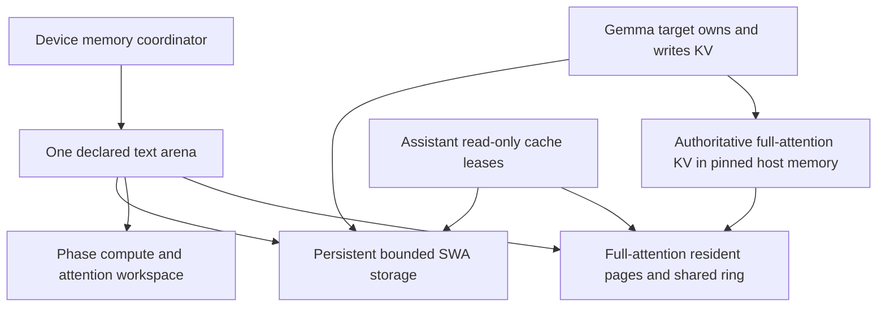
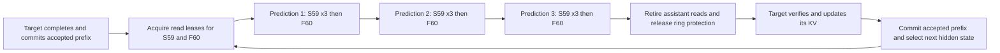
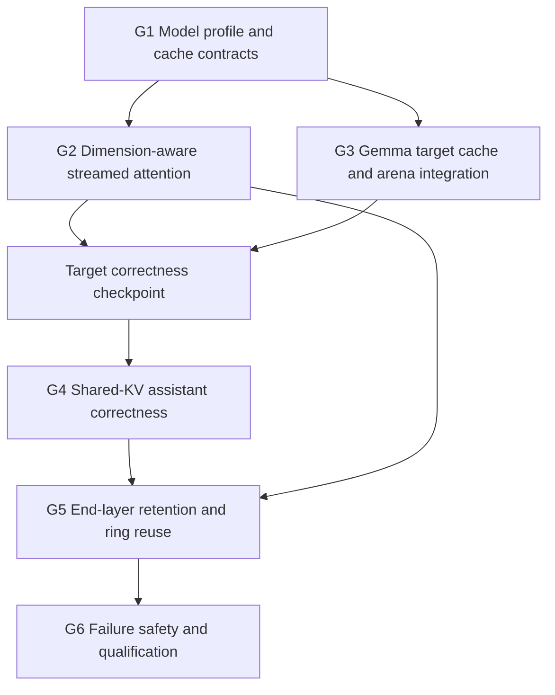

# Gemma 4 Adaptive KV Streaming Roadmap

Extend the existing memory ownership, adaptive KV streaming and phase arena implementation to Gemma 4 31B text generation, then add its shared-KV MTP assistant. Preserve the qualified Qwen path. Reuse the common memory and scheduling contracts; put model differences in narrow adapters and backend differences in capability-driven attention implementations.

Status: implementation started on `feature/gemma4-adaptive-kv-stream`, forked from `feature/adaptive-kv-stream-v2` at `db8fd5d89` on 2026-10-17. No Gemma streaming or assistant profile is qualified yet. This supersedes the 2026-10-14 planning baseline at `45ee09caa` and includes the completed upstream attention re-port, DFlash2, vision lifecycle and KQ1-KQ6 quantization work. Production remains on its existing configuration.

Use the independent G1-G6 milestone identifiers below. They do not replace or renumber existing consumer, vision, MTP or CUDA compatibility stages. Each lettered stage is a commit unit containing implementation, tests and a progress entry. The user authorized title-only commits for completed steps and continuation through G6, including MTP. Do not push. If a feasibility gate requires a material scope or configuration change, report the evidence and obtain a decision instead of weakening acceptance.

### Existing foundations and remaining work

Reuse the implemented foundations below. Their Qwen and synthetic qualification does not establish Gemma model support:

- The [common bounded resident KV consumer](DFLASH2_ADAPTIVE_KV_ROADMAP.md#shared-bounded-resident-kv-consumer) provides checked storage requirements, persistent leases, identity and lifecycle handling. G3a adapts it to Gemma's stock causal sliding-window cache; it does not build a new allocator.
- Common target scheduling, span/resume machinery and recurrent rollback infrastructure cover TG1-TG8 for the qualified Qwen paths. Gemma's 512-dimensional full-attention kernels, cache routing and assistant admission still require implementation and qualification. Gemma does not use Qwen recurrent rollback.
- PF0-PF6 added bounded, stock-order prefill with progressive resident/ring execution, tile-local conversion and compact visibility descriptors for supported configurations. Extend these paths to Gemma geometry instead of restoring a full-history encoded/F16 gather as the default. Existing compact descriptors do not advertise SWA support; Gemma's local attention keeps stock window/mask semantics.
- Prepared transfer resources, transfer-span fences, sparse feedback and explicit cross-consumer prefetch are implemented. Commit `45ee09caa` qualifies target/attached-MTP handoff and immutable-prefix adoption for TG1-TG8 on Qwen. Gemma still needs read-only target-cache bindings and its own consumer-order qualification.
- KQ1-KQ6 provide quant-aware storage/publication and capability-driven admission. CUDA currently qualifies 64 reader pairs across F32, F16, BF16, Q8_0, Q5_0, Q5_1, Q4_0 and Q4_1; IQ4_NL lacks a native CUDA flash-attention reader and is rejected before execution. Preserve this behavior, the all-pair operator coverage and the existing Qwen MTP/DFlash qualification. Q8/Q4 is the initial Gemma measurement profile, not a new hardcoded format requirement.
- Shared adaptive draft caches inherit target formats and reject explicit draft-format overrides. Gemma's borrowed caches must obey the same byte-consistency rule. The ordinary speculative driver already has a shared-cache assistant mode; extend its streaming admission and cache bindings rather than replacing its candidate-generation algorithm.

G1-G6 remain the implementation sequence. Revalidate compatibility at the actual starting revision and record changes here rather than repeating completed infrastructure stages. The deferred phase-scoped recurrent staging plan in [the MTP roadmap](MTP_ADAPTIVE_KV_ROADMAP.md#deferred-phase-scoped-recurrent-publication-staging-2026-10-14) is not a prerequisite for this non-recurrent Gemma target.

## Scope and acceptance

The initial model profile is `unsloth/gemma-4-31B-it-GGUF`, `gemma-4-31B-it-Q3_K_M.gguf`, with its matching separate 31B assistant. This replaces the earlier `UD-Q3_K_XL` baseline. G1a pins both actual artifacts, revisions and checksums before qualification. The first runtime profile is one serial request on one CUDA device, Flash Attention, GPU KV offload, Q8_0 keys and Q4_0 values, batch/ubatch 256/256 and UVM disabled for physical-budget qualification. Qualify no MTP first, then maximum draft lengths 1-3 and target verification TG1-TG4.

Derive verification/catch-up requirements and headroom from the requested draft length and algorithm, not new fixed four-row assumptions. For sequential proposal length D, target verification needs up to D+1 rows. Common TG8 support is not permission to admit Gemma draft lengths 4-7 before their kernels, workspace and cache recovery are qualified. Gemma's shared-KV assistant has no independent KV catch-up workload.

Derive cache geometry, cache roles and kernel support from metadata and actual backend capabilities. This qualification profile is not permission to hardcode Q8/Q4 byte sizes, 60 layers, target layer 59/60 or head dimension 256 into common infrastructure.

Acceptance requires correct inference within the admitted working-set budget, preserved cache semantics across serial requests, stock-matched numerical qualification and bounded device allocation. When the phase minima fit, exceeding KV residency must cause streaming, not failure merely because a complete full-attention layer cannot remain in VRAM simultaneously.

The objective includes native context 262144. Whether this GGUF's actual GPU weights, local caches and minimum compute fit on a 16 GB card is a measured feasibility condition. File size is not GPU weight allocation size. Report an impossible phase minimum and obtain an explicit decision about further work or configuration changes. Do not silently reduce layers, batch, context, change KV quants or enable UVM and call the original profile qualified.

Initial non-goals are parallel slots, multi-GPU splitting, a new accelerator streaming port, other Gemma variants, assistant-weight eviction during every speculative round, mmproj/vision/audio/video qualification, and DFlash/DFlash2 integration. Native Gemma MTP is in scope. Reuse infrastructure developed for Qwen DFlash2 without admitting a Gemma DFlash pairing. Optional follow-ups have separate gates. Muse Glimmer is outside this workstream.

## Model profile and execution order

Use one-based layer numbers in explanations and zero-based indices in code. Confirm the selected GGUF's actual metadata before allocation; publisher JSON does not replace artifact inspection.

| Property | Qwen 3.8 27B target | Gemma 4 31B target |
| --- | --- | --- |
| Target blocks | 64 | 60 |
| Repeated attention pattern | Three recurrent blocks, then full attention | Five sliding-window blocks, then full attention |
| Full-attention histories | 16 | 10 |
| Bounded companion memory | Convolution history and DeltaNet state for 48 recurrent blocks | Local KV caches for 50 sliding-window blocks |
| Full-attention K/V head dimensions | 256/256 | 512/512 |
| Full-attention KV heads | 4 | 4 |
| Local attention geometry | No sliding-window target cache | 256/256 dimensions, 16 KV heads |
| Target KV sharing | Not the Gemma sharing mechanism | Published 31B configuration has zero shared-KV target layers |
| Draft cache ownership | Independent Qwen MTP logical history | Assistant borrows existing target KV |

Gemma target visits are `S1 ... S5, F6, S7 ... S11, F12, ... S59, F60`. All block operations still run. Copy queues may look ahead without reordering model dependencies.

The selected assistant has four blocks: local, local, local, full. The current llama.cpp adapter maps its three local blocks to target S59 and its full block to F60. Derive and validate source mappings from topology, cache role and geometry rather than scattering those two indices through the implementation. Draft length three means three passes through all four blocks, not three separate KV-producing heads.

The assistant reads a frozen target prefix throughout drafting. It does not append draft K/V or run an independent prompt-KV catch-up. Token/hidden inputs change between predictions; query position stays fixed within a round. Target verification writes target KV and supplies the accepted hidden state for the next round.

### Published metadata references

- [Target GGUF repository](https://huggingface.co/unsloth/gemma-4-31B-it-GGUF/tree/c1ac76e99d5513b141e8adde7288b85c3f9c32ec), including matching assistant files. Pin actual filenames, revisions and checksums for qualification.
- [Target configuration](https://huggingface.co/unsloth/gemma-4-31B-it-GGUF/resolve/c1ac76e99d5513b141e8adde7288b85c3f9c32ec/config.json).
- [Google assistant configuration](https://huggingface.co/google/gemma-4-31B-it-assistant/blob/627c5ec1458b9086b841a91e0512fd31fd2fbbf1/config.json).
- [Assistant execution semantics](https://huggingface.co/docs/transformers/model_doc/gemma4_assistant), including cache sharing, no independent prefill and fixed drafting position IDs.

## Memory ownership and phase design

The target is the only KV writer and owns two distinct cache groups. Each cache has a logical identity, valid positions and content generation. The assistant receives read-only source views tied to those identities, not another set of cache layers.



Local cache bytes stay on the device through text prefill, target verification and drafting. They hold a bounded token window plus batch headroom and alignment, not the whole prompt. With the stock defaults, one sequence, window 1024 and ubatch 256, that normally means 1280 local positions. `--swa-full` changes this requirement and must be explicitly supported or rejected, not treated as bounded storage.

Only the full-attention group participates in the adaptive resident/ring policy. Its geometry is uniform for the selected profile, but differs from the local group. Do not combine both groups in one page-size calculation or assume identical valid token ranges.

The local group uses the common bounded resident KV consumer implemented in DFlash2 D5a. Its checked sizing, persistent arena regions, leases, content identity and transition lifecycle are reusable; Gemma supplies actual layer IDs, geometry, window and stock causal cache behavior. The Qwen draft's feature-injection and temporary mask-token rules are not Gemma target write semantics. Sharing infrastructure does not mean replacing either model's masks or calculating local attention with a new custom kernel.

Speculative rejection must preserve the accepted prefix's local-cache bytes as well as cell positions and masks. If provisional writes can overwrite a window entry needed after rollback, retain sufficient headroom or explicitly preserve/restore those entries before admitting execution. Logical truncation alone is not proof of recovery. Derive the requirement from the actual stock cache behavior and requested verification width.

Gemma's target combines that resident group with streamed full-attention storage. Its assistant receives generation-valid read leases over existing target sources, not a new SWA allocation. Keep local KV contents and positions alive through assistant reads and text phase changes; a read lease may not publish or advance the target's cache.

Persistent bytes do not require an unchanged lease handle forever. If an arena generation needs fresh handles, retire old graph users, preserve the fixed local-cache region and contents, then publish new bindings. A retained raw pointer is not equivalent to a valid lease.

The accounting is:

```text
arena capacity >= persistent local KV
                + phase compute workspace
                + phase attention and writer scratch
                + full-attention resident and ring working set
                + required alignment and owned metadata storage
```

Target and assistant compute are serial and may share the maximum of their phase requirements, rather than their sum, once output lifetimes permit the handoff. Preserve or copy needed target hidden rows and logits before recycling their scratch. Report target weights, assistant weights and driver/native-executable allocations separately when outside the parent arena.

Use the existing bounded, stock-order prefill design as the implementation baseline, extending its conversion, continuation and compact-mask paths to the actual 512-dimensional full-attention geometry. Preserve local stock attention separately. Quotes and preflight must cover every admitted full/short microbatch and selected native family. A separately budgeted strict-gather path may remain a numerical diagnostic, but must not be a silent production fallback. Neither prefill nor decode may conceal missing support with an unbudgeted full-cache gather. G3f is conditional only if the adapted bounded path needs an additional design to meet the intended profile.

### Assistant and ring reuse



Retain F60 pages that remain valid after the final target attention. Fetch missing chunks: progressive target execution does not leave the complete F60 history in the ring automatically. Reuse retained data across assistant predictions where capacity permits.

Two modes are required. Complete-layer execution retains the resident prefix and ring suffix through drafting. Progressive execution resumes stock-equivalent attention over ready chunks when the complete cache cannot fit; it may transfer some F60 data again on later predictions. Complete-layer retention must not become an unconditional maximum-context admission requirement.

Release protection only after the final GPU reader completes. Target lookahead may use unrelated free slots, but cannot overwrite F60 pages still needed by a later assistant pass. Return drafting protection before conflicting target writes or next-pass prefetch. No permanent MTP reservation is taken from the target ring.

## Implementation dependencies



Retain the architecture gate until a complete path is available. Kernel work can use synthetic fixtures without claiming Gemma server support. Reuse completed foundations at each stage; MTP optimization follows correct target and assistant integration.

## Milestone G1 Model profile and cache contracts

Outcome: describe both models without allocating unsupported storage or assuming every memory container is Qwen hybrid memory.

| Stage | Implementation boundary | Required TDD evidence |
| --- | --- | --- |
| G1a | Pin Q3_K_M target and matching assistant artifacts, inspect GGUF metadata, create small fixtures, and capture ordinary dispatch and allocations at a fitting short context. Confirm the assistant loader selects the separate assistant artifact. Establish physical target-only and joint assistant feasibility before promising the full profile. | Valid versus wrong assistant, tokenizer/embedding mismatch, absent source cache, unsupported metadata and incompatible geometry. Record ordinary target and MTP controls, actual source revision and shared-foundation dependencies. Full native-context stock allocation is not required as a control when it cannot fit. |
| G1b | Add the smallest private adapter exposing full-attention streaming and bounded companion resources. Route Qwen through it unchanged; keep recurrent operations inside its adapter. | Qwen routing equivalence, Gemma topology, unsupported adapter rejection, retained lifetimes and no invalid hybrid casts. Resolve stable groups once where practical. |
| G1c | Define producer versus read-only source bindings with cache ID, source layer, geometry, valid positions, content generation and lease revision. Separate assistant block count from new KV-history count. Update common initialization to distinguish embedded cache-producing MTP from a separate shared-cache assistant, without treating the assistant's four blocks as auxiliary KV histories. | Multiple readers alias one source, bad mappings/stale generations fail, readers cannot publish, separate assistant loading is admitted only for a valid source contract, explicit draft KV overrides reject, and four assistant blocks add no cache histories. Qwen embedded MTP and DFlash admission remain unchanged. |
| G1d | Preserve structured quota shortage versus allocation/capture OOM throughout assistant construction. Failed shared admission must not become a misleading OOM from separate fallback scratch. | Narrow feasible intervals, one-MiB fit, updated assistant minimum, quota followed by fallback OOM, unrelated errors, cleanup and retry. Preserve explicitly allowed separate-workspace fallbacks. |

G1a also establishes hardware feasibility: actual GPU weights, local KV, compute/attention scratch, pinned host memory and assistant weights. It does not claim fit from GGUF file size.

## Milestone G2 Dimension-aware streamed attention

Outcome: select supported streamed kernels by actual geometry, rather than globally rejecting head dimensions other than 256.

| Stage | Implementation boundary | Required TDD evidence |
| --- | --- | --- |
| G2a | Carry independent K/V head dimensions through geometry, requests, dispatch identities, capability queries and workspace plans. Derive row sizes, F16 strides and partial outputs. Keep page token count independent. | 256/512 metadata, unequal dimensions where supported, quant alignment, overflow, tails and transactional failure. Qwen budgets stay unchanged. |
| G2b | Generate needed dimensional instances through existing compiled quant/family settings. Reuse stock family, launch configuration, resource limits and split selection; version changed private ops contracts. | Matching path versus absent code, device/resource rejection, reduced-quants builds and exact preflight sizing. Correct diagnostics before execution. |
| G2c | Generalize 512/512 span execution and tile-local conversion, retaining fast small-span addressing and stock pipelines. Generalize output reductions and byte strides without replacing page/thread constants. | TG1-TG4 stock comparisons for initial MTP admission, resident-only/mixed/wrapped/streamed spans, quant tails, masks, scale parameters and CUDA memcheck. Preserve existing Qwen TG1-TG8 tests. No independently normalized half-head calculations. |
| G2d | Extend the existing bounded progressive/resumable machinery to Gemma decode/verification and wide prefill. Preserve stock split/tile order, final reduction and type-specific conversion; adapt compact full-attention visibility descriptors without changing local SWA semantics. | Cache larger than pool, tiny ring, full/short query tiles through the admitted ubatch, wrapped spans, exact mask bits, delayed copies, cancellation and one finalization. No context-sized encoded/F16 gather or dense context-by-query mask in the admitted bounded full-attention path. |
| G2e | Cache immutable plans where safe; qualify overhead and resource use before live integration. | Existing 256 regressions, representative compiled pairs, 512 dispatch trace, repeated calls and scratch bounds. Investigate routing overhead above the agreed 5-10% goal at equal residency. |

Accept only when a compiled streamed path and its resources support the requested geometry, KV types, query width and operation features. This does not admit arbitrary dimensions, sinks, masks or softcapping without implementations. Preserve stock attention scaling; final-logit softcapping is not an attention softmax parameter.

## Milestone G3 Gemma target cache and arena integration

Outcome: correct target generation with bounded resident local KV and adaptive full-attention KV, without MTP first.

| Stage | Implementation boundary | Required TDD evidence |
| --- | --- | --- |
| G3a | Integrate DFlash2 D5a's common bounded resident KV consumer with Gemma's target SWA group, preserving stock causal cells, masks and sequence semantics. Register exact persistent requirements; do not create a second allocator. | Gemma geometry/group IDs, window/headroom/padding and byte guards, explicit `swa_full` behavior, content/positions across rebind, stock causal outputs and no DFlash injection semantics. Common synthetic coverage does not replace these model tests. |
| G3b | Attach streaming to Gemma's non-SWA cache. Derive layer IDs, route encoded writes/attention through the owner, and leave local attention on stock execution. | Correct source mapping, target publication once per full-cache layer, no recurrent access, no streaming of local layers and no full host history for a local window. |
| G3c | Coordinate prefill/decode grants while preserving local KV. Reclaim prefill graph/gather storage for full-cache residency and ring; retire captures before rebinding. | Local bytes untouched by repartition, larger effective decode pool, low-high-low transitions, failed rebind recovery, stale-view rejection and parent bounds. |
| G3d | Integrate serial reset, append, truncation, prefix reuse and prompt-state save/restore for both groups. Establish the local-cache headroom or preservation needed for speculative rollback before assistant admission. | Changed content at equal length, shorter prefixes, partial reuse, restored state, window wraparound, cancellation and retry. Verify accepted local bytes survive provisional window overwrites; check positions/masks as well as bytes. |
| G3e | Enable Gemma admission only after real-model target controls pass; verify native-context hardware minima. | Matching stock-family logits/continuations, short/medium/long physical-budget tests, startup diagnostics and Qwen regressions. Larger-than-pool histories execute progressively when minima fit. |

Conditional stage **G3f** is activated only if adapting the existing bounded prefill path in G2d/G3c exposes an additional feasibility gap. Record the specific missing family, mask, geometry or workspace requirement and agree on the extra bounded design before implementation. Do not defer ordinary bounded prefill until this optional stage, quietly restore a full-history gather, or lower the batch size. If physical minima remain impossible, report the blocked hardware profile.

The target checkpoint requires G1, G2 and G3a-G3e, plus G3f if its feasibility gate requires it. It does not claim assistant support.

## Milestone G4 Shared KV assistant correctness

Outcome: Gemma MTP reads target KV without adding four auxiliary caches or running a full assistant KV prefill.

| Stage | Implementation boundary | Required TDD evidence |
| --- | --- | --- |
| G4a | Attach the matching assistant through leased target sources, using the common bounded consumer's read-only leases for local KV and the streamed source for full KV. Replace raw-address aliases where arena bindings can move. Provide correct progressive borrowed reads when a complete full-attention history exceeds the ring; this is a correctness requirement, not a G5-only optimization. | Correct local/global aliases, incompatible metadata rejection, stale generations, read-only enforcement, retained source lifetime and no new draft KV storage/rows. Independent draft quant flags cannot silently reinterpret shared bytes. A smaller-than-one-cache ring completes stock-matched drafting without duplicate full-history staging. |
| G4b | Register the actual assistant serial workload and share compute scratch safely. Reserve normal one-query draft graphs, not an unused full-prompt assistant graph. Derive target verification requirements from configured proposal depth and validate every admitted width. | Workspace guards, retained target outputs, short-prefill handoff, exact/one-byte-short budgets, graph retirement and reuse. No assistant KV catch-up; hidden handoff remains. Unsupported wider requests reject before execution. |
| G4c | Preserve stock candidate generation: changing token/hidden inputs, fixed position within a round, confidence cutoff and configured sequential predictions. Initially admit and qualify lengths 1-3 without baking that ceiling into common cache/lease contracts. | Lengths 1-3, intermediate verification widths, early stop, hidden-state reset, all four blocks visited each pass and unchanged cache version throughout drafting. Higher lengths require separate qualification, not merely removal of the CLI gate. |
| G4d | Integrate verification, accepted-prefix selection and target cache rollback. Retire old assistant views before mutation and select the accepted target hidden row. Preserve overwritten local entries where accepted-prefix recovery needs them. | Zero/partial/full acceptance at every rejection position, correction token, context-end headroom, rejection across window wrap, restored prefixes, cancellation and request reuse. Compare local-cache content/positions and correction logits with stock. No Qwen recurrent snapshots for Gemma. |

Conditional stage **G4e** addresses a measured prefill peak caused by assistant weights that are unused during target prefill. Evaluate deferred device loading and a phase-owned weight lifecycle using the existing infrastructure. Handle later requests, not just startup, and validate joint decode requirements. Per-round weight eviction/upload is not the default; footprint/transfer tradeoffs require an explicit decision.

Compare with ordinary Gemma MTP using matching checkpoints, cache types and execution mode. Do not demand equality against no-MTP TG1 if stock's own batched verification differs numerically.

## Milestone G5 End layer retention and ring reuse

Outcome: retain useful F60 data through drafting without a permanent reservation during main-model execution or a complete-layer residency requirement.

| Stage | Implementation boundary | Required TDD evidence |
| --- | --- | --- |
| G5a | Hand the final target cache to the assistant with accepted-frontier, generation and completion identity. Reuse valid pages/device-published tail rows; fetch missing data. | Pending host publication, rejected suffixes, stale ring bytes, wrong identity and unaccepted rows excluded. Do not assume progressive target attention retained every F60 chunk. |
| G5b | Optimize the correct G4 progressive reader with retained complete coverage when it fits, and retained partial coverage where safe when it does not. Never allocate duplicate history or full-cache decode staging. | One suffix upload across predictions when coverage permits; smaller-than-one-cache ring still works; repeat traffic measured honestly. Exact source bytes in mixed/wrapped spans. |
| G5c | Reuse prepared transfer-span and final-reader handoff fences; recycle consumed slots for next target full attention. Use other free slots for safe lookahead without globally draining later next-consumer work. | Delayed final reader, cancellation, reused events, pending D2H and racing target prefetch. All protection returned before conflicting verification; no permanent ring reserve or broad backend wait introduced for retirement. |
| G5d | Connect Gemma's actual source-read sequence to existing explicit next-consumer lookahead, immutable-prefix adoption, sparse feedback and adaptive repartition. Keep assistant cache reads distinct from Qwen auxiliary-cache publication. | No premature next-target prefetch evicting useful F60 data, separate target/borrowed-read accounting, stale-frontier rejection, context growth, partition crossings and repeated-round benchmarks. Reuse existing TG1-TG8 transport contracts without claiming wider Gemma admission. |

S59 is read three times per assistant pass with different queries. Keeping its bytes resident does not permit reusing its attention outputs. F60 is read once per pass; retention saves uploads, not attention evaluations. Assistant weights and workspace remain real costs.

## Milestone G6 Failure safety and qualification

Outcome: expose only qualified profiles and produce reproducible comparisons without hiding failed points or regressing Qwen.

| Stage | Implementation boundary | Required TDD evidence |
| --- | --- | --- |
| G6a | Complete phase preflight and error propagation for target, local caches and assistant readers. Reuse prepared transfer resources; validate every admitted query width, bounded prefill variant and fallback's actual requirements, including local rollback headroom/preservation. | Exact aligned minima/additional bytes, graph/copy failures, poisoned/null handles, recovery and teardown. No hidden gather fallback. External executable OOM is reported safely, not promised impossible. |
| G6b | Run common-owner regressions and supported CUDA build/runtime profiles. Keep model/cache semantics backend-neutral without claiming another streaming backend. | Views, leases, allocators, transition/Meta tests where changed; CPU sanitizers; CUDA memcheck; Gemma representative KV pairs and older-architecture builds. Preserve the existing 64-pair Qwen operator matrix and TG1-TG8 numerical controls. Forward JIT is not real older-card performance evidence. |
| G6c | Qualify real serial server lifecycles with and without the assistant. | Low/high/low prompts, different content, cached prefixes, state restore, long decode across partitions, window wraps, cancellation, pending publication and restart. Check cache frontiers and stock-matched logits, not speed alone. |
| G6d | Run controlled sweeps/traces after correctness gates, matching artifacts, build, corpus, positions, query mode, cache types and environment. | Context-matched 8 Ki steps toward 256 Ki, at least 256 output tokens, no MTP/draft lengths 1-3; resident/light/moderate/heavy ring controls and long decode. Independent per-mode max arenas/no-fit records. |
| G6e | Document launch usage, allocation categories, capabilities and actual qualification. Create checkpoint branches only with user approval after gates pass. | Reproducible scripts/plots, explicit missing points, rebuilt server/libraries together, correct transfer denominators and production restoration. Loading another variant is not qualification. |

Measure stock/no-streaming controls where their allocations fit. A stock UVM control can serve longer-context comparisons when feasible, but remains distinct from required non-UVM bounded-budget qualification. Match stock family and query width for numerical tests.

Transfer accounting distinguishes target verification, assistant reads, host publication and any weight movement. Report accepted output counts, drafted/accepted counts, bytes per round and bytes per emitted token with explicit denominators. Bytes per attention call are not bytes per generated token. Report effective phase pools and physical allocation; UVM residency cannot be inferred from `nvidia-smi` alone.

## Numerical and performance gates

All-resident paths retain stock behavior. Streamed paths preserve stock family, conversion, token traversal, split boundaries and reduction order where applicable. Require bit identity where justified and observed; establish absolute/relative error and continuation criteria before accepting other paths. Do not relax tolerance just to make a failing test pass.

Do not use independently normalized per-span attention with an arbitrary merge as the preferred production arithmetic. Do not split a 512-dimensional head into separately normalized 256-dimensional heads. A semantic CPU oracle is useful, but does not replace the stock numerical control.

The 5-10% span-routing overhead goal concerns equal geometry and residency. It is not a promise that long streamed decoding is within 10% of fully resident stock. Weight size, local-cache reservation, transferred bytes and draft acceptance affect end-to-end throughput.

Inspect actual families, transfer spans, fence waits, launch gaps, layout changes and scratch at representative contexts. Preserve qualified 256-dimensional Qwen paths through the refactor; do not silently replace them with an unqualified generic path.

## Optional follow ups

- **Gemma vision/mmproj (deferred):** qualify the real projector/embedding path separately. Suspension must preserve full-cache mirrors and bounded local bytes/positions; retire assistant readers first. The Qwen projector lifecycle is not automatically sufficient. Not part of G1-G6 acceptance.
- **Gemma DFlash/DFlash2 (deferred):** select and inspect an actual matching checkpoint before planning its cache roles, feature taps, masks, block width and loader support. Do not treat a DFlash checkpoint as DFlash2 or assume its draft caches are all windowed. Not part of G1-G6 acceptance.
- **Longer native-MTP proposals:** extend qualified Gemma admission beyond lengths 1-3 only after all requested widths, cache recovery and workspace minima pass. Common TG1-TG8 machinery is reusable, not an already-qualified Gemma profile.
- **Other Gemma variants:** inspect geometry, inter-layer reuse, per-layer embeddings and assistant mappings. Preserve aliases rather than duplicating physical caches, then qualify each profile.
- **Other backends:** provide actual attention and async-copy adapters behind these same contracts and compare against each backend's stock paths.
- **Other models:** discuss Muse Glimmer separately before changing this plan or assuming its topology. Describe cache roles/geometry/ownership rather than model-name switches, but do not build a new model registry just for this port.

## Existing code and roadmap references

| Area | Implementation or reference |
| --- | --- |
| Ownership and leases | [DEVICE_MEMORY_INFRASTRUCTURE.md](DEVICE_MEMORY_INFRASTRUCTURE.md), [ggml-backend-memory.h](ggml/src/ggml-backend-memory.h) |
| Plans and execution | [DEVICE_MEMORY_CONSUMERS_ROADMAP.md](DEVICE_MEMORY_CONSUMERS_ROADMAP.md), [llama-context-memory.cpp](src/llama-context-memory.cpp), [llama-memory-transition.h](src/llama-memory-transition.h) |
| Qwen policy and retained layers | [MTP_ADAPTIVE_KV_ROADMAP.md](MTP_ADAPTIVE_KV_ROADMAP.md), [llama-kv-stream-model.cpp](src/llama-kv-stream-model.cpp), [llama-kv-stream-layer-lease.cpp](src/llama-kv-stream-layer-lease.cpp) |
| Gemma target and cache groups | [gemma4.cpp](src/models/gemma4.cpp), [llama-kv-cache-iswa.cpp](src/llama-kv-cache-iswa.cpp), [llama-model.cpp](src/llama-model.cpp) |
| Assistant and drafting | [gemma4-assistant.cpp](src/models/gemma4-assistant.cpp), [speculative.cpp](common/speculative.cpp) |
| Current gates and assumptions | [llama-context.cpp](src/llama-context.cpp), [llama-kv-cache.cpp](src/llama-kv-cache.cpp), [kv-stream-partial.cu](ggml/src/ggml-cuda/kv-stream-partial.cu), [kv-stream-tile.cu](ggml/src/ggml-cuda/kv-stream-tile.cu) |
| Private backend operations | [ggml-backend-execution.h](ggml/src/ggml-backend-execution.h), [ggml-kv-stream-device.h](ggml/src/ggml-kv-stream-device.h), [ggml-kv-stream-copy.h](ggml/src/ggml-kv-stream-copy.h) |

Reuse the existing geometry, policy, model/context, span/resume/tile, context-memory, transition/recovery and sweep fixtures. Add Gemma tests for topology and assistant semantics rather than replacing Qwen coverage.

## TDD workflow and progress

For each stage, add the failing test first, record the original failure, implement the smallest correct change, run affected tests and broader regressions proportional to risk. Update this plan with the change, measurements, limitations and stage commit. Commit only related files with a title-only message under the user's authorization. Do not push, switch production models or start another workstream. Temporary production stops for GPU qualification are permitted by the user's standing authorization; restore and verify the existing service afterward.

The 2026-10-17 review updates the baseline, quantization regression gates, separate-assistant admission and progressive-reader dependency. No Gemma implementation stage is marked complete by the existing Qwen/synthetic evidence. Model downloads and real-model controls belong to G1a; record their exact artifacts and results below.

### Progress ledger

- 2026-10-17: created `feature/gemma4-adaptive-kv-stream` from `db8fd5d89`; reviewed the native shared-cache assistant driver, current Qwen-only streaming admission and the stock SWA/base cache split. Updated the roadmap before implementation. All G1-G6 runtime qualification remains pending.
- G1a complete (2026-10-17): pinned and downloaded the target and Q8_0 assistant in [gemma4-31b-artifacts.json](benchmarks/data/gemma4-31b-artifacts.json), verified both SHA-256 hashes, and added the GPU-free [artifact audit](benchmarks/inspect_gemma_artifacts.py). Confirmed 60 target blocks, ten full caches (512/512, four KV heads), 50 local caches (256/256, 16 KV heads, window 1024), and assistant source IDs `[58,58,58,59]` with no new histories. Nine adversarial metadata tests plus a real miniature-GGUF reader test cover identity, geometry, missing producers, projection dimensions and raw attribute versus token-order differences. Red evidence: missing-audit import, missing target projections accepted, and raw attributes confused with token reordering; each was corrected before green tests. Existing 54 DFlash artifact/harness tests and Python type checks pass.
- G1a native controls: the coherent baseline CUDA server at `db8fd5d89`, arch 120, all FA reader pairs, no arena/UVM/mmproj, Q8/Q4, all GPU layers, b/ub 256 and capacity 8192 completed 2048-token prompts plus 32 outputs in target-only and separate-assistant MTP=3 modes. Outputs matched each other for this prompt; this is not a streamed-path numerical claim or a representative throughput sweep. Process VRAM was 15100/15694 MiB; short control rates were 41.38/76.69 token/s, with 21/30 draft tokens accepted. Evidence and commands: `benchmarks/results/gemma4-g1a-20261017/native-controls.json` and native logs. Both runs restored production and verified port 1234 healthy. Native full-context allocation and streamed phase minima are still unqualified.
- Artifact caveat: ordered token text is identical, but the files' raw token types differ at IDs 1 and 258884. The audit retains the original type-sensitive fingerprints, reports that difference, and separately checks the ordered text fingerprint, following native assistant compatibility rather than falsely declaring a token reorder. Native loading applies its existing control-token handling. No runtime tokenizer behavior was changed.

| Milestone | Status | Checkpoint requirement |
| --- | --- | --- |
| G1 Model profile and cache contracts | In progress: G1a complete | G1b-G1d adapters, source roles and structured admission fixtures remain |
| G2 Dimension-aware streamed attention | Planned | 512 span/resume decode and bounded prefill qualified; 256/TG1-TG8 regressions pass |
| G3 Gemma target integration | Planned | Common bounded consumer reused; correct no-MTP target with local/full cache coordination and phase budgets |
| G4 Shared KV assistant correctness | Planned | Stock-matched assistant/verification and window-safe rejection without independent draft KV |
| G5 End layer retention and ring reuse | Planned | Existing consumer-handoff machinery adapted to read-only source reuse and safe return of the ring |
| G6 Failure safety and qualification | Planned | Lifecycle, physical-budget tests and reproducible benchmark ledger |

Conditional G3f and G4e become explicit progress entries only when their feasibility gates require them. Preserve all other stage IDs and record scope changes before implementing them. Removing the architecture guard or producing plausible short output does not complete a milestone.
