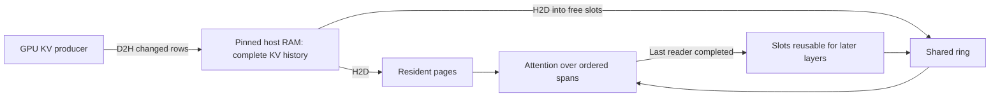
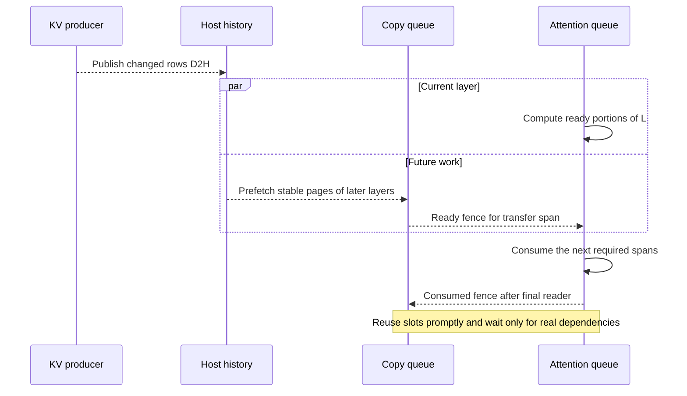
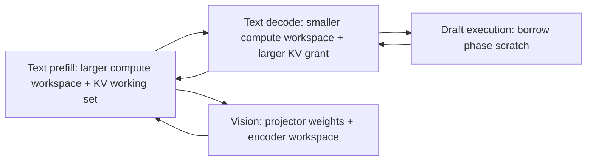
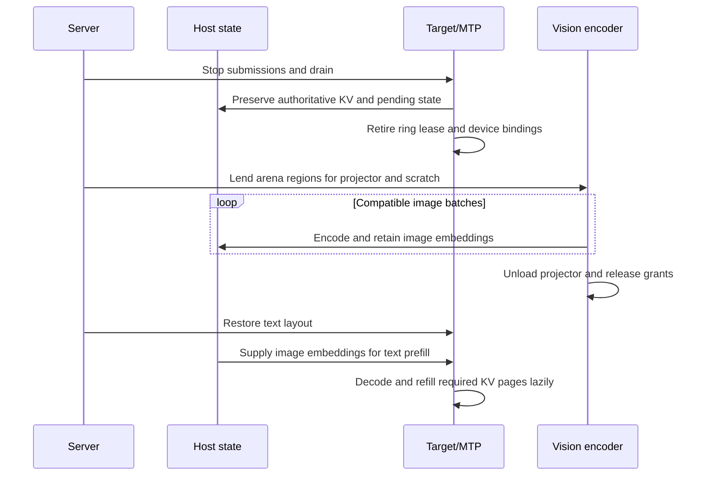
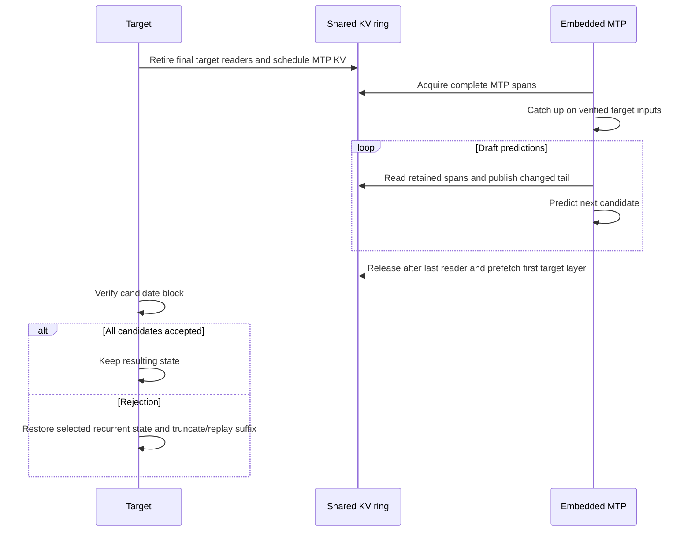
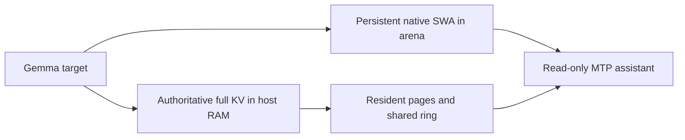
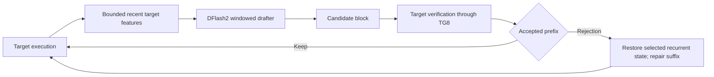
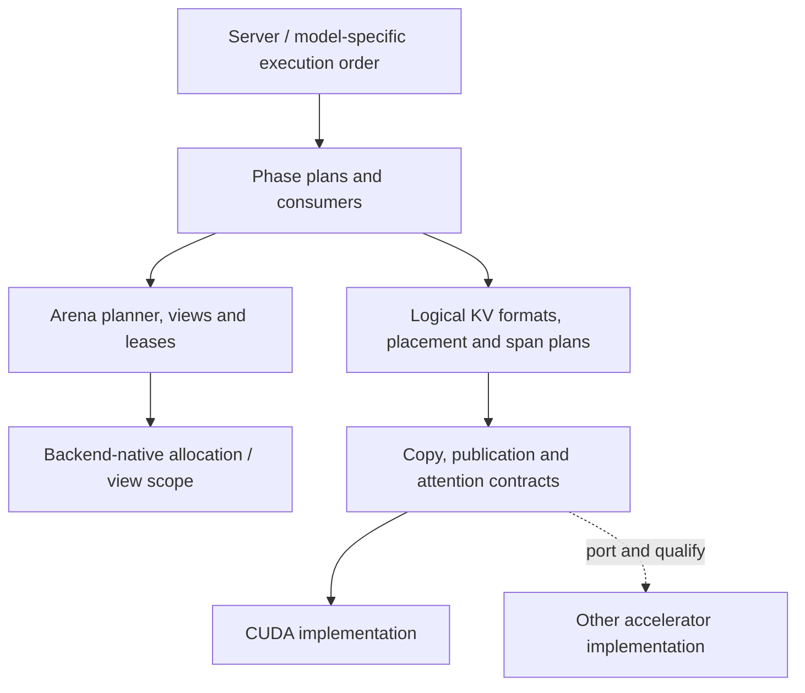

# Adaptive KV Streaming for llama.cpp V2

Quantized Qwen3.8-27B and Gemma 4 31B weights can fit on a 16 GB GPU, but that leaves limited space for a long conversation's KV cache. As context grows, the cache can exceed the remaining VRAM. Unified Memory allows oversubscription, but repeated movement between RAM and VRAM can sharply reduce decoding speed.

Adaptive KV Streaming V2 manages that movement explicitly. It keeps the complete encoded full-attention KV history in system RAM, retains part of it in VRAM, and prefetches the rest through a shared ring buffer as attention needs it. The same GPU space is reused across layers, allowing full attention to cover history beyond what fits in VRAM without discarding earlier tokens. Attention still runs on the GPU; UVM is optional.

To make long-context generation faster, V2 also shares memory between prefill, decode and drafting, plus vision on both targets. Qwen's embedded MTP streams an auxiliary history; Gemma's separate MTP assistant borrows target KV without creating another history. DFlash2 provides another Qwen option, with different memory costs and acceptance rates.

On an RTX 5070 Ti with IQ4_XS weights and Q8_0 K / Q4_0 V, stock llama.cpp with UVM measured 2.5 tok/s at 128 Ki, while V2 target-only measured 26.1 tok/s. MTP=3 increased that to 59.7 tok/s at the same context and still delivered 22.3 tok/s at the model's native 262,144-position capacity. Stock was slightly faster at short contexts; streaming's benefit becomes clear as the cache puts pressure on VRAM.


The colored lines are the 128-point V2 sweep with UVM disabled and independently maximum-fit arenas. The gray line is a fresh 16-point stock-UVM sweep, without KV streaming, an arena or speculation, ending at 128 Ki. Both use the same IQ4_XS model, Q8/Q4 KV, corpus, context-matched prompts, 256 output tokens and b/ub=256. These are separate recorded sweeps, not repeated statistical A/B trials; results depend on the workload and hardware. [V2 details](#qwen-measurements) · [V2 CSV](media/adaptive-kv-four-mode-comparison.csv) · [Stock-UVM CSV](media/stock-uvm-iq4-throughput.csv) · [V2 project discussion](https://www.reddit.com/r/LocalLLM/comments/1wt03zh/adaptive_kvcache_streaming_v2_full_context_mtp/).

Gemma 4 31B now uses the same streaming infrastructure while keeping its sliding-window caches resident. In the 60-point Q3_K_M/Q8-Q4 sweep, MTP=3 measures 91.2 tok/s at 8 Ki and 28.3 tok/s at 120 Ki, versus 39.6 and 10.3 target-only. The separate post-D512 MTP3 sweep extends through 256 Ki, measuring 7.8 tok/s there. These are separately fitted arenas, not equal-memory comparisons or a stock-UVM baseline.


The chart shows the earlier target-only, MTP1 and MTP2 cohort through 120 Ki and the separate post-D512 MTP3 cohort through 256 Ki; no curves are extrapolated. Both throughput axes start at zero. [Chart CSV](media/gemma4-256ki-throughput.csv) / [cohort provenance](media/gemma4-256ki-throughput.json). The [original all-mode measurements](#gemma-4-measurements) remain available at every 8 Ki step through 120 Ki. The shared prefill path also reuses bounded KV conversion and overlaps transfers with attention; [repeated A/B measurements](#common-prefill-improvements) separate those gains from the context sweeps.

The implementation supports **one serial Qwen3.8-27B or Gemma 4 31B request on one CUDA GPU**. Supported combinations and tested limits are listed below. Ordinary upstream modes remain available without adaptive execution. The Qwen figure above is its earlier recorded cohort, not a rerun with the newer prefill implementation.

[Supported features](#supported-features) · [Quickstart](#quickstart) · [Performance](#performance-and-reproduction) · [How it works](#how-it-works) · [Developer guide](#developer-guide) · [Upstream README](#upstream-llamacpp-readme)

## Supported features

### Models and execution modes

The reference targets are Unsloth Qwen3.8-27B `UD-IQ4_XS` and Gemma 4 31B `Q3_K_M`, with a matching `Q8_0` Gemma assistant. The separately qualified Gemma image profile uses `Q3_K_S` and a matching local `Q8_0` projector. Weight encoding and KV-cache encoding are separate settings. Other weight encodings use llama.cpp's readers but need their own memory-fit and inference qualification; earlier Qwen experiments also used Q3_K_XL, Q4_K_S and NVFP4.

| Target / drafter | Context capacity | Draft length | Draft KV history | Image input |
| --- | --- | --- | --- | --- |
| Qwen3.8-27B, target-only | Up to 262,144 positions | None | None | Matching F16 mmproj supported |
| Qwen3.8-27B, embedded MTP | Up to 262,144 positions | 1-3 predictions; target verification through TG4 | Full history, streamed as an auxiliary KV layer | Supported with the matching mmproj and shared arena |
| Qwen3.8-27B + IncoAI DFlash2 sidecar | Up to 262,144 positions | 1-7 predictions; target verification through TG8 | Bounded 2,048-position window plus execution headroom | Not supported with the vision arena |
| Gemma 4 31B, target-only | 8-120 Ki target-only sweep; metadata capacity 262144 | None | Ten full-attention histories streamed; fifty bounded SWA histories resident | Matching local Q8 projector with Q3_K_S; scoped below |
| Gemma 4 31B + matching MTP assistant | 8-120 Ki text sweep, all lengths 1-3; MTP3-only through 256 Ki | 1-3 predictions; target verification TG1-TG4 | Read-only target KV; no assistant KV append/catch-up | Matching local Q8 projector with Q3_K_S; lengths 1-3, scoped below |
| Other Gemma variants, Muse Glimmer and other architectures | Not qualified here | Not qualified | Need model topology, admission and numerical qualification | Not qualified |

TG1 means one query token in an attention invocation; TG4/TG8 mean four/eight queries. These are not request-concurrency settings. Context capacity includes the prompt, image positions, generated tokens and speculative headroom; it is not a promise of a 262,144-token prompt followed by additional generation.

Qwen embedded MTP needs a target GGUF containing its MTP tensors; its architecture is represented by `qwen35` in the source/GGUF metadata. Gemma requires the separate matching assistant, passed with `--model-draft`; its roughly 475.81 MiB of GPU weights remain **outside the arena**. DFlash2 requires its own matching Qwen sidecar, not an arbitrary draft model and not a Gemma pairing. See the pinned [Gemma artifacts](benchmarks/data/gemma4-31b-artifacts.json) and [Qwen DFlash2 artifacts](benchmarks/data/dflash2-qwen27b-artifacts.json).

Gemma's 120 Ki endpoint is the completed all-mode text sweep. The separate post-D512 MTP3-only sweep covers all 32 maximum-fit points through 256 Ki; it does not qualify other modes or image prefill there. Native controls are separate fitting cases: the 16 Ki native-MTP attempt ran out of VRAM while loading assistant weights, before inference. Long streamed lifecycle tests also cover a 98,304-token prompt and greater-than-4-GiB saved state; that is not long-context native numerical equivalence. See the [current Gemma ledger](GEMMA4_ADAPTIVE_KV_ROADMAP.md).

### Vision support

Both Qwen3.8-27B and Gemma 4 31B support still images and interleaved image/text prompts, target-only or with MTP lengths 1-3, on one CUDA GPU. Each requires a matching vision projector (`--mmproj`). Qwen uses its matching F16 projector; the qualified Gemma image profile uses a `Q3_K_S` target and matching local `Q8_0` projector, separate from the Q3_K_M text benchmarks above.

Both models reuse the text phase arena for vision weights and encoder workspace; main-model and optional assistant weights stay outside it. Model-specific position/cache handling remains separate: Gemma preserves its resident SWA cache and uses shared-KV MTP, while Qwen retains its image-aware auxiliary MTP history. Image count, token budget and batch size need their own fit; this profile excludes audio/video, LoRA, parallel slots and DFlash.

See the shared [vision launch examples](#vision-launch-examples). The [Gemma vision report](docs/multimodal/gemma4-vision.md) contains its projector preparation, sizing tables, measurements, qualification limits and internal APIs; [vision tests](tools/server/tests/README.md#adaptive-kv-vision-qualification) document Qwen's separate controls.

### KV-cache formats

Gemma long-context text and image requests are not restricted to Q8_0 K / Q4_0 V. The pairs below are supported for text and vision on both models, subject to compiled kernels, geometry and memory fit. Request type does not select a different fixed KV precision.

| K format | V format | Qwen3.8-27B | Gemma 4 31B |
| --- | --- | --- | --- |
| `q8_0` | `q4_0` | Supported | Supported |
| `q8_0` | `q8_0` | Supported | Supported |
| `q5_1` | `q5_1` | Supported | Supported |

These three reference pairs have model-level controls for both targets; changing format still requires refitting the arena. Q8/Q4 is the reference setting for the published Gemma long-context sweeps and all-budget image measurements, **not a format restriction**. Q8/Q8 and Q5_1/Q5_1 are also supported; their measurement coverage is recorded separately in the [performance results](#performance-and-reproduction) and [vision report](docs/multimodal/gemma4-vision.md#kv-format-support-and-test-coverage).

The common readers also admit all 64 ordered pairs from `f32`, `f16`, `bf16`, `q8_0`, `q5_0`, `q5_1`, `q4_0` and `q4_1`, subject to compiled kernels, geometry and memory admission. All-pair operator qualification is not an all-pair full-model or image benchmark. `iq4_nl` is not admitted by the current stock CUDA Flash Attention reader.

Adaptive MTP and DFlash inherit the target's K/V formats. **Do not pass draft-cache overrides**, even identical values: `--spec-draft-type-k/v` and their aliases are rejected for adaptive execution. Native non-streaming drafting retains independent cache settings.

F32 describes storage, not fully FP32 attention: the CUDA reader follows stock attention's FP16 input rounding. Cache-format speed measurements are not model-quality measurements.

### Platforms and operational limits

| Platform / backend | Implemented or tested here | What this does not establish |
| --- | --- | --- |
| Linux + CUDA, RTX 5070 Ti / SM120 | Qwen text/MTP/DFlash2/vision and Gemma text/shared-KV MTP/image phase arena, cache/recovery and scoped numerical/performance checks | Other cards, drivers and workloads can have different memory limits; other Gemma modalities/variants are not qualified |
| CUDA SM61/SM70/SM75/SM86 | Gemma D512 affected-unit functional compilation: 19 logical units, 72 actual device images; changed prefill adapters rechecked | Not a full legacy server link or physical Pascal/Volta/Turing/Ampere runtime/performance test |
| Other CUDA targets, including SM89 | Earlier Qwen selected-target/forward-JIT evidence is recorded separately | Forward-JIT on the 5070 Ti does not reproduce older-card resource/performance limits |
| Windows + CUDA | The CUDA path and DLL export fixes are in the source | The recorded Linux matrix is not Windows/MSVC qualification |
| CPU | Buffer views, leases, allocators, planning, transitions and host tests | Not a GPU streaming adapter |
| OpenCL / SYCL | Current builds pass; this machine lacks a compatible GPU/runtime for the Gemma qualification | Compile-only evidence is not streamed inference qualification |
| Vulkan / Meta composition | Actual common memory/view/completion/metadata tests | Not complete Gemma or Qwen streamed-attention inference |
| HIP / ROCm | Shared CUDA/HIP buffer-view implementation | No end-to-end AMD streaming qualification |

For SM61/SM70 builds, use a toolkit that still compiles those targets, such as CUDA 12.9; CUDA 13 cannot compile them. For older-target evidence and exact device-check commands, see [CUDA qualification](docs/build.md#adaptive-kv-cuda-qualification-and-startup-errors). Memory API portability does not make CUDA kernels portable.

| Setting | Current behavior |
| --- | --- |
| Requests / GPUs | One serial request, one CUDA GPU; no parallel slots or multi-GPU split |
| Attention | Flash Attention and GPU KV offload required |
| Batch / microbatch | 256/256 is the full text-matrix reference; other settings need their own fit test and backend admission |
| Vision | Qwen with matching F16 projector; Gemma 4 31B Q3_K_S with matching local Q8 projector and optional matching shared-KV MTP1-3. Image/text only, no LoRA/embeddings/DFlash |
| Image batching | Multiple images are supported within the admitted vision-batch and context limits; there is no universal image-count or resolution guarantee |
| UVM | Optional for model weights; the shared KV/phase arena stays device-local |
| Other GPU applications | Managed weights may migrate under pressure; the device-local arena itself is not automatically pageable |

The arena bounds its participating allocations, **not total process memory**. Model weights, host KV, persistent recurrent data and driver/native-executable allocations also need memory. Startup admission is not a guarantee against every later OOM.

## Quickstart

### Build

Build this fork rather than an upstream release binary. From a checkout of the Gemma-enabled `feature/gemma4-adaptive-kv-stream` branch/revision (the older V2 branch alone does not include these Gemma changes):

```sh
cmake -S . -B build-v2 -DGGML_CUDA=ON -DGGML_CUDA_FA_QUANTS=all -DCMAKE_BUILD_TYPE=Release
cmake --build build-v2 --target llama-server --parallel 2
```

Set `-DCMAKE_CUDA_ARCHITECTURES=...` for your GPU if needed. Increase build parallelism only when host RAM permits: the wide CUDA translation units can be memory-heavy, especially for legacy targets. Selected-pair builds can use, for example, `-DGGML_CUDA_FA_QUANTS="f16-f16;q8_0-q4_0;q8_0-q8_0;q5_1-q5_1"`. F32 storage uses its F16 counterpart in that list. The older `GGML_CUDA_FA_ALL_QUANTS=ON` remains a deprecated alias.

### Find a usable arena size

Make sufficient GPU memory available, supply local model files, and choose an unused port.

These two examples use each GGUF's native 262,144-position capacity, MTP3, Q8_0 K / Q4_0 V and a configured matching projector. `--probe-mode preflight` searches with short runtime probes (2,048 prompt tokens plus 256 outputs here), not just startup admission. `--validate-selected` then checks the full requested text workload **once**, at the selected arena. A failed final check stops without publishing a successful fit.

**Gemma 4 31B:** The example uses the Q3_K_S vision profile, local Q8 projector and matching external Q8 assistant. Substitute your own paths:

```sh
python3 benchmarks/find-max-arena.py \
  --server build-v2/bin/llama-server --model /path/to/gemma-4-31B-it-Q3_K_S.gguf \
  --model-draft /path/to/mtp-gemma-4-31B-it-Q8_0.gguf \
  --mmproj /path/to/mmproj-gemma4-31B-Q8_0-local.gguf \
  --context-size 262144 --cache-type-k q8_0 --cache-type-v q4_0 \
  --spec-mode mtp --draft-length 3 --batch-size 256 --ubatch-size 256 \
  --image-min-tokens 70 --image-max-tokens 70 --decode-tokens 256 \
  --probe-mode preflight --validate-selected \
  --output benchmarks/results/fit-gemma-vision-mtp
```

Selected fields from the real Gemma `result.json` on the RTX 5070 Ti:

```json
{
  "arena_mib": 2472,
  "next_mib_rejected": 2473,
  "context_size": 262144,
  "draft_length": 3,
  "probe_mode": "preflight",
  "prompt_tokens": 2048,
  "requested_prompt_tokens": 261873,
  "decode_tokens": 256,
  "runtime_probe_validated": true,
  "full_workload_validated": true,
  "projector_configured": true,
  "vision_execution_validated": false
}
```

**Qwen3.8-27B:** The example uses IQ4_XS weights and the matching F16 projector. MTP is embedded in this model, so no separate assistant is supplied:

```sh
python3 benchmarks/find-max-arena.py \
  --server build-v2/bin/llama-server --model /path/to/Qwen3.8-27B-UD-IQ4_XS.gguf \
  --mmproj /path/to/mmproj-Qwen3.8-27B-F16.gguf \
  --context-size 262144 --cache-type-k q8_0 --cache-type-v q4_0 \
  --spec-mode mtp --draft-length 3 --batch-size 256 --ubatch-size 256 \
  --image-min-tokens 64 --image-max-tokens 4096 --decode-tokens 256 \
  --probe-mode preflight --validate-selected \
  --output benchmarks/results/fit-qwen-vision-mtp
```

Selected fields from the real Qwen `result.json` on the same card:

```json
{
  "arena_mib": 2324,
  "next_mib_rejected": 2325,
  "context_size": 262144,
  "draft_length": 3,
  "probe_mode": "preflight",
  "prompt_tokens": 2048,
  "requested_prompt_tokens": 261873,
  "decode_tokens": 256,
  "runtime_probe_validated": true,
  "full_workload_validated": true,
  "projector_configured": true,
  "vision_execution_validated": false
}
```

Both selected arenas completed the final **261,873-token prefill and all 256 outputs**, with actual MTP drafts. Each 1 MiB-larger neighbor was rejected during the short-probe search. These are real, workload-specific fits with UVM disabled and no arbitrary reserve, not portable arena recommendations. [Recorded outputs, artifact hashes and validation receipt](benchmarks/data/native-context-finder-examples.json). The Gemma Q3_K_S fit does not replace the Q3_K_M performance cohort.

With no `--image`, both runs configure the deferred projector but test text execution: `projector_configured=true`, `vision_execution_validated=false`. Image-dependent minimum grants are a separate check. Add `--image /path/to/photo.png` to execute that image workload; see the [image-aware fitting example](docs/multimodal/gemma4-vision.md#find-a-fit-for-your-images). A prompt file needs one `<__media__>` marker per image. Preflight never truncates a supplied image request.

Use `arena_mib` to launch the server. The tool also prints the complete selected command and stores:

| File | Contents |
| --- | --- |
| `result.json` | Selected size, tested configuration, validation scope and launch command |
| `command.txt` | Complete POSIX-shell launch command, ready to copy |
| `probes.jsonl` | Results of the arena search probes |
| `arena-<MiB>.log` | Server output for each attempted arena size |
| `selected-validation/` | Full selected-workload record and log when requested |

Omit `--validate-selected` for short-probe sizing alone; then the report does not claim full text-workload validation. The default `--probe-mode full` retains the older behavior of testing the full workload for every candidate. `--prompt-tokens N` and `--prefill-text FILE` select another text workload. `--initial-arena-mib` is optional (default starting guess 2240), not a required arena size or reserve. `next_mib_rejected` is `null` if no larger neighbor was tested.

The finder removes inherited `LLAMA_ARG_*`, UVM and graph/rollback debug overrides. Unsupported kernels, incomplete responses, device faults and other non-OOM failures stop the search. Different images, prompt shapes, concurrent GPU users or driver allocations can change fit; there is no universal OOM guarantee. Even one full native-context validation can take several minutes.

### Launch examples

These examples use Bash. On Windows, adapt the argument grouping and executable path to your shell; the recorded qualification was on Linux. Substitute your own model paths and the arena found for **each** configuration.

```bash
KV_SERVER=./build-v2/bin/llama-server
KV_MODEL=/path/to/Qwen3.8-27B-UD-IQ4_XS.gguf
KV_DFLASH=/path/to/Qwen3.8-27B-DFlash2-Q4_K_M.gguf
KV_ARENA=2240  # Example only; use your fit result.
KV_COMMON=(--model "$KV_MODEL" --ctx-size 262144 --parallel 1
           --batch-size 256 --ubatch-size 256 --n-gpu-layers 999
           --flash-attn on --fit off)
```

**Target-only text:**

```bash
"$KV_SERVER" "${KV_COMMON[@]}" --shared-device-memory-mib "$KV_ARENA" \
  --cache-type-k q8_0 --cache-type-v q4_0 --spec-type none --no-mmproj
```

**Another cache format:**

```bash
"$KV_SERVER" "${KV_COMMON[@]}" --shared-device-memory-mib "$KV_ARENA" \
  --cache-type-k q5_1 --cache-type-v q5_1 --spec-type none --no-mmproj
```

**Embedded MTP:**

```bash
"$KV_SERVER" "${KV_COMMON[@]}" --shared-device-memory-mib "$KV_ARENA" \
  --cache-type-k q8_0 --cache-type-v q4_0 --no-mmproj \
  --spec-type draft-mtp --spec-draft-n-max 3
```

**DFlash2:** its extra GPU weights usually leave a smaller arena than embedded MTP. The 1,500 MiB value below is an example, not the result of the MTP fit above.

```bash
"$KV_SERVER" "${KV_COMMON[@]}" --shared-device-memory-mib 1500 \
  --cache-type-k q8_0 --cache-type-v q4_0 --no-mmproj \
  --model-draft "$KV_DFLASH" --spec-draft-ngl 999 \
  --spec-type draft-dflash --spec-draft-n-max 7 --spec-draft-n-min 0 --spec-draft-p-min 0
```

**Gemma target-only and separate shared-KV MTP:** use different fitted budgets for each mode. These 8 Ki sizes are measured examples on the reference card, not portable defaults.

```bash
GEMMA_MODEL=/path/to/gemma-4-31B-it-Q3_K_M.gguf
GEMMA_MTP=/path/to/mtp-gemma-4-31B-it-Q8_0.gguf
GEMMA_COMMON=(--model "$GEMMA_MODEL" --ctx-size 8192 --parallel 1
              --batch-size 256 --ubatch-size 256 --n-gpu-layers 999
              --flash-attn on --fit off --offline --no-context-shift
              --cache-type-k q8_0 --cache-type-v q4_0 --no-mmproj)

# Target-only: no assistant is loaded.
"$KV_SERVER" "${GEMMA_COMMON[@]}" --shared-device-memory-mib 1510 --spec-type none

# Run separately: matching Q8_0 assistant weights stay outside the 1032 MiB arena.
"$KV_SERVER" "${GEMMA_COMMON[@]}" --shared-device-memory-mib 1032 \
  --model-draft "$GEMMA_MTP" --spec-draft-ngl 999 \
  --spec-type draft-mtp --spec-draft-n-max 3 --spec-draft-n-min 0 --spec-draft-p-min 0
```

For Gemma lengths 1 or 2, change `--spec-draft-n-max` and refit. For 120 Ki, use `--ctx-size 122880` and repeat the finder at that capacity; do not reuse the 8 Ki result blindly. Leave `--swa-full` off: the shared arena requires bounded SWA. Common startup derives target verification width automatically; Gemma does not use Qwen recurrent snapshots. Do not attach DFlash. For images use the separately fitted Q3_K_S/Q8-projector configuration in [vision support](#vision-support), not these text-only arena examples.

#### Vision launch examples

Qwen and Gemma use the same launch mechanism and image-request API: add a matching `--mmproj` and a shared device arena. Choose **one** of the following model profiles, then use the common launch commands below. The example arena/budget values are reference settings, not universal fits; use the [image-aware finder](docs/multimodal/gemma4-vision.md#find-a-fit-for-your-images) with your actual inputs when sizing another workload.

Qwen profile, with its embedded MTP weights:

```bash
VISION_MODEL_ARGS=(--model /path/to/Qwen3.8-27B-UD-IQ4_XS.gguf
                   --mmproj /path/to/mmproj-Qwen3.8-27B-F16.gguf --ctx-size 8192
                   --image-min-tokens 64 --image-max-tokens 4096)
VISION_DRAFT_ARGS=()
VISION_ARENA=1024
```

Gemma profile, with a separate matching assistant when MTP is enabled:

```bash
VISION_MODEL_ARGS=(--model /path/to/gemma-4-31B-it-Q3_K_S.gguf
                   --mmproj /path/to/mmproj-gemma4-31B-Q8_0-local.gguf --ctx-size 4096
                   --image-min-tokens 70 --image-max-tokens 70)
VISION_DRAFT_ARGS=(--model-draft /path/to/mtp-gemma-4-31B-it-Q8_0.gguf --spec-draft-ngl 999)
VISION_ARENA=2048
```

Common launch commands for either profile; each starts its own local server:

```bash
VISION_COMMON=(--parallel 1 --batch-size 256 --ubatch-size 256 --n-gpu-layers 999
               --flash-attn on --fit off --offline --no-context-shift
               --cache-type-k q8_0 --cache-type-v q4_0
               --shared-device-memory-mib "$VISION_ARENA" --host 127.0.0.1 --port 8080)

# Target-only: no assistant is loaded.
./build-v2/bin/llama-server "${VISION_MODEL_ARGS[@]}" "${VISION_COMMON[@]}" --spec-type none

# Alternative: stop the first server with Ctrl-C, then launch with MTP3.
./build-v2/bin/llama-server "${VISION_MODEL_ARGS[@]}" "${VISION_COMMON[@]}" "${VISION_DRAFT_ARGS[@]}" \
  --spec-type draft-mtp --spec-draft-n-max 3 --spec-draft-n-min 0 --spec-draft-p-min 0
```

Once the server is ready, open `http://127.0.0.1:8080` and attach an image. No pre-existing server or container is required. The [vision report](docs/multimodal/gemma4-vision.md#running-an-image-request-locally) includes the same HTTP image-request shape for either model. Gemma's projector preparation, larger budgets and protected SWA details remain in that report rather than requiring a different client API.

Only run one of these commands at a time. `--kv-stream-arena-mib` is an alias for `--shared-device-memory-mib`; the legacy fixed KV-pool option is not sufficient for shared vision/phase memory. The embedded auxiliary-layer count is derived from model metadata; do not add an auxiliary history for Gemma's borrowed caches or DFlash's independent sliding-window cache.

**Optional managed weights:** prefix a launch with `GGML_CUDA_ENABLE_UNIFIED_MEMORY=1`. The model weights become managed pages while the arena remains physical VRAM. This can help a multi-purpose GPU, but neither guarantees availability for another application nor eliminates migration slowdowns. Do not enable it during physical maximum-fit testing.

### Common startup and fit errors

| Error | What to check |
| --- | --- |
| Native/streamed attention unavailable for K/V or query width | Compiled FA pairs, GPU family, tensor geometry and supported model; a larger arena cannot add a missing kernel |
| Shared arena quota insufficient | The admitted execution needs more arena space; use the reported minimum when available |
| Device allocation OOM | Weights, arena, driver/executables and other applications must fit together; reduce the arena and rerun the full workload |
| Draft-cache override rejected | Remove draft K/V flags and their environment equivalents; adaptive drafting inherits target formats |
| Gemma bounded-cache / combined quota rejected | Leave full-SWA disabled and use the required persistent-local plus graph/attention minimum; a quote is not a guarantee against external driver OOM |
| Arena finder port unavailable | Select a free `--port`; live listeners are never contacted. Completed POSIX probe sockets can be reused without mistaking them for another service |
| Vision request rejected | Matching projector, image count/dimensions/token limits, context room and parent capacity; do not silently treat every image error as VRAM OOM |

## Performance and reproduction

The introduction shows the context-scaling charts. The [detailed performance report](docs/development/adaptive-kv-performance.md) keeps full plots, tables, qualification scope and benchmark commands, grouped by model rather than development order. Results are workload- and hardware-specific; independently fitted sweeps are not equal-memory comparisons or repeated statistical A/B studies.

### Qwen measurements

The IQ4_XS/Q8-Q4 reference sweep covers target-only, MTP3 and DFlash2 draft lengths 3 and 7 through 256 Ki, with 32 points per mode. A separate stock-UVM baseline ends at 128 Ki: target-only decode there is 26.15 tok/s streamed versus 2.48 tok/s stock+UVM. This earlier sweep is not a rerun with the newer prefill optimizations.

[Four-mode data](media/adaptive-kv-four-mode-comparison.csv) · [Stock-UVM data](media/stock-uvm-iq4-throughput.csv) · [Three-format comparison](docs/development/adaptive-kv-performance.md#full-context-comparison-kv-formats-and-drafting-modes)

### Gemma 4 measurements

The Q3_K_M/Q8-Q4 records have two separate scopes: the earlier 60-point target-only/MTP1-3 sweep through 120 Ki, and a post-D512 MTP3-only 32-point sweep through 256 Ki. The overview chart keeps target-only/MTP1/2 at their measured 120 Ki endpoints. The Q3_K_S vision profile is a separate workload, not another point in these text curves.

[All-mode 120 Ki data](media/gemma4-120ki.csv) / [profile](media/gemma4-120ki.json) · [Overview including 256 Ki MTP3](media/gemma4-256ki-throughput.csv) / [cohort provenance](media/gemma4-256ki-throughput.json) · [Detailed Gemma results](docs/development/adaptive-kv-performance.md#gemma-4-measurements)

### Common prefill improvements

These comparisons use fixed 1 GiB arenas and successive adaptive implementations, not stock UVM or the independently fitted context sweeps. The conversion and transfer studies use three paired trials; the D512 feature study is a single matched screen per point. Do not multiply gains from different cohorts into an unmeasured combined speedup.

| 64 Ki prefill comparison | Gemma target-only / MTP3 | Qwen target-only / MTP3 |
| --- | ---: | ---: |
| Bounded conversion reuse vs pre-conversion | +32.44% / +32.12% | +5.14% / +5.23% |
| Two-wave transfers vs conversion-only | +3.64% / +3.65% | +1.25% / +1.82% |
| D512 feature pipeline vs earlier D512 | +7.34% / +7.38% | Target-only D256 control: less than 0.1% change |

Paired inputs, output IDs and draft counts are checked. Decode is screened for regressions; profiler timelines explain mechanisms, not throughput speedups. [Methods, raw data links and D512 qualification](docs/development/adaptive-kv-performance.md#optimization-comparisons).

### Reproduce text sweeps

Use the [benchmark commands](docs/development/adaptive-kv-performance.md#reproducing-text-sweeps) for Qwen, Gemma and DFlash, with explicit context ranges, cache pairs and a fresh output directory. They start their own test servers and use `--no-manage-production` where applicable, so no pre-existing service is required. The [arena finder](#find-a-usable-arena-size) is for sizing; a throughput sweep still executes complete measured workloads.

## How it works

### 1. Adaptive KV streaming

The two targets have different cache topologies, but use the same ordered-span reader and ownership contracts:

| Target | Full histories streamed from host | Bounded companion state |
| --- | --- | --- |
| Qwen3.8-27B | 16 full-attention blocks, head dimensions 256/256, four KV heads | 48 recurrent/linear-attention blocks |
| Gemma 4 31B | Ten full-attention blocks, dimensions 512/512, four KV heads | Fifty native SWA caches, dimensions 256/256, sixteen KV heads |

Full attention reads the growing history. The streaming pool manages those histories, not one independent full cache for every model block. Gemma's five-local/one-full pattern keeps native local masks and sliding-window semantics; only its full-attention group streams.

The complete encoded full-attention K/V history is authoritative in pinned host RAM. Gemma's local SWA caches do not get a second full host history. A logical page contains 256 token positions; its byte size follows the K/V types and head geometry. GPU space is divided into resident pages and one shared ring, not a separate large streaming allocation per layer.



When the history fits, attention reads resident data. Under pressure, the policy can stream selected layers first, then adjust placement as context grows. It trades resident pages for ring slots when earlier copies need more room to meet consumption deadlines. Newly written rows are published; unchanged historical pages do not need to be copied back to the host every token.

An attention input has at most the resident span, the current ring span and a wrap-around span in the optimized layout. The kernel follows logical token order rather than physical address order. Prefetch lookahead uses available slots and feedback, not a fixed three-layer window.



Ready fences prevent reads before copies finish; consumed fences prevent overwriting live data. Transfer-span/batch fences avoid one host/event operation for every page. Stock-compatible split/resume work can consume ready portions without inventing a different reduction order. Lookahead follows the next actual consumer, including a transition to MTP, rather than blindly prefetching another target round.

The implementation preserves stock traversal, quant conversion and final-reduction order where qualified. This avoids the extra rounding from independently reducing arbitrary chunks and merging their softmax results in a new order. Strict prefill uses bounded gathering/compact mask descriptors; attention still reads all required history. The tests qualify numerical behavior, not universal bit identity for every device and prompt.

For eligible quantized wide prefill (at least 128 query rows), one 2,048-token FP16 K/V stage reuses conversion across query tiles. Its additional quote is `2048 * KV_heads * (K_dimension + V_dimension) * sizeof(fp16)`: 8 MiB for the Qwen full layers and 16 MiB for Gemma's full layers. Existing converters and native attention plans/splits/checkpoints/reduction order are retained. Nonquantized caches, small queries and tile fallbacks keep native conversion execution; format support does not imply every profile benefits from preparation.

The prefill pipeline uses two alternating halves of the **existing encoded ring**, plus that single decoded stage. Transfer and ready-attention grouping are both bounded to a ceiling-half wave (seven/six pages for thirteen slots). While compute consumes one wave, DMA can fill the other. Conversion and attention remain ordered on the compute queue; this is not a claim that all three stages execute concurrently. Existing last-reader fences still protect slot reuse, including cancellation and failed submissions. No new GPU buffer or CUDA arithmetic is introduced, and decode scheduling is unchanged.

### 2. Phase arena

A native execution graph needs tensor workspace in addition to weights and KV. Keeping peak prefill, target decode, drafter and vision scratch independently allocated wastes space when they cannot run simultaneously. The arena gives those phases different layouts inside one bounded parent.



| Allocation | Lifetime / placement |
| --- | --- |
| Target model weights | Outside the shared arena; optionally managed by UVM |
| Gemma assistant / Qwen DFlash weights | Outside the shared arena; their presence reduces the maximum parent that fits |
| Compute workspace | Leased by the active target/draft phase |
| Gemma bounded SWA | Persistent fixed suffix inside the parent, preserved across prefill/decode/draft handoffs |
| Quantized wide-prefill preparation stage | Fixed 8/16 MiB for the reference full-layer geometries, inside prefill scratch; reused across layers/chunks and reclaimed for decode |
| Resident KV + ring | Uses the phase's remaining admitted KV grant |
| Vision weights + encoder workspace | Temporary separate grants inside the parent, returned after encoding |
| Complete full-attention KV history | Pinned host RAM, not the device arena |
| Recurrent/rollback state and staging | Host-backed and bounded device resources; not a second full-context draft KV allocation |
| Driver/native graph-executable bookkeeping | Also needs memory; not all of it is covered by the arena |

The main gain is reuse of graph **tensor workspace**, not an assumption that destroying a CUDA graph handle returns a fixed 1 GiB. A handoff drains affected work, invalidates stale executable bindings, releases changed leases, commits a new layout, then rebinds consumers. Reusing the same parent address does not make old tensor pointers valid.

The preparation stage raises the admitted prefill minimum by a fixed amount; startup does not silently negotiate a slower native-only profile for an undersized arena. The arena's declared total is unchanged when it fits, and decode recovers that space. Gemma's Q8/Q4, window-1024, ubatch-256, single-sequence SWA storage is 1,280 rows across fifty local roots: 425,984,000 bytes (406.25 MiB). This remains resident; the full history of the ten global layers is in host RAM. Other cache formats/batches have different quotes.

### 3. Vision and mmproj

For matching Qwen and Gemma vision encoders, image encoding is a distinct phase before text consumes the resulting embeddings. Gemma additionally keeps its native local/SWA region protected inside the same parent. Existing target/MTP history survives the temporary change of device layout.



Multiple images produce separate embedding chunks in prompt order; compatible encoder work may be batched. Larger image dimensions, token limits or image batches change the encoder requirement. The encoder grants must fit; they are not silently allowed to overwrite live text memory.

The server retains the source needed to reload projector weights. The Qwen image-aware MTP path keeps raw image embeddings distinct from shifted target hidden rows and tracks physical KV rows separately from M-RoPE positions. Gemma uses ordinary sequential decoder positions and a shared-source assistant with no auxiliary KV catch-up; its image SWA is non-causal while global attention remains causal. Checkpoint and RAM prompt-cache restoration also preserve pending MTP inputs.

The earlier Qwen no-MTP native-capacity image runs used short backgrounds, not full-262K text histories. With a 2,240 MiB parent, repeated MTP=3/512px image requests settled at 15,836 MiB on the 16,303 MiB reference card; actual vision grants were about 884.62 MiB of weights plus 30.02 MiB of compute. These are sampled, workload-specific measurements, not an instantaneous peak guarantee. See [vision qualification and measurement instructions](tools/server/tests/README.md#adaptive-kv-vision-qualification) and [the consumer roadmap](DEVICE_MEMORY_CONSUMERS_ROADMAP.md#stage-75c-image-aware-embedded-mtp-qualification).

### 4. MTP integrated with KV streaming

#### Qwen: an auxiliary KV layer

The tested model has one dense MTP attention block. Its separate logical KV history has the same head geometry and inherited encoding as the target's full-attention histories. The common placement policy therefore counts it as a **17th attention KV layer**, while keeping its host identity and lifetime distinct.

A drafting phase acquires its resident portion plus a complete nonresident suffix in the shared ring. Catch-up and sequential predictions reuse that lease; new tail rows update it without uploading the unchanged prefix again. After the final MTP reader, the ring is released for target verification. It is not permanently carved into a target half and an MTP half.



| Stock-style separate allocation | Shared implementation |
| --- | --- |
| Full-context draft GPU KV (about 416 MiB for Q8/Q4 at native capacity) | Separate host history; GPU pages compete within the shared 17-layer pool |
| Independent peak draft graph workspace | Borrowed phase workspace rather than simultaneous peak ownership |
| Large device rollback candidates for recurrent blocks | Host-backed candidates with bounded device staging; restore the chosen accepted prefix |
| Uncoordinated lookahead across target/draft phases | Common next-consumer scheduling and lease readiness |

This is **less extra VRAM, not zero extra VRAM**. MTP weights, active workspace, resident pages, device staging and transfers still have a cost. A depth-three rollback staging measurement is about 18.7 MiB of device memory plus 449 MiB of pinned host snapshots; these figures are not additive savings claims or a bound on all MTP memory. The current maximum-fit MTP arena is smaller than target-only in the performance graph.

Recurrent rollback must restore more than KV positions: recurrent state, candidate hidden inputs and cache frontiers must agree with the accepted prefix. Numerical/lifecycle tests force rejection paths instead of relying on a high benchmark acceptance rate to leave them untested. See [MTP architecture and qualification](MTP_ADAPTIVE_KV_ROADMAP.md).

#### Gemma: a read-only assistant over target KV

The matching Gemma assistant has four blocks: three local and one full. Its local blocks read the target's final local source and its full block reads the final full-attention source. The adapter derives/validates the source roles and geometry; it does not allocate four new histories or perform an independent KV catch-up. Three proposals mean three passes through all four assistant blocks, at a fixed query position within the round.



Full-cache reads use progressive waves when a whole source cannot fit. Immutable ring coverage can be reused across predictions only while source identity, generation, logical rows and slot contents still match. Local reads retain checked native views. The serial owner lends the same parent workspace to the TG1 assistant and target verification; it reserves up to `draft_length + 1` target queries independently of Gemma's recurrent depth, which is zero. Weights remain separate from the arena.

Target verification is the only KV writer. Acceptance, correction hidden rows, local-window rollback, cancellation and saved-state restoration follow the stock driver and are tested against matching native execution. A rewind beyond available local history rejects transactionally rather than pretending the missing window was recomputed. Next-consumer hints follow actual source/role identity; borrowed reads do not train/reset the target feedback tuner, and target diagnostics do not substitute assistant transfer counts. Further Gemma decode optimization is deferred; the evaluated G5c async prototype was removed because its measured gain was negligible.

### 5. DFlash2: a separate bounded Qwen drafter

DFlash2 is not another full-history auxiliary target layer. The tested sidecar has five attention layers with a bounded sliding window, consumes target features, and produces a candidate block for verification. Its bounded cache and compute workspace participate in phase ownership, while its GPU weights still reduce the space available to target KV.



The Q8/Q4 draft cache is about 18.3 MiB at ubatch 256, rather than a second 262K-position GPU KV history. Its roughly 1,080 MiB of GPU weights remain outside the arena. Depth-seven target rollback uses about 43.6 MiB of bounded device staging inside the shared parent. Both the cache and workspace depend on the admitted configuration, including K/V formats and batching.

Two staging slots and completion dependencies allow recurrent state publication to overlap subsequent work without overwriting an in-flight source. The common ownership layer also coordinates target-feature publication, draft execution, verification and rejection recovery. A high draft length is not automatically faster: target KV grant, transfer volume, draft compute and acceptance all matter. See [DFlash2 design/qualification](DFLASH2_ADAPTIVE_KV_ROADMAP.md).

Gemma's shared-cache assistant above is not a DFlash pairing. Other Gemma variants and Muse Glimmer still need their own model/topology/admission qualification; generic memory APIs alone do not admit them.

## Developer guide

These are experimental fork contracts, not a stable upstream API. The policy/ownership layers are backend-neutral; actual transfer, KV-write, attention and executable-invalidation work still needs backend implementation.

### Architecture and API map



| Layer | Entry points / source | Responsibility |
| --- | --- | --- |
| Buffer ownership | [ggml-backend.h](ggml/include/ggml-backend.h): `ggml_backend_buffer_retain/free/view` | Reference-counted storage and bounded, independently resettable views |
| Tensor/graph allocators | [ggml-alloc.h](ggml/include/ggml-alloc.h): `ggml_tallocr_new_range`, `ggml_gallocr_set_buffer_range` | Place tensors and stock graph allocations inside caller-owned ranges |
| Arena and leases | [ggml-backend-memory.h](ggml/src/ggml-backend-memory.h) | Transactional region maps, retained leases, generations and submission gate |
| Scheduler borrowing | `ggml_backend_sched_attach_memory_lease/detach_memory_lease` | Attach complete leased workspace; detach safely before address reuse |
| Resource declarations | [llama-memory-requirements.h](src/llama-memory-requirements.h), [plans](src/llama-memory-plan.h) | Domain, alignment, size, access and content-lifetime requirements |
| Phase changes | [llama-memory-transition.h](src/llama-memory-transition.h) | Prepare, drain, invalidate, release, commit, bind, activate and recovery |
| Completion | [llama-memory-completion.h](src/llama-memory-completion.h) | Backend event or explicit synchronous fallback; safe producer/consumer dependencies |
| KV metadata | [ggml-kv-stream.h](ggml/src/ggml-kv-stream.h), [policy](src/llama-kv-stream-policy.h) | Encoded layout, validated spans and placement decisions |
| Backend execution | [copy ops](ggml/src/ggml-kv-stream-copy.h), [attention ops](ggml/src/ggml-kv-stream-device.h), [buffer-local hooks](ggml/src/ggml-backend-execution.h) | Backend-specific movement and execution within common ownership rules |
| MTP / DFlash consumers | [complete-layer lease](src/llama-kv-stream-layer-lease.h), [bounded KV](src/llama-memory-bounded-kv.h) | Full-history auxiliary leases versus bounded-window drafter storage |
| Gemma split caches | [iSWA cache](src/llama-kv-cache-iswa.h), [native cache](src/llama-kv-cache.h) | Stream the full group, quote/bind persistent local storage, reject unavailable rollback windows |
| Read-only consumers | [cache read bindings](src/llama-memory-phase.h), [session](src/llama-kv-stream-session.h) | Retained semantic/physical source bindings and progressive attention without append |

### Ownership, views and bounded allocation

A view changes the logical range/reset scope without copying storage. It retains its parent, so releasing the caller's parent handle does not destroy memory still used by a live child. This matters for OpenCL/SYCL-style buffers with per-buffer tensor metadata as well as pointer-addressed CUDA buffers.

```cpp
ggml_backend_buffer_t ggml_backend_buffer_view(
    ggml_backend_buffer_t parent, size_t offset, size_t size);

bool ggml_tallocr_new_range(
    ggml_tallocr * allocator, ggml_backend_buffer_t buffer,
    size_t offset, size_t size);

bool ggml_gallocr_set_buffer_range(
    ggml_gallocr_t allocator, int buffer_id, ggml_backend_buffer_t buffer,
    size_t offset, size_t size);
```

A bounded tallocr places persistent tensors within that range; gallocr still plans normal graph tensor reuse inside its external workspace. These do not turn tensors into relocatable virtual addresses. Growing a tensor, moving preserved contents or remapping pages requires an explicit higher-level policy.

Offsets, alignment, sizes and overflow are checked before access. Stateful graph workspace must use an isolated complete view rather than reset a shared parent. Retain/free are lifetime operations, not GPU synchronization: retaining an already-dead raw handle cannot resurrect it, and a live lease does not mean queued kernels are finished.

### Borrowing an arena region as graph workspace

Representative setup for one backend; callers must also follow the phase lifecycle below:

```cpp
bool attach_workspace(ggml_backend_sched_t scheduler, ggml_backend_t backend,
                      ggml_backend_buffer_type_t type, size_t bytes) {
    auto arena = ggml_backend_memory_arena_new(type, bytes);
    if (!arena) return false;
    ggml_backend_memory_region region{};
    const bool planned =
        ggml_backend_memory_arena_begin(arena, GGML_BACKEND_MEMORY_PLAN_NONE) &&
        ggml_backend_memory_arena_reserve(
            arena, 1, bytes, ggml_backend_buft_get_alignment(type),
            GGML_BACKEND_MEMORY_REGION_NONE, &region) &&
        ggml_backend_memory_arena_commit(arena);
    auto lease = planned ? ggml_backend_memory_arena_acquire(arena, 1) : nullptr;
    const bool attached = lease &&
        ggml_backend_sched_attach_memory_lease(scheduler, backend, lease);
    ggml_backend_memory_lease_free(lease);
    ggml_backend_memory_arena_free(arena);
    return attached;
}
```

The scheduler retains the attached lease; that lease retains the arena/storage. The caller can therefore release its handles after attachment. Later, `ggml_backend_sched_detach_memory_lease(scheduler, backend)` synchronizes/detaches the workspace and invalidates its graph tensor addresses. Never directly free the borrowed buffer returned by `ggml_backend_memory_lease_buffer()` as though it were a new owned allocation.

### Plans and phase transitions

Resources declare their memory domain/allocation class, minimum/preferred size, alignment, read/write access and whether contents are discardable, preserved or reconstructible. A plan is an ordered execution description, not an automatic LRU policy or an unrestricted graph of concurrent consumers.


Implement `llama_memory_consumer::prepare()` without mutating active state or submitting work. Its `llama_memory_preparation` then supplies `quiesce`, `drain`, `invalidate`, `release`, `bind` and `activate`. Recovery is an explicit opt-in contract; it must preserve/reconstruct consumer contents after partial failure, not merely restore pointer values.

Arena commits are transactional metadata changes with view materialization. A generation/revision change means cached bindings and native graph executables may need rebuilding even if the physical parent address is unchanged. Persistent bindings can survive only when the new plan preserves their contract. Check completion before releasing or repurposing asynchronously used memory.

### KV formats, spans and backend hooks

Common layout code derives encoded row sizes, page offsets and transfer extents from actual GGML types. A span plan represents logically ordered coverage and retains its physical source leases. The common adaptive policy proposes placement; it does not call CUDA or move bytes.

```cpp
llama_kv_stream_policy_result llama_kv_stream_policy_step(
    const llama_kv_stream_policy_config & config,
    const llama_kv_stream_policy_state & previous,
    const llama_kv_stream_policy_observation & observation,
    llama_kv_stream_policy_decision & output);

ggml_kv_stream_result ggml_kv_stream_span_plan_make(
    const ggml_kv_stream_shape & shape,
    const ggml_kv_stream_span_source * spans, size_t count,
    size_t active_tokens, size_t query_tokens,
    ggml_kv_stream_span_plan_t & output);
```

The backend's versioned copy table supplies operations such as `enqueue_span`, `acquire_span`, `release_span`, producer fencing, resource preparation and sparse feedback polling. The attention table advertises real K/V/geometry/query-width support and workspace requirements before allocation. A fallback with different workspace requirements must be admitted before launch, not silently chosen after a failed reservation.

```cpp
// Selected callbacks; consult the headers for the full versioned contracts.
bool (*enqueue_span)(void *, size_t first_slot, const void * k, const void * v,
                     size_t live_tokens, size_t padded_tokens);
bool (*acquire_span)(void *, size_t first_slot, size_t count);
bool (*release_span)(void *, size_t first_slot, size_t count);

bool (*spans)(ggml_backend_t backend, const ggml_tensor * attention,
              ggml_kv_stream_span_plan_t spans, ggml_backend_buffer_t workspace);
```

Buffer-local hooks redirect only the admitted KV-write/attention work into the owner; other graph operations remain ordinary backend execution. Host publication, consumer-ready fences, final-reader fences and cancellation have separate meanings. Do not replace them with a raw pointer whose lifetime is only implied by the next API call.

Qwen embedded MTP uses the logical-format, publication and complete-layer span contracts; Gemma instead borrows progressive read-only target sources. DFlash declares a bounded window and ordered feature/verification dependencies. Model-specific catch-up, candidate acceptance and recurrent rollback belong above the backend; they should not be reimplemented independently in every accelerator adapter.

### Gemma bounded storage and read-source contracts

Use common startup and keep the target, physical parent and source pins alive through every assistant read. Direct callers must select bounded SWA explicitly. The [detailed storage/read-source contracts](docs/multimodal/gemma4-vision.md#bounded-storage-and-read-sources) cover quoting, binding, generations, verification widths and recovery.

### Gemma vision lending and completion

Use the existing MTMD session path to measure, lend and return temporary vision grants around the protected SWA region. The [vision lending/completion guide](docs/multimodal/gemma4-vision.md#vision-lending-and-completion) documents admission, lease lifetimes, output limits, assistant rebinding and failure handling.

### Porting and tests

| Contribution | Required work |
| --- | --- |
| New backend | Native allocation/views and reset scope; host registration or suitable transfer storage; copy/completion semantics; encoded writes; stock-order span/resume attention; capability/workspace reporting |
| New model | Describe full-history, recurrent, sliding-window and aliased caches; derive the actual access order and speculative feature dependencies; implement preservation/recovery |
| New format or kernel path | Use actual encoded strides and bounds, retain arithmetic-order qualification, quote all scratch, and keep unsupported paths rejected |
| Optimization | Preserve ownership/cancellation correctness and compare matching execution modes plus representative throughput/memory measurements |

Use TDD for exact-fit/one-byte-short bounds, alignment/overflow, nested lifetimes, reset isolation, held leases, failed transitions, stale graphs, pending copies, cancellation and recovery. Then qualify actual backend execution and matched native/streamed numerical behavior, followed by long-context performance. Host memory tests alone do not prove GPU execution or race freedom.

See [memory infrastructure](DEVICE_MEMORY_INFRASTRUCTURE.md), [consumer roadmap and qualification](DEVICE_MEMORY_CONSUMERS_ROADMAP.md), [MTP roadmap](MTP_ADAPTIVE_KV_ROADMAP.md), [DFlash roadmap](DFLASH2_ADAPTIVE_KV_ROADMAP.md) and [KV-format qualification](KV_QUANTIZATION_ROADMAP.md) for the detailed contracts and ledgers. The CUDA [copy adapter](ggml/src/ggml-cuda/kv-stream-copy.cu) and [attention adapter](ggml/src/ggml-cuda/fattn.cu) are concrete porting references, not portable kernels.

---

## Upstream llama.cpp README

# llama.cpp


<div align="center">

<b>LLM inference in C/C++</b>

[](https://opensource.org/licenses/MIT)
[](https://github.com/ggml-org/llama.cpp/releases?q=tag:v0)
[](https://github.com/ggml-org/llama.cpp/releases?q=b)
[](https://github.com/ggml-org/llama.cpp/actions/workflows/server.yml)
[](https://github.com/ggml-org/llama.cpp/actions/workflows/docker.yml)
[](https://github.com/ggml-org/llama.cpp/actions/workflows/winget.yml)

[ggml](https://github.com/ggml-org/ggml) / [ops](https://github.com/ggml-org/llama.cpp/blob/master/docs/ops.md) / [maintainer PRs](https://github.com/ggml-org/llama.cpp/issues?q=is%3Apr%20is%3Aopen%20draft%3AFalse%20(author%3Argerganov%20OR%20author%3AKitaitiMakoto%20OR%20author%3Adanbev%20OR%20author%3Aaldehir%20OR%20author%3Amax-krasnyansky%20OR%20author%3ACISC%20OR%20author%3Aggerganov%20OR%20author%3Aam17an%20OR%20author%3Ajhen0409%20OR%20author%3Abartowski1182%20OR%20author%3Anikwen%20OR%20author%3Ahipudding%20OR%20author%3Aravi9%20OR%20author%3AServeurpersoCom%20OR%20author%3Apwilkin%20OR%20author%3Areeselevine%20OR%20author%3Angxson%20OR%20author%3Ajeffbolznv%20OR%20author%3Amarty1885%20OR%20author%3A0cc4m%20OR%20author%3ATitaniumtown%20OR%20author%3Aangt%20OR%20author%3AIMbackK%20OR%20author%3Aarthw%20OR%20author%3AJohannesGaessler%20OR%20author%3AORippler%20OR%20author%3Aruixiang63%20OR%20author%3Axctan%20OR%20author%3Aallozaur%20OR%20author%3Ayomaytk%20OR%20author%3Aaendk%20OR%20author%3Awine99%20OR%20author%3Agaugarg-nv%20OR%20author%3Ataronaeo%20OR%20author%3Aforforever73%20OR%20author%3Alhez%20OR%20author%3Anetrunnereve%20OR%20author%3Afairydreaming)%20sort%3Aupdated-desc) / [dev stats](https://github.com/ggml-org/llama.cpp-dev) / [lib llama API](https://github.com/ggml-org/llama.cpp/issues/9289) / [llama-server REST API](https://github.com/ggml-org/llama.cpp/issues/9291)

</div>

## Quick start

A few options to get `llama.cpp` installed on your machine:

```bash
# curl
curl -LsSf https://llama.app/install.sh | sh

# powershell
irm https://llama.app/install.ps1 | iex
```

- Visit https://llama.app and follow the instructions
- Run with Docker - see our [Docker documentation](docs/docker.md)
- Download pre-built binaries from the [releases page](https://github.com/ggml-org/llama.cpp/releases)
- Build from source by cloning this repository - check out [our build guide](docs/build.md)

Once installed:

```sh
# Download and run a model directly from Hugging Face
llama cli -hf ggml-org/Qwen3.5-0.8B-GGUF

# Launch OpenAI-compatible API server
llama serve -hf ggml-org/Qwen3.5-0.8B-GGUF
```

<table align="center">
    <tr>
        <td align="center" width=50%>
            
            <i>VLM session with <b>llama cli</b></i>
        </td>
        <td align="center">
            
            <i>Built-in web UI against <b>llama serve</b></i>
        </td>
    </tr>
<table>

## Description

The main goal of `llama.cpp` is to enable LLM (and VLM) inference with minimal setup and state-of-the-art performance on
a wide range of hardware - locally and in the cloud.

- Plain C/C++ implementation without any dependencies
- Apple silicon is a first-class citizen - optimized via ARM NEON, Accelerate and Metal frameworks
- AVX, AVX2, AVX512 and AMX support for x86 architectures
- RVV, ZVFH, ZFH, ZICBOP and ZIHINTPAUSE support for RISC-V architectures
- 1.5-bit, 2-bit, 3-bit, 4-bit, 5-bit, 6-bit, and 8-bit integer quantization for faster inference and reduced memory use
- Custom CUDA kernels for running LLMs on NVIDIA GPUs (support for AMD GPUs via HIP and Moore Threads GPUs via MUSA)
- Vulkan and SYCL backend support
- CPU+GPU hybrid inference to partially accelerate models larger than the total VRAM capacity

The `llama.cpp` project is build on top of the [ggml](https://github.com/ggml-org/ggml) library.

## Supported backends

| Backend | Target devices |
| --- | --- |
| [BLAS](docs/build.md#blas-build) | All |
| [BLIS](docs/backend/BLIS.md) | All |
| [CANN](docs/build.md#cann) | Ascend NPU |
| [CUDA](docs/build.md#cuda) | Nvidia GPU |
| [HIP](docs/build.md#hip) | AMD GPU |
| [Hexagon](docs/backend/snapdragon/README.md) | Snapdragon |
| [IBM zDNN](docs/backend/zDNN.md) | IBM Z & LinuxONE |
| [MUSA](docs/build.md#musa) | Moore Threads GPU |
| [Metal](docs/build.md#metal-build) | Apple Silicon |
| [OpenCL](docs/backend/OPENCL.md) | Adreno GPU |
| [OpenVINO [In Progress]](docs/backend/OPENVINO.md) | Intel CPUs, GPUs, and NPUs |
| [RPC](https://github.com/ggml-org/llama.cpp/tree/master/tools/rpc) | All |
| [SYCL](docs/backend/SYCL.md) | Intel GPU |
| [VirtGPU](docs/backend/VirtGPU.md) | VirtGPU APIR |
| [Vulkan](docs/build.md#vulkan) | GPU |
| [WebGPU](docs/build.md#webgpu) | All |
| [ZenDNN](docs/build.md#zendnn) | AMD CPU |

## Documentation

#### Tools

- [cli](tools/cli/README.md)
- [completion](tools/completion/README.md)
- [server](tools/server/README.md)
- [GBNF grammars](grammars/README.md)

#### Development

- [How to build](docs/build.md)
- [Running on Docker](docs/docker.md)
- [Build on Android](docs/android.md)
- [Multi-GPU usage](docs/multi-gpu.md)
- [Device memory infrastructure](DEVICE_MEMORY_INFRASTRUCTURE.md)
- [Adaptive KV streaming and MTP integration](MTP_ADAPTIVE_KV_ROADMAP.md)
- [Performance troubleshooting](docs/development/token_generation_performance_tips.md)
- [GGML tips & tricks](https://github.com/ggml-org/llama.cpp/wiki/GGML-Tips-&-Tricks)
- [XCFramework](docs/xcframework.md)
- [Completions](docs/completions.md)
- [Models](docs/models.md)
- [Release process](docs/release.md)

## Contributing

- Contributors can open PRs
- Collaborators will be invited based on contributions
- Maintainers can push to branches in the `llama.cpp` repo and merge PRs into the `master` branch
- Any help with managing issues, PRs and projects is very appreciated!
- Read the [CONTRIBUTING.md](CONTRIBUTING.md) for more information

## Acknowledgements

- [yhirose/cpp-httplib](https://github.com/yhirose/cpp-httplib) - Single-header HTTP server, used by `llama-server` - MIT license
- [nothings/stb](https://github.com/nothings/stb) - Single-header image format decoder, used by multimodal subsystem - Public domain
- [nlohmann/json](https://github.com/nlohmann/json) - Single-header JSON library, used by various tools/examples - MIT License
- [mackron/miniaudio](https://github.com/mackron/miniaudio) - Single-header audio format decoder, used by multimodal subsystem - Public domain
- [sheredom/subprocess.h](https://github.com/sheredom/subprocess.h) - Single-header process launching solution for C and C++ - Public domain
