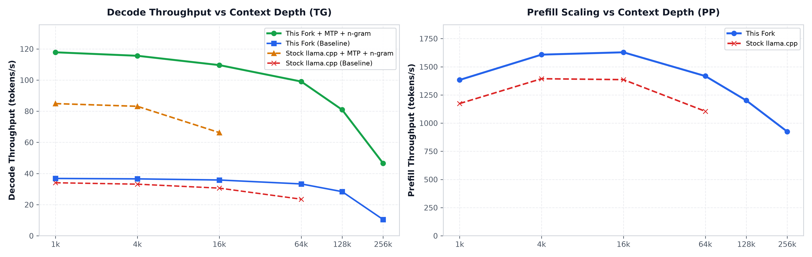
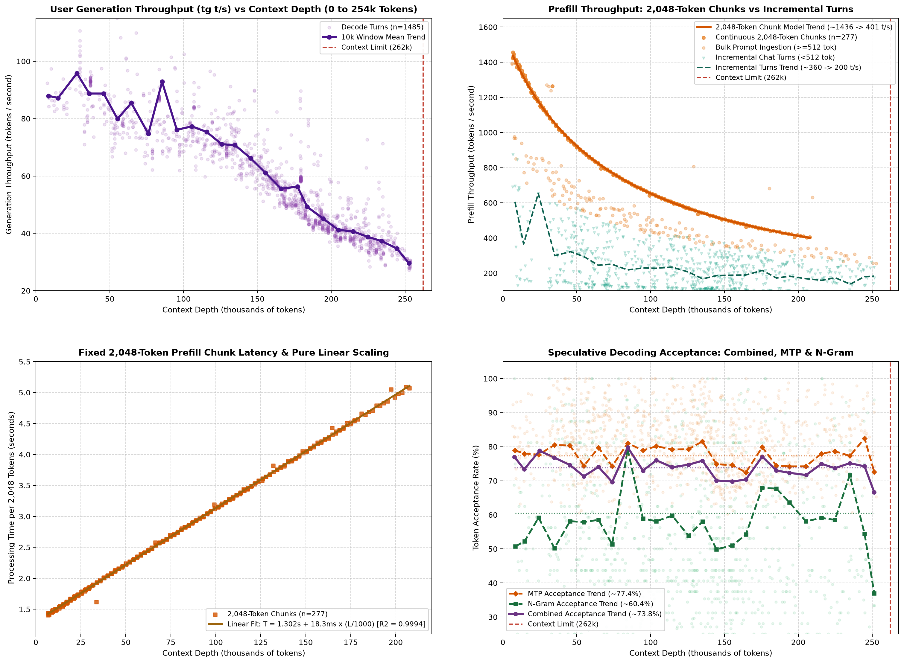

# llama.cpp (Adaptive KV Streaming & RDNA 4 ROCm Optimizations)

This fork adds **Adaptive KV Streaming** and **RDNA 4 (gfx1201) / ROCm optimizations** to `llama.cpp`. It allows consumer GPUs with 16 GB VRAM (such as the AMD Radeon RX 9070 XT) to execute models like **Qwen3.8-27B** (`IQ4_XS` model weights, `Q8_0` K / `Q4_0` V cache) across their full **262,144-token context window** without running out of memory, delivering **80+ t/s** decode generation and **1,400+ t/s** prefill throughput.

---

## Improvements

- **Adaptive KV Streaming**:
  - Automatically pages and streams the KV cache between host RAM and GPU VRAM.
  - Active VRAM residency is fixed and bounded within dedicated prefill and decode working sets.
  - Dedicated asynchronous copy engine streams KV pages via PCIe SDMA alongside compute streams.
  - Enables full 262,144-token context depth on a single 16 GB GPU with 100% recall and zero allocation crashes.
- **RDNA 4 (gfx1201) and ROCm Kernel Optimizations**:
  - Multi-column `mmvq` with 4 rows per block tuned for RDNA 4 wave dispatch.
  - Kernel fusions: fused residual add + RMS norm, fused SwiGLU + quantized activation copies for `mmvq`, and fused gated delta net (GDN) recurrent kernels.
  - Sibling matmul activation reuse across parallel projections.
  - Aligned LDS reads for K fragments and compact V scales in paged decode attention.
  - Vectorized 16-byte reads per call for Q4_K and Q5_K `mmvq`.
- **Probabilistic Rejection-Sampled Speculative Pipeline**:
  - Multi-Token Prediction (MTP) drafts are sampled probabilistically at request temperature and verified by rejection sampling instead of naive greedy matching, preserving model output distribution.
  - Single-head MTP decodes verify catch-up in its first draft step.
  - Stacks opportunistic n-gram drafting with MTP, delivering up to 16-token speculative bursts on repetitive context and code editing.
- **HIP Runtime and Graph Tuning**:
  - Tuned for ROCm 7.2.3 and HIP graphs with single-queue async mode to prevent launch bubbles.
  - Constrains hardware queue allocations to prevent preemption save area VRAM blowups during long prefills.

This work builds on concepts from [RaymondHuang210129/llama.cpp-adaptive-kv-streaming](https://github.com/RaymondHuang210129/llama.cpp-adaptive-kv-streaming) and [stew675/llama-cpp-rdna-boosts](https://github.com/stew675/llama-cpp-rdna-boosts), re-implemented specifically for RDNA 4 hardware targets in ROCm/HIP.

---

## Setup

The configurations and benchmarks in this repository use **Qwen3.8-27B** (ASCII-condensed `IQ4_XS`, 12.63 GiB): [bsaleh03/Qwen3.8-27B-ASCII-Condensed](https://huggingface.co/bsaleh03/Qwen3.8-27B-ASCII-Condensed). Another option would be [troed/Qwen3.8-27B-ASCII-Condensed](https://huggingface.co/troed/Qwen3.8-27B-ASCII-Condensed).

### System Requirements

- **GPU**: AMD Radeon RX 9070 XT (`gfx1201`, RDNA 4) or compatible ROCm GPU with >= 16 GB VRAM.
- **Host Bus**: PCIe 5.0 x16 recommended for optimal streaming throughput at > 80k context (PCIe 4.0 supported).
- **Host RAM**: >= 32 GB RAM (~7.4 GB host memory allocated for 262,144 context; dual-channel DDR5 recommended).
- **ROCm Toolchain**: ROCm 7.2.3 or later on Linux.

### NixOS

```bash
nix run .#serve-openai -- -m /path/to/Qwen3.8-27B-ASCII-Condensed-UD-IQ4_XS.gguf
```

### Other Linux Distributions

Follow official documentation to install AMD ROCm for your distribution.

```bash
# Build
cmake -B build-rocm -G Ninja \
  -DCMAKE_C_COMPILER=hipcc \
  -DCMAKE_CXX_COMPILER=hipcc \
  -DGGML_HIP=ON \
  -DAMDGPU_TARGETS=gfx1201 \
  -DGGML_HIP_NO_VMM=ON \
  -DGGML_CUDA_FA_QUANTS="q4_0-q4_0,q8_0-q8_0,f16-f16,bf16-bf16,q8_0-q4_0" \
  -DGGML_BACKEND_DL=OFF

cmake --build build-rocm --config Release -j$(nproc)
```

```bash
# Launch server
export ROCR_VISIBLE_DEVICES=0
export GPU_MAX_HW_QUEUES=2
export DEBUG_HIP_FORCE_ASYNC_QUEUE=1
export DEBUG_HIP_FORCE_GRAPH_QUEUES=1

./build-rocm/bin/llama-server \
  -m /path/to/Qwen3.8-27B-ASCII-Condensed-UD-IQ4_XS.gguf \
  --host 127.0.0.1 --port 8080 \
  -c 262144 -np 1 -dev ROCm0 -fa on -fit off \
  -ctk q8_0 -ctv q4_0 -ctkd q8_0 -ctvd q4_0 \
  --kv-stream \
  --kv-resident-mib 450 \
  --kv-resident-mib-decode 2100 \
  --spec-type draft-mtp,ngram-mod \
  --spec-ngram-mod-n-max 16 \
  --spec-ngram-mod-n-min 12 \
  --spec-ngram-mod-n-match 24 \
  --spec-draft-sampling probabilistic \
  -b 2048 -ub 512
```

---

## Benchmark

- **Hardware**: AMD Radeon RX 9070 XT (`gfx1201`), PCIe 5.0 x16, ROCm 7.2.3.
- **Fork Build**: Commit `bd063a49a` (`feature/adaptive-kv-stream-rocm`).
- **Upstream Build**: Commit `23f7aabc1` (`upstream/master`), compiled with identical ROCm flags.
- **Workload**: Real SQLite amalgamation C source code (`sqlite3.c`) scaled to context ladder depths (`1k`, `4k`, `16k`, `64k`, `128k`, `256k`), prompting a standard helper function implementation (`sqlite3_custom_column_hash`).
- **Generation**: 128 output tokens at greedy temperature 0.0 (deterministic token path).
- **Metrics**: Prompt processing throughput (prefill t/s) and token generation throughput (decode t/s) reported directly by the server `/completion` JSON timings.



### Decode Throughput (tokens/second)

| Context Depth | Stock llama.cpp | Stock + MTP | This Fork | This Fork + MTP |
| :--- | :--- | :--- | :--- | :--- |
| **1,024 tokens** | 33.87 t/s | 65.83 t/s | **36.53 t/s** (+7.8%) | **71.83 t/s** (+9.1%) |
| **4,096 tokens** | 33.46 t/s | 66.00 t/s | **36.22 t/s** (+8.2%) | **86.51 t/s** (+31.1%) |
| **16,384 tokens** | 30.27 t/s | 59.58 t/s | **35.54 t/s** (+17.4%) | **81.11 t/s** (+36.1%) |
| **65,536 tokens** | 21.33 t/s | 37.87 t/s | **32.13 t/s** (+50.6%) | **72.89 t/s** (+92.5%) |
| **131,072 tokens** | **OOM** | **OOM** | **26.96 t/s** | **78.60 t/s** |
| **262,144 tokens** | **OOM** | **OOM** | **9.50 t/s** | **31.08 t/s** (+227.2%) |

### Prefill Throughput (tokens/second)

| Context Depth | Stock llama.cpp | This Fork |
| :--- | :--- | :--- |
| **1,024 tokens** | 1,287.9 t/s | 1,368.4 t/s |
| **4,096 tokens** | 1,464.2 t/s | 1,517.0 t/s |
| **16,384 tokens** | 1,402.5 t/s | 1,443.7 t/s |
| **65,536 tokens** | 1,096.1 t/s | 1,120.3 t/s |
| **131,072 tokens** | **OOM** | **863.0 t/s** |
| **262,144 tokens** | **OOM** | **585.8 t/s** |

---

## Multi-Turn Agent Performance

I have been using this setup for multi-turn agentic coding sessions. Here are the aggregated results from these sessions:



While the measurements above were taken at 300W TDP, operating with a 231W power limit (-24% power reduction relative to 304W default TDP) incurs only a 3.6% prefill latency and exhibits virtually identical decode throughput, providing significant power and thermal savings for real-world workloads.

---

*(Original upstream llama.cpp documentation follows below)*

---

# llama.cpp


<div align="center">

<b>LLM inference in C/C++</b>

[](https://opensource.org/licenses/MIT)
[](https://github.com/ggml-org/llama.cpp/releases?q=tag:v0)
[](https://github.com/ggml-org/llama.cpp/releases?q=b)
[](https://github.com/ggml-org/llama.cpp/actions/workflows/server.yml)
[](https://github.com/ggml-org/llama.cpp/actions/workflows/docker.yml)
[](https://github.com/ggml-org/llama.cpp/actions/workflows/winget.yml)

[ggml](https://github.com/ggml-org/ggml) / [ops](https://github.com/ggml-org/llama.cpp/blob/master/docs/ops.md) / [maintainer PRs](https://github.com/ggml-org/llama.cpp/issues?q=is%3Apr%20is%3Aopen%20draft%3AFalse%20(author%3Argerganov%20OR%20author%3AKitaitiMakoto%20OR%20author%3Adanbev%20OR%20author%3Aaldehir%20OR%20author%3Amax-krasnyansky%20OR%20author%3ACISC%20OR%20author%3Aggerganov%20OR%20author%3Aam17an%20OR%20author%3Ajhen0409%20OR%20author%3Abartowski1182%20OR%20author%3Anikwen%20OR%20author%3Ahipudding%20OR%20author%3Aravi9%20OR%20author%3AServeurpersoCom%20OR%20author%3Apwilkin%20OR%20author%3Areeselevine%20OR%20author%3Angxson%20OR%20author%3Ajeffbolznv%20OR%20author%3Amarty1885%20OR%20author%3A0cc4m%20OR%20author%3ATitaniumtown%20OR%20author%3Aangt%20OR%20author%3AIMbackK%20OR%20author%3Aarthw%20OR%20author%3AJohannesGaessler%20OR%20author%3AORippler%20OR%20author%3Aruixiang63%20OR%20author%3Axctan%20OR%20author%3Aallozaur%20OR%20author%3Ayomaytk%20OR%20author%3Aaendk%20OR%20author%3Awine99%20OR%20author%3Agaugarg-nv%20OR%20author%3Ataronaeo%20OR%20author%3Aforforever73%20OR%20author%3Alhez%20OR%20author%3Anetrunnereve%20OR%20author%3Afairydreaming)%20sort%3Aupdated-desc) / [dev stats](https://github.com/ggml-org/llama.cpp-dev) / [lib llama API](https://github.com/ggml-org/llama.cpp/issues/9289) / [llama-server REST API](https://github.com/ggml-org/llama.cpp/issues/9291)

</div>

## Quick start

A few options to get `llama.cpp` installed on your machine:

```bash
# curl
curl -LsSf https://llama.app/install.sh | sh

# powershell
irm https://llama.app/install.ps1 | iex
```

- Visit https://llama.app and follow the instructions
- Run with Docker - see our [Docker documentation](docs/docker.md)
- Download pre-built binaries from the [releases page](https://github.com/ggml-org/llama.cpp/releases)
- Build from source by cloning this repository - check out [our build guide](docs/build.md)

Once installed:

```sh
# Download and run a model directly from Hugging Face
llama cli -hf ggml-org/Qwen3.5-0.8B-GGUF

# Launch OpenAI-compatible API server
llama serve -hf ggml-org/Qwen3.5-0.8B-GGUF
```

<table align="center">
    <tr>
        <td align="center" width=50%>
            
            <i>VLM session with <b>llama cli</b></i>
        </td>
        <td align="center">
            
            <i>Built-in web UI against <b>llama serve</b></i>
        </td>
    </tr>
<table>

## Description

The main goal of `llama.cpp` is to enable LLM (and VLM) inference with minimal setup and state-of-the-art performance on
a wide range of hardware - locally and in the cloud.

- Plain C/C++ implementation without any dependencies
- Apple silicon is a first-class citizen - optimized via ARM NEON, Accelerate and Metal frameworks
- AVX, AVX2, AVX512 and AMX support for x86 architectures
- RVV, ZVFH, ZFH, ZICBOP and ZIHINTPAUSE support for RISC-V architectures
- 1.5-bit, 2-bit, 3-bit, 4-bit, 5-bit, 6-bit, and 8-bit integer quantization for faster inference and reduced memory use
- Custom CUDA kernels for running LLMs on NVIDIA GPUs (support for AMD GPUs via HIP and Moore Threads GPUs via MUSA)
- Vulkan and SYCL backend support
- CPU+GPU hybrid inference to partially accelerate models larger than the total VRAM capacity

The `llama.cpp` project is build on top of the [ggml](https://github.com/ggml-org/ggml) library.

## Supported backends

| Backend | Target devices |
| --- | --- |
| [BLAS](docs/build.md#blas-build) | All |
| [BLIS](docs/backend/BLIS.md) | All |
| [CANN](docs/build.md#cann) | Ascend NPU |
| [CUDA](docs/build.md#cuda) | Nvidia GPU |
| [HIP](docs/build.md#hip) | AMD GPU |
| [Hexagon](docs/backend/snapdragon/README.md) | Snapdragon |
| [IBM zDNN](docs/backend/zDNN.md) | IBM Z & LinuxONE |
| [MUSA](docs/build.md#musa) | Moore Threads GPU |
| [Metal](docs/build.md#metal-build) | Apple Silicon |
| [OpenCL](docs/backend/OPENCL.md) | Adreno GPU |
| [OpenVINO [In Progress]](docs/backend/OPENVINO.md) | Intel CPUs, GPUs, and NPUs |
| [RPC](https://github.com/ggml-org/llama.cpp/tree/master/tools/rpc) | All |
| [SYCL](docs/backend/SYCL.md) | Intel GPU |
| [VirtGPU](docs/backend/VirtGPU.md) | VirtGPU APIR |
| [Vulkan](docs/build.md#vulkan) | GPU |
| [WebGPU](docs/build.md#webgpu) | All |
| [ZenDNN](docs/build.md#zendnn) | AMD CPU |

## Documentation

#### Tools

- [cli](tools/cli/README.md)
- [completion](tools/completion/README.md)
- [server](tools/server/README.md)
- [GBNF grammars](grammars/README.md)

#### Development

- [How to build](docs/build.md)
- [Running on Docker](docs/docker.md)
- [Build on Android](docs/android.md)
- [Multi-GPU usage](docs/multi-gpu.md)
- [Performance troubleshooting](docs/development/token_generation_performance_tips.md)
- [GGML tips & tricks](https://github.com/ggml-org/llama.cpp/wiki/GGML-Tips-&-Tricks)
- [XCFramework](docs/xcframework.md)
- [Completions](docs/completions.md)
- [Models](docs/models.md)
- [Release process](docs/release.md)

## Contributing

- Contributors can open PRs
- Collaborators will be invited based on contributions
- Maintainers can push to branches in the `llama.cpp` repo and merge PRs into the `master` branch
- Any help with managing issues, PRs and projects is very appreciated!
- Read the [CONTRIBUTING.md](CONTRIBUTING.md) for more information

## Acknowledgements

- [yhirose/cpp-httplib](https://github.com/yhirose/cpp-httplib) - Single-header HTTP server, used by `llama-server` - MIT license
- [nothings/stb](https://github.com/nothings/stb) - Single-header image format decoder, used by multimodal subsystem - Public domain
- [nlohmann/json](https://github.com/nlohmann/json) - Single-header JSON library, used by various tools/examples - MIT License
- [mackron/miniaudio](https://github.com/mackron/miniaudio) - Single-header audio format decoder, used by multimodal subsystem - Public domain
- [sheredom/subprocess.h](https://github.com/sheredom/subprocess.h) - Single-header process launching solution for C and C++ - Public domain
