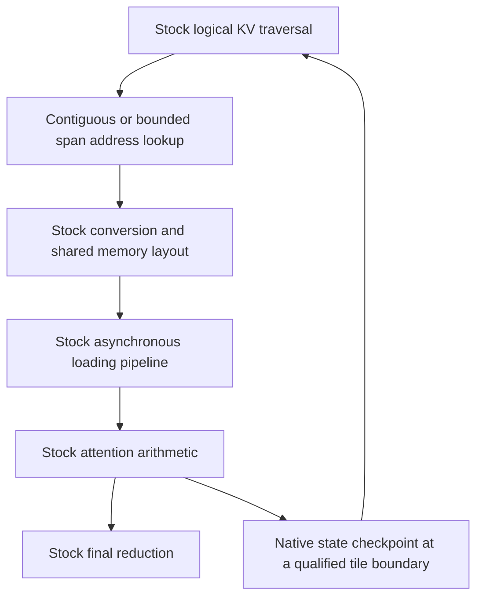

# Upstream Attention Port Roadmap

Port Adaptive KV Streaming V2 onto the updated upstream CUDA attention kernels without replacing their calculation order, tuning or synchronization fixes. Preserve bounded KV streaming, backend-neutral ownership, phase reuse, MTP and vision behavior. This is a temporary integration roadmap, separate from the Gemma and DFlash2 feature plans.

## Baselines and recovery

- V2 baseline: `05c0a5e454210ed18bf2486dfb7a6c7eba4b1cc7` on `feature/adaptive-kv-stream-v2`.
- Pinned upstream: `10a60cf303566e10d6a7a2774c17d2085503d87b`. Do not move this reference during qualification.
- Recovery branch: `backup/adaptive-kv-stream-v2-before-upstream-20261009`.
- Partially rebased history: `backup/adaptive-kv-stream-v2-upstream-partial-20261009` at `8d1914fc3`, immediately before the MMA span extension.
- Working branch: `integration/adaptive-kv-stream-v2-upstream-port`, in the original repository checkout, initially based on pinned upstream.
- Committed reference snapshot: `ac16245a776835f3656ad3fed98dba06230f89cc` on that integration branch.
- History reconstruction: `rebase/adaptive-kv-stream-v2-upstream`, also based on pinned upstream. The user authorized one-line commits for the replay on 2026-10-10; published V2 remains unchanged pending their branch replacement.
- The previously staged Gemma roadmap changes are preserved with their index in stash `a6b2d7ab3d031ccb6d92e2c12571375fc79d2c67`. Restore them with `git stash apply --index` when returning to V2; keep the stash until restoration is checked.

Stage new changes for user review outside the explicitly authorized history replay. Do not push or rewrite the published branch without a separate instruction. A partially replayed history is not a qualified build. Preserve unrelated benchmark results and scripts.

## Execution contract

Logical KV positions keep their stock order regardless of physical placement. The span adapter resolves addresses in resident storage, the first ring interval and a wrapped ring interval. It does not skip logical positions, independently normalize spans or introduce a span-based reduction.

Fragmented storage and sparse attention are independent. Existing streamed Qwen attention remains dense even when physically fragmented. Preserve upstream sparse behavior for ordinary attention; reject unimplemented sparse streaming during admission, before device execution. Do not use sparse mode as a shortcut for spans or reduce dense pipeline stages because a ring is active.

Upstream is the numerical reference with matching device, compiled architecture, KV types, tensor strides, query width, masks and selected kernel. Updated stock may differ from old stock. Preserve bit-exact requirements where already qualified and the existing approved numerical bounds on other paths; do not loosen tolerances to make this port pass.

## Changes that must survive the port

| Area | Upstream behavior to preserve | V2 extension to preserve |
| --- | --- | --- |
| Dispatch | Device and operation based vector, tile or MMA selection | Compiled and resource-valid streamed admission |
| KV loading | Shared-memory swizzling, matching matrix loads and hardware pipeline depth | Bounded span address resolution and compressed tile prefetch |
| Arithmetic | Tile order, precision, masks, scale, online softmax and final reduction | Native state preservation at qualified pause points |
| Scheduling | Current block partitioning, occupancy inputs and Stream-K fixup | Caller-owned scratch and completion-fenced ring reuse |
| Resources | Actual kernel shared memory and device limits | Exact grants, checked sizes and no hidden full-context decode allocation |
| Synchronization | Warp helpers, uniform barriers and asynchronous copy completion | Safe publication, cancellation, stale-lease rejection and retry |

The upstream whole-tile preference introduced by `d89651a7b` is conditional on DGX Spark, asynchronous KV preload and mask scanning. It is not an unconditional optimization for RTX 5070 Ti decoding.

## Stage P0 Stock control and regression fixtures

Build pinned upstream without span changes in a new build directory. Use existing backend-op tests and small fixtures to record stock TG1-TG4 attention, representative KV pairs and dispatch. Test CPU reference and CUDA execution when the GPU is available. Preserve an immutable unmodified stock binary for subsequent comparisons; do not overwrite it while building the port.

Acceptance:

- The ordinary CUDA control builds and runs representative attention cases, including Q8_0/Q4_0.
- Record compiler, architecture, flags, inputs and numerical policy.
- Build activity does not need the production GPU. Stop and restore production only around authorized GPU tests.
- Identify tests that need real older hardware; compiling an older architecture on RTX 5070 Ti is not runtime qualification.

## Stage P1 Shared launch planning

Extract the existing Stream-K block-selection arithmetic into a small private, allocation-free helper used by ordinary attention and later by span execution. Preserve force/whole-tile conditions, integer efficiency thresholds, rounding and fixup decisions. Keep architecture selection in the CUDA caller. Validate overflow and reject invalid inputs without partially changing a plan.

TDD:

- Fixed cases at the 75 percent tile-efficiency and 5 percent block-rounding boundaries.
- Whole-tile preference versus ordinary forced Stream-K behavior.
- One tile, one block, uniform versus nonuniform fixup, and total work smaller than occupancy.
- Differential tests against the pinned pre-extraction formula over a deterministic input matrix.
- Zero, negative, overflowing and otherwise unrepresentable geometry; failed planning preserves output.
- Existing stock attention checks after wiring the helper. Device/kernel occupancy queries remain in the caller.

Acceptance: the same valid launch inputs select the same blocks and reduction structure as pinned stock. Span descriptors may add resource usage, but must not silently change the numerical partition.

## Stage P2 FP16 span loading

Start from the updated upstream MMA body. Add source-address selection only at KV loading boundaries. Keep the ordinary path compile-time direct. Use stock destination swizzling and matrix readers for both ordinary and span storage. Keep a fast path when a tile fits one span and a bounded boundary-aware path when it crosses a span or ring wrap.

TDD: one, two and three spans; boundaries before, inside and after a tile; feature offsets; heads; short tails; padded and masked rows; complete-layer output versus matching stock. Guard source and destination storage. Verify asynchronous copy alignment and bounds before launch.

Acceptance: tile contents and previously exact attention cases match stock, with no full-layer gather introduced for decode. Preserve stock launch bounds and synchronization fixes.

## Stage P3 Quantized span loading

Retain compressed tile prefetch and stock-equivalent conversion. Decode into the new shared-memory KV layout. Describe when each shared region contains compressed data, FP16 KV or intermediate calculation data; preserve completion and reader barriers before reuse. Swizzling applies to decoded KV storage, not indiscriminately to every reused shared region.

TDD: Q8_0/Q4_0 first, then all previously supported selected families and pairs; conversion rounding and signed zero; contiguous versus strided source semantics; ring wrap; feature slices; final partial rows; asynchronous staging guards. Check resource queries against actual per-block usage.

Acceptance: preserve the established conversion and attention policies without disabling the dense multistage pipeline. No extra permanent VRAM staging is assumed; any required footprint increase is measured and presented before adopting it.

## Stage P4 Resume and ring lifetimes

Port vector and generic tile resume extensions onto their updated stock bodies. Recompute state layout and logical split traversal from current plans. At each qualified pause, complete kernel-local copies, preserve native maxima, sums and accumulators, and publish the logical cursor. Fence physical ring reuse after the GPU reader completes. Finalize each logical output exactly once.

TDD: single versus multiple waves; empty-work splits; small rings; delayed copies; tail publication; changed span bindings; cancellation and failed publication; generation and geometry mismatch; exact/one-byte-short scratch and byte guards. Run CUDA memory checking on focused cases.

Acceptance: preserve the existing resumable family coverage and complete-layer MMA behavior. General resumable MMA and wider verification are not silently added by this stage.

## Stage P5 Complete the V2 integration

Replay the remaining V2 changes onto the updated foundation, using the saved partial history where appropriate. Carry the shared planner into the actual span launcher and preflight. Adapt changed batch, context, graph, speculative and multimodal interfaces while retaining upstream behavior outside the opt-in feature.

TDD: allocator and buffer lifetime tests; context admission; serial publication; phase transitions; MTP catch-up and rejection; recurrent checkpoints; prompt cache; text/image execution and cancellation. Test semantic changes even when Git merges without a conflict.

Acceptance: the complete server and relevant tests build together, the existing V2 command line remains supported, and startup sizing describes actual dispatch resources. Native DFlash2 arriving through upstream does not imply streamed DFlash2 support.

## Stage P6 Numerical and performance qualification

Use IQ4_XS with Q8_0/Q4_0, one serial slot and UVM disabled for physical-budget tests. Compare matching stock execution and the previous V2 baseline. Run no-MTP and draft lengths 1-3 with real prefill and long decode. Verify accepted/rejected recurrent state, serial reuse and vision behavior before production deployment.

Measure all-resident, light-ring, moderate-ring and heavy-ring cases. Compare equal effective decode KV pool sizes first, then maximum allocatable arenas. Record prefill/decode speed, H2D bytes/calls, effective KV grant, memory minima and GPU resource limits. Investigate all-resident overhead beyond the existing 5-10 percent goal; do not increase a unit-test tolerance to mask throughput or numerical regressions.

Acceptance: no new numerical or lifecycle regression, no unaccounted device allocation, preserved bounded streaming at long context, and an explained comparison of performance and footprint. Restore production after testing. Only after qualification and user approval should the rebased result replace the V2 branch.

## Detailed numerical and boundary coverage

Use deterministic encoded inputs shared by the control and port. Stock CPU/reference comparisons establish ordinary operator correctness; exact GPU snapshot comparisons detect drift introduced by the port. CPU and CUDA are not required to produce identical bits. A passed launch-plan test is not a substitute for kernel or model qualification.

| Dimension | Required cases |
| --- | --- |
| Query width and routing | TG1-TG4 with each stock-selected family; prefill query tiles through the previously supported ubatch sizes; no forced old family to hide changed dispatch |
| KV geometry | Existing supported K/V dimensions and GQA ratios, including non-power-of-two head grouping and padded query/head lanes |
| Physical layout | One, two and three spans; resident-only, ring-only and mixed; wraparound; contiguous and strided encoded tensors; boundaries on and inside tiles |
| Tails | Around quant blocks, attention tiles, 128-token vector boundaries and 256-token pages; final partial page, exact final allocation and masked padded rows |
| Conversion | Every supported selected pair, FP16/BF16/F32 where supported, Q8/Q4 and QX_0/QX_1; extreme scales, zero/signed zero and matching stock contiguous versus strided rounding |
| Calculation state | Converted tile bytes, intermediate maxima/sums, native accumulator checkpoints, partial output/reduction metadata and final output; maxima that change between tiles |
| Launch and resources | Exact efficiency/rounding thresholds, short/long work, zero work, bounded overflow, changed occupancy, required shared memory, exact and undersized scratch |
| Resume | One wave versus several, no-work splits, repeated refills, delayed completion, tail-only mutation, finalization once, no early ring overwrite |
| Failure and lifetime | Cancellation at each boundary, copy/publication failure, stale generation, resource creation failure, retry, byte guards and focused CUDA memory checking |
| Model state | Long prefill/decode, MTP zero/partial/full acceptance, correction/replay, recurrent state restoration, context/page boundaries, serial prefix reuse and vision/text transitions |

For previously exact paths, any nonzero output or checkpoint difference is a failing regression to investigate. Report maximum absolute error, relative L2 error and mismatch counts alongside token agreement. Do not infer numerical equivalence from matching text alone. Preserve documented tolerances for older hardware, and label architecture builds separately from tests on actual devices.

## Progress

| Stage | Status | Evidence |
| --- | --- | --- |
| P0 | Completed for the initial control profile | CUDA 13.0.88, GNU 13.3, Release, architecture 120a; five explicit FA pairs. CPU and CUDA controls pass 70 deterministic cases, including six sparse-mask cases. Four existing upstream sparse operator checks also pass against CPU reference. Ordinary upstream kernel source was unchanged when built. |
| P1 | Completed for ordinary launch planning | Stub first failed; extracted Stream-K planner passes 393216 stock-formula cases, boundary/overflow tests and ASan/UBSan. Ordinary launcher uses the helper; all 70 CPU outputs and all 70 CUDA outputs match their stock snapshots bit-for-bit. Span-launcher reuse remains part of P5. |
| P2 | Completed for the qualified low-level FP16 profile | Ordered metadata admission, stock swizzled span loading and compile-time shared MMA body; 11520 tile probes and 576 attention cases are exact. Focused memory/race/synchronization checks are clean; all 70 ordinary CUDA outputs remain exact against pinned stock. Live owner integration remains P5. |
| P3 | Completed for the qualified low-level encoded profile | Independent encoded plane admission; 672 conversion, 80640 staging and 1440 mixed-pair MMA cases pass exact comparisons across seven types and 49 pairs. Existing FP16 and ordinary CUDA controls remain exact; focused memory/race/synchronization checks are clean. Live dispatch and owner admission remain P5. |
| P4 | Completed for the qualified low-level resume profile | 1568 generic-tile comparisons are bit-exact with stock; 130 vector comparisons are bit-exact between uninterrupted and multi-wave execution, with stock normalized-output max absolute error 1.49012e-8 inside the existing 1e-6 vector bound. Checked wave/scratch admission, generation/cancellation/publication and cross-stream ring fences pass; focused CUDA memory/race/synchronization checks are clean. Live owner integration remains P5. |
| P5 | Completed for the qualified V2 integration profile | CPU/CUDA server and owners build together. 50 CPU ownership tests, nine vision/CLI checks, 14 ASan/UBSan checks, 12 CUDA API checks, 17 integrated span tests, 11 resume tests and 29 model-owner/MTP tests pass. Real IQ4_XS MTP=3 serial text, cache reuse, one/two images and text after vision pass. A full-context native parent probe passes. Four allocation/view/Meta tests pass separately on OpenCL, SYCL and Vulkan. Long-context real-model comparisons remain P6. |
| P6 | Completed for the recorded reference profile | Matching-stock outputs, forced-streaming TG1-TG4 replay, corrected Release controls, 8/96/128/192-Ki measurements, equal effective grants, maximum-arena endpoints and profile-guided vector correction are collected. Final 192-Ki MTP=3 reaches 28.51 tokens/s with unchanged token IDs and grant. The reconstructed history receives a separate final build/test check below; this is not an all-context or older-hardware qualification. |

### P0 and P1 artifacts

The unmodified CUDA control is in `build-upstream-attention-stock`; do not rebuild this directory against later modified kernel sources. Its `libggml-cuda.so.0.26.0` SHA256 is `774f936d06214f72b427859cc3209040f90f5f752058c5016f3a7db7276091a5`. The extracted-planner build is `build-upstream-attention-port`. Explicit compiled FA pairs are `f16-f16;q8_0-q4_0;q8_0-q8_0;q4_0-q4_0;bf16-bf16`; this is not an all-quant qualification.

- Stock build log: `/tmp/upstream-attention-stock-build-20261009.log`.
- Final stock fixture executable: `/tmp/test-cuda-fattn-native-stock-20261009`, linked against the untouched stock libraries. It extends the initial 64-case fixture with sparse masks without rebuilding the stock CUDA library.
- CPU reference snapshot: `/tmp/upstream-attention-stock-cpu-70-20261009.bin`; port comparison: `/tmp/upstream-attention-port-cpu-70-20261009.log`.
- CUDA reference snapshot: `/tmp/upstream-attention-stock-cuda-70-20261009.bin`; port comparison: `/tmp/upstream-attention-port-cuda-70-20261009.log`.
- CTest: `/tmp/upstream-attention-port-ctest-70-20261009.log`, three tests passing, CPU and actual CUDA execution with no skips.
- Ordinary sparse operator control: `/tmp/upstream-attention-stock-sparse-20261009.log`, four cases passing. This is CPU-reference correctness evidence, not bitwise CPU/CUDA equivalence.
- The launch-plan tests also pass when compiled with `-DNDEBUG`, because test assertions remain active.
- Empty snapshot rejection was exercised and returns exit 1 rather than silently accepting missing data.
- Production was stopped briefly for GPU checks, then restarted; its existing health endpoint returned `{"status":"ok"}`.

The initial checkpoint adds no device allocation and changes no device-side attention arithmetic. Exact GPU snapshot comparison found zero bit mismatches; the deterministic input matrix is still limited to the recorded fixture geometries. It does not qualify span, resume, real-model or other-GPU paths before their later stages.

### P2 FP16 span checkpoint

The updated upstream MMA body is shared by ordinary and span entry points through a compile-time KV address adapter. Ordinary loads delegate directly to the original dense/sparse loader. Span loads use the original swizzle for both synchronous stores and `cp.async`, preserving dense multistage loading and stock matrix readers. A complete tile inside one interval uses the stock loader; a boundary-crossing or partial tile resolves its physical rows without changing logical traversal. The original V2 span descriptor layout is retained.

The host metadata check validates one to three ordered intervals, exact logical coverage, FP16 row alignment, stride minima and address arithmetic overflow. It does not replace the owner's physical allocation and lease validation. Span metadata is cached after the existing per-block shared workspace: three 56-byte descriptors consume 168 bytes plus at most 15 bytes of offset alignment. This is shared SRAM, not a permanent VRAM pool or full-layer gather. The CUDA owner must account for it and query actual launch resources during P5 integration.

TDD evidence:

- An empty host-admission implementation fails its first valid-span assertion, then passes valid head-major/interleaved layouts and rejects gaps, empty intervals, null/misaligned pointers, bad strides and overflow.
- An empty GPU loader fails the stock tile comparison. The implemented loader passes 11520 probes over one/two/three intervals, physically wrapped ring placement, separate K/V contents, both heads, signed zeros, swizzled/padded tile layouts, feature slices, empty/partial/final rows and synchronous/asynchronous copies. Complete tile bytes, unused padding and source/output guards match.
- Full attention uses zero-filled prototype K/V buffers for the span entry; the real KV exists only behind span descriptors. Deliberately replacing the span adapter with ordinary contiguous access fails on TG1 at 257 active tokens. Restoring the span adapter passes 576 cases.
- The attention matrix covers TG1-TG4, 31/257/1023/8192 active tokens, padded masked tails, one/two/three spans, head-major/interleaved storage, non-power-of-two GQA six, ordinary and 16x query magnitudes, stock-selected splits, whole-tile execution and general fractional-tile fixup. Intermediate split accumulators and softmax metadata, final output bits, source guards and output/fixup guards are checked.
- All 70 ordinary attention fixtures still match the untouched stock CUDA snapshot bit-for-bit, including the sparse-mask controls. No numerical tolerance was widened.
- CUDA memcheck, racecheck and synccheck each pass a focused 48-loader/12-attention matrix with zero errors; racecheck also reports zero warnings. CTest passes all four attention tests without skips. Host launch/span tests also pass ASan/UBSan.

Artifacts: `/tmp/upstream-attention-p2-loader-red.log`, `/tmp/upstream-attention-p2-routing-red.log`, `/tmp/upstream-attention-p2-final-spans.log`, `/tmp/upstream-attention-p2-native-exact.log`, `/tmp/upstream-attention-p2-final-memcheck.log`, `/tmp/upstream-attention-p2-racecheck.log`, `/tmp/upstream-attention-p2-synccheck.log` and `/tmp/upstream-attention-p2-ctest.log`.

Runtime evidence is RTX 5070 Ti, CUDA 13.0.88, architecture 120a. The probe/attention translation unit also compiles for SM75 and SM86; these are compile-only checks, not execution on Turing or Ampere hardware. No Windows, HIP or older-GPU runtime claim is made. Production was restored and its health endpoint returned `{"status":"ok"}`. The published V2 branch remains unchanged; quantized loading, resume and full server integration remain later stages.

### P3 Quantized span checkpoint

The encoded decoder uses stock device dequantizers and preserves the distinct contiguous Q4_0 expression and contiguous Q8_0 half multiplication. Per-plane conversion-mode flags survive physical ring placement. Encoded row sizes come from actual block structures; K and V strides are validated independently. Raw staging is not swizzled. Once its copies complete, decoded FP16 values are written into the stock swizzle.

For a two-stage converted path, the existing K region holds raw encoded bytes and the existing V region holds decoded values. Expand K into V before KQ reads, then prefetch raw V into K. After KQ readers retire, expand V into V and prefetch the next raw K into K while VKQ consumes decoded V. No third tile region or permanent device staging allocation is added. Single-stage hardware/configurations decode synchronously while preserving completion of asynchronous mask loading. The two-stage path checks encoded capacity and equal decoded tile strides at compile time.

TDD starts with an empty decoder failing against actual stock FA conversion bytes and empty compressed staging failing its tile comparison. Final qualification covers F16, BF16, Q8_0, Q4_0, Q4_1, Q5_0 and Q5_1:

- 672 conversion cases pass byte-exact comparisons against actual stock GPU conversion, including independent contiguous/strided semantics, signed zero, subnormal and extreme finite scales, both heads, physical wrap and one/two/three intervals.
- 80640 staging cases pass byte-exact comparisons with guards on raw and decoded storage. These cover synchronous and asynchronous staging, swizzled/padded destinations, feature slices, empty/partial/final rows and physical layouts.
- 1440 complete MMA cases pass exact final-output and intermediate reduction-metadata comparisons. All 49 K/V pairs cover TG2-TG4 and four independent per-plane conversion flags; Q8/Q4 additionally covers 31/257/1023/8192 active tokens, one/two/three spans, head-major/interleaved layouts and stock/whole-tile/general-fixup partitions. Matching stock MMA execution is the reference, not a different stock-selected vector family.
- All 11520 existing FP16 tile probes, 576 FP16 attention cases and 70 ordinary CUDA snapshot cases still pass without bit mismatches. No numerical tolerance was widened.
- CUDA memcheck, racecheck and synccheck pass the focused matrix with zero errors or hazards; racecheck also reports zero warnings. That matrix includes 588 encoded attention cases plus conversion/staging and FP16 controls. Host launch/span validation passes ASan/UBSan.

Artifacts: `/tmp/upstream-attention-p3-decoder-red.log`, `/tmp/upstream-attention-p3-staging-red.log`, `/tmp/upstream-attention-p3-current-build.log`, `/tmp/upstream-attention-p3-full.log`, `/tmp/upstream-attention-p3-native-exact.log`, `/tmp/upstream-attention-p3-memcheck.log`, `/tmp/upstream-attention-p3-racecheck.log` and `/tmp/upstream-attention-p3-synccheck.log`. All four registered attention tests pass without skips in `/tmp/upstream-attention-p3-ctest.log`. Runtime qualification uses RTX 5070 Ti, CUDA 13.0.88 and architecture 120a. P2's SM75/SM86 compile checks do not qualify these new P3 templates or their runtime behavior on older hardware. Production was restored with its existing configuration after the checks.

One reference-fixture issue is kept separate from the port: reusing a backend across independently freed F16/BF16 graphs produced a zero BF16 conversion buffer instead of the expected nonzero reference. The upstream graph property cache records source pointers, dimensions and strides but omits source types. Using a fresh backend lifetime for each reference graph eliminates the mismatch without changing the decoder or relaxing comparisons. P5 must review type-changing capture reuse; no unrelated production graph-cache fix is included here.

F32 scalar conversion is implemented as a building block, but F32 compressed staging exceeds one FP16 tile region and is not added to this MMA matrix. Preserve existing generic tile/vector F32 support in P4. Likewise, synthetic qualification of additional mixed pairs does not automatically enable them in the live owner; dispatch and preflight admission remain P5.

### P4 Resume and ring-lifetime checkpoint

Vector resume shares the updated stock body and launch ABI. It retains global causal-mask coordinates and the original logical split ownership across physically reused windows. Maxima, sums and per-thread value accumulators are restored after the producer dependency wait, and saved before stock lane reductions. Resumed launches do not signal early programmatic completion: the ring's read fence must cover the final source read. TG1/TG2 vector resume remains the existing supported profile; the old span-per-partial vector shortcut is not imported or qualified here.

Generic tile resume retains upstream's current tuning tables and native reductions. Its checked layout accounts for actual thread counts, query/head grouping, tile width, split count and accumulator representation. Half2 accumulators remain half2 bytes across checkpoints, without converting each wave into an independently normalized attention result. The adapter resolves up to three encoded intervals into stock tile storage, reusing P3's decoder and independent source-conversion flags, including F32 on the generic tile path. Padded logical positions never extend physical source intervals. The global tail, not the transfer-wave boundary, selects stock's out-of-bounds arithmetic.

Admission recomputes the supplied layout before checking the exact scratch capacity, pointer/stride arithmetic, wave alignment, logical coverage, scratch/source overlap and masked padding. Failed admission preserves the descriptor. The serial cursor separately tracks submission, actual read completion and final publication; stale generations, cancellation, failed completion and failed publication cannot advance or republish an operation. Raw-pointer admission still requires P5's owner to validate real allocation extents and retained grants; it is not a replacement for lease validation.

TDD and qualification:

- A stub layout planner fails its first valid case, and a stub wave-admission helper fails a valid two-span window. Tests cover native accumulator sizes, invalid geometry, forged layouts, one-byte-short scratch, overlap, overflow, non-tile boundaries, early and final padded waves, stale generations, cancellation with an outstanding reader, failed completion and publication exactly once. Host tests pass ASan/UBSan.
- A no-op vector resume kernel fails the stock comparison; a no-op tile resume kernel likewise fails its output check. Completed tile tests pass 1568 bit-exact stock comparisons over TG1-TG4, 40/64/72/256-dimensional heads, non-power-of-two GQA six, 257/1025/8193 active tokens, one/multiple waves, one/two/three intervals, head-major/interleaved placement, masked tails and split counts 1/3/17. The selected pairs exercise F16, BF16, F32, Q8_0, Q4_0, Q4_1, Q5_0 and Q5_1. Split outputs, softmax metadata, final stock reduction, guards and source integrity are checked.
- Vector tests pass 130 cases over TG1/TG2, 64/128/256-dimensional heads, selected scalar/quantized pairs, one/multiple waves, sinks and empty-work splits. Multi-wave outputs and reduction metadata match uninterrupted execution bit-for-bit. Normalized stock comparisons retain the original V2 vector bound of 1e-6; the measured maximum absolute error is 1.49012e-8. This is not a claim of bitwise stock equivalence for the vector family. No previously exact MMA or generic-tile tolerance is widened.
- Uploads and attention run on separate non-blocking CUDA streams. A ready event orders attention after the copy, and a read-completion event gates ring refill and descriptor reuse. Nonfinal waves cannot publish output. Full numerical tests pass twice in separate processes.
- The CUDA quick matrix contains 96 tile and 18 vector cases. Memcheck, racecheck and synccheck pass with zero errors, hazards or warnings. All 70 ordinary CUDA outputs still match the immutable stock snapshot bit-for-bit.

Two issues were resolved during qualification. First, newer padded-head tuning changes the compiler's FP16 rescale/first-update fusion: the span path now preserves the observed stock rounding for those configurations instead of relaxing comparisons. Second, racecheck found a warp-local shared-weight read/overwrite hazard in both the port and the untouched stock binary. A warp fence before tile reuse removes the warnings without changing ordinary stock snapshot results. Its throughput cost remains part of P6 qualification.

An intermittent empty-split mismatch was a test-fixture ordering error, not lost kernel state: default-stream cudaMemset could race with a non-blocking attention stream and overwrite early results. Initialization now runs on the compute stream. The provisional empty-split shortcut was removed; the tests exercise the actual stock reduction path.

Artifacts: `/tmp/upstream-attention-p4-plan-red.log`, `/tmp/upstream-attention-p4-wave-red.log`, `/tmp/upstream-attention-p4-padding-red.log`, `/tmp/upstream-attention-p4-vector-red.log`, `/tmp/upstream-attention-p4-tile-red.log`, `/tmp/upstream-attention-p4-full.log`, `/tmp/upstream-attention-p4-repeat.log`, `/tmp/upstream-attention-p4-host-sanitize.log`, `/tmp/upstream-attention-p4-memcheck.log`, `/tmp/upstream-attention-p4-racecheck.log`, `/tmp/upstream-attention-p4-synccheck.log`, `/tmp/upstream-attention-p4-stock-racecheck.log` and `/tmp/upstream-attention-p4-native-exact.log`. All six registered attention tests pass without skips in `/tmp/upstream-attention-p4-ctest.log`, including the existing full P3 matrix. Production was restored with its existing configuration, and its health endpoint returned `{"status":"ok"}`.

Runtime qualification remains RTX 5070 Ti, CUDA 13.0.88, architecture 120a. Focused resume probes also compile for SM75 and SM86, including quantized vector, mixed quantized tile and F32/BF16 padded-head paths; these are compile-only checks, not older-GPU runtime or numerical qualification. This stage does not add general resumable MMA, streamed sparse attention, wider verification, new public APIs or full server wiring. Existing complete-layer MMA behavior remains covered by P2/P3 tests; model/owner integration and real-model throughput remain P5/P6.

### P5 integration checkpoint

The integration keeps upstream's native `llama_batch_ext` transport. A private, separately owned hidden-state input carries visual MTP state through microbatch splitting without confusing image embeddings with target hidden states. Position admission validates the native token/embedding payload and four-coordinate image positions. Context graph retirement clears both upstream graph-cache slots. New upstream PLE history is retained for ordinary contexts; the existing R/S-only host spill rejects that unsupported history before allocation.

The previous private execution hint used attention op-parameter word 4, which upstream now uses for sparse `n_kv_max`. The hint moved to the last reserved parameter word. A red test reproduced the collision; the green test preserves all five upstream parameter words and does not mistake sparse metadata for borrowed scratch. Streamed sparse attention remains rejected during admission.

The backend factory uses upstream's `GGML_CUDA_FA_<K>_<V>` flags rather than treating an explicit mixed-pair build as a default same-type build. Span launch sizing accounts for upstream's swizzled shared tiles and uses P1's stock logical block planner. The old span-per-partial vector shortcut is not restored: it changes logical split ownership. The qualified resumable vector body remains the integration path until matching-stock performance is measured.

The P3 source-type graph-cache concern is now reproduced by a small real CUDA regression: identical addresses, dimensions and strides with F16 changed to BF16 execute the stale F16 conversion. Recording source types in CUDA graph properties fixes the regression, including repeated capture reuse in both directions. This is a host cache-key correction, not altered attention arithmetic or an additional VRAM allocation.

Explicit mixed-pair qualification exposed a second capability bug: Q5_1/Q4_1 was compiled but rejected because side-level checks assumed that a same-type or F16 companion was also compiled. A compiled direct pair now supplies both side-level native capabilities. Selected-pair tests reject uncompiled combinations without changing an output descriptor. The packed row-conversion probe also reproduced 35 Q4_0 half-bit mismatches from using strided rounding on packed rows; conversion now retains the matching stock mode. Numerical bounds were not widened. More-than-three-span MMA fixtures became negative admission tests, matching the resident/ring/wrap contract rather than extending it to arbitrary fragmentation.

The real-server test found a graph-shape ordering issue that proxy tests could not expose. Upstream's hidden-state setter invalidates reservations. Enabling it after the attached draft borrowed the arena caused target re-reservation while the draft still retained the old allocation, producing an additional 2240 MiB allocation attempt. Streaming target/draft construction now establishes the known MTP extraction intent before reservation and borrowing. Upstream invalidation remains intact for ordinary contexts and actual later shape changes. The failing real request became green without reducing the arena.

Qualification artifacts:

- `/tmp/upstream-attention-p5-owner-ctest.log`: 50 CPU tests passed; two GPU-only entries skipped.
- `/tmp/upstream-attention-p5-owner-wave-{red,green}.log`: retained allocation bounds and wave admission, 88 assertions.
- `/tmp/upstream-attention-p5-graph-types-{red,green}.log`: actual F16/BF16 capture reuse.
- `/tmp/upstream-attention-p5-vision-host-ctest.log`: nine vision, chat, CLI and architecture checks passed.
- `/tmp/upstream-attention-p5-sanitize-ctest.log`: 14 tests passed with GGML and llama ASan/UBSan, leak checking enabled.
- `/tmp/upstream-attention-p5-cuda-api-ctest.log`: 12 CUDA lifetime, prepared-copy, buffer, UVM/device-local and CLI checks passed.
- `/tmp/upstream-attention-p5-owner-spans.log`: 17 tests, 1351 assertions passed; selected Q8_0/Q4_0, Q5_1/Q4_1 and Q4_0/F16 vector cases, complete-layer MMA and bounded failure paths. Q4_0/BF16 is explicitly uncompiled in this build and rejected. Stock-matching TG3/TG4 output error remains zero.
- `/tmp/upstream-attention-p5-owner-resume.log`: 11 tests, 328 assertions passed; resident/ring waves and 32-page copy batches. `/tmp/upstream-attention-p5-owner-model.log`: 29 tests, 3152 assertions passed, including MTP admission, retained leases, publication, cancellation, serial growth and phase suspension.
- `/tmp/upstream-attention-p5-native-exact.log`: all 70 ordinary attention outputs match pinned stock bit-for-bit. `/tmp/upstream-attention-p5-low-spans.log` and `/tmp/upstream-attention-p5-low-resume.log`: full P3/P4 fixtures still pass.
- `/tmp/upstream-attention-p5-models-cpu.log`: llama dense/MoE and Qwen35 graph/arena checks pass. `/tmp/upstream-attention-p5-recurrent-stock-cpu.log` and `/tmp/upstream-attention-p5-recurrent-spill-cpu.log`: upstream multi-sequence checks and serial host-spilled checkpoint/replay pass separately, including both cache fills.
- `/tmp/upstream-attention-p5-context-probe.log`: 30 assertions passed for native target/draft construction at 262144 context with an 1800 MiB parent; MTP workspace borrows that same physical parent.
- `/tmp/upstream-attention-p5-server-smoke-results.log` and `/tmp/upstream-attention-p5-server-vision-smoke-results.log`: actual IQ4_XS, Q8_0/Q4_0, MTP=3, UVM off, 4096 context, 2240 MiB arena. Serial cached text requests return consistent continuations; one and two solid-red images each return `Red`, followed by successful text requests. These short 16/32-token checks are functional tests, not P6 throughput measurements.
- `/tmp/upstream-attention-p5-{opencl,sycl,vulkan}-ctest.log`: four allocation/view/Meta tests passed on each build. No non-CUDA streaming-kernel claim is made.
- `/tmp/upstream-attention-p5-final-host-ctest.log`: final combined host run, 59 tests passed and two GPU-only entries skipped. `/tmp/upstream-attention-p5-live-{memcheck,racecheck,synccheck}.log`: focused retained-owner GQA-six and ring-resume execution, zero CUDA memory/synchronization errors and zero race hazards or warnings.

The expanded CUDA integration build selects `f16-f16;q8_0-q4_0;q8_0-q8_0;q4_0-q4_0;bf16-bf16;q5_1-q4_1;q4_0-f16`; the immutable P0 stock build retains its original five pairs. Runtime evidence remains RTX 5070 Ti, CUDA 13.0.88, architecture 120a. No older-card or Windows execution claim is added. Recurrent streaming remains R/S-only, and native upstream DFlash2 is not streamed DFlash2 support.

Shared-phase teardown still prints peak-versus-current buffer-size diagnostics for borrowed/host groups; these do not indicate a failed request or an extra live allocation. Long-context numerical, memory and throughput comparisons, including the performance cost of the qualified vector resume path, remain P6. Production is restored with its existing configuration and healthy endpoint; the published V2 branch and saved future-model documentation stash remain unchanged.

### P6 qualification in progress

Reference sources are read-only archives of pinned upstream `10a60cf303566e10d6a7a2774c17d2085503d87b` and published V2 `05c0a5e454210ed18bf2486dfb7a6c7eba4b1cc7`. The active source branch is not switched. The P0 immutable libraries remain untouched. New reference server builds are `build-upstream-attention-reference-stock` and `build-upstream-attention-reference-v2`; archive builds report an unknown Git banner, so source IDs and library hashes, not that banner, identify them. Both use CUDA 13.0.88, GNU 13.3, Release and 120a. Stock uses the original five explicit FA pairs; V2 uses its original all-quants option so its older factory contains Q8_0/Q4_0.

The corpus SHA256 is `ca19e089c46f80c2f661d31a1312aeda21fbc73bd17ddf371e5f3a0befa9102e`. The restored sweep and SSE collector come directly from V2. The small qualification wrapper adds a stock command without streaming flags, explicit matching draft Q8_0/Q4_0, complete token-ID retention, capacity-versus-execution failure reporting and exclusive result-directory creation. Finished responses survive telemetry errors; partial runs are not silently retried.

Same-build native-versus-streamed teacher-forced tests use separate contexts with matching query width, a shared model, UVM off and a deliberately small arena. Eight-Ki tests use a 160 MiB arena; 32-Ki tests use 320 MiB, 32512 prefill tokens and 256 forced tokens. TG1-TG4 all pass with zero final-logit and recurrent-state differences, including periodic full checkpoint restoration and replay. The tests retain their strict zero-error assertions. Per-operator low-level approved vector bounds remain separately documented in P4; matching text alone is not treated as numerical qualification.

Artifacts: `/tmp/upstream-attention-p6-numeric-tg{1,2,3,4}-ring.log`, `/tmp/upstream-attention-p6-numeric-32k-tg{1,2,3,4}-ring.log` and `/tmp/upstream-attention-p6-harness-tests.log`. Performance results go into `benchmarks/results/upstream-attention-p6-20261010`, separate from historical results. The first pilot uses identical 7932-token prefill and 256-token greedy decode for no MTP and lengths 1-3; stock capacity failures remain visible rather than enabling UVM or lowering GPU offload.

The initial 8-Ki pilot is complete. Every port mode produces all 256 token IDs identical to matching pinned upstream, with identical draft acceptance counts. Port decode rates are 46.47/65.08/78.10/88.60 tokens/s for MTP lengths 0/1/2/3; published V2 rates are 46.61/68.21/82.50/94.33. The corresponding decode KV grants differ by less than 0.2 MiB. These timing comparisons are provisional: the build-parity audit found empty CUDA Release flags in both new reference caches after their initially failed compiler identification. Their C++ flags were Release, and nvcc still optimized device code, but CUDA-host optimization and `NDEBUG` did not match the port. The original binaries are preserved in `/tmp/llama-p6-controls-before-release.wgQkke`; both references are rebuilt with explicit `CMAKE_CUDA_FLAGS_RELEASE=-O3 -DNDEBUG` before final qualification. The P0 immutable control already has those flags and remains untouched.

Updated upstream generates a different continuation from old V2, so MTP timing against V2 is not identical-work timing. Estimated verification rounds (`predicted_n - draft_n_accepted`) must be reported alongside throughput, without treating that estimate as a substitute for measured per-phase timings. The clean 96-Ki port runs completed before the reference rebuild. The 128-Ki no-MTP run overlapped compilation by about two seconds, and the following unfinished run was interrupted. Keep their logs and accepted results, but recollect the affected timing in a separate directory; do not benchmark while compiling. Production was restored and healthy during the reference rebuild.

The equal-arena long-context matrix uses 96/128/192 Ki context, 256 decoded tokens and all four MTP modes, with both servers at 2240 MiB. Check actual decode grants against a 1 MiB matching allowance; equal command-line arenas alone are not proof of equal grants. A separate 500 ms NVML-backed `nvidia-smi` log samples GPU free/used memory, power and utilization. Collector rows record wall timestamps so memory minima can be associated with each completed run. Sampled minima do not prove instantaneous allocation peaks.

Collector tests additionally cover serial cached-prefix versus fresh replay, retaining measured acceptance rather than overwriting it with later requests, and optional per-mode maximum-arena search. Maximum search reuses the existing fast prefix probe, validates the full workload, retains accepted probe results and refuses to treat execution failures as OOM. No reserve or silent retry is added. The published V2 branch and production configuration remain unchanged; the long-context test shell restores the existing production container on exit.

The corrected Release pilots are `release-pilot-{stock,v2,port}`. All four port modes retain identical 256 token IDs and acceptance counts to matching upstream. New CUDA library hashes are stock `0592722b39199b665ffd991b2c092d7814d7cc5c3d3ac063275b50c736419fc7`, V2 `e229313a1cda7d487f64c5111e7b416157d6944618e326a62b6cfb2963107a81` and port `6355a1648d6a43b54bcd82afdea16c9afdb144de8cb5e47a6a50bfe030f3ecb2`.

Independent-stock 32-Ki checks use 32508 prefill and 256 decoded tokens, followed by a cached 32-token continuation and a fresh replay of the same extended prefix. Port uses 512 MiB to force streaming; stock is contiguous. All four MTP modes match their stock counterpart for each of these three outputs, including the exact 32504-token cache boundary. The helper rejects different context/query profiles, cache boundaries and incomplete outputs; an injected token difference fails its matching-control comparison.

Cached and fresh outputs are not themselves a zero-error oracle. Stock processes a 12-token tail on cache reuse and the whole 32516-token extended prefix on fresh replay. Its no-MTP and MTP=1 continuations differ at token 30; port reproduces both stock outputs exactly. MTP=2/3 cached and fresh outputs happen to agree for this prompt. The initial stock no-MTP row remains preserved with its original false-oracle failure label in `release-reuse-stock`; subsequent modes are in `release-reuse-stock-remaining`. No kernel/state tolerance is changed. The corrected collector records both modes for matching-stock comparison rather than requiring different execution histories to agree. The complete Python harness suite passes 69 tests, including rejecting missing control-profile fields instead of assuming they match.

The clean 128-Ki port measurements are 25.93/30.79/42.02/47.23 tokens/s for MTP lengths 0/1/2/3, at 2240 MiB arena. Heavy-ring 192-Ki measurements and the matching V2 matrix continue in the guarded test job. A subsequent job checks independently maximized all-resident/heavy-ring endpoints (8/192 Ki, MTP 0/3) and profiles the all-resident MTP=3 path to explain its overhead versus stock. Intermediate maximum-arena points and older-GPU runtime behavior are not part of this representative endpoint qualification. P6 remains in progress until these jobs are collected, budget differences and overhead are explained, and production health is confirmed.

### P6 profile-guided vector correction

The first matrix and maximum endpoint jobs completed successfully, and production was restored healthy. At 192 Ki the unoptimized port measures 13.35/18.22/24.73/25.51 tokens/s for MTP 0/1/2/3; V2 measures 13.37/17.84/23.73/23.79. Higher MTP=3 acceptance hides a per-round slowdown, so headline throughput is not a sufficient optimization comparison. Both builds find the same endpoint maxima: 2720/2318 MiB at 8 Ki and 2710/2306 MiB at 192 Ki, for no MTP/MTP=3 respectively.

Separate 8/128-Ki CUDA node traces use temporary external NVTX interposition, compiled against each build's own batch ABI. The reference binaries are not changed. Profiled outputs match their unprofiled counterparts. At 128 Ki both traces retain 307 resident pages/layer, 240 ring slots and equal KV traffic per target evaluation, within 0.2 MiB of effective grant. Prediction vector kernels consume about 896 ms in the port versus 230 ms in V2 across the measured decode window. Target MMA and catch-up do not account for that gap. These are traced aggregate kernel times, not standalone unprofiled throughput measurements.

An unaligned context selected the guarded resume kernel for every KV block, even complete blocks. The correction retains the same logical splits and existing state workspace: full 128-token blocks use the aligned kernel; only the final short block uses guarded loads. Both complete spans and ring waves use this dispatch. Physical source ranges are validated before cropping, head strides remain unchanged, no padded rows are read and final reduction/publication still occurs only once. No additional device buffer is allocated.

TDD exposed a rounding issue before this dispatch was accepted. Mixing aligned and guarded variants initially differed by 1.11759e-8. Forcing separate rescale multiplication made the mix exact but broke previously bit-exact native aligned cases, so that candidate was rejected. PTX inspection shows stock fuses accumulator rescaling with the first value contribution. Resumed float accumulation now explicitly preserves that fused ordering in both tail modes; ordinary kernels and non-CUDA paths remain unchanged. No numerical threshold is widened.

The full low-level matrix passes 1568 exact tile cases and 130 exact vector wave cases; vector stock maximum output error is now zero in this matrix. All 70 immutable ordinary CUDA snapshots remain exact. All 17 integrated span tests pass 1351 assertions, including exact aligned TG2 and wrapped placements. CUDA memcheck/synccheck report zero errors; racecheck reports zero hazards, errors or warnings. Long real-model TG1-TG4 replay tests and the 8/96/128/192-Ki follow-up timings are in progress. The pre-correction port binaries are preserved in `/tmp/llama-p6-before-bulk-tail.jH5KbH/bin`.

All four corrected real-model checks now pass 32512 prefill tokens and 256 forced tokens with periodic replay, with zero final-logit and recurrent-state differences. The ordinary 70-case snapshot is unchanged. At 8 Ki, corrected MTP 0/1/2/3 rates are 46.48/65.75/78.78/89.71 tokens/s, with identical tokens and grants to the pre-correction port. At 96 Ki, MTP=3 improves from 61.28 to 69.96 tokens/s (V2: 69.82), again with identical token IDs and effective grant. No-MTP remains 30.28 versus 30.26 before the change. The 128/192-Ki follow-up jobs remain in progress and restore production on exit; P6 is not yet marked complete.

Artifacts: `node-{port,v2}-{8k,128k}.{nsys-rep,sqlite}` and `bulk-tail-fused-{8k,long}/results.jsonl` under the P6 result root. Detailed CPU/GPU phase attribution is in `/tmp/upstream-attention-p6-node-{port,v2}-{8k,128k}-analysis.json`. CPU range times are disjoint; GPU kernel sums can overlap transfers and are not added to transfer times as wall time. Numerical, snapshot, owner and sanitizer logs are `/tmp/upstream-attention-p6-bulk-fused-{numeric,native,owner,memcheck,racecheck,synccheck}.log`; model logs use the `model-tg1` through `model-tg4` suffixes. No reference binary, production image or published branch was replaced.

### P6 final reference results

The corrected follow-up completed at 128 and 192 Ki. Each completed row preserves all 256 token IDs and the effective KV grant from its pre-correction counterpart. The corrected TG1-TG4 real-model replay checks retain zero final-logit and recurrent-state error. Production was restored healthy after that job. The earlier in-progress notes above describe intermediate runs, not unfinished P6 work.

All following rates use IQ4_XS, Q8_0/Q4_0, 256 decoded tokens, a 2240 MiB arena, matching context capacity and UVM off. Effective port/V2 grants differ by less than 0.2 MiB. V2 can generate a different continuation because it uses older upstream arithmetic, so this is a workload-profile comparison, not identical-work timing between versions.

| Context | Port, no MTP | V2, no MTP | Port, MTP=3 | V2, MTP=3 |
| --- | ---: | ---: | ---: | ---: |
| 8 Ki | 46.48 | 46.83 | 89.71 | 94.70 |
| 96 Ki | 30.28 | 30.01 | 69.96 | 69.82 |
| 128 Ki | 25.92 | 25.51 | 54.06 | 51.48 |
| 192 Ki | 13.33 | 13.37 | 28.51 | 23.79 |

The 128-Ki MTP=3 correction improves 47.23 to 54.06 tokens/s; at 192 Ki it improves 25.51 to 28.51. The 8-Ki corrected port still has about 5.3 percent overhead against old V2 MTP=3 and about 10.4 percent against matching new stock. Profiling attributes the large long-context regression to guarded vector execution; correcting that does not remove all ownership/scheduling overhead. This result is not a claim that the port outperforms stock at every context or MTP length.

Independent maximum search remains the measured 8/192-Ki endpoints, MTP 0/3: both variants find 2720/2318 MiB at 8 Ki and 2710/2306 MiB at 192 Ki. Intermediate maximum points, a complete 8-to-256-Ki sweep, Windows, actual older CUDA hardware and non-CUDA streaming execution are outside this acceptance profile. No numerical tolerance or device budget was increased to make the correction pass.

### History reconstruction audit

The user authorized committing the reference and rebuilding the history on 2026-10-10. The original 134 non-merge commits are replayed in dependency order with the same authors, author dates and titles, followed by focused upstream integration/port commits. Merge wrappers are flattened. The [replay record](UPSTREAM_HISTORY_REPLAY.md) and its commit map identify the retained history; the published V2 branch and future-model stash are unchanged.

All runtime source under `common`, `ggml`, `include`, `src`, `tools/mtmd` and `tools/server` (excluding its test documentation/scripts) matches reference `ac16245a7` byte-for-byte. Intentional retained material includes the historical plots, HTTP vision harnesses, compatibility build guide and GPU-independent compiled-feature test. Old tile-only device fixtures are consolidated into the unified native/span/resume matrix. The retained architecture test initially fails against the changed upstream head-256 thread counts; its assertions are updated to the pinned table, not by changing runtime kernels or relaxing numerical checks.

The complete reconstructed host build passes. The focused host matrix has 63 passing tests and two GPU-only skips; 32 sweep tests, 18 qualification tests and 11 retained vision-harness tests also pass. CUDA compilation and final owner/real-model qualification are recorded separately before this reconstructed branch is handed off for replacement.

The reconstructed CUDA server and selected test targets now build together. The retained compiled-feature check passes without a GPU. All 70 ordinary CUDA outputs remain exact against the immutable stock snapshot. The full span matrix passes 11520 FP16 tile probes, 576 FP16 attention cases and 1440 encoded attention cases. Resume checks pass 1568 exact tile and 130 exact vector cases, with vector stock maximum error zero. Integrated owner span/resume/model suites pass 1351/328/3152 assertions respectively; six focused CUDA CTests pass without skips.

Real IQ4_XS TG1-TG4 checks each complete 32512 prefill tokens and 256 forced tokens with periodic checkpoint replay, zero final-logit/recurrent-state error and no skips. The freshly rebuilt server then completes all four 8-Ki MTP modes with all 256 token IDs, effective KV grants and draft accepted/generated counts identical to the qualified reference. Decode rates are 46.87/65.88/79.10/89.90 tokens/s; these small timing differences are not new optimization claims. Results are in `benchmarks/results/upstream-history-replay-20261010/server-8k/results.jsonl`; model logs are `/tmp/upstream-history-model-tg{1,2,3,4}.log`, and other qualification logs use `/tmp/upstream-history-cuda-*.log`.

The original failed metadata build is retained at `/tmp/upstream-history-cuda-build.log`; the corrected complete build is `/tmp/upstream-history-cuda-build-corrected.log`. No runtime kernel changes were needed for that test correction. Production is restored with its existing container configuration, and `/health` returns `{"status":"ok"}`. Runtime tree equality, the original commit map and title-only commit messages are checked before handoff; no published branch or remote ref is moved.
