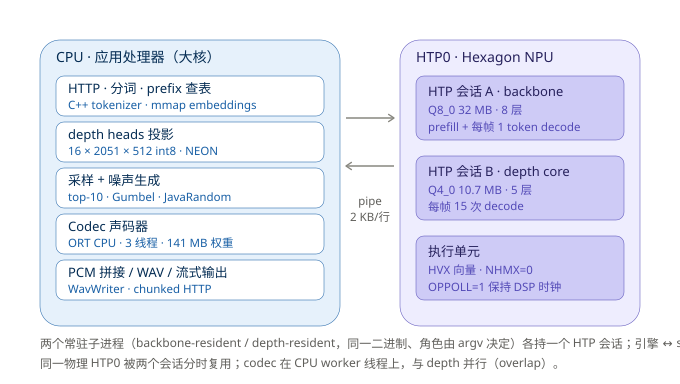
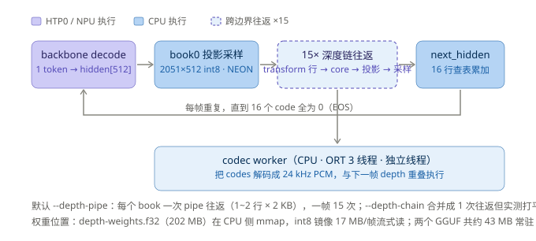
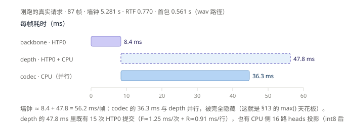

# M5-TTS 优化尝试总账（2026-11-14）

> 本文是 M5-TTS（Snapdragon HTP/llama.cpp 移植）性能与工程优化的**结构化台账**：
> 每一项尝试的方法、实测数字、结论与状态。负结果（排除的路线）单独成章——
> 它们定义了问题的边界，和成功项同等重要。
> 时间线细节与操作步骤见 `m5-tts-port-notes.md`；本文只回答"试过什么、结果如何、现在到哪了"。
> **系统教程**：`examples/m5-tts/learning-hub/index.html` 把本台账整理成 9 章的交互式研学页面
> （推理流水线、性能分析方法论、成本模型、逐项优化复盘、llama.cpp 通用套路、Qwen3-TTS 音色原理、实验手册）。

**测试约定**（贯穿全文）：
- 性能对比一律**同轮交替 A/B**（设备热漂移可让同代码 RTF 0.75→0.91，跨轮绝对值不可比）；
- 生成正确性门禁 = codes 确定性 + ASR 转写 + 音频统计族（RMS/过零率/峰值）；
- codes 与 Java 参考的逐位一致性在 f16 heads 上线后**明确放弃**（f16/int8 数值扰动
  会让自回归采样分叉——同分布的另一条轨迹，不影响可懂度）。

---

## 1. 总账

### ✅ 成功项（已上线为默认）

| # | 尝试 | 关键数字 | 状态 |
|---|------|----------|------|
| 1 | **HTP 环境旋钮固化** `GGML_HEXAGON_OPPOLL=1 / NHMX=0` | 同句 RTF 1.62→0.75（**2.2×**）；丢失会静默慢一倍 | deploy.sh 写死 |
| 2 | **codec 三步量化 + Snake 融合**（CT→MatMul、权重 int8、融合 Snake 算子） | RTF 0.898→**0.837**；codec 7.49→**4.68 s**（115 帧句）；体积 362→141 MB | 默认部署 |
| 3 | **f16 heads（FMLAL 内核）**——含宏名事故修复 | 每帧 -16%（57.3→48.3 ms）；RTF -11~13%（5/5 句） | 默认部署 |
| 4 | **heads int8 量化**（per-row 对称，NEON） | heads_s 0.94→**0.38 s（2.5×）**；RTF 0.86→**0.75（-13%）** | 默认部署（`M5_HEADS_INT8=0` 回退） |
| 5 | **codec ORT 线程调优** | 2/3/4 线程 = 3.56/2.84/3.20 s → **3 最优** | 即默认值 |
| 6 | **按请求 chunk 策略**（wav 4/16、pcm 2/4） | wav 路径 codec ONNX 调用 18→5 次；pcm 保首包 0.33-0.59 s | 默认部署 |
| 7 | **WavWriter 三模式**（文件/内存/丢弃） | wav 响应零磁盘 I/O；pcm 流式不再白写临时 wav | 默认部署 |
| 8 | **deploy.sh 一键部署** | 停服→推二进制/web→备份模型→固化 env→启动→forward；设备重启后一条命令恢复 | 已固化 |
| 9 | **--depth-chain 协议**（16-book 链进子进程，1 次往返/帧） | 与 legacy **逐位一致**（宿主 200 组 0 mismatch）；性能打平（-1.5%）→ 保留为批量/量化落点，默认仍 --depth-pipe | 代码保留，opt-in |
| 10 | **X-M5 分项统计头** + 埋点修复 | Backbone-S/Depth-S/Codec-S 回传；`g_heads_s` 双计 bug 修复 | 默认部署 |
| 11 | 工程小项：voices.json mtime 缓存、CORS 头去重、GET / no-store、pcm 错误预校验、Web 统计显示修复（`Access-Control-Expose-Headers`） | — | 默认部署 |

### ❌ 负结果（实测排除，详见 §3）

| # | 尝试 | 结论 |
|---|------|------|
| 12 | **depth 15 步串行 decode 的六条精确压缩路径**（批量合并 / 投机草稿 / Jacobi 迭代 / 跨帧批量 / 后端融合 / 哑输入） | 全部实测排除，见 §3.1 |
| 13 | **HTP 后端旋钮 sweep**（OPBATCH/OPQUEUE/OPFUSION/NHMX/NHVX/POWER…） | OPPOLL 之外无增益，当前配置已最优（§3.2） |
| 14 | **m5_ring 共享内存环** | 比匿名管道慢（futex 等待拖累 HTP 提交路径），维持 opt-in |
| 15 | **噪声预生成向量化** | JavaRandom 位精确约束不可向量化；实测占比 ≤2%，收益不足以破约束 |
| 16 | codec 尾部 CT 保留 fp32 / 激活×激活 MatMul 量化 | 前者无收益（12.78 vs 12.75 dB）；后者掉 1.3 dB（Softmax 敏感） |
| 17 | 跨请求 KV 复用 / voice embedding 预计算 | 文本不同无法复用；预计算收益 <2 ms |

### 🔬 待研究（复活条件已写明）

| 方向 | 解锁的收益 | 条件 |
|------|-----------|------|
| ~~**学习型草稿**~~（code[b]←code[b-1] 小映射器） | **§14 判死（NO-GO）**：α_oracle ≈ 0.18，连训练都不值得 | 门槛 0 已实测关闭；只剩重训 depth 头（改模型图） |
| 改 depth 模型图（一次前向出多 book） | 同上 | 需重训 |
| codec 权重 int8 化保 QLinearConv 快速路径 | codec 流量减半 | 动态量化路已试不通（§3.3） |

---

## 2. 性能演进与当前账目

### 演进链（同句口径注明，绝对值随热状态漂移）

| 时点 | 配置 | RTF | 备注 |
|------|------|-----|------|
| 11-14 早 | 基线（qdq-ex4 codec，f32 heads，无 OPPOLL） | 0.898（CLI 长句） | JNI 0.964 |
| 11-14 午 | + codec snake 融合 | 0.837 | codec 7.49→4.68 s |
| 11-14 傍晚 | + f16 heads 修复 + HTP env 固化 | **0.717** | 11.0 s 长句，首包 0.526 s |
| 11-14 夜 | + heads int8 | **0.75**（24 字句 A/B）/ 0.798（server） | f16 同口径 0.86 → -13% |

### 当前每帧账目（24 字句 / 70 帧 / HTP0，int8 heads）

| 环节 | 每帧 | 占比 | 说明 |
|------|-----:|-----:|------|
| depth 15 次串行 decode | ~41 ms | ~62% | 成本模型：1.25 ms/次提交 + 0.91 ms/行（depth-bench 拟合） |
| backbone（prefill+decode 摊销） | ~9 ms | ~13% | 33 MB Q8_0 |
| heads（int8 后） | ~5.4 ms | ~8% | 原 13.4 ms；权重流量 34 MB f16→17 MB int8 |
| codec（与 depth 重叠） | ~42 ms | 0%（隐藏） | depth 再提速才会浮出 |

**结论：depth 的 15 次串行提交仍是唯一的大头**，而它的精确压缩路径已被 §3.1
六条证据排除——不改模型/不训练草稿就到头了。

---

## 3. 负结果详录

### 3.1 depth 15 步串行 decode：六条压缩路径全部排除

成本模型（`depth_batch_bench.cpp`，HTP0，28 行四种分解）：

| 形状 | 总耗时 | 含义 |
|------|-----:|------|
| 1×28 | 26.7 ms | 一次提交 |
| 14×2 | 42.6 ms | 现状近似 |
| 28×1 | 60.4 ms | 逐行提交 |
| 1×2 | 3.07 ms | 单调用基线 |

拟合 **F ≈ 1.25 ms/次提交 + R ≈ 0.91 ms/行**。现状（15 调用 16 行）≈33 ms/帧，
理想批量（1 调用 16 行）≈16 ms/帧 → **理论 2.1×**（RTF ~0.55）。但：

1. **批量合并（哑输入）**：`M5_ZERO_TRANSFORM` 消融把 15 步的 code 条件 transform
   行全部置零——codes 翻转 **99.6%**（首帧 15/15 全翻），音频 70→500 帧发散不终止。
   transform 行完全承重（含 EOS 决策），串行链是模型语义的一部分。
2. **投机草稿（上一帧 codes）**：帧间 codes 匹配率仅 **0~1.5%**（近随机，lag 1-5
   一致）——codec codes 无时间局部性，草稿无预测力。
3. **Jacobi 迭代**：沿 15 步链传播，收敛需 O(15) 轮，比串行更差（分析排除）。
4. **跨帧批量**：`next_hidden`（codes 表查找和）反馈给下一帧 backbone 输入，
   帧间被自回归锁死。
5. **后端融合**：OPFUSION 默认已全开；0 vs 1 只差 5%（44.6 vs 42.5 ms），
   深度图太小，减 op 数量见底。
6. **--depth-chain 减往返**：16 次 pipe 往返→1 次，逐位一致验证通过（宿主
   200 组随机输入 0 mismatch；设备 chain==legacy codes/wav 双哈希相同），
   但实测性能打平（depth 4.15 vs 4.08 s）——瓶颈是权重带宽/提交开销而非
   往返次数。协议保留为后续批量化的落点。

> 复活条件：学习型草稿模型（code[b]←code[b-1] 映射器，verify 批量接受），
> 或重训 depth 头支持多 book 并行解码。在此之前，任何"把 15 次合成 1 次"
> 的尝试都应先对照本节证据。
> **§14 更新**：第一个复活条件已实测判死（α_oracle ≈ 0.18）；只剩
> 「重训 depth 头」这条改模型图的路，属另一个项目。

### 3.2 HTP 旋钮 sweep：当前配置已最优

`ggml-hexagon.cpp` 全部环境旋钮，depth-bench 同轮对照（28x1 / 14x2 / 1x28）：

| 配置 | 28x1 | 14x2 | 1x28 | 结论 |
|------|-----:|-----:|-----:|------|
| **baseline（OPPOLL=1, NHMX=0）** | **60.6** | **42.6** | **26.8** | 基准 |
| OPPOLL=0 | 111.3 | 69.7 | 31.4 | **-1.8×，OPPOLL=1 必须保留** |
| NHMX=1 | 61.4 | 42.8 | 26.8 | 无差 |
| OPBATCH=16 / 64 | 76.3 / 64.6 | 52.6 / 44.7 | 27.1 / 26.7 | 更慢 |
| OPQUEUE=1 / 2 | 60.6 / 61.0 | 42.7 / 42.9 | 26.7 / 26.7 | 无差 |
| OPFUSION=0 | 64.6 | 44.7 | 27.1 | 略慢（默认 1 正确） |

（更早的后端参数全扫 OPQUEUE 1-32、HOSTBUF、NHVX 4、POWER_MODE 亦在 ±1% 噪声内。）

### 3.3 codec 量化的两个死胡同

- **尾部 CT 保留 fp32**：12.78 vs 12.75 dB，无收益 → 全量化即可。
- **激活×激活 MatMul（QK^T/AV）量化**：掉 1.3 dB（Softmax 敏感）→ 17 个必须排除。
- **动态量化保 QLinearConv 快速路径**：路不通（权重流量 int8 化的前置条件不成立）。

### 3.4 其他

- **m5_ring**：共享内存环在本 SoC 上比管道慢（futex 等待拖累 HTP 提交路径）。
- **噪声生成向量化**：JavaRandom 顺序敏感（位精确约束），且实测占比 ≤2%（≤1.4 ms/帧）。
- **voice embedding 跨请求预计算**：<2 ms，不值得。

---

## 4. 成功项要点（方法与门禁）

### 4.1 f16 heads：从死代码到真收益

- **事故**：f16 内核守卫用了 GCC 风格宏 `__ARM_FEATURE_FP16[_FML]`，NDK clang 19
  实际定义 `__ARM_FEATURE_FP16_VECTOR_ARITHMETIC` / `__ARM_FEATURE_FP16_FML`——
  宏从未匹配，f16 是死代码；当时的 objdump 检查误报、"RTF 持平"假象。
- **修复**：守卫改宏名 + `-march=armv8.2-a+fp16+fp16fml`（CMakeLists 全局），
  objdump 128 条 fmlal 确认。交替 A/B（同种子）：每帧 -16%，RTF 5/5 句改善。
- **教训**：编译期优化必须以**反汇编/符号**验证，不能只看构建日志；宏名要按
  实际编译器的特性宏写。

### 4.2 heads int8（本轮新增）

- **动机**：heads_s 13.4 ms/帧 ≈ 纯权重带宽（34 MB f16 @ ~2.5 GB/s）。
- **实现**：`m5_depth_heads.h` 的 `build_int8`（per-row 对称量化，max/127）+
  `project8`（NEON，int8 权重→f32 累加；clang 19 无 `vcvtq_f32_s16`，
  用 `vmovl_s16 + vcvtq_f32_s32` 中转）；legacy 与 chain 子进程两路都接。
- **A/B**（同轮交替 ×2）：heads_s 0.94→0.38 s（2.5×），RTF 0.86→0.75（-13%）。
- **质量门禁**：
  - 首帧 codes 0/16 翻转 → 量化数值正确、无系统性误差；
  - 帧 2 起经 `next` 反馈链混沌分叉至 ~90% 翻转（帧数 70→75）——与换随机
    种子同级的轨迹分叉，**非误差累积**（同分布另一条采样轨迹）；
  - ASR 两句全对（24 字长句 + 疑问句），RMS/ZCR/峰值同族，模式内确定性 0% 翻。
- **开关**：默认 ON，`M5_HEADS_INT8=0` 回退 f16。

### 4.3 测量工具链（可复用）

| 工具 | 用途 |
|------|------|
| `depth_batch_bench.cpp` | llama_decode 固定提交成本 vs 每行成本分解 |
| `M5_HEAD_STATS=1` | heads_s / stage_call_s 分项 |
| `M5_ZERO_TRANSFORM=1` | transform 行消融（串行依赖敏感度） |
| `--dump-codes` | codes 逐帧 dump（确定性/翻转率分析） |
| `X-M5-*` 响应头 + `/v1` 统计 | 端到端 RTF/首包/帧数/分项 |
| AudioTranscribe | ASR 门禁 |
| `deploy.sh` | 一键部署 + env 固化 + 模型备份 |

---

## 5. 方法论教训（踩坑清单）

1. **热漂移**：连续测试下同代码 RTF 0.75→0.87→0.91。A/B 必须同轮交替跑，
   绝对值跨轮不可比。
2. **macOS BSD grep 不支持 BRE `\|` 交替**：三次假阴性误判（GGML_HEXAGON 旋钮、
   f16 宏、源码状态）——一律 `grep -E`。
3. **objdump/构建日志会误报**：f16"已生效"实为死代码；以反汇编指令计数为准。
4. **`pkill -f` 会自杀**（匹配到自身 shell cmdline）→ 用 `killall` 按进程名。
5. **adb shell heredoc 循环**会被 adb 偷 stdin → 循环内 `</dev/null`。
6. **`/tmp` 会被系统清理**（模型/ORT/脚本丢过一次）→ 重要产物放 `~/m5-assets/`。
7. **clang 19 arm_neon.h 无 `vcvtq_f32_s16`** → `vmovl_s16 + vcvtq_f32_s32` 中转。
8. **ORT 自定义算子**：注册回调置空会段错误；`KernelContext_GetInput` 是 3 参数。
9. **图级多项式展开会打爆流量**：Snake 链 5 遍读写展开成 13+ 算子更慢，
   必须融合成单算子才有效（反直觉但已实测）。
10. **变调克隆幅度 >1.2× 伤可懂度**，1.15-1.22× 是甜点区。

---

## 6. 当前状态快照

- **部署**：`/data/local/tmp/llama-m5-htp-v73`，m5-server :8080（forward 18080），
  HTP env 固化，int8 heads 默认开。
- **服务回归**（2026-11-14 21:47）：wav RTF 0.798 / 首包 0.58 s / 75 帧 / 7 项统计头齐；
  pcm 流式正常（首包 0.33 s）。
- **Web 控制台**：http://127.0.0.1:18080 （临时音色 localStorage、录音克隆、统计卡片）。
- **Android App**：NativeEngine + CPU 后端（HTP 被 OS 对 app uid 封禁），JNI RTF ~0.79-0.90。

## 7. 下一步（按性价比）

1. ~~**学习型草稿模型**~~ → **（§12 修订 depth 上限 1.78× / codec 反压；
   §14 门槛 0 实测 α_oracle ≈ 0.18 → 判死，不再投入训练或 verify 协议）**。
2. ~~**codec 权重流量**~~ **（§13 修订：已过期）**：141 MB Snake 版早已上线；
   且实测 codec 单独优化端到端零收益（被 `max(depth, codec)` 吃掉）。
   剩余相关方向只剩「与草稿捆绑」或「降 DDR 带宽」，见 §13.4。
3. 文档化之外的持续项：`M5_HEADS_INT4`（4-bit 权重带宽再减半）可作 int8 的
   后续 A/B，代价是量化误差再升一档，门禁同 §4.2。

## 8. 二次 review（2026-11-14 23:35，int8 上线后）

### 8.1 新鲜账目（三条长度句子，CLI 分项）

| 句子 | 帧 | 音频 | 墙钟 | backbone | depth | codec | RTF |
|------|----:|-----:|-----:|---------:|------:|------:|----:|
| 7 字 | 23 | 1.74 s | 1.60 | 0.293 | 1.236 | 1.182 | 0.918 |
| 19 字 | 45 | 3.50 s | 2.93 | 0.428 | 2.389 | 1.956 | 0.837 |
| 24 字 | 75 | 5.90 s | 4.38 | 0.633 | 3.651 | 3.015 | 0.742 |

线性拟合：**prefill ≈152 ms（固定）+ backbone 6.1 ms/帧 + depth 48.6 ms/帧 +
codec 33 ms/帧（被 overlap 隐藏）**。24 字句里 depth 占墙钟 **83%**。

### 8.2 本轮复验关闭的门

- **codec prime 已有跨请求缓存**（`Codec::restore_prime` 按 voice codes 命中即跳过）——
  同音色第二次请求起不付 8 帧 prime；CLI 单次进程的 0.42 s 截距只影响首次。
- **--depth-chain 在 int8 后仍略慢**（2 轮交替：RTF 0.7605/0.7575 vs legacy
  0.7493/0.7417）——pipe 往返不是瓶颈，维持 legacy。
- **GGML_HEXAGON_NHMX=1 全链路无差**（RTF 0.7510/0.7496，backbone 0.63 不变）。
- **depth 低位量化不可行**（既有证据：Q8_0 21 MB 对 Q4_0 10.7 MB 只慢 9%，
  若带宽受限应翻倍 → 每次调用是提交开销+计算主导，非权重带宽）。

### 8.3 剩余方向（按 ROI 排序）

| 优先级 | 方向 | 预期收益 | 成本/风险 | 说明 |
|--------|------|----------|-----------|------|
| A | ~~**学习型草稿**~~（蒸馏 code[b]←(hidden, code[b-1])，批量 verify） | **§14：判死，收益为 0** | — | 数学框架成立，但可预测性沿 15 步链结构性衰减；α_oracle ≈ 0.18 ≪ 0.72 门槛 |
| B | **backbone Q4_0** | 每帧 -2~3 ms，总 -3~5% | 低-中（需 host 构建 llama-quantize，ASR 门禁） | 33 MB→18 MB，per-token decode 或受益 · **已实测，听感不过 → 保持 Q8（§9）** |
| C | **heads int4** | 每帧 -2~3 ms，总 -2~3% | 低（project8 加 q4 解包，门禁同 int8） | 17 MB→8.5 MB 流量；量化误差再升一档 |
| D | **prefill 前缀 KV 缓存**（caption+reference 固定段） | 省 60~100 ms/请求（短句 4-6%） | 中（stage 协议加 state save/restore） | **已上线（§9），实测省 ~45-50 ms/请求** |
| E | **server 启动预热**（启动后跑一句短合成） | 首请求 -150~200 ms 首包 | 极低（~10 行） | **已上线（§9）** |
| F | **pcm 首块 1 帧**（first_frames 2→1） | 首包 -40 ms | 极低 | **已实测：1 帧反而更慢（0.51 vs 0.285 s）→ 维持 2 帧（§9）** |
| G | 多段文本 KV 复用 | 长文每段省 prefill | 中（D 的延伸） | 段落之间共享同一音色前缀 |
| H | /metrics 汇总 X-M5 统计 | 可观测性 | 低 | **已上线（§10）：JSON + Prometheus，pcm 路径唯一可见处** |

**不建议做**：
- codec 再压缩——被 overlap 隐藏（codec 3.0 s < depth 3.65 s），除非 depth 提速；
- codec 卸载到 CPU——比 HTP 慢一倍以上，会击穿 overlap；
- 跨帧 KV 保留——改变每帧 reset 的语义，模型行为风险大，且深度图小 KV 非瓶颈；
- depth 换更低量化——见 8.2 证据（非带宽瓶颈）；
- 并发/render_mutex 改造——单用户场景无收益。

**另一个观察**：depth 在 codec 并发时慢 ~20%（port notes：35.9→42.9 ms/帧），
这是 DSP/内存竞争；overlap 的净收益仍远大于损失（codec 全暴露要 +2.5 s）。

## 9. E/F/B/D 落地（2026-11-14 深夜）

### E：server 启动预热（已上线）

- 设计：`engine.open()` 后立即用 "你好，世界。" 跑一次丢弃模式合成
  （`render_text(text, "", nullptr, ...)`），把 backbone prefill、15 步 depth、
  codec 图、ORT kernel 全部热身；同时把共享前缀（见 D）预先载入 stage 的 KV。
- 收益：消除部署后首请求惩罚（此前 First-Pcm 0.58 s vs 稳态 0.33-0.45 s）；
  启动多花 ~1.5 s，日志打印 `warmup 1.50s (rtf=0.949 frames=21)`。

### F：pcm 首块调优（结论：维持 2 帧）

- 假设：首块 1 帧（80 ms 音频）能再省一个 depth step。
- 实测：1 帧首包 **0.51 s**，2 帧 **0.285 s**——codec 单帧调用的固定开销更大。
  维持 `set_chunking(2, 4)`；E+F 后短句首包 0.285 s、7 字句总耗时 1.44 s。

### B：backbone Q4_0（试听后决定：**保持 Q8**）

- 工具链：host 构建 `llama-quantize`（`~/m5-assets/host-build`），
  `--allow-requantize backbone-Q8_0.gguf backbone-Q4_0.gguf Q4_0` → 32.4→17.1 MB。
- A/B（同轮交替 ×2，24 字句）：backbone_s **0.632/0.619 → 0.495/0.498**（-21%），
  depth 3.65→3.10 s（-15%，DDR 竞争减少），**音频 5.90→4.94 s（-16%，语速变快）**。
- 质量：两版 ASR 全对；时长变化来自韵律漂移，需人工试听定夺（样本见
  `~/m5-assets/quant/samples/backbone-Q8.wav` / `backbone-Q4.wav`）。
- 状态：Q4 文件已上设备（`backbone-Q4_0.gguf`），未改默认命令。
- **决定（人工试听）**：保持 **Q8_0**。Q4 虽然 backbone 快 21%、总耗时 -0.7 s，
  但语速/韵律漂移（音频短 16%）在听感上不可接受——TTS 的音质与自然度优先于
  这部分 RTF 收益，且 backbone 仅占墙钟 14%（大头 depth 不受影响）。
  `m5_engine.h` 默认命令维持 `backbone-Q8_0.gguf`；Q4 仅在显式 `--backbone` 时可用。
  教训：**量化收益必须用耳朵验收**，ASR 全对 + 指标同族不等于听感可接受。

### D：prefill 前缀 KV 缓存（已上线）

- 结构：每段 prefix 行 = [条件标记+参考文本 token][本段文本 token][参考音频 codes]。
  前两段共享（同音色同 caption），但 BPE 会在参考尾字与文本首字间合并，
  因此**共享边界固定为「共享 token 数 - 2」**（只依赖音色，不依赖文本，hash 稳定）。
- 协议：新增 `count == -1` 预填充消息 `[shared_rows][hash][rest_rows][rows...]`；
  子进程在 hash 命中时 `llama_memory_seq_rm(seq, shared, -1)` 只保留共享段 KV，
  否则 clear 后重放；引擎对 ring 传输自动回退到全量预填充。
- 收益（同音色不同文本，server）：Backbone-S **0.603 冷 → 0.555-0.572 命中**，
  短句 0.237-0.329；即每请求省 ~45-50 ms 预填充。预热后首个请求即命中。
- 质量：多段长文本 ASR 全对；token 序列与全量预填充一致（仅批形状不同）。
- 坑：**缓存命中时子进程必须读掉共享段字节**，否则管道错位、下一条消息头读出
  垃圾 count（表现为 "embedding message exceeds remaining context" 后服务崩溃）。

### 环境坑：8080 上出现过两个监听进程

- 早前会话遗留的 `m5-server-cockpit` 与新 `m5-server` 同时监听 0.0.0.0:8080，
  连接被随机分发 → 表现为「wav 一半 500、pcm 正常」的假回归。
  `deploy.sh` 的 pidof 停止逻辑只杀 `m5-server`，不动其他名字。
  排查此类问题时先 `netstat -tlnp | grep 8080` 确认监听者唯一。

## 10. H：GET /metrics 汇总统计（2026-11-15 00:2x）

动机：`X-M5-*` 头只在 wav 全量响应里存在——chunked pcm 在首个分块前就定稿了响应头。
于是流式路径的性能数据此前只落在设备日志里，回归对比必须上设备 `tail`。

- 端点：`GET /metrics`（JSON，控制台与脚本用）；`?format=prometheus`
  返回 `text/plain; version=0.0.4`，可直接刮。
- 内容：累计 `requests / failed / render_s / audio_s`、`avg_rtf`、
  最近 64 次窗口的 `p50_rtf` 与 `p50_first_pcm_s`、`warmup`、`last`
  （取**最近一次成功**，避免被拒绝请求把 gauge 打成 0）、以及 `recent[]`
  逐条明细（voice / format / text_bytes / ok / rtf / elapsed / audio /
  first_pcm / frames / segments / backbone / depth / codec）。
- 埋点位置：wav 路径（成功与失败）、pcm worker（成功与失败）、启动预热
  （单独存档，不进窗口，避免污染分位数）。失败一律计入 `failed` 并保留 ok=false 记录。
- 控制台：合成完成后再拉一次 `/metrics`，在统计卡片下追加一行
  「服务端累计 N 次（失败 M）· 均值 RTF · 首包中位 · 启动预热」——
  pcm 模式下也有一致的服务端视角（卡片本身仍走客户端实测兜底）。
- 验证：三笔请求（wav 长句 / pcm 短句 / 404 坏音色）后
  `requests=3 failed=1 avg_rtf=0.800 p50_first=0.428 m5_last_rtf=0.818`，
  `last_*` 正确跳过末尾那次 404。
- 回归用法：`curl -s .../metrics?format=prometheus | grep m5_p50`，
  不再需要 `adb shell tail` 抓日志。

## 11. Web 控制台：默认值 + 音频动画 + 交互细节（2026-11-15 00:3x）

### 默认值：Serena + 流式 pcm

- 音色默认 `serena`（服务端内置），用户选择写入 `localStorage.m5-voice`，
  下次打开优先恢复；找不到时按 saved → Serena → 首个服务端音色 → 任意 依次回退。
- 输出格式默认 **流式 pcm**（`localStorage.m5-fmt`），选择持久化；切到 wav 时
  按钮旁提示改为「完整 wav · 生成后可拖动进度」。

### 音频动画（#viz，单 canvas 两种模式）

- **流式 pcm**：每个 `AudioBufferSourceNode` 汇入 `AnalyserNode` → destination，
  rAF 按 log-spaced 频段取 44 根柱，上升 0.45 / 下降 0.16 做非对称平滑，
  语音能量集中在低频，线性 bin 会让右侧整片死平。播放结束柱体自然衰减后循环自停。
- **wav**：`decodeAudioData` 取整段包络（每柱取窗口峰值，按最大值归一化后
  取 0.75 次幂），画「包络 + 播放游标」：已播部分 0.92 透明度、未播 0.28，
  游标由 `audio.currentTime / duration` 驱动。**音频路由完全不碰**——曾经想用
  `MediaElementSource` 复用分析器，但该节点创建后无法撤销，若 AudioContext 被
  自动播放策略挂起就会静音，风险不可接受。
- 状态行加 4 根 CSS 动画横条（`#eq`），流式播放期间显示，结束/停止即隐藏。

### 其它交互

- `Ctrl/⌘ + Enter` 生成、`Esc` 停止；中文输入法组词时不误触（由 keydown 的 Enter 判定）。
- 字数计数 `n / 2000`，超限变红并拒绝提交（服务端同样有 2000 上限）。
- **下载 wav**：wav 模式直接用原 blob；pcm 模式保留整段 s16 采样，点击时现拼 RIFF 头。
- **流式结果可回放**：pcm 播完后（等尾部排空）把整段 PCM 交给原生 `<audio>`，
  可重播/拖动进度——否则流式结果只能重新合成才能再听。
- 统计卡片入场动画、focus-visible 焦点环、`prefers-reduced-motion` 下全部动画关闭。
- pcm 的统计改为**服务端权威值**：流结束后拉 `/metrics`，按 `last.id` 递增判定
  本次记录并取其 rtf/first_pcm/frames，不再显示 `≈` 估算（客户端测量仅作兜底）。

### 本轮踩到的坑

1. `.eq { display: inline-flex }` 这类类选择器会压过浏览器的 `[hidden]{display:none}`，
   导致「合成完成」旁边还挂着动画条、`.stats` 初始也可见。加全局
   `[hidden] { display: none !important; }` 一次解决。
2. `/metrics` 字段是 `elapsed_s`，前端误写 `elapsed` → `undefined.toFixed()` 崩掉整个
   metrics 行（静默失败，只有浏览器控制台能看到）。渲染函数改为数值兜底。
3. 波形用固定增益（`peak * 1.7`）会把所有窗口削顶成等高方块，看不出包络 → 按峰值归一化。
4. 截图里的统计卡片发灰不是配色问题，是 `rise` 入场动画被截在 0.26s 内——等待后正常。

### 验证方式（新）

无头 Chrome + 手写 WebSocket 客户端走 CDP，真实点击而不是读代码：
`/tmp/cdp_test.py` 断言语义（默认音色/格式、状态机到「合成完成」、五张卡片数值、
下载可用、canvas 像素数证明动画真的画了、`/metrics` 行同步），并支持 `M5_FMT=wav`
与 `M5_DARK=1` 组合截图。pcm 与 wav 两条路径均通过；Esc 中止、回放挂载单独验证。

---

## 12. 学习型草稿模型：可行性与方案评估（2026-11-15 01:1x，纯分析，未动代码）

> **本节修订 §1 待研究表、§7、§8.3 的乐观外推**：那里写的「depth 2.1× → RTF ~0.55」
> 把 depth 当成唯一瓶颈了。codec 与 depth 并行（overlap），depth 一旦提速，
> codec 立刻变成新的串行项，**单独做草稿的端到端 RTF 下限约 0.64，不是 0.55**。

### 12.1 三个让方案在数学上成立的结构事实

重读 `m5_depth_heads.h::chain()` + `backbone.cpp --depth-pipe` 后确认，此前的
「串行链不可批量」结论需要限定为「无草稿时不可批量」：

1. **depth core 是标准因果 KV 累积**。`backbone.cpp:392-404` 每次 `llama_decode`
   用 `positions[i] = start + i`，KV 不清（只有 `count == 0` 帧 reset 才清）。
   于是「一次提交 16 行 + 因果 mask」在数学上等价于「16 次串行 decode」——
   前提是 16 行的输入（即前 15 个 codes 的 transform 查表）**事先全部已知**。
   这正是投机解码的 verify 步骤，不是被 §3.1 排除的「哑输入批量」。
2. **采样噪声预生成且与 codes 无关**。`m5_engine.cpp:1251-1254` 在 `depth.run()`
   之前用 JavaRandom 填满 `16 × 2051` 的 exponential 噪声；`heads::sample()` 是
   `argmax(softmax_top10(logits/0.9) / noise)` 的确定性函数。给定 logits 与 noise，
   code 唯一确定。因此接受判据就是 **draft code == verify 重采样 code** 的精确匹配，
   无需 LLM speculative decoding 的概率 accept/reject，也没有分布偏差。
   这比一般投机解码干净得多。
3. **code 0 免费精确**。`chain()` 的 book 0 直接 `proj(0, hidden, logits, kVocab)`
   采样，不经 depth core。每帧至少有一个已知正确前缀，第一轮 verify 的位置 1
   输出一定有效。另外 `--depth-chain` 已把整条链搬进 stage 进程，是天然落点。

§3.1 的六条排除依旧有效，它们排除的是**零信息草稿**（上一帧 codes，命中 1.5%）
和**丢掉 code 条件的哑输入**（99.6% 翻转）。学习型草稿是第七条、且是唯一
未被排除的路径。

### 12.2 成本模型：接受率 α 才是成败变量

沿用 §3.1 的 `F ≈ 1.25 ms/次提交 + R ≈ 0.91 ms/行`，补上此前被忽略的两项：
heads 每行投影+采样 `H ≈ 0.34 ms`（int8 后 5.44 ms/帧 ÷ 16），草稿推理 `D`。
串行基线 = `15F + 16(R+H) = 38.75 ms/帧`；理想一轮通关 = `F + 16(R+H) + D
≈ 21.75 ms/帧`（`D = 0.5 ms`，**depth 阶段天花板仅 1.78×，不是 2.1×**——
2.1× 只算 core，漏了 heads）。

设 α = 逐 book 的 code 命中率，γ = 每轮草稿长度。拒绝发生在第 k 个候选时，
前 k-1 个接受、第 k 个用该位置（输入前缀仍正确）的有效 logits 修正，
该轮净前进 k 个，之后 KV 用 `llama_memory_seq_rm` 截断到接受前缀。
递推 `f(n) = F + γ(R+H) + Σ_{k=1..γ} α^{k-1}(1-α) f(n-k) + α^γ f(n-γ)`，
`f(15) + D` 为每帧期望成本（非自回归草稿一次出全 15 个候选，D 只付一次）：

| α | γ=3 | γ=5 | γ=8 | γ=15 | 最优加速 |
|---:|----:|----:|----:|-----:|--------:|
| 0.70 | 34.8 | 40.1 | 49.7 | 65.1 | 1.11× |
| 0.80 | 31.4 | 33.7 | 39.1 | 50.2 | 1.23× |
| 0.90 | 28.4 | 28.2 | 29.8 | 35.4 | 1.38× |
| 0.95 | 27.0 | **25.6** | **25.6** | 27.9 | 1.52× |
| 0.98 | 26.1 | 24.0 | **23.3** | 23.5 | 1.66× |
| 1.00 | 25.5 | 23.0 | 21.8 | **20.5** | 1.89× |

**盈亏平衡 α**：γ=3 需 0.60、γ=5 需 0.72、γ=8 需 0.80、γ=15 需 0.88。
γ 必须随 α 自适应（EMA 在线估计）：α<0.9 用 γ≈5，α>0.98 才给 γ=15；
α 长期低于 0.6 就整帧回退串行，否则比不做还慢（表中 α=0.5 是 0.90×）。

**草稿自身成本是隐藏杀手**：若草稿也要用 `W_b` 把预测的 512 维 hidden 投影成
2051 维 logits，它自己就要付 ~5.1 ms/帧（近乎一次完整 heads），天花板立刻从
1.78× 掉到 1.47×，α=0.9 时甚至只有 1.13×。因此草稿必须做**低秩预乘**：
把 `decoded_hat[b] = A_b · hidden` 的 `A_b` 限为秩 32~64，离线预计算
`P_b = W_b U_b (2051×32)`，运行时只算 `P_b @ (V_b^T hidden)`，15 个 book
合计约 1M MAC（相比 8M 省 8×），`D ≈ 0.5-0.8 ms` 才成立。

### 12.3 codec 反压：为什么单独做草稿不值

§8.1 的 24 字句（75 帧 / 音频 5.90 s）：backbone 0.633 s、depth 3.651 s、
codec 3.015 s（与 depth 并行、被隐藏）、墙钟 4.38 s。按 `wall ≈ backbone +
max(depth, codec) + prefill`：

| 场景 | depth | codec | 墙钟 | RTF |
|------|-----:|------:|-----:|----:|
| 现状 | 3.651 | 3.015 | 4.38 | 0.742 |
| 草稿 α=1（1.78×） | 2.05 | 3.015 | 3.80 | **0.644** |
| 草稿 α=0.95（1.52×） | 2.40 | 3.015 | 3.80 | **0.644** |
| 草稿 α=1 + codec -33% | 2.05 | 2.02 | 2.84 | **0.481** |
| 草稿 α=.95 + codec -33% | 2.40 | 2.02 | 3.19 | **0.540** |

即：**codec 未动时，α 从 0.95 提到 1.0 在端到端上收益为零**（都被 3.015 s
卡住），短句更差（7 字句 depth 1.236 vs codec 1.182，几乎零收益）。
要兑现 §7 写的 RTF ~0.55，必须把「codec 权重流量/快速路径」与草稿捆绑。
这也把验收门槛从 α≥0.95 降到 α≥0.8（depth 只需 1.21× 就撞上 codec 天花板），
对「要不要投入训练」是决定性的。（§13 用实测基线把数字更新为
0.725→0.602 单独草稿 / 0.458 捆绑；「消除争抢」路径已被证伪。）

### 12.4 四道 go/no-go 门槛（按验证成本排序）

| # | 门槛 | 怎么测 | 判据 |
|---|------|--------|------|
| 0 | **统计可预测性上界** | host ONNX（`capture_depth_reference.py` 已能 expose 16 个 scores / 各层输入输出）采 N 帧；teacher-forcing 把单个 code 换成随机值，看后续 logits 的 top-1 变化率；再拟合岭回归 `decoded[b] ← hidden` 测离线 α | α_oracle ≥ 0.85 才继续 · **§14 实测 ≈0.18 → NO-GO，门槛 1/2/3 无需再做** |
| 1 | **HTP 多行输出** | depth stage 改 `batch.logits[i]=1`（需 `n_outputs_max_per_seq ≥ 16`），一次 decode 16 行并用 `llama_get_embeddings_ith(ctx, i)` 取全部输出，与 15 次串行比 logits | 一次 16 行 ≈16 ms 且数值可用；**此门槛最可能直接判死**，ggml-hexagon 多 logits 输出从未验证 |
| 2 | **批量/串行数值等价** | 同前缀下批量 forward vs 串行 forward 的 logits 最大差、top-1 一致率 | 允许微小误差：verify 重采样本身就定义了新的自洽采样过程，不要求与旧路径逐位一致（int8 heads 已有分叉先例），只需过 §4.2 门禁 |
| 3 | **质量门禁** | ASR + RMS/过零率/峰值 + **人耳试听**（B/Q4 的教训：指标全对也会韵律漂移） | 通过后才替换默认 |

### 12.5 方案设计

**草稿模型（非自回归，一次前向出 15 个候选）**
- 输入：`hidden[512]` + 位置 `b` + 已知 noise（可选，用于直接对齐 Gumbel 判据）；
  不依赖前序 code，因此拒绝后剩余候选仍可复用，无需重跑草稿。
- 输出：15 个候选 code。三档实现按成本递进：
  ① 岭回归 `decoded_hat[b] = A_b hidden + c_b`（闭式解，几千帧，零框架依赖）；
  ② 低秩 head `P_b = W_b U_b`（秩 32~64）+ 小 MLP，损失 = 15 路 2051 类 CE
  或 codes 的 hinge/蒸馏；
  ③ 直接蒸馏非自回归 depth head（一次前向出 16 codes，彻底删掉 15 步链）——
  收益最大但需改模型图/重训，风险另立项目。
- 训练数据完全离线：`backbone.onnx` 批量产 hidden，`depth_frame.onnx` 产
  scores/codes/decoded；覆盖多文本、多音色、多 seed、句中不同帧位置、
  EOS 附近帧。导出为单个 f32 权重文件（同 `depth-weights.f32` 的 mmap 方式）。

**verify 协议（落在 `--depth-chain` stage 内）**
1. 帧开始 `llama_memory_clear`；code 0 由 heads 从 hidden 精确投影采样。
2. 草稿给 γ 个候选 code → 查 `w[off.projected + (b-1)*kVocab + code]` 得到
   transform 行（位置 0 是 `projected_hidden`），一次 `llama_decode` 提交
   `γ+1` 行，`positions` 从当前 KV 长度递增，`logits` 全 1。
3. 取位置 1..γ 的 output embedding → heads int8 投影 → 用**同一份 noise**
   `sample()` → 得到该位置的 target code。
4. 顺序比对：接受前缀 j；第一个拒绝处用该位置（前缀仍正确）的 logits 重采样
   修正，丢弃其后所有结果。
5. `llama_memory_seq_rm(mem, seq, accepted_pos, -1)` 截断 KV（复用 §9 D 的
   prefix-cache 原语），回到 2 处理剩余 book。
6. 16 个 code 齐了再算 `next_hidden` 与 EOS，语义与 `chain()` 完全一致。
- γ 自适应 + α 低于阈值整帧回退串行；`M5_DRAFT=0` 可一键关掉做 A/B。

### 12.6 决策建议（本轮不改代码）

**暂缓投入训练，先做两件更便宜的事**：
1. **门槛 0/1 的离线实验**（不改设备部署）：若 HTP 多 logits 输出不可用，
   或 α_oracle <0.85，整个方向直接关闭，成本仅数小时。
2. ~~**codec 优化先行**~~ → **§13 实测作废**：codec 单独优化端到端零收益，
   且「让 codec 让路以释放 depth」的机制不存在（depth_s 与 codec 负载不相关）；
   §7 第 2 项本身也已过期。当前第一优先仍是门槛 0/1 离线实验。

**风险清单**：新音色/情感/长句的草稿分布外导致 α 崩塌；codes 混沌分叉使帧数与
韵律漂移（int8 heads 已证明 ASR 全对也会变轨迹）；depth 与 codec 并发资源竞争
在批量化后改变（§8.3 观察过并发让 depth 慢 ~20%）；低秩草稿的量化误差叠加
int8 heads 后再抬一档。所有 A/B 必须同轮交替（§开头测试约定）。

> **2026-11-15 补注**：下面 §12.6 第 2 条的「codec 优化先行」与本节用旧 +20%
> 反压做的外推，已被 §13 的 48 次实测证伪，请直接看 §13。

---

## 13. P0 实测：并行资源让渡假设被证伪（2026-11-15 01:4x）

> **本节推翻 §12.6 第 2 条和上一轮的口头建议**：「让 codec 让路、释放 depth
> 并发反压，零成本拿到 -13%」不成立。当前默认配置（overlap + ORT 3 线程 +
> chunk 2/4 + 默认调度）**已是端到端最优**，且这次是按 `elapsed_s` 验证的。

### 13.1 实验设计

无需改代码：设备 CLI 自带 `--no-overlap / --threads / --first / --chunk`，
输出 JSON 分项（`m5_engine_main.cpp:109`）。停掉 m5-server 独占设备，
固定句子（94 帧 / 7.42 s 音频）、seed 1234、env `OPPOLL=1 NHMX=0`，
**4 轮正序/逆序交替**抵消热漂移，每配置 4 次取中位数；
判据是 `elapsed_s`（端到端），不是 `codec_s` 或 `first_pcm_s`。
脚本与原始结果：`~/m5-assets/p0-ab.sh`、`p0-affinity.sh`、`p0*-results.txt`。

配置：A=默认；B=`--no-overlap`；C/D/H=线程 2/4/1；E/F=chunk 8/16；G=t2+c8。
第二轮用 `taskset` 测 CPU 放置：默认 / 小核 `0f` / 大核 `f0` / 单核 `80`。
设备 CPU 拓扑：cpu0-3 1.8 GHz 小核，cpu4-7 2.2–2.3 GHz 大核。

### 13.2 结果（中位数，共 32 + 16 次合成）

| 配置 | elapsed | RTF | depth | codec | 首包 | vs A |
|---|---:|---:|---:|---:|---:|---:|
| **A overlap t3 c4** | **5.381** | **0.725** | 4.530 | 3.615 | 0.363 | 基准 |
| B no-overlap t3 c4 | 7.744 | 1.044 | 4.017 | 3.019 | 0.551 | **+43.9%** |
| C overlap t2 c4 | 5.519 | 0.744 | 4.603 | 4.522 | 0.449 | +2.6% |
| D overlap t4 c4 | 5.474 | 0.738 | 4.631 | 4.074 | 0.413 | +1.7% |
| E overlap t3 c8 | 5.501 | 0.741 | 4.595 | 3.500 | 0.397 | +2.2% |
| F overlap t3 c16 | 5.630 | 0.759 | 4.529 | 3.368 | 0.394 | +4.6% |
| G overlap t2 c8 | 5.619 | 0.757 | 4.619 | 4.354 | 0.454 | +4.4% |
| H overlap t1 c4 | 6.559 | 0.884 | 4.671 | 6.551 | 0.662 | +21.9% |

**没有任何配置快于 A**；所有运行都是 94 帧（codes 未受旋钮影响，正确性无扰）。

并发反压的真实幅度（A → B）：depth **-11.3%**、codec -16.5%、backbone
-10.8%——三个分项同时变慢，是「codec 线程存在」的系统级共存代价，**不是**
port notes 旧测量的 +20%（那是 362 MB codec / Java 路径）。而 overlap 的净收益
是 **-43.9%**（7.744→5.381 s），远大于这份税；争抢是 overlap 必须付的固定开销。

**证伪的关键证据**：`depth_s` 在所有 overlap 配置里恒定在 4.53~4.67 s，
与 codec 负载完全不相关——t2 让 codec 慢 25%（3.615→4.522）depth 反而略慢；
chunk16 让 codec 快 7%（3.615→3.368）depth 几乎不动（4.529）。
即「减 codec 负载 → 释放 depth」这条机制**不存在**。让 codec 让路既拿不到
depth 提速，又白白损失 codec 侧的隐藏余量。

亲和性（taskset 绑整个进程树）：默认 5.403 / 大核 `f0` 5.419（+0.3%，噪声内）、
小核 `0f` 10.255（+89.8%）、单核 `80` 16.892（+212.6%）。默认调度已把线程放对；
HTP 提交路径依赖大核，绑小核/单核是数量级劣化。**CPU 放置没有可利用杠杆。**

### 13.3 修正后的端到端收益矩阵（KV32 转正前的实测基线；新基线见 §16）

codec 余量 0.915 s（25.3%）；`wall ≈ backbone 0.743 + max(depth,codec) + prefill 0.108`。

| 场景 | wall | RTF | 相对 |
|---|---:|---:|---:|
| 现状 | 5.38 | 0.725 | — |
| codec 单独 -33% | 5.38 | 0.725 | **0%（被 max 吃掉）** |
| 学习型草稿单独（depth 1.78×） | 4.47 | 0.602 | -17% |
| 草稿 + codec -33% 捆绑 | 3.40 | 0.458 | -37% |
| 无争抢 depth（理论下界，不可达） | 4.87 | 0.656 | -9.5% |
| 关 overlap（实测，codec 全暴露） | 7.74 | 1.044 | +44% |

「无争抢」下界不可达：要让 depth 回到 4.017 必须关 overlap，而关掉之后
codec 的 3.019 s 全部暴露，实测墙钟 7.744 s。**§12 用旧 +20% 反压外推的
「消除争抢 ≈ 草稿单独做」不成立。**

### 13.4 方向修正

1. 旋钮已按端到端口径确认最优——把原先「按单边指标定的默认值」升级为实测
   结论，可以收掉这一整类 A/B。
2. **codec 单独优化零收益**，且 141 MB Snake 版已上线（设备上
   `codec_decoder_cached.onnx` 与 `codec-snake.onnx` md5 相同）；§7 第 2 项
   过期，§12.6 第 2 条作废。
3. 稳态 RTF 被 `max()` 锁死，~~唯一突破仍是「草稿 + codec 捆绑」（-37%）~~
   **§14 修订：草稿路径已判死，该捆绑不再可达**；不改模型图时稳态 RTF
   0.725 即为本流水线极限。
4. 不投入训练时的真实收益不在稳态 RTF，而在**首包（0.363 s）、热漂移
   （同代码 0.75→0.91）、长时功耗**——它们不受 `max()` 约束。
5. 唯一未测过的机制级方向：**降低 codec 的 DDR 权重流量**（int4 / 结构化稀疏），
   与减线程/chunk 不同，它减少的是带宽而非线程负载，理论上才可能动到那份
   固定共存代价。风险是音质，需过 §4.2 门禁。

实验结束后已用 `deploy.sh --no-models` 恢复 m5-server，Web 入口 18080 正常。

---

## 14. 门槛 0 实测：学习型草稿判死（2026-11-15 03:2x）

> **本节关闭 §12 留下的唯一「大杠杆」**：学习型草稿（非自回归、一次出 15 个
> 候选、输入只有 hidden）在官方 ONNX 上的 α 上界约 **0.18**，远低于 §12.2 的
> 盈亏平衡 0.72~0.88。**不建议再投入训练、verify 协议或 HTP 多 logits 验证。**

### 14.1 数据与方法（全离线，不改设备）

- conda base（numpy / onnx / onnxruntime 1.18 / tokenizers）+ 官方 M5 源码
  `/Users/wangyifan/Desktop/M5-TTS`；从设备回拉 701 MB ONNX 包到
  `~/m5-assets/onnx-lab/`。
- `tokenizer.json` 下载被网络挡 → 改用设备 CLI `--encode` 取 8 条真实中文
  文本的 token ids（含控制 token），配 `voices.json` 的两个音色构造 prefix，
  分布与真实请求一致。
- 复用 `capture_depth_reference.py` 的图插桩：expose 16 个 ArgMax 输入
  （即 `probs/noise`）与 15 步 core 的输入/输出；用 `scores*noise` 还原 probs。
- 按官方 `infer_onnx.generate()` 的 KV / positions 规则跑 16 条 AR 轨迹 ×
  60 帧 = **960 帧**，前 12 条训练、后 4 条测试（按 run 切分防泄漏）。
- 脚本 `onnx-lab/collect.py / analyze.py / variance.py / perturb.py`，
  数据 `frames.npz`（960×16×2051）。

### 14.2 三组实验

**(a) 最简草稿：ridge `hidden → probs → argmax(probs/noise)`**

| λ | test α | train α | mean R²(probs) |
|---:|---:|---:|---:|
| 1 | 0.031 | 0.264 | -2.63 |
| 10 | 0.039 | 0.254 | -1.34 |
| 100 | 0.046 | 0.221 | -0.39 |
| 1000 | 0.059 | 0.169 | -0.04 |

众数基线 α=0.017，每 book 训练集有 403~518 个不同 code（近均匀）。
**连训练集都只有 0.17~0.26，泛化几乎为零**；线性 ridge `decoded[b]←hidden`
的 test R² 从第 1 步 0.55 掉到第 15 步 -0.11（λ=100）。

**(b) 信息到底在不在 hidden 里（排除「线性模型太弱」）**

- 固定 hidden、只换 Gumbel noise（40 个 hidden × 16 次）：probs 的 top-1
  跨噪声一致率 `1.00 / 0.72 / 0.20 / 0.10 / 0.08 … / 0.07`（book0..15），
  book1+ 平均 **0.119**；decoded 的「同 hidden 内方差 / 总方差」从 0.07
  升到 0.54（后半段一半以上由 code 前缀决定）。
- 非线性 RBF 核回归 `decoded[b] ← hidden`（test R²，α=1）：第 1/3/6/10/15
  步 = **0.60 / 0.34 / 0.26 / 0.21 / 0.20**。即使用核方法，后面步骤也只有
  约 20% 方差能由 hidden 解释。

**(c) 因果证据：改一个 code 会污染多少**

不改 ONNX 图，只把 `noise[b, winner]` 放大 1e6 倍，强制 book b 改选另一个
top-k code（60/60 成功），其余噪声与 hidden 完全不变：

| 强制 book b | 后续 code 一致率 | 后续 probs top-1 一致率 |
|---:|---:|---:|
| 0 | 0.174 | 0.136 |
| 1 | 0.126 | 0.062 |
| 3 | 0.161 | 0.100 |
| 7 | 0.250 | 0.221 |
| 11 | 0.396 | 0.287 |

一个错误几乎让整条剩余链作废——既印证 §12.2 的「接受前缀」模型，
也说明草稿拿不到真实 code 前缀就跨不过第一个错误。

### 14.3 结论与 α 上界

可预测性沿链衰减是**结构性**的：book0 完全由 hidden 决定（§12.1 的
「code0 免费精确」实测确认，一致率 1.00），book1 部分可预测（0.72，
只依赖 code0 的 transform），**从 book2 起 logits 主要由前面采样的 codes
决定**，而 codes 在给定 hidden 下仍随 noise 混沌分叉（§3.1 的帧间相关
1.5% 与 `M5_ZERO_TRANSFORM` 99.6% 翻转都是同一现象的两个侧面）。

乐观上界：取 book0=1.00、book1=0.72、book2=0.20、book3+=0.07 作为逐 book
的 oracle 命中率，平均 **α_oracle ≈ 0.18**；而 §12.2 盈亏平衡是 0.72
（γ=5）~0.88（γ=15）。**差 4 倍以上，不是调参或换 loss 能补的。**

唯一能让 α 变高的「草稿」必须自己逐步模拟 depth core——给定 hidden+noise，
整串 codes 本就是确定性函数——那等于重跑 teacher，省不掉 15 次提交，
而且输入要含 16×2051 维 noise，不可能满足 §12.2 要求的 D≈0.5 ms。
真正的高 α 只能来自**重训 depth 头为非自回归 / 一次出多 book**，那是改
模型图、需要原始训练数据与算力的另一个项目，不是投机解码。

### 14.4 台账修订

- §12.4 门槛 0 判据 `α_oracle ≥ 0.85` → **实测 ~0.18，NO-GO**；
  门槛 1（HTP 多 logits 输出）、2、3 因此不再需要验证。
- §7 第 1 项、§12.6 第 1 条、§13.4 第 3 条里「学习型草稿仍是第一优先 /
  唯一突破」全部作废：**不改模型图的前提下，稳态 RTF 0.725 已是这套
  流水线的极限**，单边优化、资源让渡、投机解码三条路均已实测排除。
- 剩下的真实收益不在稳态 RTF：首包（0.363 s）、热漂移（同代码
  0.75→0.91）、长时功耗、音质 / 情感表达；以及需要重训的模型级改造
  （非自回归 depth head、codec 蒸馏）。

---

## 15. 当前推理流水线的 NPU / CPU 边界（2026-11-15 03:3x，架构快照）

> 本节是**结构说明**，不含新实验。三张原理图随文放在
> `docs/backend/snapdragon/m5-tts-pipeline-*.svg`；同一组图也已内联进
> Learning Hub 第 9 章（随明暗主题变色）。

### 15.1 一句话结论

**真正跑在 NPU 上的只有两个 transformer**：backbone（8 层 Q8_0，32 MB）
与 depth core（5 层 Q4_0，10.7 MB），合计约 43 MB 常驻 HTP0。
heads 投影、采样、噪声生成、codec、PCM 输出**全在 CPU**。



### 15.2 模块归属表

| 模块 | 执行单元 | 权重 / 数据 | 成本 | 为什么放这里 |
|---|---|---|---|---|
| HTTP / 分词 / prefix 查表 | CPU（server 主线程） | text / audio embeddings mmap | 一次性 ~150 ms prefill | 纯 CPU 逻辑 |
| backbone prefill + 1-token decode | **HTP0** · 常驻子进程 A | Q8_0 32 MB / 8 层 | 8.4 ms/帧 | 规则 GEMM，权重可常驻 |
| depth core 15 次 decode | **HTP0** · 常驻子进程 B | Q4_0 10.7 MB / 5 层 | 47.8 ms/帧（含 CPU heads 与提交开销） | 同上 |
| depth heads 16 路投影 | CPU · NEON int8 | `depth-weights.f32` 202 MB mmap → 17 MB/帧流式 | ~5.4 ms/帧 | 稀疏查表型权重，HTP 不划算 |
| 采样（top-10 + Gumbel）+ 噪声 | CPU | JavaRandom 16×2051 | ≤1.4 ms/帧 | 位精确约束，不可向量化 |
| codec | CPU · ORT 3 线程（独立 worker） | 141 MB Snake 融合 ONNX | 36.3 ms/帧（被 overlap 隐藏） | ONNX 图 + 自写 `m5::Snake` 算子 |
| WavWriter / chunked HTTP | CPU | — | — | I/O |

### 15.3 进程、线程与数据搬运

- `m5-server` 主进程（CPU）持 HTTP 线程与 render 主线程；`overlap=true` 时
  另起一个 **codec worker 线程**（`m5_engine.cpp:1180`）。
- `backbone-resident` / `depth-resident` 是**同一个二进制的两个常驻子进程**
  （`deploy.sh` 里 cp 一份改 argv），各自
  `ggml_backend_dev_by_name("HTP0")` + `n_gpu_layers=-1`（`backbone.cpp:72-77`），
  各持一个 HTP 会话，分时复用**同一物理 HTP0**。分开是为了 KV / 上下文隔离，
  以及分别调量化与 env（`OPPOLL=1 / NHMX=0`）。
- 引擎 ↔ stage 走匿名 pipe，一行 FP32 512 维 = 2 KB；stage → DSP 走 FastRPC。
  默认 `--depth-pipe` 每个 book 一次往返，**一帧 15 次**；
  `--depth-chain` 可合成 1 次但实测打平（§3.1），`m5_ring` 更慢（§3.4）。



### 15.4 真实一帧的时间线

2026-11-15 03:31 的实跑请求（Serena，87 帧，`X-M5-*` 头）：
墙钟 5.281 s / RTF 0.770 / 首包 0.561 s；
`backbone 0.734 s`、`depth 4.160 s`、`codec 3.156 s`，
折合每帧 8.4 / 47.8 / 36.3 ms。



`wall ≈ backbone + max(depth, codec) + prefill`：codec 的 36.3 ms 与 depth
并行、被完全隐藏。这正是 §13 的 `max()` 天花板，也解释了为什么
「codec 单独优化」端到端收益为 0。

### 15.5 两个容易误解的点

1. **两个 HTP 会话 ≠ 两个 NPU**。都是 HTP0，只是两个独立的 llama 上下文。
2. **App 形态拿不到 HTP**。OS 对 app uid 封了 `/dev/adsprpc-smd`（EACCES），
   JNI 版只能全 CPU 跑（RTF ~0.79–0.90）；只有 shell 域启动的 `m5-server`
   才能用 NPU。因此 §13 / §14 的全部 NPU 结论只适用于 server 形态。

### 15.6 与前面结论的关系

- §13 的资源让渡实验之所以无效，是因为 depth 的 47.8 ms 里主体是
  **HTP0 的 15 次提交开销**（F≈1.25 ms/次 + R≈0.91 ms/行），
  与 CPU 侧 codec 线程负载不相关。
- §14 的学习型草稿之所以判死，是因为草稿只能见 hidden，而 depth core
  每步输出从 book2 起由 CPU 侧采样出的 codes 决定——这条链横跨
  CPU↔NPU 15 次，正是图 15-2 的结构。

### Codec 尾部 FP32 子图移植探针

从设备当前 INT8 codec 抓取真实流式第 2 个 4 帧 chunk。探针子图为
`/conv_32`（96→96、7 taps、dilation 9）→ Snake → `/conv_33`（1 tap），
输入已带 54 个历史位置，输出在 residual add 之前。生产 ORT profile
的三个算子中位耗时分别为 11.03、0.94、2.02 ms。GGML CPU 3 线程
直卷积全块 40.03 ms，FP32 im2col + MatMul 全块 40.00 ms，两者相对
ORT 最大绝对误差 1.19e-5。GGML 路径用 sin 表达 Snake，ORT 使用融合实现。
真机 HTP 拒绝该形状的 CONV_2D 和通用 SIN。只把 conv_32 改写成
HTP im2col + MatMul，可以运行，但含上传、等待和读回为 45.96 ms。
这些数字是隔离探针与生产算子 profile 的对照，未做并发或 PCM A/B。
探针和日志分别位于 `examples/m5-tts/codec_tail_probe.cpp` 和
`~/m5-assets/htp-quality/tail-block/`。

#### Conv32 九相位重排

在同一个真实 4 帧 chunk 中把时轴按位置模 9 分组，各组执行 dilation=1
的七点卷积，补齐相位长度后丢弃多余输出。仅测 conv32 与 bias，
耗时包含主机重排、输入上传、计算、读回与交错还原。权重保持 FP32。

- CPU 直卷积 39.92 ms，输出相对 ORT 最大绝对误差 1.19e-6。
- HTP 直卷积仍不支持。该部署源码的两条 CONV_2D kernel 路径都要求 HMX。
- HTP 相位 im2col + MatMul 48.26 ms，未分相位的同轮对照 45.99 ms。
  两者最大误差同为 9.54e-7；生产 ORT Conv32 中位数 11.03 ms。

相位变换简化了索引，但未消除 im2col 或打开无 HMX 的直卷积路径。
未接入生产 codec。原始日志：`~/m5-assets/htp-quality/tail-block/phase.log`。

#### Conv32 无 HMX 的 HVX 直卷积原型

以 `M5_HVX_CONV32=1` 在隔离后端选择固定形状的 FP32 直卷积。
HVX 沿时间向量化，每线程处理不同输出通道，直接读取 dilation=9 的
七个 taps，不构造整块 im2col。相同真实 4 帧输入，计入上传、完整图执行
（含 bias）与读回，14 次热运行上中位数为 148.814 ms，
相对 ORT 最大绝对误差 3.81e-6。对照为同一输入的 HTP im2col
45.99 ms 和生产 ORT Conv32 profile 11.03 ms。
该原型只按输出通道分工，对不同输出通道重复读输入，尚未用 VTCM
跨输出通道复用输入。隔离部署未改服务；未测小块形状、PCM 或 CPU 核秒。
日志：`~/m5-assets/htp-quality/tail-block/hvx-direct.log`。

#### Conv32 HVX 四输出通道分块

同一隔离构建用 `M5_HVX_CONV32_BLOCKED=1` 选择四输出通道 × 128
时间位置，四个通道复用每次 HVX 输入向量。ABBA 顺序，单轮各取 14
次热测中位数。原版 150.368 / 146.850 ms，分块版 79.913 / 80.681 ms，
均含上传、bias 与读回。最大误差均为 3.81e-6。读入复用明显有效，
但仍慢于 45.99 ms 的 HTP im2col 和 11.03 ms 的 ORT 算子基线。
此次未使用 VTCM，未测 CPU 核秒或端到端。
日志：`~/m5-assets/htp-quality/tail-block/hvx-blocked-ab.log`。

#### Depth FP16 KV 与 HVX Flash Attention

隔离 depth stage 用 `M5_DEPTH_ATTENTION=f16` 或 `flash`，backbone
及 INT8 codec 不变。交替顺序 base/f16/flash/flash/f16/base，长句、
固定种子、3 线程、chunk 4。前 1900 次 decode 的平均 API 耗时：
FP32 普通注意力 2.649–2.656 ms，FP16 普通注意力 2.602–2.649 ms，
FP16 Flash Attention 1.922–1.924 ms。HTP profile 确认 FLASH_ATTN_EXT
走 2 HVX。整句 RTF 基线 0.778–0.860，Flash 0.645–0.657；
整句墙钟基线 7.673–8.475 s，Flash 6.620–6.744 s。
基线 127 帧，FP16 143 帧，Flash 132 帧，故优先用同次数 decode
判断单步收益。Flash WAV 与基线不等价；单句 ASR 无整句漏读，
但有近音差异，未通过多文本盲听。生产服务配置未切换。
日志：`~/m5-assets/htp-quality/depth-attention-ab.log`。

#### Serena Flash Attention 听感复查

固定导航加闲聊文本、Serena 和种子，交叉比较普通注意力或 Flash 与
INT8 或 FP32 Snake/CT codec。相同 attention 的 codes 跨 codec 完全相同，
普通注意力 69 帧，Flash 76 帧。四份 PCM16 均无满幅样本，峰值
0.755–0.801。Flash 的 INT8 分块 2/4/8 帧输出 WAV 逐字节一致。
用户在同 codes 的两份 Flash 音频中指出「别着急」这几个字，INT8 更明显，FP32 有所缓解。优先检查 codec 的量化误差，Flash 轨迹仍可能有贡献。FP32 对照是融合 Snake 和 ConvTranspose 分解的版本，不能用这组试听锁定某个量化节点。RTF 不能代替听感：
Flash INT8 0.673，换 FP32 codec 后 1.127。原始样本和统计位于
`~/m5-assets/htp-quality/attention-quality/`。学习中心第 10 章记录
按 OPBATCH 聚合、隔离变量和音质判据。

#### 「别着急」尾部混合精度试听

固定 Serena 的 76 帧 Flash codes。恢复 /conv_28、/conv_29、/conv_30
的原 FP32 权重和 bias，绕过这些层的输入与输出 Q/DQ，其余继续使用
生产量化图。设备按 INT8 / 混合 / 混合 / INT8 顺序验证，四次 codes
与原 Flash 一致。INT8 RTF 0.742/0.668，混合 0.739/0.697。混合
首 PCM 0.502/0.565 s，INT8 0.446/0.430 s。单句混合版仍实时。用户同 codes 试听指出全 FP32 明显更好，尾部
三层混合版与 INT8 听感接近。该候选增加首 PCM 延迟，决定不采用。脚本及样本位于
`~/m5-assets/htp-quality/restore-tail.py` 与 `attention-quality/`。

#### 「别着急」按阶段恢复精度

基于生产量化模型分别恢复两组，权重、偏置和对应输入输出 Q/DQ
一起处理。中段卷积组是 /conv_14–19 和 /conv_21–26，另一组是
反卷积拆解后的六个 MatMul（__ct0/n1 至 __ct5/n1），其布局操作
保持原样。两个模型都通过 ONNX checker。真机按 INT8、中段、上采样、
上采样、中段、INT8 测试。所有样本的 76 帧 Flash codes 逐字节一致。
中段 RTF 0.829–0.840，首 PCM 0.685–0.704 s；上采样
RTF 0.713–0.726，首 PCM 0.511–0.573 s。两者均在本句保持实时。
用户对比同句生产版后，确认生产版听感明显更好，Flash codes 的
中段和上采样混合精度版都未达到生产版听感。停止针对这组 Flash codes
继续扩大 codec FP32 范围，当前 FP16 KV + Flash 组合不进入生产。
本轮没有单独试听普通注意力 + FP16 KV，尚不能区分 KV 精度和融合
注意力实现各自的影响。复现脚本为
`~/m5-assets/htp-quality/restore-codec-stage.py`，实测音频和 JSON
位于同目录的 `attention-quality/`。

#### 保持 PCM 逐字节一致的采样实验

用户试听 FP16 KV + 普通注意力时未听到破音，但韵律下降。因此以
FP32 KV、普通注意力和原 INT8 codec 为基准。实验只压缩 top-10
之后的非零概率候选，保持原始顺序、归一化、除噪声顺序及 RNG 消耗。
同一 Serena 文本，两个种子的 codes 和 WAV 均逐字节相同。
seed 1234 交替两轮：基线 RTF 0.807–0.810，候选 0.815–0.821，
heads 累计均约 0.35 s。seed 42 单对为 0.818 对 0.793，
收益未复现于 1234，候选不保留在执行路径。原始数据和实验补丁为
`~/m5-assets/htp-quality/depth-sparse-ab.log` 和 `depth-sparse.patch`。

#### 等价图优化：只输出最后一行 embedding

旧 trace 的 1,820 个 80-op decode batch 中，每批 K/V SET_ROWS 均值分别为
33.66/164.14 us；V 的标量散写是下一处应隔离测量的目标。先验证既有图尾
行筛选。M5 depth 每帧第一次 decode 输入两行、只用末行，但 embeddings
模式默认强制输出所有行。实验只允许 M5 测试子进程尊重输出标记，保留
两行的 KV 写入、FP32 KV 和普通注意力。两个文本及种子配对的 codes 和
WAV 哈希一致。seed 1234 两轮 RTF 约 0.824→0.820，stage 累计平均
3.069→3.039 s。seed 42 单对 RTF 0.874→0.831，heads 也波动，不能
将全部收益归因于图。收益不足以保留核心 API 行为改动。补丁、脚本和日志
存于 `~/m5-assets/htp-quality/depth-output-rows.patch` 及 `depth-rows-ab.*`。

#### FP32 V cache 直接散写与矩阵乘法分组

隔离版 `M5_HVX_DIRECT_V=1` 在 DSP 主线程按原索引复制 FP32 位型，
对 128/256 个标量绕过小行的 DMA 和 worker 队列。保留原边界检查、
写入顺序、KV 布局和普通注意力。真机两文本两种子 codes/WAV 一致。
主样本 ABBA 整句 RTF 0.813–0.815 → 0.793–0.796，depth stage
3.018–3.046 → 2.905–2.931 s。第二样本 0.833 → 0.808。旧 profile
与新 profile 相同 80-op 形状的 V SET_ROWS 平均 164.1 → 27.6 µs/步
（1820 与 378 批次，跨采样任务）。未直接比较整份 KV 原始缓冲。
日志位于 `~/m5-assets/htp-quality/v-direct-ab.log` 和
`v-direct-profile.log`。**2026-11-15 05:2x 已转为编译期默认，见 §16。**
（`M5_HVX_DIRECT_V=0` 可回退做 A/B。）

同形状旧批次按图中权重/缓存名聚合，五层每步合计：QKV 144 µs、
QK 499 µs、AV 194 µs、注意力输出 89 µs、FFN gate/up 446 µs、
FFN down 257 µs。QKV 与 gate/up 已用 MUL_MAT_NX，down 已与残差
融合。QK 每层约 98–108 µs，KV 轴是固定填充到 256 的短序列；
下一轮可用小长度分桶衡量收益，须验证变化的 reduction 形状是否保持采样。

#### Depth 普通注意力 KV 读取长度 256 → 32

仅 depth 子进程开启 `M5_KV_PAD32`，两组均开启 V 直接散写。
保留 256 容量缓冲与 FP32 KV，仅读取按 32 向上取整的有效范围，
不截断有效位置。同一导航闲聊样本 ABBA，基线 4.214/4.250 s，
候选 3.853/3.792 s。另一车控导航样本 3.954→3.556 s。两组 codes
与 WAV 逐字节一致。按 trace 的单行 decode 聚合，五层 QK/AV
约由 693 降至 265 µs/步，profile 来自独立运行，未纳入墙钟 A/B。
**2026-11-15 05:2x 已转为编译期默认并重新验证，见 §16。**
日志为 `~/m5-assets/htp-quality/kv-pad-ab.log` 与
`kv-pad-profile.log`。

## 16. KV32 转正：新基线与 `max()` 天花板到位（2026-11-15 05:2x）

### 16.1 转正范围

之前 KV32 只存在于设备上的 `depth-kv32/` 隔离 runtime 目录，靠
`deploy.sh` 给 depth 子进程注入 `M5_KV_PAD32=1 M5_HVX_DIRECT_V=1`
才能生效——源码默认仍是 256，实验结论也标着「生产未切换」。本次把它
变成**编译期默认**，所有路径（server / CLI / App stage）自动生效：

| 文件 | 改动 |
|---|---|
| `src/llama-kv-cache.cpp` | `get_n_kv()` 的 `n_pad` 默认 32；`M5_KV_PAD=<n>` 覆盖，`M5_KV_PAD=256` 回退 upstream 行为 |
| `examples/m5-tts/backbone.cpp` | 非 depth/chain 分支 `setenv("M5_KV_PAD","256",0)`，让 backbone 保持 256——严格复现实验条件（实验只有 depth 用 32），避免长上下文 prefix 图每 32 行重建 |
| `ggml/src/ggml-hexagon/htp-kparams.cpp` | V 直接散写默认开启，`M5_HVX_DIRECT_V=0` 回退；形状保护条件不变 |
| `examples/m5-tts/deploy.sh` | 删掉隔离目录检查与 `--depth env …` 注入；`M5_DEPTH_CMD` 仅作可选 A/B 覆盖；补推 6 个 stage 库（原脚本只推二进制、库靠手工推送，是个部署缺口） |

`docker_build_stage.sh` 增量重编 19 s，主目录库的 md5 与 host 产物一致；
server 命令行与 depth 进程 env 均已无任何 `M5_*` 注入。

### 16.2 验证：12 次交替 A/B，逐字节等价

停 server 独占设备，固定 Serena / seed 1234 / 69 帧导航闲聊句 /
`--chunk 4 --threads 3`，4 轮正逆序交替（A B C / C B A），取中位数。
A = 新默认；B = `M5_KV_PAD=256`；C = `M5_HVX_DIRECT_V=0`。

| 配置 | elapsed | RTF | depth_s | codec_s | backbone_s | first_pcm |
|---|---:|---:|---:|---:|---:|---:|
| **A 默认（KV32 + direct-V）** | **3.775** | **0.710** | 2.853 | 2.820 | 0.726 | 0.435 |
| B pad 256 | 4.163 | 0.783 | 3.261 | 2.782 | 0.710 | 0.404 |
| C 关 direct-V | 3.894 | 0.732 | 2.970 | 2.722 | 0.726 | 0.387 |

12 次 codes/WAV 的 SHA256 **全部相同**（`2f30728f…` / `c5166f23…`），
且与 §15 实验记录的基线哈希一致——是逐字节等价，不是 ASR 级别的近似。
KV32 单独 **-9.3% 墙钟 / -12.5% depth**（RTF 0.783→0.710）；
V 直接散写再 **-3.1% / -4.0%**；`backbone_s` +2.1%（噪声内，backbone
仍用 256 pad，符合设计）。首包 0.404→0.435 s 波动在噪声内，不下结论。

### 16.3 新基线：两条并行分支只差 1.15%

`wall ≈ 0.726 + max(2.853, 2.820) + 0.197 = 3.775 s`，RTF 0.710，
音频 5.32 s。`depth − codec = 0.032 s`。§13 里那个「codec 有 25%
空闲余量」的快照已被 KV32 吃掉。

| 动作 | wall | RTF | Δ |
|---|---:|---:|---:|
| 当前 | 3.78 | 0.710 | — |
| depth 单独 -27%（Flash 级） | 3.74 | 0.704 | **-0.9%** |
| depth 降到 0（理论极限） | 3.74 | 0.704 | **-0.9%** |
| codec 单独 -20% | 3.78 | 0.710 | **0%** |
| depth -27% + codec -20%（捆绑） | 3.18 | 0.598 | -15.8% |
| 两者各 -20%（捆绑） | 3.20 | 0.602 | -15.1% |

**结论：单独压 depth 最多 0.9%，单独压 codec 为 0；稳态 RTF 0.710
在不改模型图、不捆绑的前提下就是极限。** 而 §12 草稿、§13 旋钮 /
亲和性、§14 门槛 0 已判死，§15 之后的 codec 尾部 HTP 移植探针
（相位重排 / HVX 直卷积）也全部慢于 ORT，所以「捆绑」目前**没有
现成的 depth 侧手段**。

这同时改变了 Flash Attention 的定位：它在旧基线下 -27% 单步 /
-17% 整句（`depth-attention-ab.log`），但在新基线下与 KV32 争同一段
depth，叠加后立刻撞 codec 天花板，端到端只剩 ~0.9%，不值得为它
承担用户试听已否决的音质风险（学习中心第 10 章）。

### 16.4 下一步（按信息量 / 成本）

**P0 · 归因实验，判死或救活 Flash 线（一个下午，零训练）**
`M5_DEPTH_ATTENTION=flash-f32` 在 `backbone.cpp` 已实现但从未单独测过：
FP32 KV + 融合注意力 kernel。台账明确记着「没有单独试听普通注意力 +
FP16 KV，尚不能区分 KV 精度和融合注意力实现各自的影响」，而用户试听
FP16 KV + 普通注意力时只报告韵律下降、无破音。这个组合保留 FP32 KV
的采样语义，只换 kernel。判据：① codes/WAV 是否逐字节一致；
② 多文本盲听；③ 与 KV32 是否叠加。**它是归因实验而不是性能实验**
（速度收益已被 `max()` 吃掉）——目的是决定「融合注意力 kernel」是否
还值得作为未来捆绑方案里 depth 的那一半。

**P1 · 不受 `max()` 约束、用户能直接感知的维度**
首包 0.435 s，其中固定开销 ≈0.197 s、前 2 帧 depth、codec prime；
拆开量化找固定税（§13 已证稳态被锁，但首包不被锁）。其次是热漂移
（同代码 RTF 0.75→0.91 的历史观察）、长时功耗、音质 / 情感表达
——用户主观试听是硬门禁，RTF 不能代替听感。

**P2 · 唯一有实质收益的稳态方向：捆绑（约 -15%），属模型级改造**
depth 侧重训非自回归 depth head（§14 判死的是投机草稿，不是改图重训）；
codec 侧 INT4 / 稀疏权重降 DDR 流量（§13 唯一未测的机制方向）或蒸馏。
两者必须一起验收，且先过 codes/WAV 一致性 + ASR + 人耳试听。

**明确不做**：codec 单独优化（0%）、depth 更低量化（≤0.9%）、
backbone Q4（试听否决）、旋钮 / 亲和性 / 并发重扫（§13 证伪）、
学习型草稿（§14 判死）、codec 尾部再搬 HTP（已实测慢 4–13×）、
为单用户改 `render_mutex`。

### 16.5 交付状态

编译期默认；`M5_KV_PAD=256` / `M5_HVX_DIRECT_V=0` 可回退 A/B。
`deploy.sh --no-models` 已重启 server，`/health` OK，
Web 入口 http://127.0.0.1:18080 正常，一次真实 69 帧请求
RTF 0.778（server/wav 路径，含首块开销）。脚本与原始数据：
`~/m5-assets/kv32-ab.sh`、`kv32-results.txt`，设备侧 `kv32-out/`。

## 17. P0 归因实验：融合注意力 kernel 判死（2026-11-15 05:3x）

### 17.1 设计：只改一个变量

§16.4 留下的空白是「尚不能区分 KV 精度和融合注意力实现各自对音质的影响」：
`flash`（FP16 KV + Flash）用户试听否决，`f16`（FP16 KV + 普通注意力）
用户报「无破音但韵律下降」，两者都改了 KV 精度。`M5_DEPTH_ATTENTION=flash-f32`
在 `backbone.cpp` 里**保持 FP32 KV、保持原采样语义，只把 `flash_attn_type`
设为 ENABLED**，正好补上缺失的那一格。

判据三条：① codes/WAV 是否逐字节一致；② 多文本盲听；③ 与 KV32 是否
叠加（单帧 core 与整句墙钟分开看）。固定 Serena、`--chunk 4 --threads 3`、
`codec-snake.onnx`，4 轮正逆序性能交替 + 3 条文本 + 第二 seed，共 16 次。
文本覆盖动态导航要素（数字 / 方向 / 路名 / 单位）与已知敏感词「别着急」。

### 17.2 先证明改动真的生效（算子级）

短句 `GGML_HEXAGON_PROFILE=1`：

| | `FLASH_ATTN_EXT` | `SOFT_MAX` | 注意力 KV 轴 |
|---|---:|---:|---|
| A 默认 | 0 | 1419 | `256:32:8:1` |
| B `flash-f32` | **1350** | 152 | — |

不能凭 env 名假设改动生效；这里同时得到一个解释：融合 kernel 的价值是
避免**大 KV 轴**上的显式 QK + Softmax，而 KV32 已把该轴从 256 压到 32
（§15 实验里的历史 profile 是 `64:256:2:1`）。所以两者抢的是同一份收益，
不是可叠加的两份。

### 17.3 16 次 A/B 结果（性能轮中位数）

| 指标 | A 默认 | B `flash-f32` | Δ |
|---|---:|---:|---:|
| 单帧 `core_ms` | 31.665 | 29.480 | **-6.9%** |
| `depth_s` / 帧 | — | — | -5.6% |
| 帧数 | 69 | 76 | **+10.1%** |
| 音频时长 | 5.32 s | 5.88 s | +10.5% |
| `depth_s` | 2.812 | 2.925 | +4.0% |
| `codec_s` | 2.778 | 3.044 | +9.6% |
| `backbone_s` | 0.716 | 0.772 | +7.8% |
| **`elapsed_s`** | **3.724** | **3.914** | **+5.1%** |
| **`rtf`** | **0.700** | **0.666** | **-4.9%** |
| 首包 | 0.398 s | 0.396 s | -0.5% |

四条文本/seed 配对的 codes/WAV 哈希**全部不同**：

| 配对 | 帧数 A/B | 音频 A/B | 墙钟 A/B | RTF A/B | codes 一致 |
|---|---:|---:|---:|---:|---|
| T1 seed 1234 | 69 / 76 | 5.32 / 5.88 | 3.727 / 3.925 | 0.701 / 0.667 | 否 |
| T2 seed 1234 | 82 / 86 | 6.46 / 6.78 | 4.240 / 4.219 | 0.656 / 0.622 | 否 |
| T3 seed 1234 | 63 / 66 | 4.94 / 5.18 | 3.318 / 3.302 | 0.672 / 0.637 | 否 |
| T1 seed 42 | **80 / 75** | 6.20 / 5.80 | 4.232 / 3.887 | 0.682 / 0.670 | 否 |

seed 42 的帧数反向漂移（80→75）说明整句时长由**生成轨迹**主导，
不是 kernel 更快；单帧 core 在所有配对里都稳定快约 7%。

### 17.4 RTF 陷阱：分子分母同时变

`RTF = elapsed_s / audio_s`。候选改变生成轨迹时，分母也变了：本例
音频长 10.5%、墙钟长 5.1%，于是 RTF 反而**降** 4.9%。只看 RTF 会得出
「flash-f32 更快」的反向结论。正确判据是：

1. **墙钟** `elapsed_s`（用户等的是它）；
2. **归一化到相同工作量**：`core_ms/帧`、`depth_s/帧`，或固定 decode 次数
   （学习中心第 10 章已写过这条，本轮是它的实测反例）；
3. **等价性**：输出变了就不是同一个任务，先过门禁再谈速度。

叠加到 §16 的收益矩阵：即使帧数不变，单帧 -6.9% 会让 depth 从 2.853
降到约 2.656 s，低于 codec 2.820 s，codec 立刻成为新的 `max`，端到端
只能兑现约 -0.9%。**Flash 的全部剩余价值只有 ~0.9%，却要付出轨迹漂移
与音质风险。**

### 17.5 结论

- **不等价**：即使 KV 保持 FP32，融合 kernel 也让 4/4 组 codes/WAV 全变、
  帧数漂移 ±5~10%。音质问题**不能只归咎于 FP16 KV 精度**；
  `FLASH_ATTN_EXT` 的 reduction / mask 数值路径本身就与基线不同。
- **无收益**：单帧 -6.9%，整句 +5.1%；在 §16 天花板下理论上限也只有 ~0.9%。
- **判死**：`f16` / `flash` / `flash-f32` 三档全部不进入生产；不再为它做
  codec 精度补偿（§15 已试过中段 / 上采样 / 尾部三档，用户试听全部否决）。
  复活条件只剩「重训模型并全程用同一 attention 实现」，那是改图项目。
- 盲听样本（a/b 顺序已打乱）与映射表：`~/m5-assets/p0-flash/`，
  原始结果 `~/m5-assets/p0flash-results.txt`，脚本 `~/m5-assets/p0-flash-ab.sh`。

### 17.6 盲听复核（用户验收）

三条文本各出两份音频，a/b 顺序打乱后交给用户盲听，映射表
`~/m5-assets/p0-flash/blind-key.json` 在反馈前不揭晓。用户指出
**第 3 组（车站播报）的 `3a` 有点差**。揭晓：`3a = flash-f32`（融合
kernel），`3b = 默认基线`；另两组未收到差异反馈。

这是独立于 codes/WAV 哈希与 ASR 的**人耳证据**：在保持 FP32 KV 的前提下，
只换融合 attention 实现仍能被听出差别，与 §17.5 的「kernel 自身改变
生成轨迹」一致。按 §18 的等价性分层门禁，第 ③ 层不通过即否决；
因此 Flash 全线维持判死。注意样本量小（3 组、仅 1 组被明确指出），
结论是「不进入生产」，不是「所有文本上都可听出差异」。

## 18. 性能分析方法论（沉淀，供学习中心汇总）

以下是本项目反复用到、可迁移到其他推理引擎的判据。每条都附本仓库的
实证，避免变成空泛的口号。

1. **先写可证伪的墙钟模型，再动手。** 从分项统计推导
   `wall ≈ backbone + max(depth, codec) + 固定开销`，用残差检验模型
   （§16 里固定项稳定在 0.197 s）。模型的用途是**算可兑现收益**，
   不是解释已经发生的数字。
2. **区分「组件耗时」与「端到端可兑现收益」。** `max()` 结构下优化非瓶颈
   分支收益为 0（§13：codec 单独 -33% → 0%；§16：depth 降到 0 → -0.9%）。
   先画并行结构，再排优化顺序。
3. **每次成功优化后重算余量、重排优先级。** KV32 把 codec 余量从 25%
   压到 1.15%，Flash 从「最大杠杆（-17%）」变成「不值得」。旧结论有
   适用基线，不能跨基线沿用。
4. **同轮交替 A/B，判据用 `elapsed_s`。** 正序 / 逆序交替、固定文本与
   seed、取中位数；热漂移能让同代码 RTF 0.75→0.91（§13）。
   不要用单项耗时（codec_s、first_pcm_s）当验收指标。
5. **RTF 只在输出不变时可用。** 分母 `audio_s` 会随生成轨迹变化；
   本轮 §17.4 出现墙钟 +5.1% 而 RTF -4.9% 的反向结论。同时看墙钟、
   每帧成本、输出长度三者。
6. **等价性门禁分层。** ① codes/WAV 逐字节一致（最强，可跳过听感）；
   ② ASR + 音频统计（峰值 / 长度 / 满幅）；③ 多文本人耳盲听。
   教训：heads int8 codes 混沌分叉但 ASR 干净；B/Q4 ASR 全对却韵律漂移；
   §17 的 flash-f32 三档音质全被用户否决。**指标全对 ≠ 听感通过。**
7. **归因实验一次只改一个变量，并证明它真的改了。** 用 2×2 格子隔离
   （KV 精度 × kernel 实现），再用 HTP profile 数算子（1350 次
   `FLASH_ATTN_EXT`），而不是靠 env 名猜测。实验目的是「判死或救活
   一条线」，不是「快了一点」。
8. **算子形状比墙钟推测更接近机制。** `SOFT_MAX 256:32:8:1` 一眼解释
   「融合 kernel 为何只剩 7%」：KV 轴已被 KV32 压到 32，融合要省的
   大矩阵本来就不存在了。先找形状 / 带宽 / 依赖，再解释数字。
9. **负结果要写清机制与复活条件。** §12（α 上界 0.18 vs 门槛 0.72）、
   §13（反压是固定税而非负载函数）、§14（可预测性沿链衰减）、§17
   （kernel 改变轨迹）都记录了「为什么不行」，避免重复投入。
10. **先做便宜的判死实验，再投入训练 / 改图。** 门槛 0 用 960 帧离线
    数据在数小时内判死学习型草稿；P0 用 16 次合成判死 Flash 线。
    训练、重训、量化重做都排在这些实验之后。

**待汇总进 Learning Hub**：第 11 章收纳上述 10 条，配一张「优化决策
流程图」（建模型 → 算可兑现收益 → 交替 A/B → 等价性分层 → 判死/转正
→ 重算余量），并把 §17 的 RTF 反向案例做成思考题。§19 补入首包案例。

## 19. 首包拆解：固定项来自 codec prime，不是 prefill（2026-11-15 05:4x–05:5x）

### 19.1 先分清「冷」与「热」口径

之前所有分项实验都用 CLI（`m5-engine` 每次新进程），首包 ≈0.398 s。
但 CLI 必然**冷启动**：`Codec::restore_prime` 的缓存是进程内的，
warmup 与 prefix KV 也不存在。Web 用户走的是常驻 `m5-server`，
同一音色的第二次请求起就命中 prime 缓存。**不区分冷/热，首包对比
没有意义**——这是 §18 第 4/5 条判据在延迟维度上的延伸。

### 19.2 用现成开关拆出线性模型（零重编译）

停 server 独占设备，固定 Serena / seed 1234 / 69 帧，
`--first 1/2/3/4/6/8` 两轮正逆交替（12 次）+ `--no-overlap`、
短句、长句、`--chunk 2/8`（4 次），`--verbose` 取 step-0 时间戳，
`M5_PREFIX_STATS` 取 prefix 行数（`shared=32 text=9 codes=65`）。

`first_pcm` 中位数：f1 0.616、f2 **0.398**、f3 0.457、f4 0.511、
f6 0.679、f8 0.839 s。f2–f8 拟合：

```
first_pcm = 0.234 s + 74.6 ms/帧     （残差 < 21 ms）
74.6 ms ≈ depth 单帧 31.7 ms + codec 单帧 40 ms
```

f1 是唯一的离群点：`kTail = 2400 > kHop = 1920`，单帧 chunk 的
输出全被留作 overlap tail，`drop = 0`，不产生 PCM；首包实际来自
第二个 chunk（4 帧），等于等 5 帧 → `0.234 + 5×0.0746 = 0.607 s`
（实测 0.616）。这解释了历史上「1 帧首块 0.51 s 反而更慢」。

**固定项 0.234 s 是什么**：`--no-overlap` 让 codec prime 串行暴露，
step-0 的 `cd=0.230 s`、`bb=0.160 s`，首包 0.549 s（+0.151 s）。
即 prime（8 帧参考 codes 推进 codec 递归状态）≈0.23 s，
与 backbone prefill 0.19 s 在 overlap 下并行，取 `max = 0.234`。
所以首包的大头**不是 prefill，而是 codec prime**；prefill 只是
紧随其后的次大项。短/长文本对照也印证：bb@step0 从 0.16 到 0.24 s，
首包却都是 0.418/0.419 s——被 prime 路径盖住了。

### 19.3 prime 缓存跨请求命中，但只有单条目

`Codec::restore_prime` 按参考 codes 的最后 8 帧缓存整份 codec 输入状态，
命中则跳过 0.23 s 的 prime run。server 连续请求实测（wav，`chunk (4,16)`）：

| 请求 | voice | First-Pcm |
|---|---|---:|
| 01 冷 | serena | 0.507 |
| 02 / 03 命中 | serena | 0.426 / 0.426 |
| 04 换文本 | serena | 0.436 |
| 05 换音色 | 官方样例 | 0.463 |
| 06 切回（冷） | serena | 0.497 |
| 07 命中 | serena | 0.416 |

**命中省约 0.08 s（16%）**；换文本仍命中（prime 只依赖音色），
换音色立即失效（`prime_codes_` 是单条目，被覆盖）。pcm（Web 默认
`chunk (2,4)`）冷 0.346 / 命中 0.291、0.278 s。
**§20 已把单条目改为按 codes 索引的 LRU（容量 4），切回音色也命中。**

### 19.4 落地：让 warmup 音色与 Web 默认对齐

`m5-server` 的 warmup 用 `default_voice`，未传 `--voice` 时是 `"0"`
（官方样例），而 Web 控制台默认 Serena——**每个用户的第一次请求
都在给一个用不到的音色付 prime 冷启动**。修法是部署层一行参数：
`deploy.sh` 新增 `M5_DEFAULT_VOICE`（默认 `serena`，可设空关闭），
启动命令带 `--voice`，使 warmup 缓存的就是 Serena；不碰引擎代码、
不改采样语义、可用环境变量一键回退。

重新部署后实测（同为重启后的**首次**请求）：

| 路径 | 改前首次（冷） | 改后首次 | 稳态命中 |
|---|---:|---:|---:|
| wav | 0.507 | **0.420** | 0.426–0.433 |
| pcm（Web 默认） | 0.346 | **0.280** | 0.284–0.307 |

首包 **-0.07~0.09 s（约 -17~19%）**，稳态不退化；
`/metrics` 的 `warmup.voice` 已变为 `serena`。切换音色后仍冷
（0.491 s），命中 0.422 s，行为与改前一致 —— 这条残留的冷启动路径
由 **§20** 的多条目缓存关掉。

### 19.5 剩余方向（按性价比）

1. ~~**多条目 prime 缓存**（引擎层，约 25 行）~~ **已落地并转正，见 §20**。
   实际做法是按 codes 索引的 LRU（容量 4，1.04 MB/条目），36 次交替 A/B
   证实切回音色命中、30 份 WAV 逐字节一致；收益比这里预估的 0.08 s 小
   （实测 0.04–0.06 s），因为 prime 与 prefill 在 overlap 下并行。
2. **prefill 的 pipe 传输**：命中时协议仍要发 32 行 `shared_rows`
   （stage 必须读掉，§9 D 踩过坑）。若能把命中路径改成「只发
   hash + rest 行」，可再压 0.19 s 里的一部分；但属协议改动，
   风险高于收益，需先测传输占比。
3. **不要做**：`--first 1`（kTail 决定它更慢）、`--chunk 2/8`
   （0.465/0.435，均差于 4）、关 overlap（+0.151 s）。
   `--first 2 --chunk 4` 已是最优，§13 的稳态结论与首包结论一致。

### 19.6 方法论补充

- **不受 `max()` 约束的维度要单独建账**：稳态被 codec 封顶（§16），
  但首包由固定项主导，仍可优化；两者不能混用同一张收益矩阵。
- **斜率/截距是拆解延迟的通用手法**：扫首块帧数拟合出
  「固定项 0.234 + 边际 74.6 ms/帧」，再拿 `--no-overlap`
  把并行项逐个暴露，比逐个加埋点更省事。
- **先查缓存命中条件，再谈优化**：本次真正的收益来自发现
  「缓存的是错的音色」，不是写更快的 kernel。这类错配往往零成本可修。
- 脚本与原始数据：`~/m5-assets/firstpcm-ab.sh`、`firstpcm-server.sh`、
  `firstpcm-results.txt`、`firstpcm-server-results.txt`。

---

## 20. 多条目 codec prime 缓存：关掉最后一次冷启动（2026-11-15 06:0x–06:1x）

§19.5 第 1 项落地。**已转为默认并从远程部署**，不是实验开关。

### 20.1 问题与判据

`Codec::restore_prime` 原本只有一组 `prime_codes_ / prime_inputs_ / prime_offset_`：
换音色就把上一份状态覆盖掉，切回来必然重付 prime。§19.3 实测切回 0.497 s
vs 命中 0.416 s。要验证的只有两件事：① 切回音色时**真的命中**（而不是靠首包
数值反推）；② 命中后输出与冷启动**逐字节一致**。

### 20.2 设计：按内容索引，而不是按身份

```cpp
struct PrimeEntry { std::vector<long> codes; std::vector<Input> inputs; int64_t offset; };
std::vector<PrimeEntry> prime_cache_;   // front() = MRU
size_t prime_capacity_ = 4;             // M5_PRIME_CACHE=<n>
```

- **key 取 prime 的输入本身**（参考 codes 最后 8 帧，`flat`），不取音色名字或
  索引。prime 状态是这 8 帧的纯函数，所以换文本仍命中、同名不同内容不误命中，
  浏览器内联的临时音色（`POST /v1/audio/speech` 带 `codes`）自动纳入同一缓存。
- 命中移到 front，miss 插入 front，`resize(capacity)` 淘汰尾部；
  `M5_PRIME_STATS=1` 打印 hit/miss/save 与条目字节数。
- 容量 4：内置音色 2 个 + 少量临时音色；**每条目 1,091,208 B ≈ 1.04 MB**，
  满载约 4.4 MB，无内存压力。`M5_PRIME_CACHE=1` 精确复现旧单条目行为，
  `=0` 禁用缓存（永远冷），两者都是 A/B 旋钮。
- `Codec` 是 `Engine::Impl` 的常驻成员，server 用 `render_mutex` 串行化合成，
  restore/save 都在 codec worker 线程内调用，`reset_stream()` 在 worker 启动前
  完成且不清缓存 —— 因此无需额外锁。`open()` 重建时清空并重置容量。

### 20.3 交替 A/B（36 次请求）

固定文本 / seed / Serena，序列 `serena → 官方样例 → serena → 官方样例 → serena → pcm`，
容量按 `0,1,4,4,1,0` 交替重启 server（每轮都带 warmup），判据是
`X-M5-First-Pcm-S`、服务端 prime 日志、WAV SHA256 与 `elapsed_s`。
每个请求含 2 个 segment，所以每轮 13 次 prime 调用。

| 位置 | cap=0 全冷 | cap=1 单条目 | cap=4 LRU |
|---|---:|---:|---:|
| s1 首次 serena | 0.467 | 0.429 | 0.425 |
| o1 首次官方样例 | 0.468 | 0.469 | 0.464 |
| **s2 切回 serena** | 0.499 | **0.518** | **0.484** |
| **o2 切回官方样例** | 0.462 | **0.465** | **0.437** |
| **s3 再切回 serena** | 0.499 | **0.505** | **0.463** |
| ps（pcm，Web 默认） | 0.336 | 0.284 | 0.278 |

| 配置 | 命中 / 未命中 / 保存（每轮 13 次调用） | 切回三请求首包中位数 |
|---|---|---:|
| cap=0 禁用 | 0 / 13 / 0 | 0.499 |
| cap=1 旧行为 | 8 / 5 / 5 | 0.500 |
| **cap=4 新默认** | **11 / 2 / 2** | **0.463（-7.5%）** |

cap=4 多出的 3 次命中正好对应三个切回请求；`prime save entries` 从 1 涨到 2
后就不再增长，说明两个音色同时驻留、互不驱逐。

**热漂移校正**：cap=0 永远冷，可作同轮基线，其 s1→s3 漂移 `+0.032 s`。
扣掉它之后，cap=1 的 s1→s3 仍退化 `+0.044 s`（冷启动惩罚），
cap=4 只剩 `+0.005 s`（噪声内）—— 惩罚被消除，而不是被漂移掩盖。

### 20.4 等价性门禁（最重要的一条）

30 次 wav 请求跨 cap=0/1/4、跨冷/热、跨 6 次 server 重启：
**所有 Serena 输出同一个 `405830fa36aa638c…`，所有官方样例同一个
`7e834c986b335e0b…`**，帧数恒定 69 / 78。缓存命中与完整重算 prime 逐字节一致。

稳态 `elapsed_s`（Serena wav 中位数）4.124 → 4.092 → 4.080，
`rtf` 0.7752 → 0.7692 → 0.7670：**不退化，略快约 1%**（prime run 不再占用
codec worker）。pcm 路径冷 0.336 → 命中 0.278，省 0.058 s。

### 20.5 LRU 边界：用浏览器的临时音色造 6 个 key

`prime-lru.sh` 取 Serena codes、只改最后一帧一个值，生成 6 个不同的内联
`codes` 音色，按 `1..5,1,2,6` 发送。`prime save entries` 为 `2,3,4,4,4,4,4,4`
—— 容量上限生效、旧条目被驱逐。第二次 v1 / v2 的 WAV SHA 与各自首次
**完全相同**（`0fbf3735…` / `e1b642c9…`）：被驱逐后重新计算 prime 也无损；
6 个变体彼此 SHA 不同，证明 key 确实按内容区分而非按名字。

### 20.6 为什么收益是 0.04–0.06 s，不是 0.23 s

prime 本身要 0.230 s，但 §19.2 已测到它与 backbone prefill 0.190 s **并行**，
固定项 `= max(0.230, 0.190) = 0.234 s`。命中后 prime 消失，固定项退化为
prefill 的 0.190 s —— 只能省两者的**差值 ≈0.044 s**（pcm 实测 0.058 s）。

> **跳过一个耗时 0.23 s 的操作，不等于省下 0.23 s。** 这是 §18「区分组件耗时
> 与可兑现收益」在延迟维度的翻版：稳态里 `max(depth, codec)` 吃掉了单侧优化，
> 首包里 `max(prime, prefill)` 吃掉了大部分缓存收益。任何缓存/跳过类优化，
> 都要重画一遍并行结构再算账。

### 20.7 方法论补充（可复用）

1. **缓存 key 取真正决定状态的最小输入**，别取请求身份。这里取 8 帧 codes，
   于是换文本不失效、内联临时音色自动纳入、同名不同内容不误命中。
2. **先让缓存可观测，再谈收益**：`M5_PRIME_STATS` 打印 hit/miss/save，
   比拿首包数值反推「应该命中了」可靠得多；日志还顺带给出每条目字节数。
3. **禁用缓存是天然的冷基线**：`cap=0` 同时提供「命中省多少」的对照和
   「同轮热漂移多少」的校正量，一举两得。
4. **等价性要跨命中状态验证**：不只是「同配置两次一样」，而是
   冷 / 热 / 驱逐后重算 / 不同容量 / 不同进程全部同一哈希。
5. **容量按工作集和单价定，并留旋钮**：1 MB/条目 × 4，相对 141 MB codec
   权重可忽略；但真实 Web 同时活跃音色数未统计，故用 `M5_PRIME_CACHE` 可调。
6. 按 §18 第 9 条，负结果写复活条件：本项已转正，剩余首包方向只剩
   §19.5 第 2 项（命中路径仍要发 32 行共享 prefix），属协议改动、风险高于收益。

**未覆盖**：真实用户同时活跃 >4 个音色的分布；>4 个音色时 LRU 会反复驱逐，
可用 `M5_PRIME_CACHE=8` 缓解（约 8 MB）。驱逐路径已实测，工作集分布未测。

### 20.8 交付与状态

- 引擎：`m5_engine.cpp` 的 `Codec::restore_prime / save_prime / open / close`；
  部署：`deploy.sh` 提示补上 prime 缓存与三个 A/B 旋钮。
- 重编 `m5-server / m5-engine / libm5engine.so` 并推送；生产默认容量 4、
  `M5_PRIME_STATS` 关闭，日志只有一行 `prime cache: capacity=4`。
- 脚本与数据：`~/m5-assets/prime-ab.sh`、`prime-ab-results.txt`、
  `prime-ab-logs/`、`prime-lru.sh`、`prime-lru-results.txt`、`prime-lru.log`。
