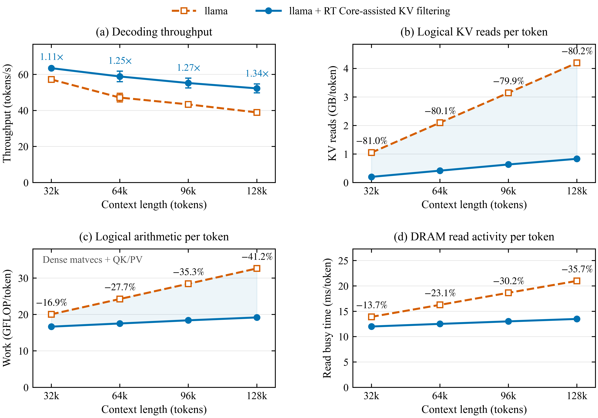
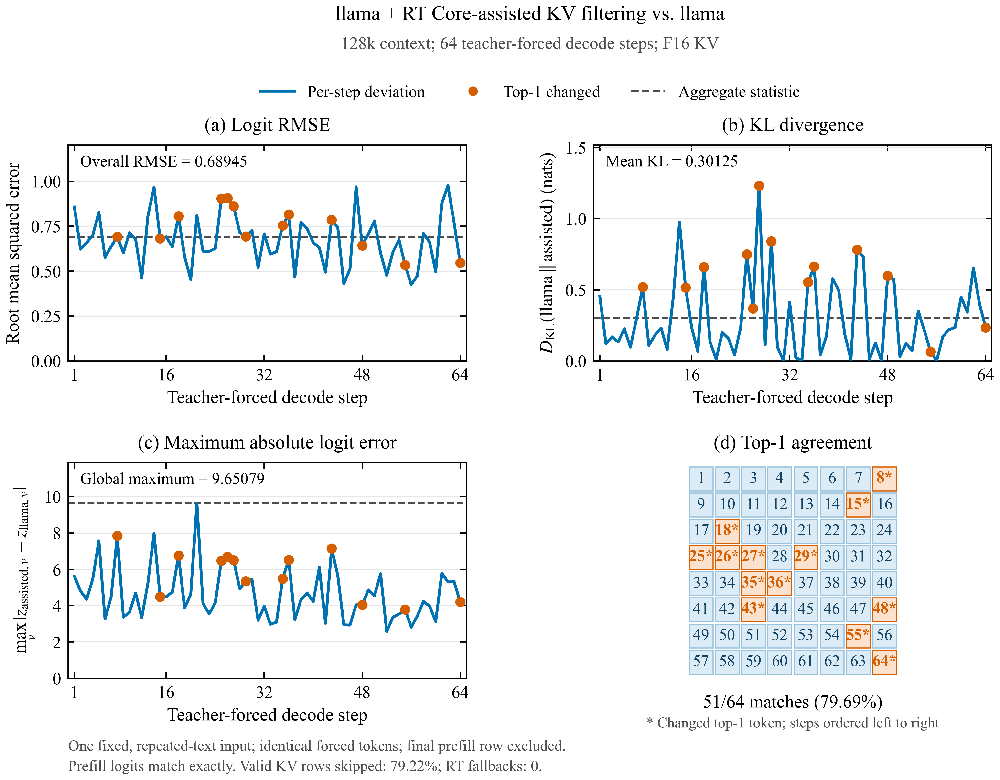

# Vulkan RT Core-assisted KV filtering

Vulkan ray queries select historical KV pages and produce the block mask consumed by native cooperative-matrix-2 FlashAttention. FlashAttention computes QK, softmax, and PV on the retained blocks with F16 K/V. Omitting pages changes both the attention numerator and denominator.

## Build and run

Install the dependencies from the [Vulkan build guide](../../build.md#vulkan), then build:

```sh
cmake -B build -DGGML_VULKAN=ON -DCMAKE_BUILD_TYPE=Release
cmake --build build --config Release -j 8
```

Enable approximate selection in PowerShell:

```powershell
$env:GGML_VK_RT_KV = "1"
$env:GGML_VK_RT_KV_APPROX = "1"

./build/bin/llama-cli.exe -m model.gguf -dev Vulkan0 -ngl 99 -fa on -ctk f16 -ctv f16 -c 131072 -b 512 -ub 512 -t 6 -n 64 -p "Explain how a library catalog works."
```

Multi-configuration builds place executables in `build/bin/Release/`. On Linux, set the same variables with `export` and use `./build/bin/llama-cli`.

## Configuration and execution

llama.cpp supplies tensor types, head dimensions, KV heads, GQA, strides, context capacity, and attention settings. Native FlashAttention tuning supplies the block width; Vulkan features and resource limits determine the query path and buffer sizes. Pipelines and page summaries are cached for each detected layout.

The selector handles single-token, single-sequence cooperative-matrix-2 FlashAttention with F32 Q, F16 K/V and mask, and F32 score accumulation. Other types and attention settings, including ALiBi, softcap, and sinks, use native FlashAttention. A finite mask bias selects all blocks.

KV writes mark changed K pages in SET_ROWS and its RMSNorm/RoPE fusions. The selector refreshes these summaries, then queries page directions with a fixed triangle box built once per backend context. It retains the first page, recent rows, and pages with zero projected magnitude. Q heads in each GQA group share a KV-head bitmap, which is converted to the native FlashAttention block mask.

Cache keys include the K buffer, offset, shape, strides, and query group. Contiguous single-stream caches update summaries incrementally; other layouts refresh them per attention call. Uploads, clears, and other writes invalidate affected summaries. The complete F16 KV cache stays allocated; RT adds summaries, generation counters, query state, block masks, and acceleration structures.

| Variable | Default | Effect |
| --- | --- | --- |
| `GGML_VK_RT_KV` | `0` | Enable RT-assisted block-mask selection |
| `GGML_VK_RT_KV_APPROX` | `0` | Use ray-selected pages directly; checked mode tests an attention truncation budget |
| `GGML_VK_RT_KV_UNIT_BOX` | Automatic | Select the fixed-box path from subgroup features in approximate mode; `0` selects AABBs |
| `GGML_VK_RT_KV_PAGE` | Automatic | Derive page size from the native block width; override: 8, 16, 32, or 64 |
| `GGML_VK_RT_KV_WINDOW` | `128` | Retain recent visible rows |
| `GGML_VK_RT_KV_PADDING` | `0.3` | Candidate-box padding |
| `GGML_VK_RT_KV_ERROR` | `0.0001` | Maximum-coordinate truncation budget in checked mode |
| `GGML_VK_RT_KV_STATS` | Unset | Print calls, selected rows, dense fallbacks, rays, and hits at backend cleanup |

Checked mode estimates omitted attention mass from page bounds. A zero budget or an exceeded budget selects all blocks. Approximate mode uses the ray-selected set directly.

Diagnostic controls:

| Variable | Default | Effect |
| --- | --- | --- |
| `GGML_VK_RT_KV_EXACT` | `0` | Evaluate omitted QK scores in the truncation check |
| `GGML_VK_RT_KV_FULL_SUMMARY` | `0` | Compute full summaries in approximate mode |
| `GGML_VK_RT_KV_REFIT` | `0` | Refit AABB acceleration structures after the initial build |
| `GGML_VK_RT_KV_DENSE` | `0` | `1`: use all rows through the adapter; `2`: select pages, then use all rows |
| `GGML_VK_RT_KV_MASK` | `1` | Enable the RT block-mask adapter |

## Measurements

Results use `QwenPaw-flash-9B-20260330-q4.gguf`, RTX 5060 Ti 16 GB, Vulkan0, full GPU offload, native FlashAttention, F16 K/V, six CPU threads, and batch/microbatch size 512. Approximate unit-box selection uses 32-row pages and a 128-row recent window. The measured implementation is preserved at commit `0cddc9eb4`, before automatic layout selection.

### Decode throughput

Each value is the mean of five runs generating 64 tokens. Context sizes are decimal token counts. The 32K llama result uses the earlier baseline run; the remaining llama results use the long-context baseline run.

| Context tokens | llama (tokens/s) | llama + RT Core-assisted KV filtering (tokens/s) | Speed increase |
| --- | ---: | ---: | ---: |
| 32000 | 57.23 | 63.50 | 10.96% |
| 64000 | 47.18 | 58.89 | 24.82% |
| 96000 | 43.39 | 55.25 | 27.32% |
| 128000 | 38.95 | 52.29 | 34.25% |

Run with the variables from [Build and run](#build-and-run):

```sh
./build/bin/llama-bench -m model.gguf -dev Vulkan0 -ngl 99 -fa on -ctk f16 -ctv f16 -p 0 -n 64 -d 32000,64000,96000,128000 -b 512 -ub 512 -t 6 -r 5 -o json
```

### KV reads and arithmetic per token

Logical counts cover eight full-attention layers, four KV heads, four Q heads per KV head, and 256-dimensional K/V. Unique KV reads count one read per KV head shared across GQA. QK/PV counts two operations per multiply-add. Dense matrices contribute 15.870 GFLOP/token; recurrent state, softmax, elementwise work, quantization decoding, selection, and padded tiles are excluded.

| Context tokens | Valid KV rows skipped | Estimated unique KV reads saved (GB/token) | Logical QK/PV arithmetic saved (GFLOP/token) |
| --- | ---: | ---: | ---: |
| 32000 | 80.96% | 0.850 | 3.399 |
| 64000 | 80.13% | 1.681 | 6.725 |
| 96000 | 79.85% | 2.513 | 10.051 |
| 128000 | 80.17% | 3.363 | 13.453 |

### Hardware DRAM read activity

Nsight Systems sampled GPU-wide `dram__read_throughput.avg.pct_of_peak_sustained_elapsed` during an isolated 256-token decode loop. Integrating the read activity as a fraction of peak and dividing by token count gives peak-equivalent milliseconds per token. The capture covers decoding, with loading, prefill, cache restore, and profiler startup excluded.

| Context tokens | llama (ms/token) | llama + RT Core-assisted KV filtering (ms/token) | Read activity reduction |
| --- | ---: | ---: | ---: |
| 32000 | 13.906 | 11.998 | 13.72% |
| 64000 | 16.268 | 12.514 | 23.07% |
| 96000 | 18.648 | 13.012 | 30.22% |
| 128000 | 20.992 | 13.489 | 35.74% |



Throughput error bars show one standard deviation. KV reads and arithmetic use logical counts; DRAM read activity uses hardware samples. [PDF](figures/rt-core-paper.pdf), [SVG](figures/rt-core-paper.svg).

### 128K logit comparison

One fixed 128000-token prompt contains numbered, rotated repetitions of English library recovery notes. Both runs use F16 K/V and the same 64 teacher-forced continuation tokens. The comparison covers 248320 logits per step, or 15892480 values; final prefill logits match exactly.

| Decode metric | Result |
| --- | ---: |
| Logit RMSE | 0.689454 |
| Logit MAE | 0.533442 |
| Maximum absolute logit difference | 9.650794 |
| Mean KL, llama to assisted distribution | 0.301247 |
| Maximum step KL | 1.231927 |
| Top-1 agreement | 51/64 (79.6875%) |
| Mean top-5 overlap | 71.875% |
| Valid KV rows skipped | 79.2176% |
| KV-head selector calls | 2048 |
| Dense fallback calls | 0 |



Per-step RMSE, KL, maximum absolute difference, and top-1 agreement. [PDF](figures/rt-kv-error-128k.pdf), [SVG](figures/rt-kv-error-128k.svg).

## Operator checks

```sh
cmake --build build --config Release --target test-backend-ops -j 8
./build/bin/test-backend-ops -b Vulkan0 -o FLASH_ATTN_EXT -p kv_pages=1
./build/bin/test-backend-ops -b Vulkan0 -o kv_update
```

Cases cover GQA, historical hot pages, partial pages, causal masks, finite mask biases, dense selection, 512-dimensional heads, 16 KV heads, 16 Q heads per KV head, and contexts beyond 131072 rows. Cache updates use I32/I64 SET_ROWS indices and F32 score accumulation. Set `GGML_VK_RT_KV=1` for checked mode or the variables from [Build and run](#build-and-run) for approximate unit-box mode.
