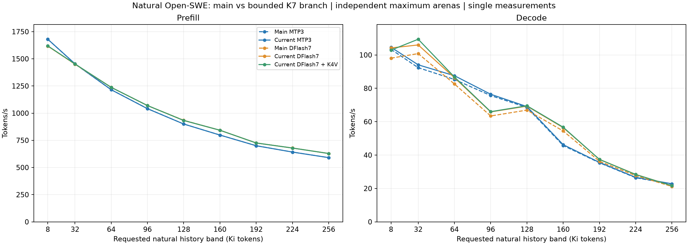

# DFlash2 + K4V: natural Open-SWE branch comparison

Main: `bcf1a81d641c478db5690d2f2c048c691801fcb2`. Current: `57ea0244a6f1f6bb684b6f4cf001246657062183`; qualified production code `8793469b2bc4894561c6e3967414fa33b0c31d9c`. Main has no supported streaming DFlash+K4V configuration, so five supported arms were measured at each of nine bands (45 points).

## Decode tokens/s

| History band | Actual prompt | Main MTP3 | Current MTP3 | Main DF7 | Current DF7 | Current DF7 + K4V |
| ---: | ---: | ---: | ---: | ---: | ---: | ---: |
| 8 Ki | 8,186 | 103.36 | 104.59 | 98.07 | 104.19 | 102.89 |
| 32 Ki | 32,819 | 92.37 | 94.08 | 100.81 | 105.99 | 109.41 |
| 64 Ki | 65,447 | 85.31 | 87.56 | 82.60 | 86.37 | 86.78 |
| 96 Ki | 98,321 | 75.67 | 76.44 | 63.42 | 65.86 | 66.00 |
| 128 Ki | 131,249 | 68.53 | 69.05 | 66.95 | 69.32 | 69.55 |
| 160 Ki | 162,768 | 45.72 | 46.23 | 54.44 | 56.45 | 56.70 |
| 192 Ki | 198,245 | 35.41 | 35.62 | 36.28 | 37.45 | 37.39 |
| 224 Ki | 229,363 | 26.42 | 26.65 | 27.70 | 28.42 | 28.34 |
| 256 Ki | 257,558 | 22.62 | 22.80 | 21.20 | 21.63 | 21.62 |

The requested labels are approximate history bands, not configured capacities:

| History band | Actual prompt tokens | Configured capacity |
| ---: | ---: | ---: |
| 8 Ki | 8,186 | 16,384 |
| 32 Ki | 32,819 | 40,960 |
| 64 Ki | 65,447 | 73,728 |
| 96 Ki | 98,321 | 106,496 |
| 128 Ki | 131,249 | 139,264 |
| 160 Ki | 162,768 | 172,032 |
| 192 Ki | 198,245 | 204,800 |
| 224 Ki | 229,363 | 237,568 |
| 256 Ki | 257,558 | 262,144 |

Capacity leaves room for the output cap and speculative headroom. Natural EOS can end generation earlier; the per-point CSV records the actual output count. At 192 Ki, pure DFlash and mixed K4V responses contain 1,359 and 1,357 tokens, with their first difference at zero-based token 941. Both observed rates remain in the table, but neither mixed-mode comparison at that band receives a matched-work gain claim. This difference alone does not establish its numerical cause or answer quality.

## Measured gains

| Band | MTP current/main | DF7 current/main | K4V current/DF7 | Combined mixed/main DF7 |
| ---: | ---: | ---: | ---: | ---: |
| 8 Ki | +1.19% | +6.24% | -1.25% | +4.91% |
| 32 Ki | +1.85% | +5.14% | +3.22% | +8.53% |
| 64 Ki | +2.63% | +4.57% | +0.46% | +5.05% |
| 96 Ki | +1.02% | +3.85% | +0.21% | +4.07% |
| 128 Ki | +0.76% | +3.54% | +0.33% | +3.89% |
| 160 Ki | +1.12% | +3.69% | +0.44% | +4.14% |
| 192 Ki | +0.58% | +3.21% | Different work | Different work |
| 224 Ki | +0.87% | +2.60% | -0.28% | +2.31% |
| 256 Ki | +0.78% | +2.00% | -0.02% | +1.98% |

One natural full completion per branch/mode/prompt at its independently maximum-fit arena, not repeated-trial statistics/equal-memory latency or long native-equivalence proof. Source-specific counters unavailable on main are null. Unequal responses remain reported but do not receive matched-work code/enablement gain claims. Nine different tasks across context bands do not isolate context scaling.

Branch-only comparisons require identical visible IDs and draft/accept counts. K4V comparisons intentionally allow different proposal schedules but require identical visible outputs. The CSV retains every raw observed rate and equality flag, including excluded comparisons. Maximum arenas and physical layouts are reported explicitly. All 18 same-mode branch pairs selected identical arenas and decode layouts; cross-mode comparisons still have different memory costs. This experiment compares entire branches and does not attribute every percent to one isolated change.

## Protocol and limits

Inputs are complete historical assistant prefixes from the pinned NVIDIA Open-SWE-Traces v1.2 revision `4fa4c2ae9afc6b397bc50391d43450c79993c138`. Selection uses length/task diversity only. No padding, concatenation, future answers, target-output/hit-rate selection or tool execution. Requested labels denote history bands; actual prompt lengths and generation-safe configured capacity are recorded in the CSV.

All arms use the same Qwen IQ4_XS target, Q8_0 K/Q4_0 V, b/ub256, one GPU/serial request, threads8, no UVM, normal graphs, headless mode, seed123/temperature0, fresh cache and natural EOS with a 2,048-output cap. MTP3 uses the embedded layer; DF7 and mixed use the same external Q4 sidecar. Mixed is N12/M7/H1. Different modes can produce different continuations; token throughput is not equal-response task latency or agent task-success evaluation.

Each point uses the existing arena finder with bounded real-SWE preflight and a separately labelled copying/resource proof. Actual full natural requests refine the selected maximum in both directions; every point retains a real rejected +1 MiB neighbor. Capacity-probe timings and forced copying are excluded from performance. No arbitrary reserve or fastest-trial selection is used. Main lacks the new prediction-forward counter, which is unavailable rather than zero.

Main was rebuilt from its exact pinned checkout: 146 host objects with original flags and Unity grouping, no CUDA recompilation. The current runtime is the qualified restore-overlap bundle. Both use pinned unchanged CUDA libraries. Generated `--version` build-info strings can predate the measured source; the per-object source/dependency/hash manifests define source identity. No runtime/kernel/model/configuration changes were made for this measurement.

[Full results CSV](../../benchmarks/data/dflash2-k4v-swe-branches.csv), [comparison CSV](../../benchmarks/data/dflash2-k4v-swe-comparisons.csv), [profile, source/binary/model hashes, prompt identities and boundary audit](../../benchmarks/data/dflash2-k4v-swe-branches.json). The introductory historical charts and older sweeps remain separate cohorts. Raw responses, immutable attempts, journals and logs remain in the local `benchmarks/results/dflash2-k4v-swe-branches-20261031/` directory; the published JSON indexes their hashes rather than bundling the dataset or binaries.

The source/runtime/model/prompt profile stayed fixed across a documented search-only controller handoff. Already completed full-fit/+1MiB measurements retain their original raw receipts; later searches use matching arena values only as starting hints and independently verify both boundaries. The local `run-v2/adopted-evidence.json` and per-entry `origin_runtime_id` retain this mapping. This avoids redundant non-measurement prefills; it does not reuse timings from older experiments.

## K4V activity in the retained natural request

| Band | K4V proposal blocks | K4V accepted tokens | Pure DF prediction forwards | Mixed DF prediction forwards | Pure selected rounds | Mixed selected rounds |
| ---: | ---: | ---: | ---: | ---: | ---: | ---: |
| 8 Ki | 1 | 7 | 48 | 47 | 48 | 48 |
| 32 Ki | 44 | 226 | 455 | 401 | 455 | 445 |
| 64 Ki | 0 | 0 | 56 | 56 | 56 | 56 |
| 96 Ki | 1 | 0 | 137 | 136 | 137 | 137 |
| 128 Ki | 37 | 205 | 126 | 90 | 126 | 127 |
| 160 Ki | 23 | 132 | 201 | 178 | 201 | 201 |
| 192 Ki | 38 | 187 | 295 | 258 | 295 | 296 |
| 224 Ki | 6 | 26 | 335 | 330 | 335 | 336 |
| 256 Ki | 6 | 19 | 303 | 297 | 303 | 303 |

Small timing differences with no supplied K4V drafts cannot be credited to avoided neural prediction. A supplied but rejected copy can also add target work. Selected rounds sum source accept calls and exclude any terminal anchor-only processing; they are not an exhaustive target-forward counter. These counters explain applicability; they are not themselves throughput gains.

## Interpreting and reproducing the comparison

The observed same-mode branch decode changes span +0.58% to +2.63% for MTP3 and +2.00% to +6.24% for DFlash7. Their prefill differences stay within 0.16%; this study does not show a meaningful prefill improvement. Additional K4V changes range from -1.25% to +3.22% on equal-output pairs, mostly near zero. The useful 32 Ki case does not establish a general K4V speedup.

For a new measurement, build each pinned revision separately and follow the [K7 run and sizing instructions](dflash2-k4v.md#run-it) with fresh output directories and the same selected prefixes. The ordinary [control harness](../../benchmarks/run_dflash_controls.py) accepts explicit `--spec-mode`, `--ngram-n`, `--ngram-m` and `--ngram-min-hits`; use the per-point CSV/JSON for actual prompt, capacity and arena values. The [finder](../../benchmarks/find-max-arena.py) starts its own server. A copying/resource probe is separate from natural-response timing, and no existing production service is required. Main mixed mode is unsupported; do not substitute an unqualified configuration to fill that arm.
