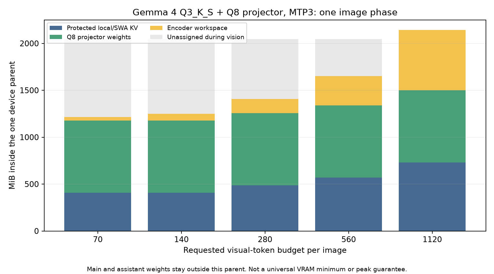
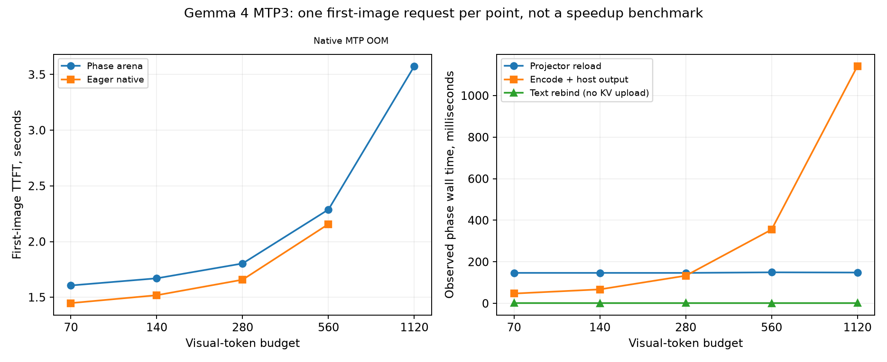

# Gemma 4 vision phase-arena report

This report records the supported image profile, measured memory and latency, numerical/lifecycle qualification, and internal ownership contracts for Gemma 4 vision with Adaptive KV Streaming V2. For a short introduction and shared Qwen/Gemma launch flow, see the [README vision summary](../../README.md#vision-support) and [vision Quickstart](../../README.md#vision-launch-examples).

## Supported profile and scope

The qualified image profile uses the pinned Gemma 4 31B `Q3_K_S` target, a locally quantized matching `Q8_0` projector, and the matching external `Q8_0` assistant for MTP1-3, plus target-only execution. This is a separate memory profile from the historical `Q3_K_M` text sweeps; their rates and fitted arenas must not be substituted. The [qualification manifest](../../benchmarks/data/gemma4-vision-qualification.json) pins artifacts and accepted evidence; the [GV0-GV9 roadmap](../../GEMMA4_VISION_PHASE_ROADMAP.md) preserves design decisions and development history.

Support is one serial request on one CUDA GPU, Flash Attention, GPU KV offload and bounded SWA. Still images, multiple images and interleaved text/image chunks are included within the admitted batch/context limits. Only this image/text Gemma 4 31B pairing is qualified on CUDA SM120. Audio/video, full-SWA, LoRA, parallel slots, Gemma DFlash, other variants and CPU/UVM fallbacks are not part of this profile. Compile-only portability evidence does not extend the vision runtime qualification.

### KV-format support and test coverage

Gemma text, long-context and image execution is not hard-coded to Q8_0 K / Q4_0 V. Q8_0/Q4_0, Q8_0/Q8_0 and Q5_1/Q5_1 are supported decoder-cache pairs; the projector's weight precision is independent of that choice. Each pair needs its own memory fit and admitted kernel geometry.

Q8/Q4 is the reference for the published long-context and all-five-image-budget campaigns. Q8/Q8 and Q5_1/Q5_1 additionally passed fitting native/arena image API controls at budget 70 across target-only and MTP1-3. Those records do not constitute a long-context/all-budget sweep of the other two pairs, but their narrower measurement coverage is not a server restriction. See the [qualification manifest's reference and additional-pair fields](../../benchmarks/data/gemma4-vision-qualification.json).

## One parent, separate phase lifetimes

Vision reuses the same device parent as text prefill, decode and drafting. It preserves the local sliding-window-attention (SWA) cache while temporarily lending the reclaimable region to projector weights and encoder workspace. The main model and optional assistant weights remain on GPU outside that parent. After encoding, owned host embeddings survive while the temporary vision grants return to text execution.

| Resource | Recorded GPU allocation | Placement during image encoding |
| --- | ---: | --- |
| Q3_K_S target weights | 12,583.79 MiB | Outside the parent; remain on GPU |
| Optional matching Q8 assistant | 475.81 MiB | Outside the parent; remain on GPU, no assistant execution |
| Local Q8 projector weights | 807,838,208 bytes / 770.41 MiB | Temporary weight grant inside the parent |
| Local/SWA KV | Depends on image microbatch; table below | Protected persistent suffix inside the same parent |
| Encoder attention and other activations | Measured for the actual image batch | Temporary compute grant inside the parent; no decoder KV history |
| Full-attention KV and completed image embeddings | Host allocations | Authoritative host history and owned outputs survive the handoff |

The device parent bounds only its participating allocations. It does not bound decoded host images, pinned full KV, output embeddings, driver executables or every future request. Model weights also need memory outside the parent.

## Projector artifacts and precision

The selected Q8 file is 807,772,384 bytes, not a pure eight-bit encoding of every tensor. Shape-incompatible and sensitive tensors retain F16/F32. A smaller local Q4_0 candidate (599,140,576 file bytes) passed component/native-bit checks and the current synthetic fixture/F16-reference comparison, but is not the selected deployment artifact. These fixtures are not a general OCR, chart or visual-detail quality certificate. Native-versus-arena equality uses the same projector artifact; cross-precision outputs need not be identical.

The recorded Q8 artifact was made directly from the pinned matching F16 projector with the existing quantizer, without overriding its sensitive-tensor exclusions or shape fallbacks. From the repository root:

```sh
cmake --build build-v2 --target llama-quantize --parallel 2
build-v2/bin/llama-quantize /path/to/mmproj-F16.gguf \
  /path/to/mmproj-gemma4-31B-Q8_0-local.gguf Q8_0 8
```

Verify the reference and resulting artifact hashes against the [qualification manifest](../../benchmarks/data/gemma4-vision-qualification.json); an arbitrary publisher's Q8 filename is not proof of identical tensors or pairing. The smaller Q4 candidate was independently quantized from F16, not requantized from Q8.

## Image budgets and measured fit

| Requested per-image budget | Square output rows | Tested b/ub | Protected SWA MiB | One-image encoder workspace MiB | Normal parent MiB |
| --- | ---: | ---: | ---: | ---: | ---: |
| 70 | 64 | 256/256 | 406.25 | 37.66 | 2048 |
| 140 | 121 | 256/256 | 406.25 | 71.20 | 2048 |
| 280 | 256 | 512/512 | 487.50 | 150.63 | 2048 |
| 560 | 529 | 768/768 | 568.75 | 311.26 | 2048 |
| 1120 | 1089 | 1280/1280 | 731.25 | 640.75 | 2143 |

Budgets are limits, not guaranteed row counts. The Gemma4V preprocessor uses floor-aligned aspect-ratio geometry; at budget 1120 the portrait/landscape fixtures produce 1064 rows and the narrow fixture 945. Qwen retains its separate preprocessing. The image chunk must fit in one admitted microbatch. Wider image batches enlarge local rollback/headroom storage, so a text-only `--ubatch-size 256` fit does not qualify every image budget. Compatible images can share an encoder batch; the larger two-image fixtures split through the existing batch limits and retain prompt order.

At ctx 4096, prefix 1333 and 16 outputs, modes 0-3 have exact per-scenario native API controls through budget 560; target-only also has them at 1120. Eager native MTP1-3 at 1120 runs out of VRAM allocating the 640.75 MiB encoder workspace after valid text controls. The arena's 1120 MTP profiles pass using staged native encoder/logit/hidden-vector oracles plus separate lifecycle self-consistency; **that is not full native API equivalence at 1120 MTP**.

The recorded two-image 1120 workload has a 2143 MiB whole-MiB phase minimum and independent maximum-fit parents of 2812 MiB target-only / 2332 MiB MTP1-3, each with an actual rejected +1 MiB neighbor. These are measured configurations on one card, not portable minima/maxima or arbitrary-image guarantees.

### Find a fit for your images

No existing server, container or background service is required. Build the [vision-enabled server](../../README.md#build), make sufficient GPU memory available, and choose an unused port. The finder below launches and cleans up its own temporary servers; it neither contacts an existing inference server nor manages other services. Run commands from the repository root, using your own model/image paths and a fresh output directory.

For text sizing with a configured projector, the [README's two native-context examples](../../README.md#find-a-usable-arena-size) use `--probe-mode preflight --validate-selected`: short real prefill/decode probes find the candidate limit, then the complete requested text workload runs once at the selected arena. The report separates probe history, requested history and full-workload validation. A configured projector without an image is not encoder validation. Supplying an image retains the complete image request even in preflight mode; it is never shortened into a causal text surrogate.

```sh
python3 benchmarks/find-max-arena.py \
  --server build-v2/bin/llama-server --model /path/to/gemma-4-31B-it-Q3_K_S.gguf \
  --model-draft /path/to/mtp-gemma-4-31B-it-Q8_0.gguf \
  --mmproj /path/to/mmproj-gemma4-31B-Q8_0-local.gguf \
  --context-size 4096 --batch-size 1280 --ubatch-size 1280 \
  --cache-type-k q8_0 --cache-type-v q4_0 --spec-mode mtp --draft-length 3 \
  --image /path/to/first.png --image /path/to/second.png \
  --prompt-file /path/to/image-request.txt --image-min-tokens 1120 --image-max-tokens 1120 \
  --decode-tokens 16 --output benchmarks/results/fit-gemma-images
```

The prompt file needs one `<__media__>` marker per image. In the recorded two-pattern run, selected fields were `arena_mib=2332`, `next_mib_rejected=2333`, `vision_execution_validated=true`, `draft_length=3`, and `decode_tokens=16`. These are real measured values for those pinned fixtures, not predicted results for the example's arbitrary photos. `--initial-arena-mib` is optional and is not a required arena input. A `--mmproj` run without `--image` remains only a configured-projector text fit.

## Running an image request locally

The shared [README vision Quickstart](../../README.md#vision-launch-examples) starts a new local server on port 8080, either target-only or with MTP. Select its Gemma profile for this report's configuration, or the Qwen profile for Qwen's matching artifacts; the client request format below is identical. Wait for that process to finish loading, then use its Web UI to attach an image. No pre-existing inference service is assumed.

For an HTTP request instead, keep that newly launched server running and execute the following in a second terminal. Set your own image path; this example encodes the image locally and sends it only to the server you just started:

```sh
python3 - <<'PY'
import base64
import json
import mimetypes
from pathlib import Path
from urllib.request import Request, urlopen

image = Path('/path/to/photo.png')
mime = mimetypes.guess_type(image.name)[0] or 'image/png'
encoded = base64.b64encode(image.read_bytes()).decode('ascii')
payload = {
    'messages': [{'role': 'user', 'content': [
        {'type': 'text', 'text': 'Describe this image.'},
        {'type': 'image_url', 'image_url': {'url': f'data:{mime};base64,{encoded}'}},
    ]}],
    'max_tokens': 64,
    'stream': False,
}
request = Request('http://127.0.0.1:8080/v1/chat/completions',
                  data=json.dumps(payload).encode(), headers={'Content-Type': 'application/json'})
with urlopen(request, timeout=600) as response:
    print(json.load(response)['choices'][0]['message']['content'])
PY
```

Stop the server with Ctrl-C when finished. Run the finder separately, not alongside this server on the same GPU unless both workloads have enough memory.

## Phase measurements




[Measured points (CSV)](../../benchmarks/data/gemma4-vision-measurements.csv) / [metrics, scope and source hashes](../../benchmarks/data/gemma4-vision-measurements.json). Each point is one first image request with prompt-cache reuse disabled, not a cold-disk measurement or a repeated latency/speedup benchmark. Encoder wall time includes the owned host-output copy; reload is not pure PCIe bandwidth. CPU preprocessing and image/text-prefill portions are not independently isolated. Device samples can miss peaks. Native 1120 MTP OOMs are missing comparison points, never zero-duration data.

## Numerical, lifecycle and memory qualification

Long image lifecycle coverage is separately scoped to budget 70, capacity 131072 and a 98304-token text prefix at all four modes, including actual ring use, later images, save/restore and process restart. It is streamed-only self-consistency, not long native equivalence or full 256 Ki image-prefill qualification. The 4 Ki image tests also cover 1024-output generations and another image after decode. Failed requests use validated recovery or an explicit uncached reset; malformed state-file rejection does not promise that the prior in-memory cache survived unchanged.

The joint public-vision and image-conditioned full-vector memory gates use the explicitly approved 1536 MiB sanitizer-only parent, unchanged model/projector/KV types and exact vector/API checks. Ordinary 2048/2143 MiB profiles remain unchanged. Encoder/component controls retain their separately recorded budgets; a largest-budget component pass is not a full joint 1120 MTP sanitizer run. Driver executables, host preprocessing and host KV are not bounded by the device arena.

The [server test guide](../../tools/server/tests/README.md#gemma-4-vision-and-shared-kv-mtp-qualification) gives standalone numerical, recovery and long-ring harness commands. Those harnesses create their own local servers and require no running service. Full native controls must fit on the device; an allocation failure is a capacity finding, not a numerical pass. Exact artifacts, rejected profiles and accepted partial results remain recorded in the manifest and roadmap.

## Internal API and lifetime contracts

### Bounded storage and read sources

These are internal C++ contracts, not additional public CLI flags. Use common model/context startup for ordinary MTP so hidden outputs, warmup retirement, assistant loading and serial workspace measurement occur in the qualified order.

| Operation | Contract |
| --- | --- |
| `llama_kv_cache_iswa::bounded_storage_requirements(...)` | Quote actual local roots, encoding, window/headroom, padding and buffer class before allocation; returns layout/identity, not storage or attention admission |
| `llama_memory_params::defer_bounded_cache` | Construct allocation-free local metadata first; normal execution is closed until the persistent lease is bound |
| `llama_kv_cache::bind_bounded_storage(lease)` | Validate exact physical quota/layout, materialize checked native tensors and retain storage. Same-lease binding preserves contents; no second persistent SWA allocation is needed |
| `llama_memory_bounded_kv::read(identity)` | Acquire a retained physical read pin. `contains_layer` revalidates root/storage bounds; `bind_layer_views` creates caller-owned metadata without initializing or clearing source bytes |
| `attach/arm/release_shared_bounded_reader(...)` | Own and validate native local-view metadata, then hold the source pin through all queued native readers. The caller completes readers before releasing it |
| `attach/arm/release_shared_stream_reader(...)` | Own full-read proxy roots over a target session. Arm after preparing the parent's serial phase; release before target mutation. Writes reject; proxy clear does not erase source KV |
| `session.read_source(...)`, `prefetch_read(...)`, `read_attention(...)` | Snapshot a completed source, validate its binding/revision/geometry, then queue/adopt or synchronously read progressive spans. No append or complete-layer residency requirement |
| `llama_context_params::kv_stream_verify_max` | Optional target query bound 1-4 for serial streamed Gemma; zero keeps the inferred profile. Common MTP startup derives D+1. Do not derive this from `n_rs_seq`, which is zero for Gemma |
| `model.sequence_stats(role)` / `runtime_diagnostics(...)` | Read-role transfer statistics stay separate; default runtime diagnostics align target append counts with target feedback timing |

Keep the target context alive until its assistant, graphs and borrowed views are destroyed. The physical parent outlives the local roots, proxy views and every queued reader. Semantic generations/frontiers come from the actual target-owned source, not a clone counter; a pointer or unchanged length does not prove unchanged content. Release graph bindings before reusing their workspace, and complete pending copies/native reads before releasing their source pins. After failed work, retain cleanup ownership until drain succeeds; reconstruct from authoritative state before reopening admission. No removed G5c ordered-reader/event-bank API is part of this contract.

For direct C API callers, select `swa_full=false` for bounded Gemma: the C API default is not the bounded profile. Full-SWA remains valid for ordinary native contexts, but shared bounded storage rejects it instead of shrinking it silently. Local metadata/cell state remains native; both cache groups must pass removal/history-availability prevalidation before either is mutated. See [Gemma qualification](../../GEMMA4_ADAPTIVE_KV_ROADMAP.md) for exact-fit/one-byte-short, rebind, window, state/restart and all-acceptance-count tests.

### Vision lending and completion

Use the existing MTMD session path rather than duplicating a server state machine. `mtmd_vision_phase_compatible` validates the loaded projector/target capabilities; it does not prove arbitrary artifacts are a matching or qualified pair. `mtmd_batch_measure_vision_phase` describes actual weight and device/host compute requirements. `llama_context_memory::quote_suspended_loans` performs a metadata-only aligned quota check before target suspension; report its required/available/additional bytes, not GGUF file-size estimates.

`llama_context_suspend_kv_device` synchronizes the target and completes any recurrent publication when present. Gemma instead preserves the bounded native SWA lease and committed full-attention host history. `lend_suspended` uses the existing `PRESERVE_PERSISTENT` arena plan and materializes only disjoint temporary grants. Unknown regions, retained temporary loans or active serial work still reject unsafe transitions. Protected bytes are not counted again as borrowed vision bytes in diagnostics.

The existing `mtmd_batch_encode_arena` / `mtmd_session_eval_chunks_arena` adapter reloads weights into a temporary grant, runs the measured encoder, retains complete owned host embeddings, drains users, retires bindings and unloads weights before returning the grants. `resume_kv` / `llama_context_resume_kv_device` explicitly remeasure/rebind the requested text phase; retained loans block resume. A failed reverse transition closes the owner, rather than executing stale tensor pointers. Lease lifetime is not GPU completion.

`register_shared_read_consumer` declares only an already registered matching serial child with no independent KV writer. That permits the Gemma assistant to suspend with its target; it does not authorize an arbitrary draft model or multiple concurrent readers. Refresh actual target-owned source bindings and post-image hidden/carry state after resume. Gemma uses ordinary sequential decoder positions and its native SWA-only non-causal image mask; global attention stays causal. Qwen's decoder M-RoPE and auxiliary MTP image catch-up are separate adapters.

For direct C/C++ setup, declare the outputs you will actually request via `common_speculative_get_output_limits`: image input rows are not all logit/hidden output rows. The tested target declares one normal / four verification outputs for MTP3; the TG1 assistant declares one. Do not reserve 1280 full-vocabulary outputs merely because an image has a 1280-row microbatch, or reduce real requested outputs to manufacture fit. The public server already derives these limits.

Projector files/settings are immutable session inputs. Restore saved state only with the matching target, projector, preprocessing and speculation settings. Existing cache/checkpoint identities remain authoritative; no filename-only cache identity or new unvalidated persistence policy is added. This report describes the measured implementation and profile, not an unrestricted memory or modality guarantee.
