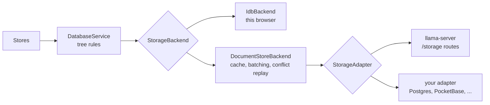

# Storage adapters

By default the UI keeps conversations and settings in the browser (IndexedDB and localStorage). A storage adapter keeps them somewhere else instead. The built-in one is llama-server's own JSON document store (`llama-server --ui-storage`). You can add your own for Postgres (Supabase, Neon), PocketBase or any other database.



## The contract

An adapter stores one **document per conversation**: `{ rev, conv, messages }`. It doesn't need to understand the document. It only stores it as a whole and enforces one rule:

- **Compare and swap on `rev`.** `putConversation(doc)` writes only if the store still holds revision `doc.rev`, where `0` means the document must not exist yet. It returns the new revision. Otherwise it throws `StorageConflictError` and writes nothing. This check and the write must be atomic.

`DocumentStoreBackend` uses that rule to merge edits from two tabs or browsers: on a conflict it fetches the fresh document, replays its own edits and retries.

Settings are plain string key/value pairs, merged per key: `updateSettings(set, remove)` must leave other keys untouched. The API key never reaches an adapter; it stays in the browser.

See `StorageAdapter` in `src/lib/types/storage.d.ts` for the full interface (six methods).

## Adding one

1. Implement `StorageAdapter` in `src/lib/storage-adapters/<name>.adapter.ts`, next to `llama-server.adapter.ts`.
2. Export a `StorageAdapterDefinition` (`id`, `name`, `description`, `isAvailable`, `create`) and add it to `STORAGE_ADAPTERS` in `src/lib/storage-adapters/index.ts`.
3. Build the UI. Settings → Import/Export → Storage then offers "Store on <name>" wherever `isAvailable` returns true, and copies the browser's data over when the user picks it.

Configuration such as a URL or a public key usually comes from build-time env vars (`import.meta.env.VITE_*`). Make `isAvailable` return false when they are missing.

The in-memory adapter in `tests/unit/document-store-backend.test.ts` is the smallest working example.

## Postgres: Supabase, Neon

Store the document as JSON columns, and do the compare and swap in one SQL function:

```sql
create table llama_ui_conversations (
    id       text primary key,
    rev      integer not null,
    conv     jsonb   not null,
    messages jsonb   not null
);

create table llama_ui_settings (
    key   text primary key,
    value text not null
);

-- returns the new revision, or null when `doc.rev` is stale
create function llama_ui_put_conversation(doc jsonb) returns integer
language plpgsql as $$
declare
    base    integer := (doc->>'rev')::integer;
    new_rev integer;
begin
    if base = 0 then
        insert into llama_ui_conversations (id, rev, conv, messages)
        values (doc->'conv'->>'id', 1, doc->'conv', doc->'messages')
        on conflict (id) do nothing
        returning rev into new_rev;
    else
        update llama_ui_conversations
        set rev = rev + 1, conv = doc->'conv', messages = doc->'messages'
        where id = doc->'conv'->>'id' and rev = base
        returning rev into new_rev;
    end if;
    return new_rev;
end $$;
```

Supabase and Neon (Data API) both expose this over PostgREST, so the adapter is a thin wrapper around `fetch`:

| Method               | Request                                                                                             |
| -------------------- | --------------------------------------------------------------------------------------------------- |
| `listConversations`  | `GET /llama_ui_conversations?select=rev,conv`                                                       |
| `getConversation`    | `GET /llama_ui_conversations?id=eq.<id>&select=rev,conv,messages`, first row or null                |
| `putConversation`    | `POST /rpc/llama_ui_put_conversation` with `{ "doc": ... }`; a null result → `StorageConflictError` |
| `deleteConversation` | `DELETE /llama_ui_conversations?id=eq.<id>`                                                         |
| `getSettings`        | `GET /llama_ui_settings`, rows into an object                                                       |
| `updateSettings`     | upsert with `Prefer: resolution=merge-duplicates`, then `DELETE ?key=in.(...)`                      |

Whatever key the adapter sends is in the built UI bundle, readable by anyone who loads the page. Protect the tables with row level security tied to a signed-in user (for example Supabase Auth), not with a key alone.

Add a `user_id` column to both tables if several people share the database.

## PocketBase

Create two collections:

- `conversations`, with `conv_id` (text, unique), `rev` (number), `conv` (json) and `messages` (json).
- `settings`, with `key` (text, unique) and `value` (text).

PocketBase's record API has no conditional update, so do the compare and swap in a custom route in `pb_hooks`. Inside `$app.runInTransaction`, read the record, compare `rev`, then save it with `rev + 1`. Answer 409 on a mismatch, and have the adapter turn that 409 into `StorageConflictError`.

## Going lower level

If you'd rather store messages as rows, for example as normalized Postgres tables, implement `StorageBackend` (`src/lib/types/database.d.ts`) directly, the way `IdbBackend` does. Then pass it to `DatabaseService.useBackend`. Your backend then has to provide transactions across conversations and messages itself; the document model above exists to avoid that requirement.
