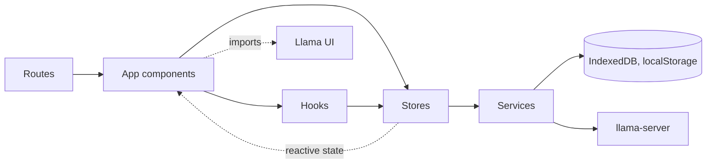
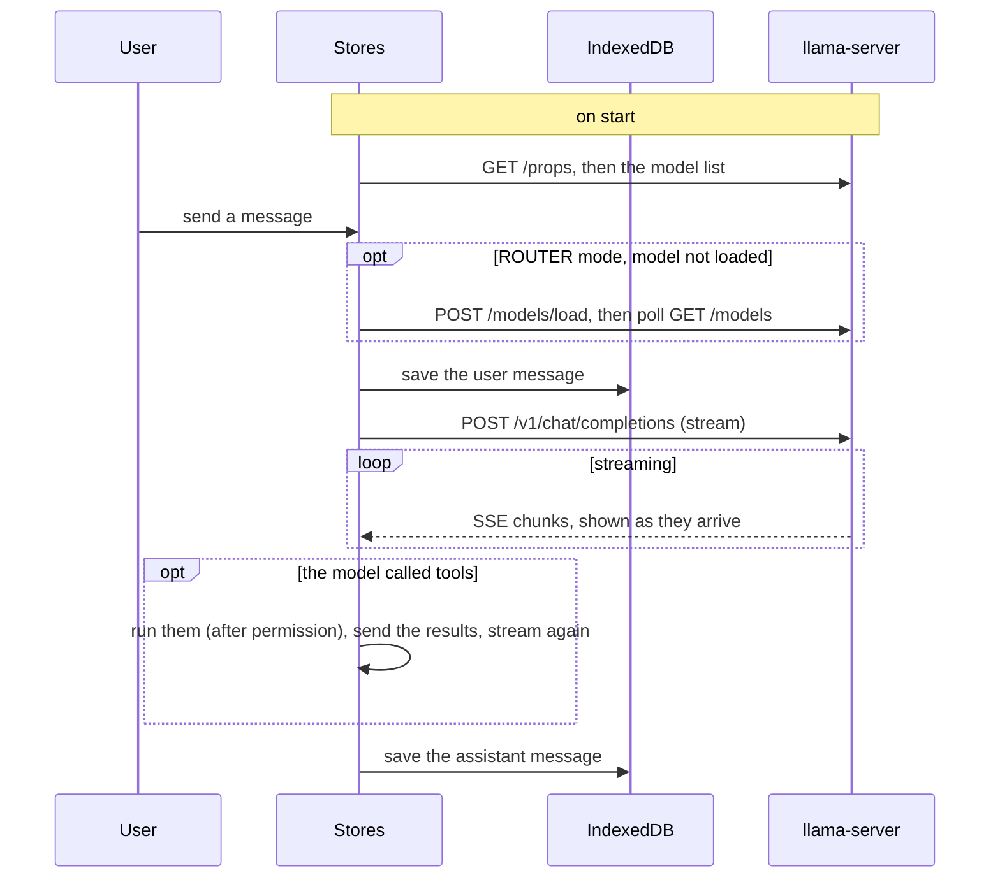

# Llama Chat

Llama Chat is the chat app for llama.cpp: a web interface for llama-server, built with SvelteKit on [Llama UI](../../lib/ui/README.md) (`@ggml-org/llama-ui`), the design system in `ui/lib/ui`. llama-server embeds it, and `npx llama-chat` runs it anywhere.

It works with a llama-server in either mode: **MODEL** (one model) or **ROUTER** (many models, loaded and unloaded on demand).

## Contents

- [Run it with npx](#run-it-with-npx)
- [Self-hosting](#self-hosting)
- [Features](#features)
- [Development](#development)
- [Architecture](#architecture)
- [Build and embedding](#build-and-embedding)
- [Publishing to npm](#publishing-to-npm)

## Run it with npx

Llama Chat is published to npm as [`@ggml-org/llama-chat`](https://www.npmjs.com/package/@ggml-org/llama-chat), with [`llama-chat`](https://www.npmjs.com/package/llama-chat) as its short name. It serves the prebuilt app as static files on localhost, or writes them to a folder for any static file server (see [Self-hosting](#self-hosting)); it brings no server and no models of its own. It needs Node.js 20 or later.

```bash
npx @ggml-org/llama-chat                                 # serve it on http://127.0.0.1:3000 for llama-server on :9931
npx @ggml-org/llama-chat --server http://localhost:8080  # for a llama-server elsewhere
npx llama-chat --host 0.0.0.0 --no-open                  # by its short name, reachable from other devices
npx llama-chat build                                     # write the static app to ./llama-chat instead
```

| Flag                              | Default     | What it does                                                                                |
| --------------------------------- | ----------- | ------------------------------------------------------------------------------------------- |
| `--server <url>`                  | `:9931`     | The llama-server the app talks to, e.g. `http://localhost:8080`; also for `build`           |
| `--port <n>`                      | `3000`      | Fixed, so the origin, and the chats the browser stores under it, stay the same between runs |
| `--host <addr>`                   | `127.0.0.1` | `0.0.0.0` to open it to the LAN                                                             |
| `--open` / `--no-open`            | open        | Opens the default browser once it listens                                                   |
| `-v`, `--version`, `-h`, `--help` |             | As usual                                                                                    |

The bare command is the documented form; `start` is accepted as an alias for it. `build` takes `--out <dir>` (default `./llama-chat`) and `--force`, which lets it write into a folder that is not empty.

How it works: the CLI only serves the files of `dist`, with llama-server's headers for the UI (`index.html` cross-origin isolated, the PWA files revalidated, hashed assets cached for good), and forwards nothing. The browser talks to the llama-server named with `--server` directly, so llama-server's own rules apply: start it with `--cors-origins http://127.0.0.1:3000` (the address you open) when it restricts origins, as it does with tools or MCP enabled, and with `--api-key` when it is reachable from the LAN. An `http://` page like this one can reach a plain `http://` llama-server on the LAN, which an `https://` page cannot.

## Self-hosting

The app is static and uses relative paths and a hash router, so any static host can serve it at any path. `npx @ggml-org/llama-chat build --out <dir>` writes the files (as does `npm run build` here, to `dist`); serve them with any static file server, for example `npx http-server llama-chat -p 3000`. Send the headers listed above with `index.html` and the PWA files, so the app behaves as it does under llama-server (see [Cross-origin isolation](#cross-origin-isolation)).

The app reaches the llama-server on its own origin by default (llama-server serves it with `--path`, or your reverse proxy puts the API next to the files). To host it apart from llama-server, name the server in `config.json`, the file next to `index.html`:

```json
{ "server": "http://localhost:8080" }
```

`npx llama-chat build --server <url>` writes that file, and `npx llama-chat` answers it without one, with `--server <url>` or else llama-server's default port on the host the page is opened from. The app reads it on every start, past its caches, so a host can change it without a new build. That llama-server needs `--cors-origins` for the app's address when it restricts origins.

## Features

- **Chat** - streaming replies, reasoning blocks, branching by edit or regenerate, tabs, search, import and export
- **Attachments** - images, PDFs (as text or as pages for vision models), audio and text files, by drag and drop or paste
- **Rendering** - Markdown (GFM), code highlighting, KaTeX math and Mermaid diagrams
- **Models** - in ROUTER mode, a selector and a models manager: load and unload, downloads, Discover from the Hugging Face Hub, favorites and hidden models
- **Tools** - built-in browser tools, llama-server's tools and MCP servers, each behind a permission prompt
- **Everywhere** - light and dark themes, phone layouts, installable as a PWA, keyboard shortcuts (`Ctrl/Cmd+K` search, `Shift+Ctrl/Cmd+O` new chat, `Ctrl/Cmd+B` sidebar, `Esc` stop the reply)

## Development

You need Node.js 20 or later and a llama-server to talk to.

```bash
cd ui/apps/chat
npm ci
npm run dev     # the app on http://localhost:5173, Storybook on http://localhost:6006
```

The dev server forwards the API (`/v1`, `/props`, `/models`, `/tools`, `/slots`, `/cors-proxy`) to llama-server on `http://localhost:9931`, or to `VITE_PUBLIC_SERVER_ORIGIN` when it is set.

| Command               | What it does                                                    |
| --------------------- | --------------------------------------------------------------- |
| `npm run build`       | The production build, in `dist/`                                |
| `npm run check`       | Type checking with svelte-check                                 |
| `npm run lint`        | Prettier and ESLint; `npm run format` fixes what they can       |
| `npm run test:unit`   | Unit tests (Vitest, `tests/unit`)                               |
| `npm run test:client` | Component tests in the browser (Vitest, `tests/client`)         |
| `npm run test:ui`     | Storybook stories run as tests (`tests/stories`)                |
| `npm run test:e2e`    | End-to-end tests (Playwright, `tests/e2e`), with a llama-server |
| `npm run storybook`   | Storybook on its own                                            |
| `npm run space`       | Deploys this branch to its preview Space (see below)            |

Locally the browser tests run in your installed Google Chrome; CI uses Playwright's bundled Chromium.

### Preview Spaces

A branch can have a preview: its build on a static Hugging Face Space, so a reviewer opens a link and tries it against their own llama-server, without a checkout or `npm install`. The Space is yours (`<you>/llama-ui-<branch>`), holds only the static files, and each branch gets its own address, so previews share no browser storage.

```bash
npm run space                             # build this branch and deploy it, creating its Space if needed
npm run space -- status                   # print the address of this branch's Space
npm run space -- rm                       # delete it
npm run space -- prune                    # delete the Spaces whose branch is gone, or whose pull request is closed
npm run space -- --visibility protected   # when it creates the Space: public (default), protected or private
npm run space -- --space <owner>/<name>   # a Space of that name, instead of the one named after the branch
npm run space -- --title '<title>'        # the title on the Space's card
npm run space -- --server <url>           # the llama-server it talks to (default: http://localhost:9931)
npm run space -- --built                  # deploy dist as it is, without building
```

It needs Node.js 24, the [`hf` CLI](https://huggingface.co/docs/huggingface_hub/guides/cli) and its login (`hf auth login`, or `HF_TOKEN`). A deploy takes the branch as it is pushed: it refuses uncommitted UI changes and a checkout that is not the branch as it is on the remote, unless you pass `--wip`. It only touches Spaces it made, which it knows by their `llama-ui-preview` tag, and a branch never takes over the Space of another whose name comes out the same. `prune` only judges Spaces named after their branch and built from your repository: one you named with `--space` stays until you `rm` it. The Space's `config.json` names the llama-server the preview talks to: `http://localhost:9931` by default, the reviewer's own.

To redeploy on every push, turn on the `UI Preview Space` workflow in your fork: set the repository variable `UI_PREVIEW_SPACE_OWNER` (your Hugging Face user or organization) and the secret `HF_TOKEN` (a token that can write to its Spaces). A push to a branch that has a Space then redeploys it (the build runs in a job of its own, without the token), deleting the branch deletes its Space, and every hour it deletes the Spaces whose pull request to ggml-org/llama.cpp is closed or merged. Without the variable the workflow does nothing, which is how it stays off in ggml-org/llama.cpp.

The Spaces stay on your account: ggml-org hosts none and holds no Hugging Face token. A deploy of a pushed commit is recorded as a deployment on your fork (with `GITHUB_TOKEN`, or the `gh` login). On a pull request, the `UI Preview Space link` workflow reads that record for the pull request's commit, and links your public or protected Space as a deployment with a View deployment button, retired when the pull request closes. Only who can push to your fork can record a deploy there, so nobody else can pass their Space for your preview. A private Space and a `--wip` deploy get no link.

Reviewing a preview: start llama-server on its default port, 9931, and open the link. The page is `https://`, so it reaches a server on `http://localhost` in Chrome, Edge and Firefox (Chrome asks once for local network access), and Safari needs the server on HTTPS. Start llama-server with `--cors-origins <the preview's address>` when it restricts origins, as it does with tools or MCP enabled. A preview runs the branch's code in your browser, with access to the server you add to it.

## Architecture

Llama Chat is the first app on Llama UI, and the reference for the line between library and app: **Llama UI draws and handles interaction, the app decides what happens.**

- **In Llama UI:** components, design tokens, fonts and surfaces, and the logic inside them (keyboard navigation, validation as you type, formatting a file size). Components take data in and report what the user did out.
- **In Llama Chat:** talking to llama-server, storing conversations, the agentic loop and its tool permissions, MCP servers, managing models, settings.

The app imports the library as `@ggml-org/llama-ui/ui/<name>` and compiles its sources in its own build, with no install of the library (see `scripts/vite-plugin-llama-ui.ts`). Data flows one way, through these layers:

| Layer          | Lives in                  | What it holds                                                                                             |
| -------------- | ------------------------- | --------------------------------------------------------------------------------------------------------- |
| Routes         | `src/routes`              | `/`, `/chat/[id]`, `/models`, `/mcp-servers`, `/settings`, `/search`                                      |
| App components | `src/lib/components/app`  | Chat, navigation, models, MCP, settings and dialogs, grouped by area                                      |
| UI components  | `ui/lib/ui`               | shadcn-svelte on bits-ui, from Llama UI                                                                   |
| Voice          | `ui/lib/voice`            | Microphone capture, transcription and dictation, from Llama Voice (`@ggml-org/llama-voice`)               |
| Hugging Face   | `ui/lib/huggingface`      | A Hugging Face account: sign-in and sharing conversations as agent traces (`@ggml-org/llama-huggingface`) |
| Hooks          | `src/lib/hooks`           | View logic between components and stores: scroll, drag and drop, pickers, keyboard                        |
| Stores         | `src/lib/stores`          | Application state as Svelte 5 runes: chat, conversations, the agentic loop, tools, models, settings       |
| Agentic loop   | `ui/lib/harness`          | Llama Harness: streams a turn, runs the tools the model called, repeats until it answers without one      |
| Services       | `src/lib/services`        | Stateless I/O: the llama-server API, IndexedDB, MCP, the Hugging Face Hub, the tool sandbox               |
| Storage + API  | the browser, llama-server | IndexedDB and localStorage; llama-server's `/v1`, `/props`, `/models`, `/tools`, `/slots`                 |



### Sending a message



### Patterns worth knowing

- **Stores** hold state as Svelte 5 runes (`$state`, `$derived`); larger ones live in folders and compose focused sub-stores. **Services** are stateless and do all I/O.
- **Per-conversation state**: streaming, loading and abort controllers are kept per conversation, so several chats can stream at once.
- **Messages form a tree**: each message knows its parent and children, and a conversation points at the branch tip it shows, so editing or regenerating branches without losing history.
- **Server role**: one codebase serves MODEL and ROUTER mode; `serverStore` reads the role from `/props`, and ROUTER-only UI shows only there.
- **Modalities**: attachments a model cannot read (images for a text-only model, say) are refused before sending, from the model's `/props`.
- **Storage**: conversations and messages in IndexedDB (Dexie), settings and model preferences in localStorage, server state and Hub details in memory only.

### Cross-origin isolation

llama-server serves the UI with `Cross-Origin-Embedder-Policy: require-corp` and `Cross-Origin-Opener-Policy: same-origin`, so every cross-origin asset needs the other origin's consent. Hugging Face Hub avatars and metadata are requested in CORS mode, which the Hub allows. MCP server icons and search-result favicons go through llama-server's `/cors-proxy` when it runs with `--ui-mcp-proxy`, and fall back to a bundled icon otherwise.

## Build and embedding

`npm run build` generates the PWA icons, bundles the app with Vite and writes it to `dist/` (or to `LLAMA_UI_OUT_DIR`) as static files: `index.html`, one JS and one CSS bundle under `_app/`, the service worker, the web manifest and `build.json` with the version (`LLAMA_BUILD_NUMBER`, `b0000` locally). Paths are relative and routing uses the URL hash, so `dist` works from any path.

llama-server embeds it: when llama-server is built, `scripts/ui-assets.cmake` takes `ui/apps/chat/dist` if it exists, runs `npm run build` if `LLAMA_BUILD_UI` is on, or downloads the release's prebuilt `dist.tar.gz` from Hugging Face, and compiles every file into the binary. The same `dist` is what `npx @ggml-org/llama-chat` serves.

**Plain chat and agent mode.** Llama Chat is a plain chat, a message and its reply with reasoning when the model gives it, unless llama-server offers the agentic features: its built-in tools or its proxy, which `llama-server --agent` turns on together. `llama-server --ui-agent` turns agent mode on with neither: the model gets only the tools that run in the browser, and MCP servers the browser reaches itself. The app reads this from `/props` and `/tools`. With them it shows the tools menu, the working folder, MCP and the Tools and Agentic settings, and runs the agentic loop; without them it shows none of these and sends the classic request. Tool calls in earlier conversations still display.

**Chat-only build.** `VITE_PUBLIC_AGENTIC=false npm run build` builds an app that is a plain chat for every server, and `npm run dev:chat-only` runs the dev server the same way. Llama Harness's loop is left out of its bundle.

**Sharing to Hugging Face.** Sharing a conversation to a Hugging Face dataset, and the sign-in it needs, is in the builds we release: the prebuilt UI llama-server downloads, the llama-server Docker images and the npm package. A build of your own leaves it out unless you ask for it: `npm run build` bundles an app without `@ggml-org/llama-huggingface`, whose sign-in, upload and dialogs are then not in it, and the app offers no sharing; `VITE_PUBLIC_HUGGING_FACE=true npm run build` bundles one with it. The dev server, the tests and Storybook have it. To embed a UI with it that llama-server builds from source (`-DLLAMA_BUILD_UI=ON`), configure with `-DLLAMA_UI_HUGGING_FACE=ON`; it builds again when the option changes, and the default prebuilt UI has the sharing whatever the option. A Docker image takes `--build-arg VITE_PUBLIC_HUGGING_FACE=true`. A `dist/` you put in `ui/apps/chat` is embedded as it is.

```text
ui/apps/chat/
├── src/
│   ├── lib/              # components, hooks, stores, services, types, utils, constants, enums
│   ├── routes/           # SvelteKit routes
│   └── service-worker/   # the PWA's service worker
├── bin/, cli/            # the npx llama-chat command and its server
├── alias/                # the llama-chat npm package, the short name
├── scripts/              # Vite plugins and build scripts
├── static/               # static assets
└── tests/                # unit, client and end-to-end tests, and the Storybook stories
```

## Publishing to npm

Two packages go out with the same version: `@ggml-org/llama-chat`, which carries the app and the CLI, and `llama-chat` (in `alias/`), which depends on it and only forwards to its CLI so that `npx llama-chat` works. A unit test (`tests/unit/cli.test.ts`) fails when their versions drift apart.

The version is set by hand and CI publishes it, as for `@ggml-org/llama-ui` (see [Releases](../../README.md#releases)). To release, bump the version in the PR that should ship it:

```bash
cd ui/apps/chat
npm version <version> --no-git-tag-version
# then set the same version, and the same @ggml-org/llama-chat dependency, in alias/package.json
```

Once that reaches `master`, [`ui-chat-publish.yml`](../../../.github/workflows/ui-chat-publish.yml) builds `dist`, checks that the package holds `dist/index.html` and no source maps, and publishes both packages with npm trusted publishing. A version npm already has publishes nothing, and a PR that changes the packages gets a dry run.

To try a package before it is published:

```bash
npm run build
npm pack
npx ./ggml-org-llama-chat-<version>.tgz
```

Build right before packing: the package carries whatever is in `dist`, and this folder's `.npmrc` sets `ignore-scripts`, so npm runs no lifecycle script such as `prepack` that could build it for you.

## Related documentation

- [llama.cpp server](../../../tools/server/README.md)
- [Multimodal input](../../../docs/multimodal.md)
- [Function calling](../../../docs/function-calling.md)
- [`DESIGN.md`](DESIGN.md), the design rules, and [`AGENTS.md`](AGENTS.md), the conventions for agents
